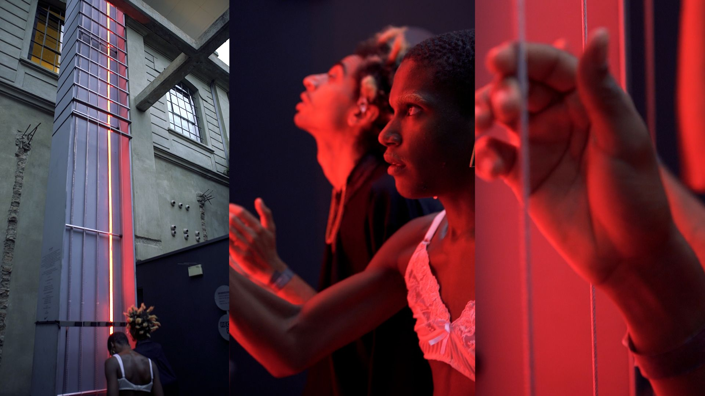
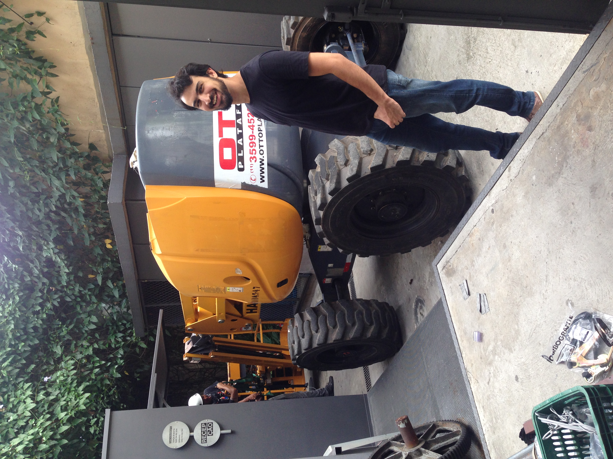
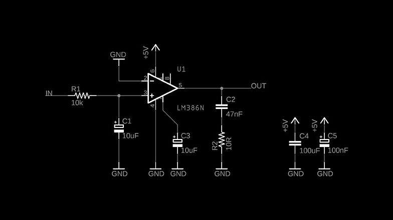
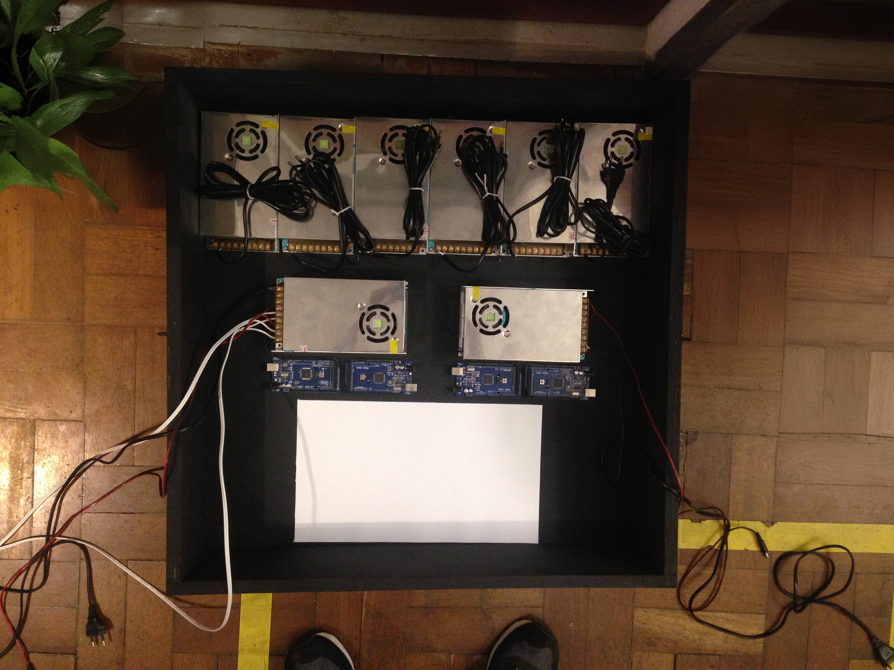

import Video from '@/components/Video.astro'
import YouTube from '@/components/YouTube.astro'
import ImageRow from '@/components/ImageRow.astro'
import Figure from '@/components/Figure.astro'

<YouTube id="KucCxUmOM1o" title="Air Guitar von Atelier Marko Brajovic für Nike" credit={{ name: "Eduardo Ohara", href: "https://www.eduardoohara.com/" }} />

## Konzept
> Die Metallsäule verbindet den Untergrund der Stadt mit dem schwebenden Dach und funktioniert praktisch wie eine Antenne, die die Vibrationen der Stadt und die durch das Gebäude verstärkten Magnetfelder einfängt.
Das Werk verwandelt das architektonische Element in ein Musikinstrument, das vom Publikum und der Stadt gespielt werden kann. Eine hybride Schnittstelle, die durch die Vibration der Luft eine sensorische Polyphonie zwischen urbanem Metabolismus und Menschen erzeugt.

*Atelier Marko Brajovic*

Atelier Marko Brajovic entwickelte diese ortsspezifische Installation zur Feier des Air Max Day. In diesem Projekt arbeitete ich eng mit Marko zusammen, gab Impulse und wies darauf hin, wo ich Potenzial für eine Installation in der [Red Bull Station](https://triptyque.com/en/projeto/redbull-station/) sah. Das kürzlich renovierte Gebäude, früher ein Kraftwerk, war inzwischen vor allem ein Musiklabor, bot aber auch Raum für andere Experimente mit Kunst und Technologie.
Der Air Max Day feierte die alten und neuen Air-Max-Schuhe und verband gleichzeitig Nike mit Red Bull. Im Kern ging es um Schnittstellen, genauer gesagt um Schnittstellen zwischen Alt und Neu, zwischen Design und Musik.
Marko entwickelte zwei Konzepte: eines mit aufblasbaren Elementen und die Air Guitar. Das erste war nicht schlecht, aber die Air Guitar war zu gut, um darauf zu verzichten.
Beim Meeting war die Marketingagentur von der Installation begeistert, fand aber, dass noch etwas fehlte. Daraufhin schlug ich vor, sie mit adressierbaren LEDs aufzupeppen.

<Figure credit={{ name: "Eduardo Ohara", href: "https://www.eduardoohara.com/" }}>
  
</Figure>

## Entwicklung
Nachdem das Konzept genehmigt war, übernahm ich auch die Koordination der gesamten Projektentwicklung, und ich war dabei vielleicht etwas zu ehrgeizig: Ich beschloss, den LED-Teil ganz allein zu entwickeln.
Vom Gitarrenteil hatte ich keine Ahnung, aber ich kannte den richtigen Mann für die Aufgabe: meinen Freund Lucas Caracik, einen professionellen Gitarrenbauer von [Caracik Guitars](https://www.caracikguitars.com/).
Rafael Ohashi war unser Mann für Veranstaltungen; er hatte schon bei vielen Events mitgearbeitet, sollte uns also anleiten und die nötige Ausrüstung und die Genehmigungen besorgen.
Das System funktionierte folgendermaßen: Die Gitarre wurde aus vier Stahlseilen und vier Bass-Tonabnehmern gebaut (ja, sie hätte eigentlich Air Bass heißen müssen, aber das klingt nicht so sexy, oder?).
Ich dachte auch daran, ein Mikrofon zu verwenden, aber Lucas' Vorschlag, Tonabnehmer zu verwenden, war konzeptionell und funktional auf einem ganz anderen Level, und er wusste alles darüber.

<Video src="/media/projects/air-guitar-by-atelier-marko-brajovic-for-nike/first-pickup-test.mp4" caption="Erster Test: Nimmt ein Tonabnehmer die Schwingung des Stahlseils auf?" />

Ursprünglich war das Konzept, die LEDs von unten bis ganz nach oben zu führen. Dafür hätten wir aber jemanden mit einer Zulassung für Höhenarbeiten gebraucht, und den fanden wir leider nicht rechtzeitig, sodass wir auf die Höhe beschränkt waren, die eine Hebebühne erreichen konnte.

<ImageRow>
  

  <Video src="/media/projects/air-guitar-by-atelier-marko-brajovic-for-nike/rafael-in-the-work-platform-lift.mp4" caption="Rafael auf der Hebebühne" />
</ImageRow>

### Interaktivität
Jeder Bass-Tonabnehmer sendete ein analoges Signal an seinen jeweiligen Arduino Mega, der dann den Wert mappte und in ein digitales Signal umwandelte, um eine bestimmte Anzahl von LEDs einzuschalten.
Theoretisch ist das ganz einfach, in der Praxis aber verlor ich mich ziemlich schnell in den Tiefen der Elektronik, bis ich nicht mehr weiterkam. Ich entwarf diese Schaltung, aber aus irgendeinem Grund funktionierte sie nicht richtig. Das Event rückte näher, und das Team wurde zunehmend nervös. Eine Woche vor dem Event kontaktierte ich André Biagioni von [Fiozeira](https://fiozera.com.br/). Zum Glück sagte er zu. Er stellte fest, dass der Schaltung ein Filter fehlte, und brachte die Arbeit zu Ende. Er zeichnete auch einen Schaltplan und half bei der Montage.



```cpp
#include "FastLED.h"

#if FASTLED_VERSION < 3001000
#error "Requires FastLED 3.1 or later; check GitHub for latest code."
#endif

#define minDelta 0
#define maxDelta 35
#define firstStrip 6
#define secondStrip 7
#define colorOrder GRB
#define ledType WS2812B
#define numLeds 600
#define maxLED 460
#define pickupPin AO
#define calibrationCycles 5000
#define Component 255
#define Component 0
#define Component 16
#define pickupNumReads 1000

int calibrationDelta = 0;
int pickup Value = 0;
int ledsToLight = 0;

struct CRGB leds[numLeds];

void calibration(){
  int minValue = 1024;
  int maxValue = 0;
  for (int i = 0; i < calibrationCycles; ++i) {
    int val = analogRead(pickupPin);
    minValue = min(minValue, val);
    maxValue = max(maxValue, val);
  }
  calibrationDelta = maxValue - minValue;
}

void pickupRead() {
  int minValue = 1024;
  int maxValue = 0;
  for(int i = 0; i < pickupNumReads; i++){
    int pickupValue = analogRead(pickupPin);
    minValue = min(minValue, pickupValue);
    maxValue = max(maxValue, pickup Value);
  }

  int pickupDelta = maxValue - minValue;
  pickupDelta = pickupDelta - calibrationDelta;

  if(pickupDelta < 0) {
    pickupDelta = 0;
  }
  else if(pickupDelta > 35) {
    pickupDelta = 35;
  }

  ledsToLight = map(pickupDelta, minDelta, maxDelta, O, maxLED);
}

void setup(){
  analogReference(EXTERNAL);
  Serial.begin(9600);
  LEDS.addLeds<ledType, firstStrip, colorOrder> (leds, numLeds);
  LEDS.addLeds<ledType, secondStrip, colorOrder>(leds, numLeds);
  FastLED.clear();
  FastLED.show();
  calibration();
}

void loop(){
  FastLED.clear();
  pickupRead();
  for(int i = 0; i < ledsToLight; i++){
   leds[i] = CHSV(255, 255, 255);
  }
  FastLED.show();
}
```



### Nach dem Air Max Day
Die Leute von der Red Bull Station mochten die Installation so sehr, dass sie darum baten, sie einen ganzen Monat dort stehen zu lassen. In dieser Zeit musste ich regelmäßig vorbeischauen, um zu prüfen, ob alles wie erwartet funktionierte. Währenddessen fielen einige LEDs an der Spitze der Installation aus, deren Austausch sehr aufwendig gewesen wäre. Das sah nicht gut aus, denn die schöne Kontinuität war dahin; die Installation wirkte, als hätte sie eine Zahnlücke. Also habe ich, anstatt die LEDs zu ersetzen, einfach die oberen 10 LEDs direkt im Arduino-Code ausgeschaltet.

### Erkenntnisse
Nichts war gelötet, ein Fehler, den nur Unerfahrene machen. Alles lief noch über die Prototyping-Kabel und Steckverbinder des Arduino auf Breadboards.
Das Event war voll, draußen stand sogar eine Schlange. Irgendwann hörte die Gitarre einfach auf zu funktionieren. Ich bekam fast einen Herzinfarkt! Ich erinnere mich noch genau: Ich war auf dem Dach der Red Bull Station, schon beim dritten Drink, als man mir von dem Problem erzählte. Ich rannte die Treppe hinunter zur Rückseite der Säule, wo der Steuerungskasten stand, schaltete alles aus und wieder ein und … Puh! Zu meiner Erleichterung funktionierte die Installation wieder.
Ich habe viel gelernt, hätte mir aber viel Ärger erspart, wenn ich von Anfang an einen Spezialisten beauftragt, die Installation eine Woche vor der Übergabe getestet und alle Verbindungen gelötet hätte.
Womit ich ebenfalls nicht gerechnet hatte, waren die Kabel. Sie mussten länger und dicker sein, als ich dachte. Die LEDs sind stromhungrig und brauchen zwei Kabel pro LED-Streifen: Die Streifen wurden unten und zusätzlich in der Mitte gespeist, sonst hätten die LEDs oben schwächer geleuchtet. Außerdem brauchte jede Einheit aus Tonabnehmer, Arduino und LEDs zwei ziegelsteingroße Netzteile, insgesamt also acht (siehe Foto oben).

<YouTube id="odFFIfzDSzE" title="Installation Air Guitar für Nike, weitere Aufnahmen" />
