import YouTube from '@/components/YouTube.astro'

<YouTube id="cv6gEACh2Vg" title="Bar & Bühne Heineken von Atelier Marko Brajovic" />

Das Atelier Marko Brajovic wurde eingeladen, eine mobile Bühne und Bar für die Festivalreihe MECA 2018 zu entwickeln. Das Design orientierte sich an der visuellen Identität der Marke; der ikonische Heineken-Stern diente als kreativer Ausgangspunkt. Mit parametrischem Design auf Basis der Sterngeometrie schuf das Team dynamische Bambuskonturen. Die Struktur wurde aus Bambus mit Metallverbindungen so gebaut, dass Demontage, Transport und Wiederaufbau möglich waren.

Das Heineken-Sponsoring war Teil der Markeninitiative #LiveYourMusic, die Konzerte und Festivals weltweit unterstützt. Die Installationen reisten durch mehrere Städte Brasiliens: Inhotim (MG), Maquiné (RS), Recife (PE), São Paulo (SP) und Rio de Janeiro (RJ).

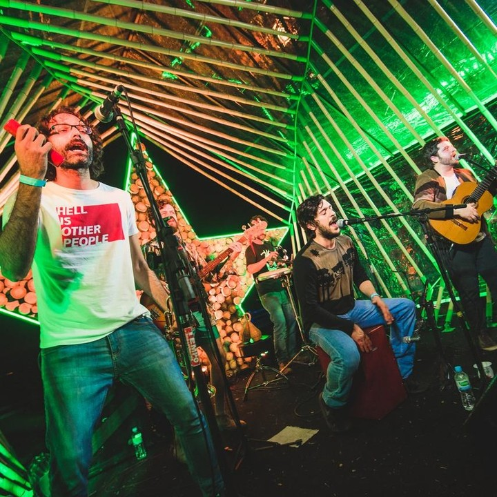

## Bar

Die Bar-Installation war eine parametrische Struktur, in der die Drehung und der Abstand jedes Bambuselements einen organischen, fließenden Unterstand schufen, der die Markenidentität in einer architektonischen Form einfing.

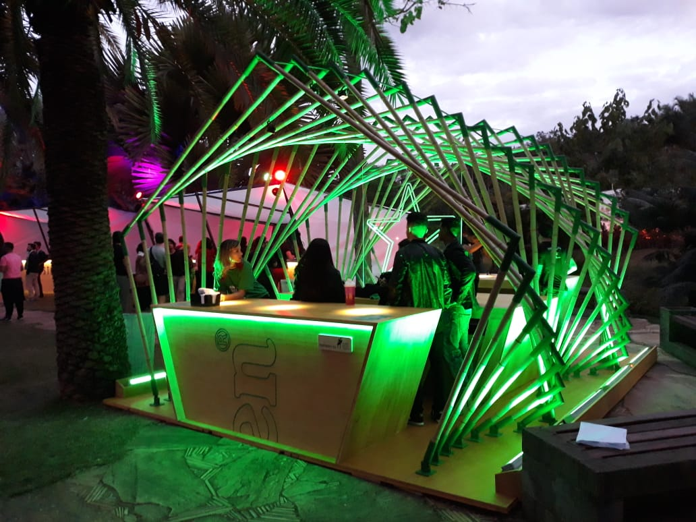

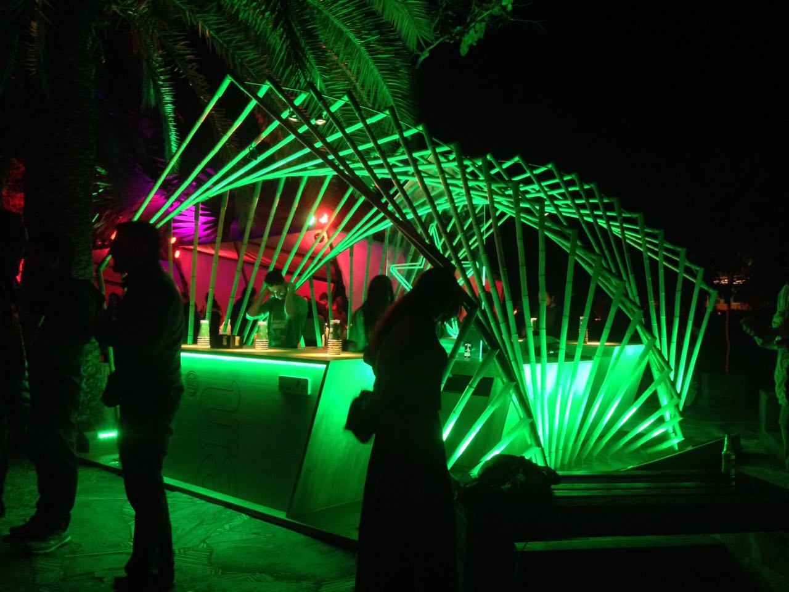

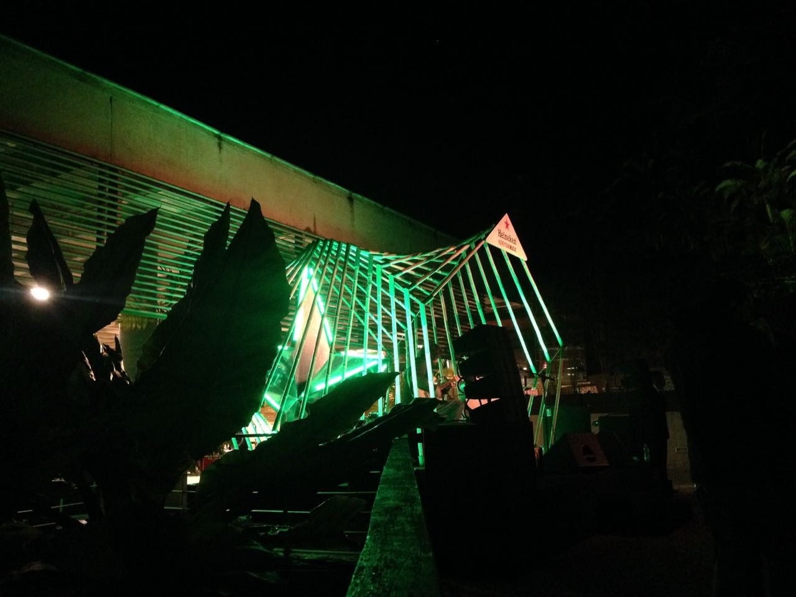

## Technische Zeichnungen

Das parametrische Design wurde in Grasshopper für Rhino entwickelt und ermöglichte eine flexible Anpassung der Struktur an verschiedene Festivalorte in Brasilien.

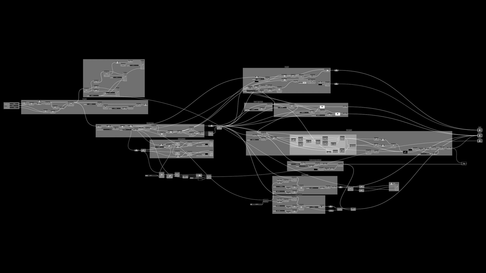

### Bühne

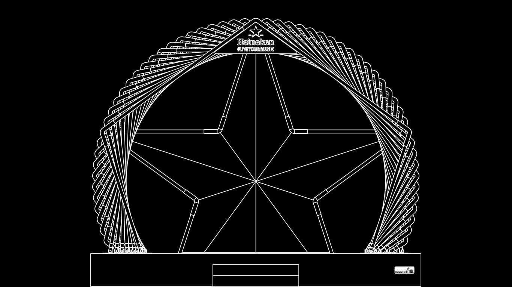

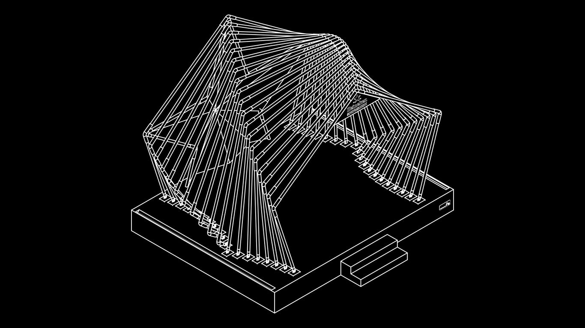

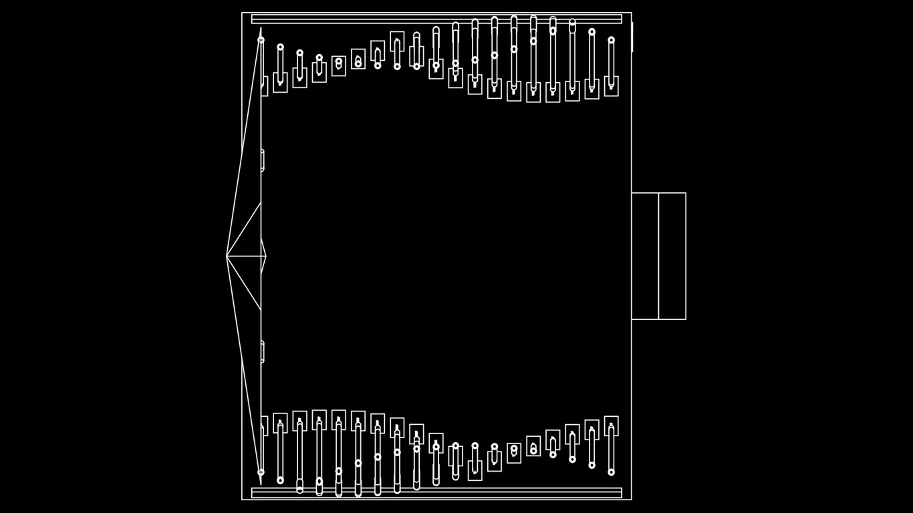

### Bar

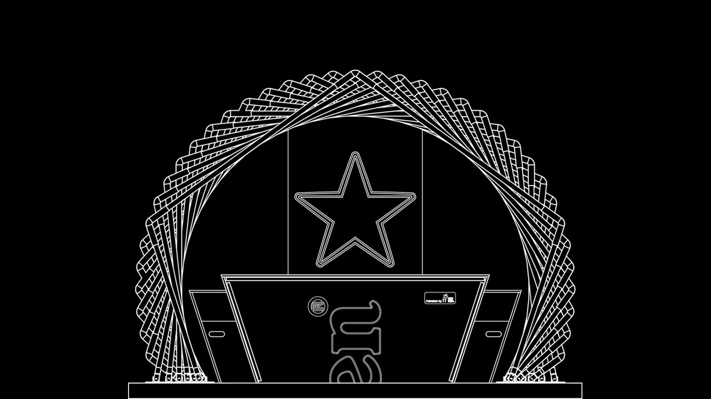

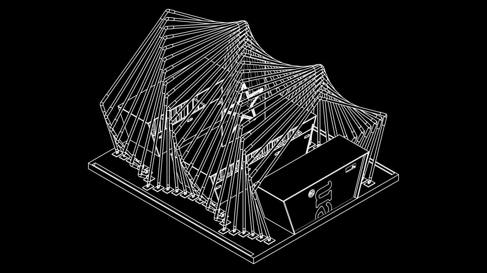

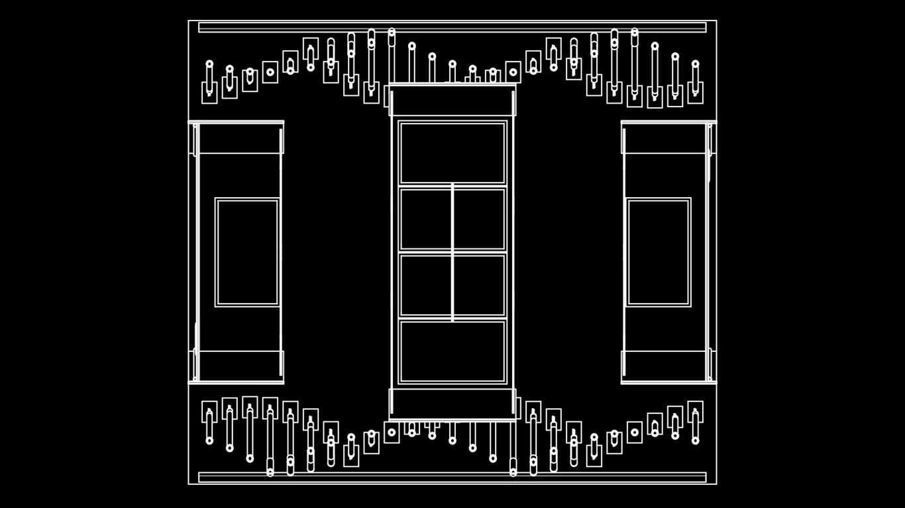
