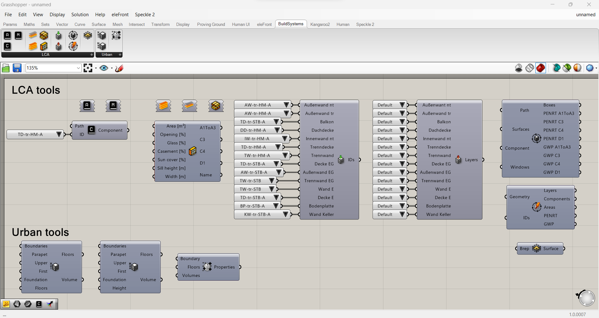
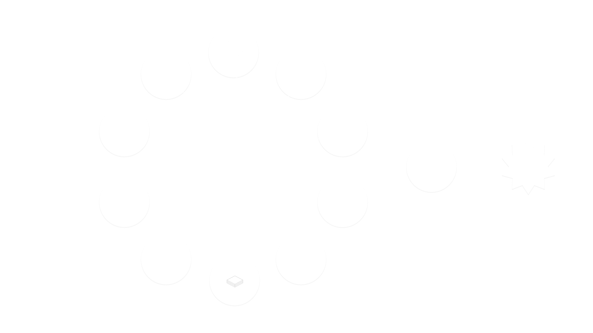
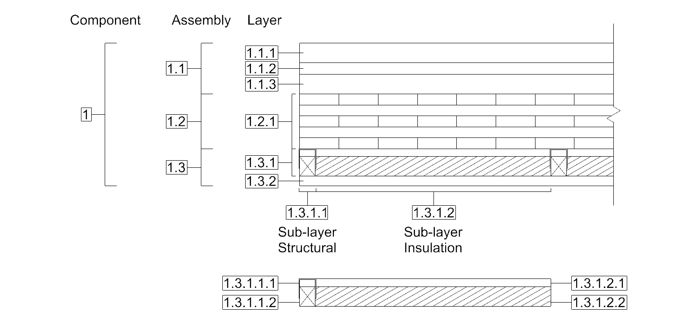

Während meiner Zeit bei BuildSystems leitete ich die Entwicklung eines Grasshopper-Plugins, das den architektonischen Entwurfsprozess vereinfachen sollte. Mit diesem Toolset konnten Nutzer Gebäudeentwürfe parametrisch definieren und analysieren und erhielten dank integrierter Ökobilanzierung (LCA) in Echtzeit Rückmeldung zu Materialverbrauch und Umweltwirkung.

Zentrale Ergebnisse dieser Entwicklung waren:
- **Detaillierung von Baukomponenten**: Einzelne Baukomponenten ließen sich mit ihren zugehörigen Materialeigenschaften definieren und verwalten.
- **Integrierte Ökobilanzanalyse**: Das Plugin bot die Möglichkeit, den ökologischen Fußabdruck von Entwürfen schnell auf Basis von Materialdaten aus Umweltproduktdeklarationen (EPDs) zu bewerten.
- **Datenverwaltung via JSON**: Wir erstellten eine strukturierte, JSON-basierte Datenbank, in der sich Daten zu Baukomponenten speichern und abrufen ließen. Diese Datenstruktur sollte auch in einer Web-App namens *Circular Component Creator* verwendet werden; diese Idee wurde leider nie weiterverfolgt.
- **Intuitive Grasshopper-Oberfläche**: Das Plugin bot eine benutzerfreundliche Oberfläche, die das visuelle Programmierparadigma von Grasshopper nutzte und eine nahtlose Integration in bestehende Arbeitsabläufe ermöglichte.

## Herausforderungen
Es gibt zwei Hauptsprachen für die Entwicklung von Grasshopper-Plugins: Python und C#. Für ein nativeres Erscheinungsbild, höhere Leistung und eine tiefere Integration ist jedoch C# die erste Wahl. Das liegt daran, dass Grasshopper selbst von David Rutten in C# geschrieben wurde.
Die größte Herausforderung während dieser Entwicklung war, dass McNeel, das Unternehmen hinter Rhino und Grasshopper, sich mitten im Übergang von *.NET Framework 4.8* zu *.NET Core* befand.
### .NET Framework 4.8
- **Vorteile**
    - Wird in Rhino 8 noch unterstützt
    - Kompatibel mit früheren Versionen von Rhino/Grasshopper
    - Funktioniert mit Rhino.Inside Revit, das noch auf .NET Framework basiert
    - Mehr Lernressourcen online verfügbar, was Debugging und Entwicklung erleichtert
- **Nachteile**
    - Wird auslaufen, was eine Migration des Plugins in naher Zukunft erfordern würde
    - Nicht plattformübergreifend: Für Windows und macOS wären separate Plugins erforderlich
    - Geringere Leistung

### .NET Core
- **Vorteile**
    - Zukunftssicher, da es die Basis für kommende Rhino/Grasshopper-Versionen ist
    - Plattformübergreifend: Ein Plugin funktioniert sowohl unter Windows als auch unter macOS
    - Höhere Leistung
- **Nachteile**
    - Nicht kompatibel mit älteren Versionen von Rhino/Grasshopper
    - Inkompatibel mit der aktuellen Version von Rhino.Inside Revit
    - Weniger Ressourcen und Beispiele online für Entwicklung und Debugging verfügbar
McNeel empfiehlt einen [Multi-Targeting](https://learn.microsoft.com/en-us/nuget/create-packages/multiple-target-frameworks-project-file)-Ansatz (das Plugin soll also beide .NET-Versionen unterstützen), was das Projekt zusätzlich verkomplizierte.

## BuildSystems Object Model (BSoM)
Das **BuildSystems Object Model (BSoM)** war ein zentraler Bestandteil des Projekts: das gemeinsame Datenmodell, auf dem Erweiterbarkeit und Wartbarkeit des Plugins beruhten.

### Konzeptphase
Wir entwarfen die Ontologie, auf die sich das Plugin stützen sollte.

### Implementierungsphase
Anschließend setzten wir das BSoM in C# um, damit Grasshopper es nativ nutzen konnte. Teil dieser Arbeit war die Definition der Datenstruktur einer Baukomponente.

## Ergebnis
Obwohl das Plugin voll funktionsfähig war, wurde das Projekt schließlich eingestellt, weil das damalige Startup BuildSystems seinen Schwerpunkt verlagerte. Zu diesem Zeitpunkt befand sich die deutsche Wirtschaft in einer schwierigen Lage, und es gab keine aktiven Bauprojekte, in denen wir das Plugin richtig hätten testen können. Wir entschieden uns für einen Kurswechsel und investierten unsere Zeit stattdessen in die Entwicklung eines Simulationstools für nachhaltige Wohnungsbaufinanzierung.
