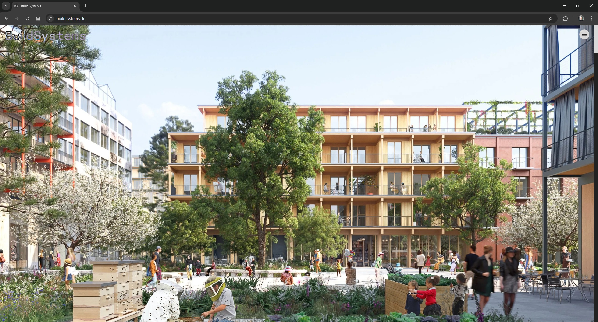
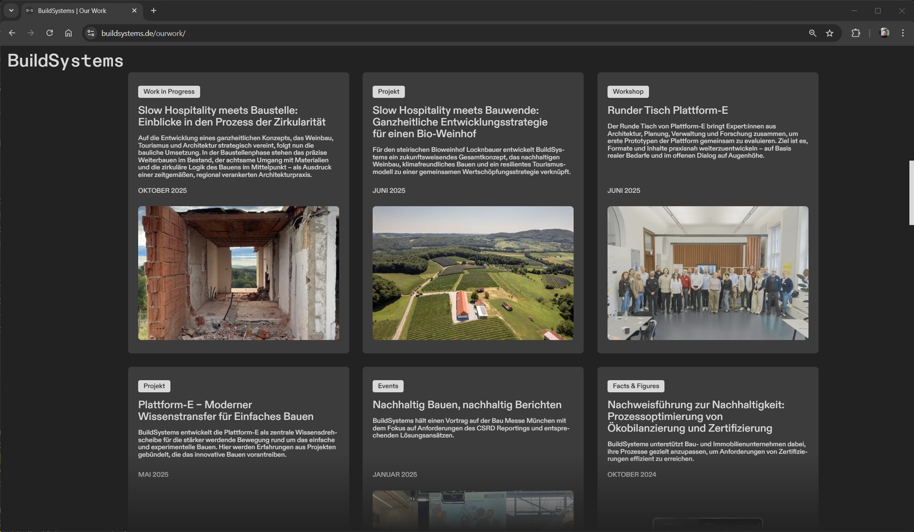

import Video from '@/components/Video.astro'

Ich habe die Unternehmenswebsite für [BuildSystems](https://buildsystems.de) entwickelt: eine Nachhaltigkeitsberatung, die die klimaneutrale Transformation im Bau- und Immobiliensektor vorantreibt. Die Website dient als digitale Präsenz des Unternehmens und zeigt Dienstleistungen, Projektportfolio, Team und Blog-Inhalte; verwaltet wird alles über Notion als CMS.

Das Design wurde von [HAND](https://www.hand.international/) erstellt. Meine Aufgabe war es, Design und Funktionalität mit einem hochmodernen, auf Performance ausgerichteten Tech-Stack umzusetzen und so beste Voraussetzungen für SEO zu schaffen.

## Tech-Stack

- [**Astro**](https://astro.build/): Statischer Site-Generator mit TypeScript, gewählt wegen seines Performance-First-Ansatzes und seines Prinzips, standardmäßig kein JavaScript auszuliefern.
- [**Tailwind CSS**](https://tailwindcss.com/): Utility-First-Styling mit benutzerdefinierten CSS-Variablen für responsive Typografie über vier Breakpoints.
- [**Notion API**](https://developers.notion.com/): Headless-CMS-Integration. Das Team verwaltet alle Inhalte (Blogbeiträge, Teammitglieder, Partner, Portfolio) direkt über Notion.
- [**Cloudflare Pages**](https://pages.cloudflare.com/): Deployment mit Edge-Caching, automatischem HTTPS und DDoS-Schutz.

## Warum Notion als CMS?

BuildSystems nutzte Notion bereits intensiv für interne Dokumentation und Projektmanagement. Anstatt ein separates CMS einzuführen, das das Team erst erlernen müsste, habe ich die Notion-API direkt in die Build-Pipeline integriert. So kann das Team Blogbeiträge schreiben und veröffentlichen, Teamprofile aktualisieren und Portfolio-Inhalte verwalten, alles direkt in Notion.

Die Integration ruft Inhalte zur Build-Zeit aus mehreren Notion-Datenbanken ab (Blogbeiträge, Teammitglieder, Partner, Organisationen) und rendert sie mit über 30 eigenen Notion-Komponenten für Überschriften, Absätze, Bilder, Codeblöcke, Tabellen, Embeds und mehr.

Die CMS-Schicht entstand als Fork von [astro-notion-blog](https://github.com/otoyo/astro-notion-blog) von Hiroki Toyokawa (MIT-lizenziert), das bereits ein Grundgerüst zum Abrufen von Notion-Inhalten und zum Rendern von Blöcken mitbrachte. Davon ausgehend habe ich die Block-Renderer erweitert, Datenbanken für Teammitglieder, Partner und Organisationen ergänzt und die Benutzeroberfläche passend zur Marke und zum Designsystem von BuildSystems neu aufgebaut.

## Hauptmerkmale

### CSS-First-Animationen
Die Designagentur hatte das Homepage-Cover und die „Drei Säulen“-Bereiche ursprünglich als Lottie-Animationen geliefert. Nach der Integration fielen die Lighthouse-Scores deutlich ab, weil die Lottie-Animationen das DOM weit über die empfohlene Größe aufblähten und die Rendering-Performance beeinträchtigten. Ich habe beide Animationen mit reinen CSS-`@keyframes` neu aufgebaut und die „Drei Säulen“ für horizontale und vertikale Layouts angepasst. So blieb die visuelle Wirkung erhalten, und die Seite blieb schlank und performant.

<Video src="/media/projects/buildsystems-website/three-pillars-animation.mp4" caption="Homepage-Animation" autoplay />

### Drag-to-Scroll-Karussell
Das Karussell der Blogbeiträge nutzt eine eigens entwickelte Drag-to-Scroll-Interaktion mit Trägheitsphysik und sanftem Scroll-Snap. Nutzer können das Karussell mit Maus oder Touch ziehen, und es rastet beim Loslassen sanft an der nächsten Karte ein.

<Video src="/media/projects/buildsystems-website/drag-to-scroll-carousel.mp4" caption="Drag-to-Scroll-Karussell" autoplay />

### Blogbeiträge aus Notion
Jeder Blogbeitrag wird in Notion verfasst und zur Build-Zeit auf der Website gerendert. Unterstützt werden vielfältige Inhalte, darunter eingebettete Medien (Instagram, TikTok, YouTube, CodePen), LaTeX-Gleichungen über KaTeX, Codeblöcke mit Prism.js-Syntaxhervorhebung und Link-Vorschauen über metascraper.

## Architektur

Das Projekt folgt einem reinen Astro-Ansatz, ohne React oder andere JavaScript-Frameworks. Die gesamte Interaktivität ist in reinem TypeScript und CSS umgesetzt, sodass clientseitig nur sehr wenig JavaScript anfällt.

Eine eigene Build-Pipeline übernimmt das Caching von Notion-Inhalten. Mit `npm run cache:fetch` werden alle Inhalte und Bilder aus Notion heruntergeladen, die Bilder mit Sharp verarbeitet (EXIF-Daten entfernt und Formate optimiert) und alles lokal gespeichert. Das sorgt für schnelle Builds und verhindert unnötige API-Aufrufe während der Entwicklung.

## Responsives Design

Die Seite verwendet CSS Custom Properties für fließende Typografie, die über vier Breakpoints skaliert: Mobil, Tablet, Desktop und Ultra-Wide.

Selbst gehostete ABC-Diatype-Schriften werden vorgeladen, um Flash of Unstyled Text (FOUT) zu vermeiden, und die Seite verwendet SVG-Sprites für Icons, um HTTP-Anfragen zu minimieren.
