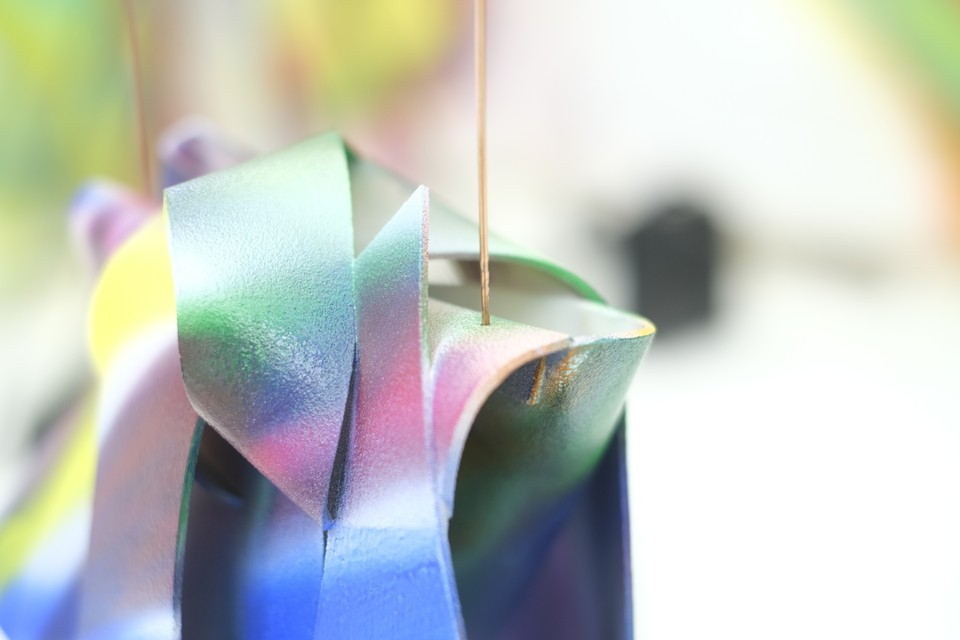
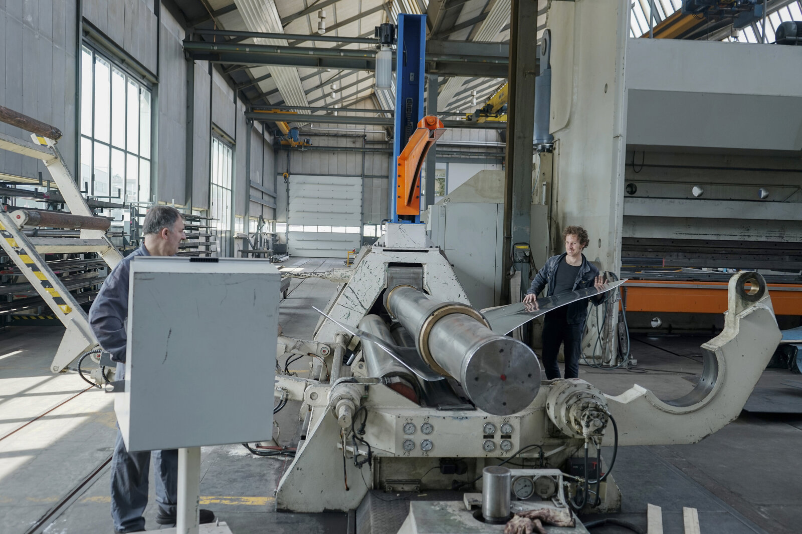
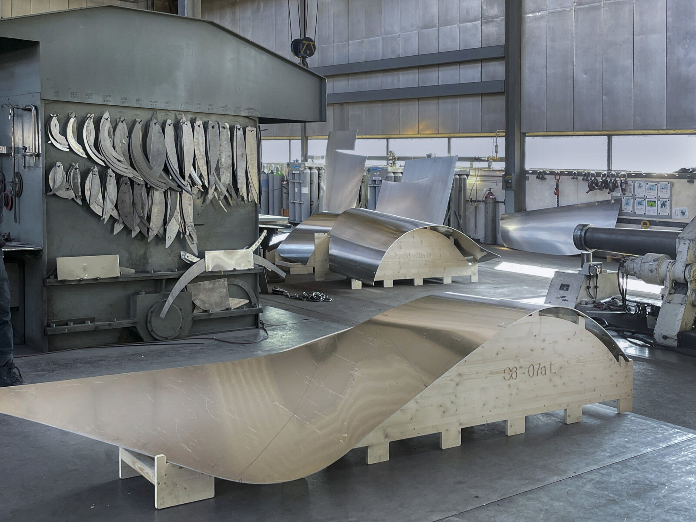
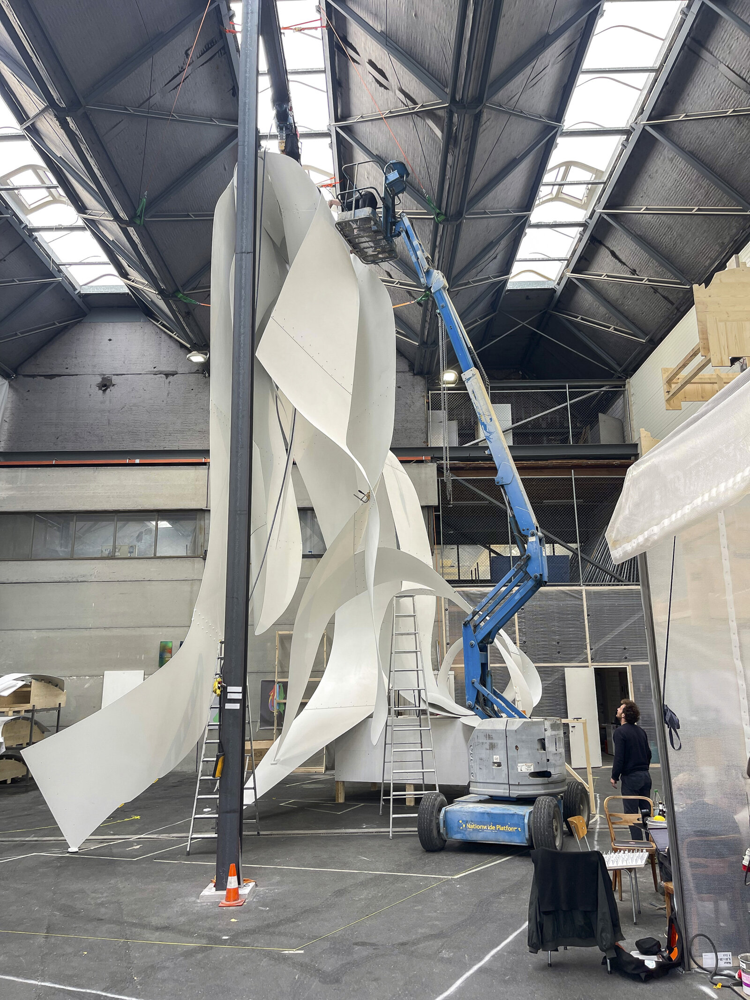
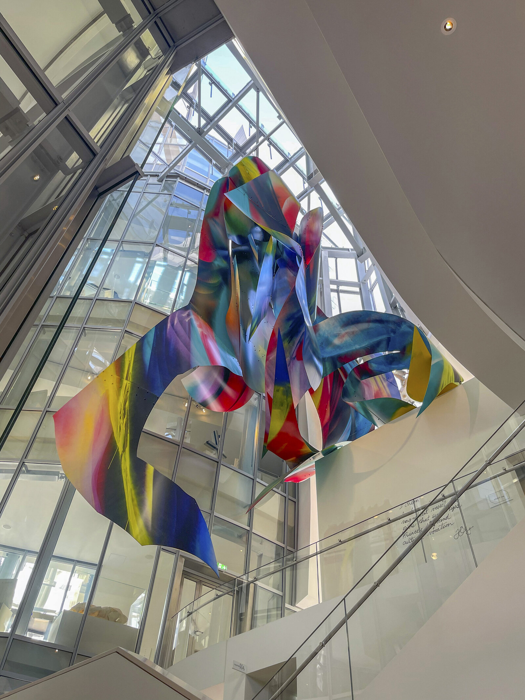

import Figure from '@/components/Figure.astro'

## Einführung
Bei ArtEngineering kam es manchmal vor, dass sich ein Kunde in einem kritischen Moment meldete: Die Zeit war knapp, und ein scheinbar einfaches, aber hochkomplexes Projekt musste geliefert werden.
Canyon war eines davon. Katharina Grosse entschied sich hier, [bildhauerisch mit Leder zu arbeiten](https://www.katharinagrosse.com/blog/drawings_mock_ups_amp_preparations_for_canyon). Die Herausforderung bestand darin, dass sie organische, lederartige Streifen in gebogene Stahlplatten übertragen wollte.

<Figure credit="Katharina Grosse">
  
</Figure>

Was der ursprüngliche Auftragnehmer nicht rechtzeitig erkannte, war, dass sich Stahl nicht wie Leder verhält. Leder kann sich in jede Richtung biegen und verdrehen, weil es flexibel ist. Stahl hingegen lässt sich nur in eine Richtung biegen. Die Lösung war eine Strategie, die seit Jahrtausenden im Bootsbau verwendet wird: [abwickelbare Flächen](https://de.wikipedia.org/wiki/Abwickelbare_Fl%C3%A4che).
## Computational Design
Ich habe mehrere Werkzeuge ausprobiert und sie miteinander verglichen, darunter Rhinos nativen Befehl für abwickelbare Flächen, Kangaroo-2-Definitionen und andere kostenpflichtige Tools. Letztendlich war das beste Werkzeug jedoch [D.Loft](https://web.archive.org/web/20240918135700/https://www.food4rhino.com/en/app/dloft), ein kostenpflichtiges Rhino/GH-Plugin. Wir nutzten zunächst die Testversion und entschieden uns später für den Kauf.
Obwohl ich nur ein Wochenende hatte, um eine Lösung zu finden, war das Projekt insgesamt eine wirklich spannende Herausforderung. Und ich durfte mit Herwig reisen, um den Produktionsprozess in der Schweiz bei der [Kunstgiesserei St. Gallen](https://www.kunstgiesserei.ch/) zu sehen; sie ist ein äußerst interessantes Atelier und Labor für digitale Fertigung.

<Figure credit="Kunstgiesserei">
  
</Figure>

<Figure credit="Kunstgiesserei">
  
</Figure>

<Figure credit="Kunstgiesserei">
  
</Figure>

<Figure credit="Kunstgiesserei">
  
</Figure>
