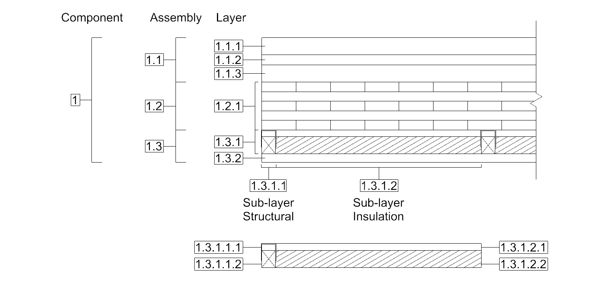
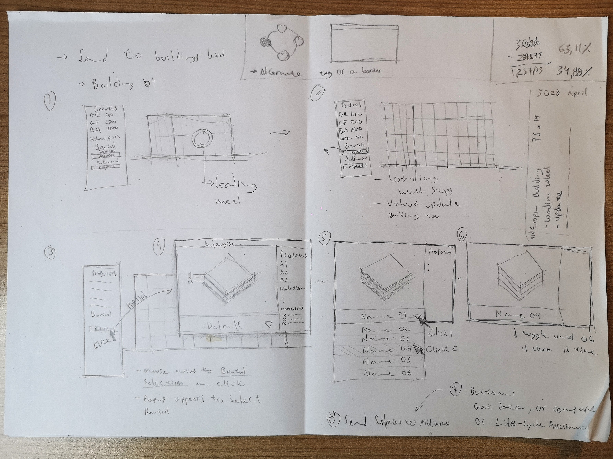
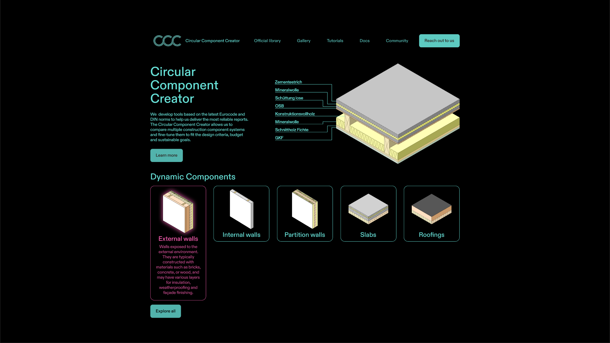
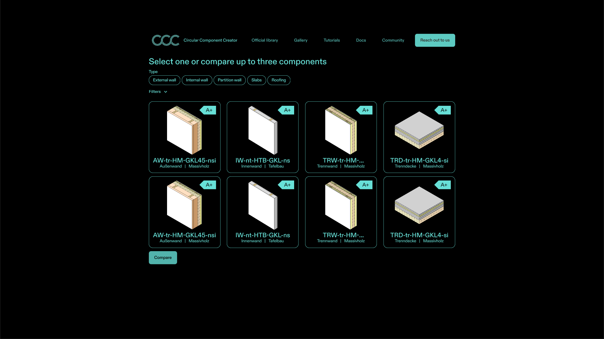
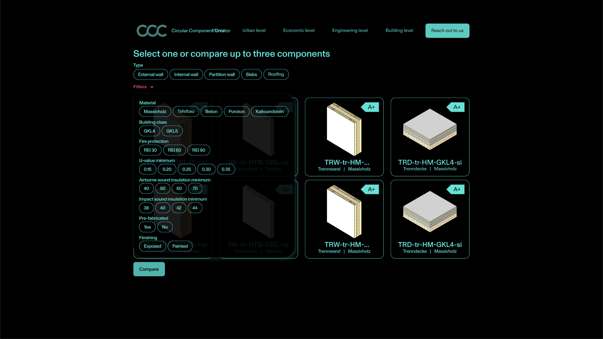
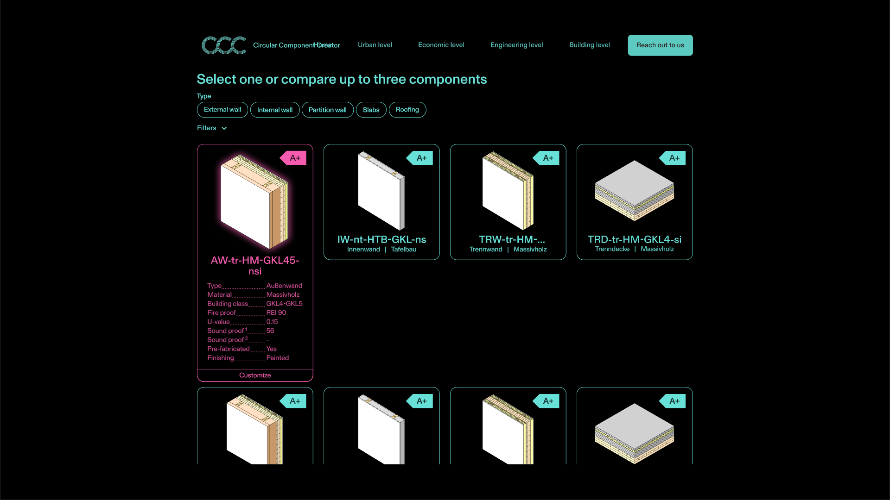
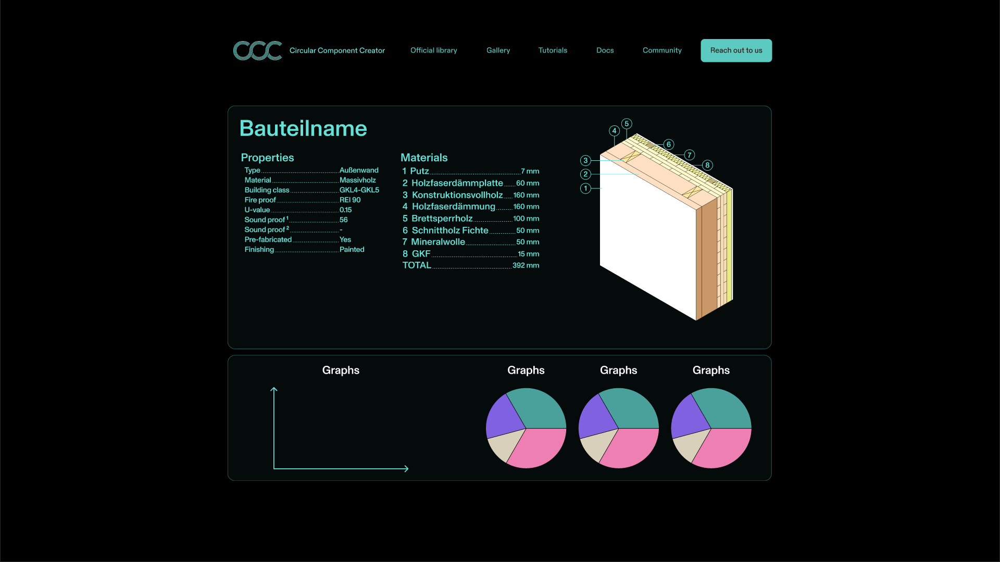

Der Circular Component Creator (CCC) war eine konzeptionelle Designstudie bei [BuildSystems](https://buildsystems.de/) für eine Web-Applikation, die es Nutzern ermöglichen sollte, Baukomponenten für zirkuläres Bauen zu durchsuchen, zu filtern und zu vergleichen. Das Projekt kam bis zu detaillierten Figma-Mockups und einer festgelegten Datenarchitektur, wurde aber nicht als lauffähige Anwendung umgesetzt.

Das Konzept entwickelte sich aus dem [BuildSystems-Plugin für Grasshopper](/projects/buildsystems-plugin-for-grasshopper), das Ökobilanz-Daten (LCA) innerhalb der Rhino/Grasshopper-Designumgebung bereitstellte. Der CCC zielte darauf ab, ähnliche Funktionen auf eine eigenständige Webplattform zu bringen und die Komponentenbibliothek einem breiteren Publikum über Grasshopper-Nutzer hinaus zugänglich zu machen.

## Datenarchitektur

Das zugrundeliegende Datenmodell folgt einer hierarchischen Struktur, die widerspiegelt, wie reale Baukomponenten zusammengesetzt werden. Eine Komponente besteht aus Baugruppen, die wiederum aus Schichten bestehen. Jede Schicht kann Unterschichten enthalten, unterteilt in tragende und dämmende Teile.

Diese Hierarchie wurde so konzipiert, dass die Anwendung aggregierte Eigenschaften (Gesamtdicke, U-Wert, Gewicht) berechnen könnte, während sich jede einzelne Materialangabe weiterhin im Detail steuern ließe.

## UX-Designprozess

Der Designprozess begann mit handgezeichneten Wireframes, um den User Flow und den Aufbau der Bildschirme zu skizzieren. Diese Skizzen definierten sechs zentrale Ansichten: die Startseite, Komponentenübersicht, Filterung, Komponentenauswahl, Detailansicht und Ergebnisanalyse.

So konnte das Team Layout und Interaktionsmuster in schnellen Iterationen verfeinern, bevor es zu den Figma-Mockups überging.

## Figma-Mockups

### Startseite

Das Startseitenkonzept stellt die Anwendung mit einem isometrischen Schnitt einer Baukomponente vor, der die einzelnen Schichten eines Wand- oder Deckenaufbaus zeigt.

Darunter werden die fünf dynamischen Komponentenkategorien angezeigt: Außenwände, Innenwände, Trennwände, Decken und Dächer. Jede Kategorie wird durch ein isometrisches Icon dargestellt, das den Nutzern einen unmittelbaren Überblick über die verfügbaren Komponententypen bietet.

### Komponentenbibliothek

Das Bibliothekskonzept zeigt alle verfügbaren Komponenten in einem Rasterlayout. Nutzer sollten bis zu drei Komponenten auswählen können, um sie direkt nebeneinander zu vergleichen. Jede Komponentenkarte zeigt eine 3D-Darstellung, die Komponentenkennung und wesentliche Eigenschaften.

### Filtersystem

Über ein Filterpanel sollten Nutzer den Komponentenkatalog nach mehreren Kriterien eingrenzen können: Materialtyp (Massivholz, Nadelholz, Beton, Porenbeton, Kalksandstein), Abmessungen und Rahmenbauweise.

### Komponentenvorschau

Beim Überfahren einer Komponentenkarte mit der Maus würde eine detaillierte Vorschau mit den wichtigsten Eigenschaften angezeigt: Name, Material, U-Wert, Feuerwiderstandsklasse und weitere Angaben.

### Komponentendetailseite

Das Detailseitenkonzept bietet eine umfassende Ansicht einer einzelnen Komponente, gegliedert in drei Bereiche:

- **Eigenschaftstabelle**: Typ, Material, bauphysikalische Werte (U-Wert, R-Wert), Feuerwiderstandsklasse und ob die Komponente vorgefertigt oder vor Ort gebaut wird.
- **Materialliste**: Eine nummerierte Aufschlüsselung jeder Schicht mit Materialbezeichnung und Dicke in Millimetern.
- **Analysegrafiken**: Vier Kreisdiagramme, die verschiedene Leistungskennwerte der Komponente darstellen.

Eine 3D-Schnittansicht auf der rechten Seite zeigt den genauen Schichtaufbau, passend zur nummerierten Materialliste.

Das war der letzte Schritt des Designprozesses, bevor das Projekt auf Eis gelegt wurde. Die detaillierten Mockups boten eine klare Vorstellung davon, wie die Anwendung funktionieren und aussehen würde, und legten ein solides Fundament für eine mögliche zukünftige Entwicklung.
