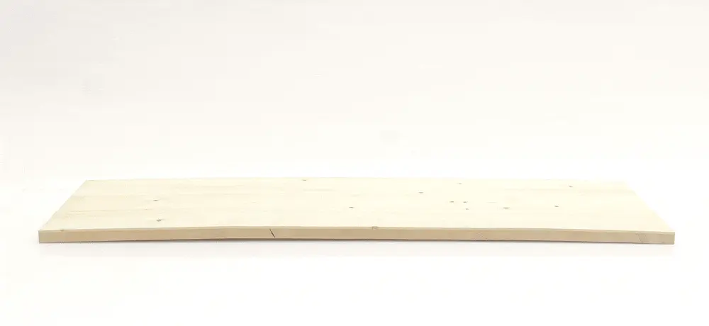
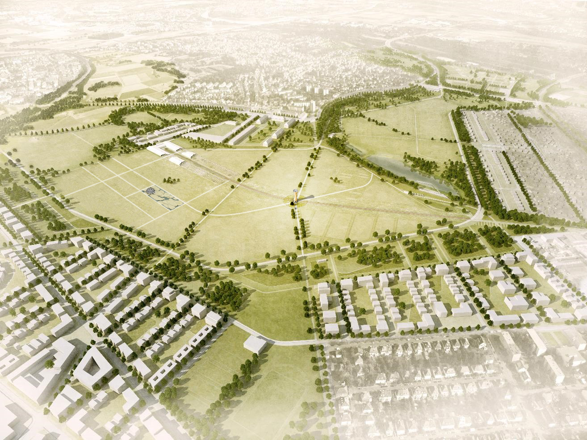
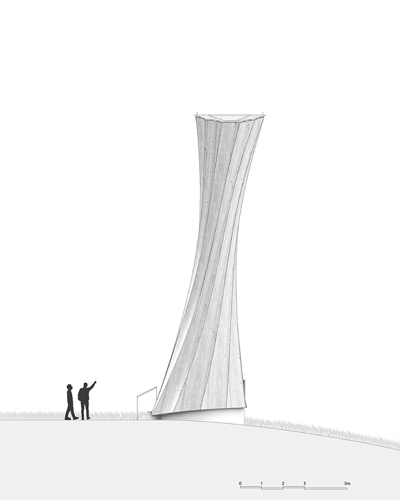

import YouTube from '@/components/YouTube.astro'
import Figure from '@/components/Figure.astro'

Ich war der Computational Designer für ein Projekt ähnlich dem [Urbach Tower](https://www.icd.uni-stuttgart.de/projects/remstal-gartenschau-2019-urbach-turm/). Der Vorschlag wurde jedoch nicht weiterverfolgt, vermutlich wegen der Pandemie.
Dennoch war es spannend, die computergestützte Strategie zur Geometrieerzeugung für eine sich selbst krümmende Brettsperrholzplatte zu verstehen. Der Trick besteht darin, mit Zylindern zu arbeiten, da sich Holz von Natur aus senkrecht zur Faserrichtung krümmt.

<Figure credit="University of Stuttgart, ICD/ITKE">
  
</Figure>

<Figure credit="University of Stuttgart, ICD/ITKE">
  
</Figure>

Ich arbeitete auch an einigen Bestandszeichnungen für den Urbach Tower selbst. Dafür erklärte mir Dylan alle konstruktiven Details des Projekts und auch, wie das Team mehrere Sensoren eingebaut hatte, um die Umwelteinflüsse auf das Tragwerk zu überwachen.

<Figure credit="University of Stuttgart, ICD/ITKE">
  
</Figure>

Dylan Woods Forschung am ICD befasste sich damit, wie sich Holz beim Trocknen von selbst formt. Mehr über den Prozess erfahren Sie in Dylan Woods TED Talk:

<YouTube id="yvPW5Q69GFc" title="Dylan Woods TED Talk über selbstformendes Holz" />
