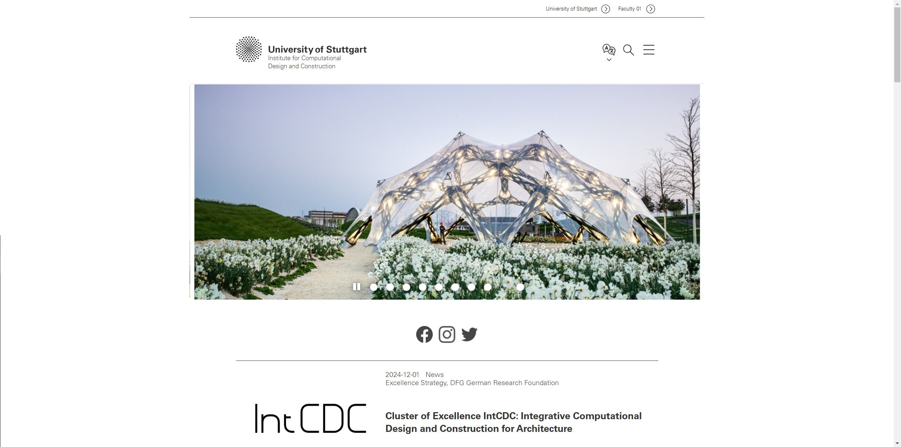

Die Universität Stuttgart führte ein standardisiertes OpenCMS-Template für alle Institute und Abteilungen ein. Für die bestehende ICD-Website, in der sich über Jahre Forschungsprojekte, Publikationen, Pavillondokumentationen und Teamprofile angesammelt hatten, hieß das: Sie musste vollständig umstrukturiert werden, damit sie zu Layout und Inhaltsmodell des neuen Templates passte.

Die Arbeit war methodisch: Seite für Seite migrierte ich Texte, Bilder und Metadaten vom alten System in die neue CMS-Struktur. Bei jedem Forschungsprojekt galt es, die Beschreibung neu zu formatieren, die Bilder in den richtigen Abmessungen neu hochzuladen und die Metadaten (Autoren, Datumsangaben, Tags) in den Inhaltstypen von OpenCMS sauber zu kategorisieren.

## Deutsch lernen durch Forschung

Was dieses Projekt persönlich besonders machte, war das unerwartete Eintauchen in die Sprache. Viele der Projektbeschreibungen, Pressemitteilungen und Verwaltungsseiten des ICD lagen auf Deutsch vor. Als Brasilianer, der gerade erst für sein Masterstudium nach Deutschland gekommen war, übersetzte und bearbeitete ich täglich deutsche Texte, nicht aus einem Lehrbuch, sondern aus echter Forschungsdokumentation über Holzbau, robotische Fertigung und biomimetische Strukturen.

## Erkenntnisse

Dieses Projekt mag im Vergleich zu robotischer Fertigung oder computergestützter Formfindung bescheiden erscheinen, aber es lehrte mich etwas Wertvolles: wie viel davon abhängt, wie Forschung vermittelt wird. Der bahnbrechendste Pavillon oder die innovativste Fertigungsmethode nützt wenig, wenn andere sie nicht finden, verstehen und zitieren können. Gutes Content-Management ist die Infrastruktur, die Wissen zugänglich macht.

Es war auch meine erste berufliche Erfahrung mit einem CMS, und dieses Wissen sollte sich später als grundlegend erweisen, als ich die BuildSystems-Website mit Astro und der Notion-API erstellte und schließlich diese Portfolio-Seite.
