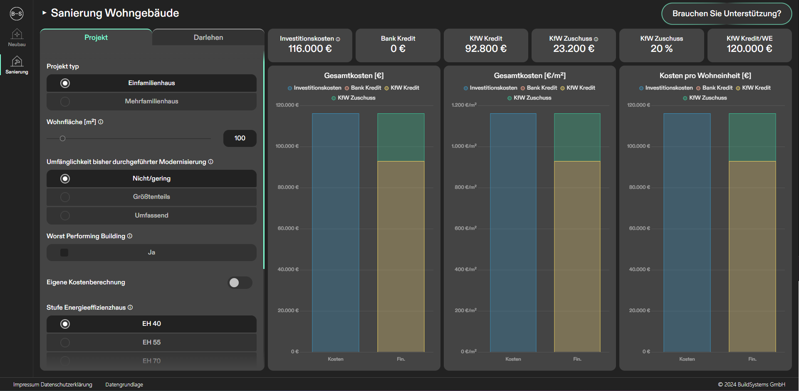

### Funktionen
- **Kostenschätzung eines Gebäudes**: Die App schätzt die Kosten eines Neubaus oder einer Sanierung auf Basis öffentlich verfügbarer Daten von [Arge e.V.](https://arge-ev.de/arge-ev/publikationen/studien/)
- **Darlehenssimulation**: Die App simuliert Darlehen präzise auf Grundlage der Kostenschätzung und der Energieeffizienz eines Gebäudes.
- **Eingabe von Energiekennwerten:** Sie beeinflusst die Förder- und Darlehensmöglichkeiten.
- **Datensicherheit**: Alle Nutzerdaten sind geschützt und werden gemäß den EU-Vorschriften behandelt.
- **Responsives Design**: Die App funktioniert nahtlos auf allen Geräten.
### Technologie-Stack
- [**GitHub**](https://github.com/build-systems/toolbox): Für das Git-Repository.
- [**Angular**](https://angular.dev/): Ein modernes JavaScript-Framework, unterstützt von Google und eingesetzt für große Anwendungen.
- [**ng2-charts**](https://www.npmjs.com/package/ng2-charts): Angular-Wrapper für die Chart.js-Bibliothek. Wird verwendet, um responsive und interaktive Diagramme zu erstellen.
- [**Cloudflare**](https://www.cloudflare.com/): Hosting-Anbieter für Zuverlässigkeit und Skalierbarkeit, keine Anfangsinvestition erforderlich.
## Warum haben wir diese Toolbox entwickelt?
Deutschland ist bekannt dafür, grüne Technologien wie Solaranlagen und Windräder mit öffentlichen Fördermitteln voranzutreiben. Aber wussten Sie, dass es auch viele Förderprogramme für energieeffizientes Bauen gibt? So attraktiv diese Programme sind, der Weg durch die Bürokratie kann äußerst mühsam sein.
Diese von [BuildSystems](https://buildsystems.de/) entwickelte App erleichtert die Simulation eines Darlehens bei der staatlichen Förderbank [KfW](https://kfw.de/). Sie vereinfacht den Prozess durch eine benutzerfreundliche Oberfläche und ermöglicht es Immobilienentwicklern und Eigentümern, ihre finanziellen Optionen schnell und einfach zu verstehen.
## Entwicklungsprozess
Die App-Entwicklung erfolgte in drei Hauptphasen: Planung und Design, Frontend-Entwicklung sowie Test und Qualitätssicherung.
### Planung und Design
Zu Beginn des Projekts definierte das gesamte Team die Anforderungen und Variablen für die App-Logik. Nachdem dies feststand, skizzierte ich die Frontend-Architektur und das UI/UX-Design.
#### App-Logik
Daniel Dieren entwickelte die App-Logik in Excel. Meine Aufgabe war es, diese zu überprüfen, die Formeln nachzuvollziehen, um sicherzustellen, dass alles korrekt war, und Verbesserungen vorzuschlagen. Dieser Schritt zog sich durch die gesamte Softwareentwicklung, denn im Lauf der Arbeit stellten wir fest, dass sich weitere relevante Informationen ergänzen ließen.
Aus der Excel-Datei erstellte ich in Notion eine einfache Dokumentation, um jede Formel gründlich zu verstehen und die spätere Übertragung nach TypeScript zu erleichtern.
#### Frontend-Architektur
Da das Team bereits [Figma](https://www.figma.com/) nutzte, entschied ich mich, im selben Ökosystem zu bleiben. Daher verwendete ich [FigJam](https://www.figma.com/figjam/), um ein erstes Softwarearchitektur-Diagramm zu skizzieren und darüber nachzudenken, welche Komponenten nötig wären und wie sie zusammenhängen.

#### UI- & UX-Design
Konzeptionell wollte ich ein vollständiges Dashboard schaffen, in dem der Nutzer ohne viel Abstraktion auf alle Variablen zugreifen kann. Später soll ein zweiter User Flow hinzukommen, der die Nutzer Schritt für Schritt durch die Darlehenssimulation führt.
Für die Prototypen verwendete ich Figma, mit dem sich sehr angenehm entwerfen lässt. Auch Mouse-over-, Mouse-in- und Mouse-out-Verhalten lässt sich simulieren. Im kostenpflichtigen Tarif lassen sich CSS-Stile und SVGs außerdem bequem über den Dev Mode kopieren. Aber auch im kostenlosen Tarif ist der Export von SVGs ein Kinderspiel.

### Aufbau der Benutzeroberfläche
Mit diesem Projekt vollzog sich meine Metamorphose zum vollwertigen Softwareentwickler. Dafür musste ich [Angular](https://angular.dev/) erlernen, ein JavaScript-Framework mit einer stark vorgegebenen Struktur, die für meinen Fall perfekt geeignet war.
#### Warum haben wir Angular gewählt?
Viele halten Angular für eines der schwierigsten Frameworks der Webentwicklung. Vergleicht man es beispielsweise mit React oder Vue, wirkt es am Anfang tatsächlich schwieriger. Allerdings bringt Angular viele eingebaute Funktionen mit (man nennt es deshalb „opinionated“) und nimmt einem dadurch viele spätere Entscheidungen ab. So blieb mir erspart, was für Autodidakten am schmerzhaftesten ist: die geistige Erschöpfung, die zu viele Wahlmöglichkeiten mit sich bringen können. Und glauben Sie mir, [Entscheidungsmüdigkeit](https://en.wikipedia.org/wiki/Decision_fatigue) ist ein reales Phänomen!
Darüber hinaus verwendet Angular eine Programmiersprache namens [TypeScript](https://en.wikipedia.org/wiki/TypeScript). Man kann sie sich als JavaScript mit einem Code-Prüfer vorstellen, der hilft, Fehler zu erkennen, bevor sie zu Problemen werden. Da ich die einzige Person war, die den Code schrieb, war TypeScript ein großes Sicherheitsnetz. Ohne die Leitplanken von TypeScript hätte ich mir nicht zugetraut, diese App zu entwickeln. Bedenken Sie: Niemand prüfte meinen Code; auf der Softwareseite war ich ein Ein-Personen-Team.
Ein weiterer Grund für die Wahl von Angular ist sein Ruf, zuverlässig und leicht wartbar zu sein, insbesondere bei großen Anwendungen. Hinter Angular steht Google, wo bereits mehr als 2.600 Anwendungen damit entstanden sind, sodass klar ist, dass das Framework komplexe Projekte bewältigen kann und langfristig gepflegt wird.
Mit meinem Hintergrund in Architektur und Ingenieurwesen verstehe ich, wie schnell die Dinge auch in diesem Bereich komplex werden können, und obwohl der KfW-Rechner auf den ersten Blick einfach erscheint, umfasst er in seiner ersten Version einige Hundert Variablen und über hundert Funktionen. Da BuildSystems eine skalierbare App wollte, die zu einem umfassenden Werkzeug für die frühe Planungsphase heranwachsen soll, passten Angulars Stärken perfekt zu diesem Projekt.
#### KI-Werkzeuge als Copilot
Diese App wurde zwischen Ende 2023 und Mitte 2024 entwickelt, als KI-gestützte Coding-Assistenten noch eine Neuheit waren und nicht zum Standardwerkzeug eines jeden Entwicklers gehörten. Trotzdem spielte ChatGPT eine entscheidende Rolle bei der Umwandlung der Excel-Formeln in TypeScript-Code. Bei brandneuen Funktionen lieferten diese Werkzeuge jedoch keine guten Antworten, da die nötigen Trainingsdaten schlicht noch nicht vorhanden waren.
#### Prozess
Während des Entwicklungsprozesses versuchte ich, eine einzelne Komponente zu erstellen, die sowohl den Neubau- als auch den Sanierungsrechner abdecken würde, um den Code weniger repetitiv zu gestalten und dem [DRY](https://en.wikipedia.org/wiki/Don%27t_repeat_yourself)-Prinzip (Don't Repeat Yourself) zu folgen.
Dies machte die Komponente jedoch zu komplex, da es viele Variablen und Anforderungen gab, die nur für einen der beiden Rechner galten. Letztendlich entschied ich mich, sie in zwei Komponenten aufzuteilen. Obwohl es etwas redundanten Code gibt, beschleunigte dies die Entwicklung.

Die Strategien zur Implementierung der Funktionen änderten sich im Laufe der Entwicklung ebenfalls, da ich mit fortschreitendem Wissen neue und verbesserte Wege fand, dasselbe Ergebnis zu erzielen. Beispielsweise änderte sich die Implementierung der Formulare bereits zweimal. Beim ersten Mal entschied ich mich, den gesamten Code zu refaktorieren, um sicherzustellen, dass alles einheitlich und der Code klarer war.
Das stellte sich jedoch als schlechte Produktmanagement-Entscheidung heraus: Die Funktionen liefen bereits, und auch wenn der Code etwas unübersichtlich war, hätte eine Änderung der internen Struktur für den Endnutzer keinerlei Unterschied gemacht. Bei der zweiten Änderung, die gerade im Zuge der zweiten Version der App läuft, werde ich den übrigen Code daher nicht refaktorieren.
Wenn Sie mehr darüber erfahren möchten, wie ich derzeit die Formulare implementiere, lesen Sie [diesen Artikel von Zoaib Khan](https://zoaibkhan.com/blog/how-to-use-signals-with-angular-forms/).

### Test und Qualitätssicherung
Außerdem habe ich mich tief in [Unit-Tests](https://en.m.wikipedia.org/wiki/Unit_testing) eingearbeitet, mit dem Standardwerkzeug [Karma](http://karma-runner.github.io/6.4/intro/how-it-works.html).
Diese Art von Tests prüft kleine Teile (Units) der Software, um sicherzustellen, dass jeder einzelne für sich korrekt funktioniert. Leider lernte ich das erst spät im Projekt, sodass ich den Code refaktorieren musste, damit die Unit-Tests laufen konnten.
Wenn ich von vorne anfangen müsste, würde ich meine Energie stattdessen auf [End-to-End-Tests](https://en.m.wikipedia.org/w/index.php?title=System_testing&diffonly=true) (E2E) mit [Cypress](https://docs.cypress.io/guides/overview/why-cypress) konzentrieren. Diese Tests prüfen das gesamte System durch Simulation von Benutzerinteraktionen und stellen sicher, dass Ein- und Ausgaben unserer Sorgfaltspflicht entsprechen.
## Deployment
Wir haben die App zunächst auf Netlify bereitgestellt, da die Nutzung dort äußerst reibungslos ist. Das Geschäftsmodell lautet „Pay as you scale“, ohne Anfangskosten. Außerdem ist es eine No-Code-Deployment-Lösung; man verbindet einfach sein GitHub-Repository und Netlify erledigt den Rest!
Dann berichteten jedoch einige Netlify-Nutzer, wie sie im kostenlosen Tarif plötzlich Rechnungen über Zehntausende Dollar bekamen, in einem Fall sogar [104.000 Dollar in einem Monat](https://www.reddit.com/r/webdev/comments/1b14bty/netlify_just_sent_me_a_104k_bill_for_a_simple/). Und das alles wegen eines DDoS-Angriffs, wie er jeden treffen kann. Da Netlify keinen DDoS-Schutzmechanismus hatte, entschieden wir uns für den Wechsel zu Cloudflare.
Cloudflare ähnelt Netlify: dasselbe Geschäftsmodell und automatisches Deployment über GitHub. Es verfügt jedoch über ein robusteres Anti-Bot-System.
Das Deployment ist automatisch und recht einfach:

## Reibungslose App-Entwicklung: wichtige Erkenntnisse und Strategien
- **Sicherheit zuerst**: Priorisieren Sie die Datensicherheit von Anfang an, um spätere Compliance-Probleme zu vermeiden.
- **Frühe Planung**: Investieren Sie Zeit in die Planung und verstehen Sie die Anforderungen, bevor Sie mit der Entwicklung beginnen.
- **KI-Werkzeuge**: 2023 griff man noch nicht so selbstverständlich zu KI wie heute, aber die Lehre aus diesem Projekt ist eindeutig: Nutzen Sie Code-Copiloten von Tag eins an und lassen Sie KI einen ersten Entwurf der Benutzeroberfläche generieren, mit dem Sie weiterarbeiten können.
- **Flexibilität**: Seien Sie sich bewusst, dass sich die App weiterentwickeln wird, und halten Sie sich daher nicht zu strikt an das [DRY](https://en.wikipedia.org/wiki/Don%27t_repeat_yourself)-Prinzip.
- **Framework-Auswahl**: Wählen Sie ein Framework, das zu den Anforderungen Ihres Projekts passt, und bleiben Sie dabei. In der Regel ist das beste Framework dasjenige, das man bereits kennt.
- **Kontinuierliches Testen**: Setzen Sie beim Testen vor allem auf End-to-End-Tests.
Eine der größten Herausforderungen war es, die App „snappy“ zu machen, also so reaktionsschnell, dass beim Bewegen eines Schiebereglers alle Werte und Diagramme in Echtzeit aktualisiert werden. Außerdem waren wir wegen der äußerst restriktiven EU-Vorschriften vorsichtig mit den Daten der Nutzer.
Die erste Entscheidung war, serverseitige Berechnungen komplett zu vermeiden. Die gesamte App läuft rein clientseitig: Nach dem Laden muss sie keine Daten mehr versenden, die Berechnung erfolgt direkt auf dem Gerät. Das bedeutete auch, dass wir uns für die erste Version keine Gedanken über Datenspeicherung machen mussten.
Die App von Grund auf zu designen war eine wertvolle Erfahrung. 2023 standen KI-Designwerkzeuge erst am Anfang, aber heute würde ich das UI-Design mit einem KI-Assistenten beginnen. Werkzeuge wie [Galileo AI](https://www.usegalileo.ai/) oder [Rendition Create](https://www.renditioncreate.com/) können einen ansprechenden, aus Prompts generierten ersten Entwurf einer App-Oberfläche liefern (Text to UI). Mit einem UI-Entwurf zu beginnen ist immer schneller, selbst wenn sich der Entwurf drastisch ändert.
## Supabase-Backend
Wir haben außerdem die zweite Version der App veröffentlicht, die einen weiteren Rechner sowie Funktionen wie das Speichern eines Projekts und den Vergleich zweier Projekte brachte. Die Datenebene haben wir auf [Supabase](https://supabase.com/) aufgebaut; das untenstehende Schema zeigt, wie Projekte, Benutzer und Bearbeitungsverläufe modelliert sind.
![Supabase-Schema: auth_users oben; darunter die drei Projekttabellen neubau_projects, sanierung_projects und einzelmassnahmen_projects, jeweils mit id, title, created_by, created_at, owned_by, last_edited_by, last_edited_at und Projektwerten, die alle über created_by, owned_by und last_edited_by auf auth_users verweisen; eine Verknüpfungstabelle user_*_projects (eine pro Rechner), die Nutzer mit ihren Projekten verbindet; sowie einzelmassnahmen_items und einzelmassnahmen_values an einzelmassnahmen_projects.](/assets/content/projects/kfw-funding-calculator-by-buildsystems/supabase-schema.svg "Supabase-Schema: Nutzer, drei Projekttabellen, Verknüpfungstabellen, Einzelmassnahmen-Items und -Werte")
