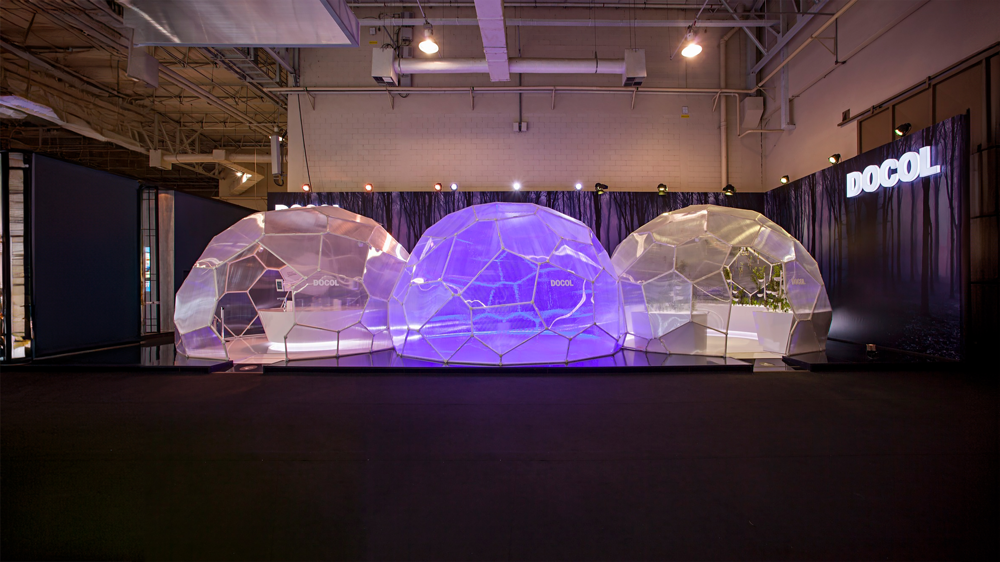
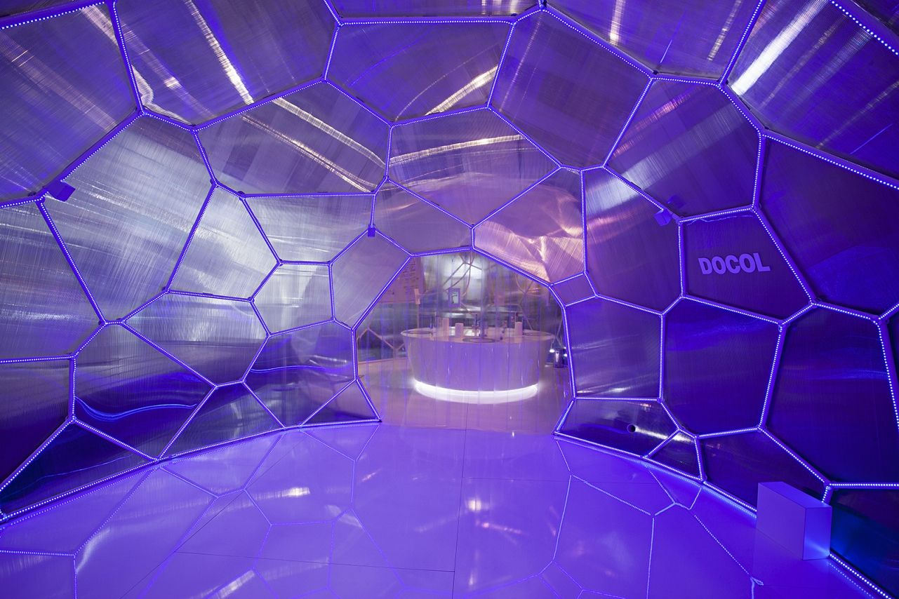
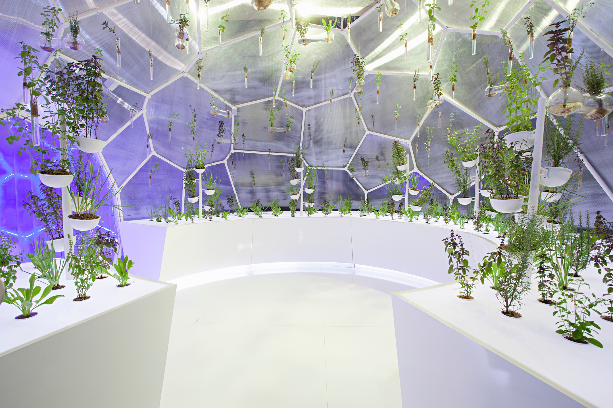
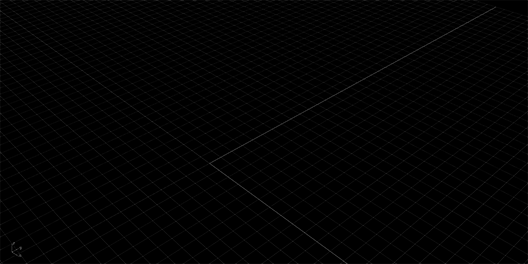
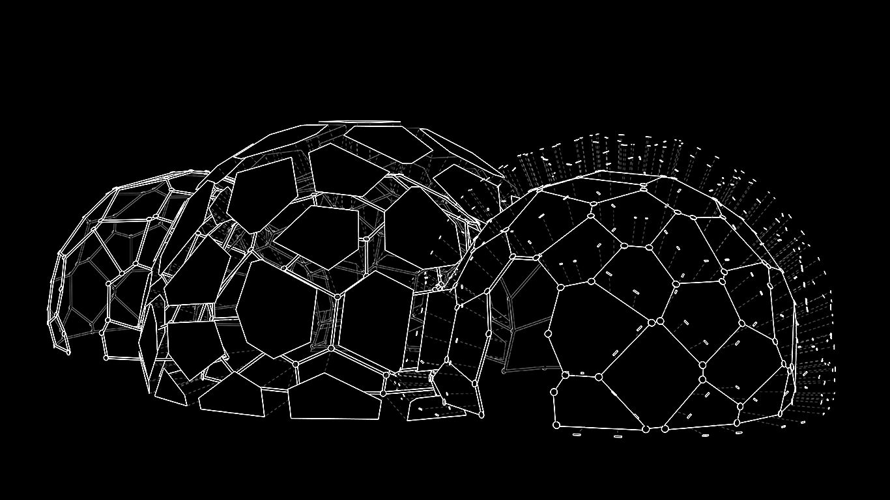
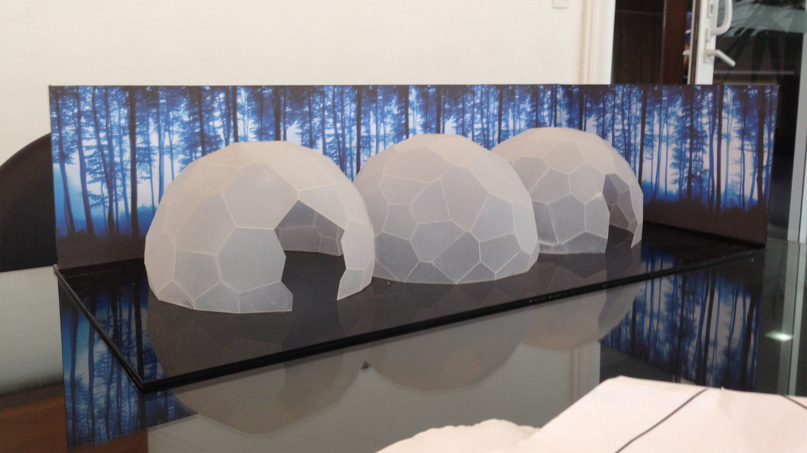
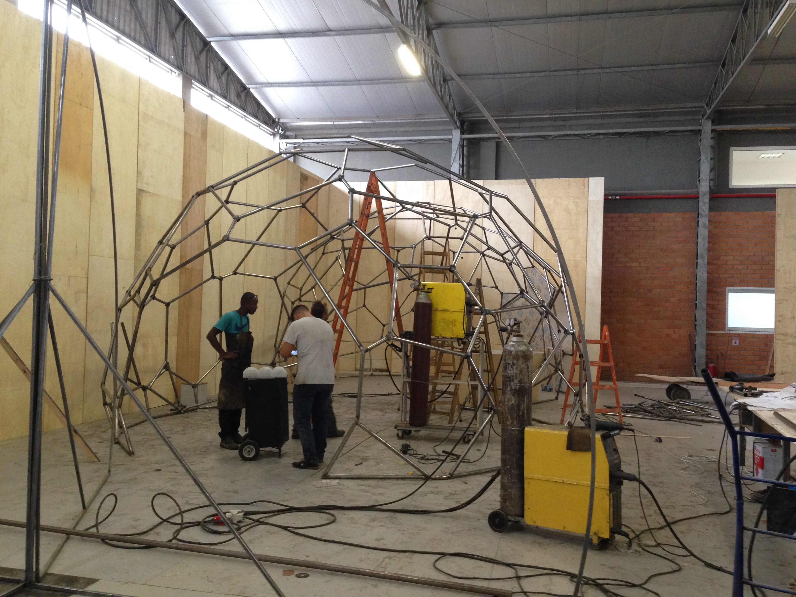

import YouTube from '@/components/YouTube.astro'

<YouTube id="MI3apyOKecs" title="O3-Pavillon von Atelier Marko Brajovic für Docol" />

## Konzept
> Der O3-Pavillon wurde vom Ozon-Trioxid-Molekül inspiriert. Die drei Sauerstoffatome werden zu drei Räumen, jeder mit einem einzigartigen multisensorischen Erlebnis.

*Atelier Marko Brajovic*

## Computational Design
Der O3-Pavillon wurde vom Atelier Marko Brajovic zu einer Zeit konzipiert, als ich meine ersten Schritte in der Welt des Computational Design machte. Ich hatte gerade mein Studium an der FAU-USP mit einer Abschlussarbeit beendet, bei der ich den Umgang mit allen für diesen Pavillon nötigen Werkzeugen gelernt hatte: Rhino, Grasshopper 3D und Kangaroo Physics.
In diesem Projekt arbeitete ich an der Formfindung und erzeugte die Daten für die digitale Fertigung.
### Formfindung
Besonders knifflig war die Formfindung an den Verschneidungen der Kuppeln. Da jede Kuppel eine eigene Form hatte, stimmten die Voronoi-Zellen an den Verschneidungen nicht überein. Ich musste das Kangaroo-Plugin verwenden, um gegenüberliegende Kuppelzellen in dieselbe Form zu zwingen. Dabei musste der Rest des Pavillons relaxieren, während die Planarität der Kuppeln erhalten blieb.

### Fertigung
Der Fertigungsprozess lag allerdings nicht in unseren Händen. Er wurde von einem Subunternehmer im Süden Brasiliens durchgeführt: [Paleta Stands](https://paleta.com.br/). Vorfertigung und Transport waren ein großes logistisches Puzzle, an dem ich leider nicht beteiligt war. Genau darum geht es in dem Paper, das auf der SIGraDi 2018 in São Carlos, Brasilien, vorgestellt wurde.
Das Paper ist hier zu finden:
[High-Low as Expression of The Brazilian Digital Fabrication](/de/publications/high-low-as-expression-of-the-brazilian-digital-fabrication)

