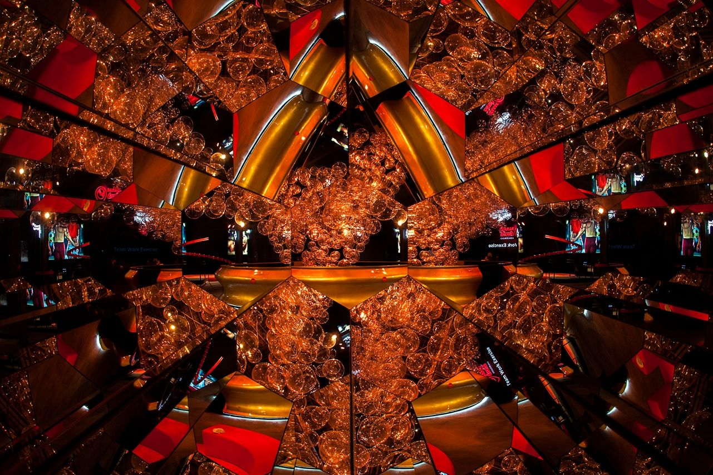
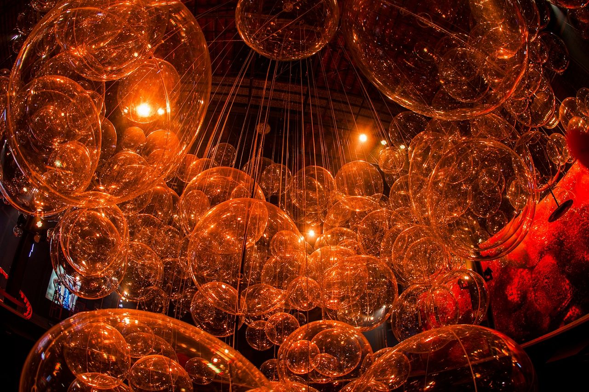
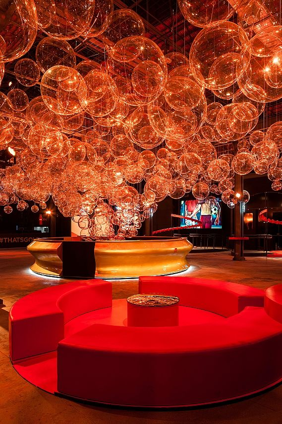

import Figure from '@/components/Figure.astro'

> Wir verwendeten mehr als 500 transparente Acrylkugeln verschiedener Größen, die an der Deckenkonstruktion der Lagerhalle hingen, sich über fast 1.000 m² verteilten und so beleuchtet wurden, dass der Eindruck aufsteigender Kohlensäurebläschen entstand. Unter der zentralen Blaseninstallation unterhielten verschiedene interaktive Aktivierungen und Ausstellungen das Publikum und erzählten die visuelle Geschichte des Unternehmens.

*Atelier Marko Brajovic*

Parada Coca-Cola war mein allererstes Projekt, bei dem ich Computational Design anwendete. Dieses sensorische Erlebnis war von der Coca-Cola-Flasche inspiriert und ahmte die Blasen und Farben des Getränks nach. Dazu kamen viele weitere „Aktivierungen“, wie man das bei brasilianischen Marketingagenturen nennt.

<Figure credit="Fernando Martins">
  
</Figure>

<Figure credit="Fernando Martins">
  
</Figure>

## Computational Design
Meine Rolle im Projekt war es, die Kunststoffkugeln parametrisch zu platzieren und dabei sicherzustellen, dass weder die Kugeln noch die Seile, an denen sie von der Decke hingen, miteinander kollidierten. Dafür verwendete ich Grasshopper und Galapagos.
Später kam eine weitere Aufgabe hinzu: eine Tabelle mit allen Seillängen und Kennzeichnungen zu erstellen, damit sich das gesamte Material für Versand und Montage ordentlich organisieren ließ. Nun ja, zumindest war das die Idee. Denn irgendwann hielt es jemand für eine gute Idee, die Kennzeichnungen zu entfernen 🤯. Für die Kolleginnen, die das Event koordinierten, war das ein Albtraum.

<Figure credit="Fernando Martins">
  
</Figure>
