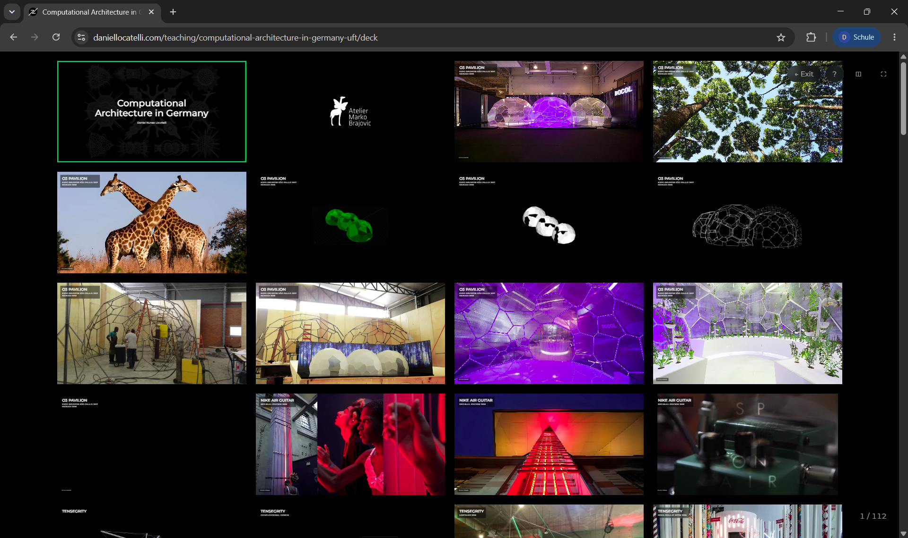
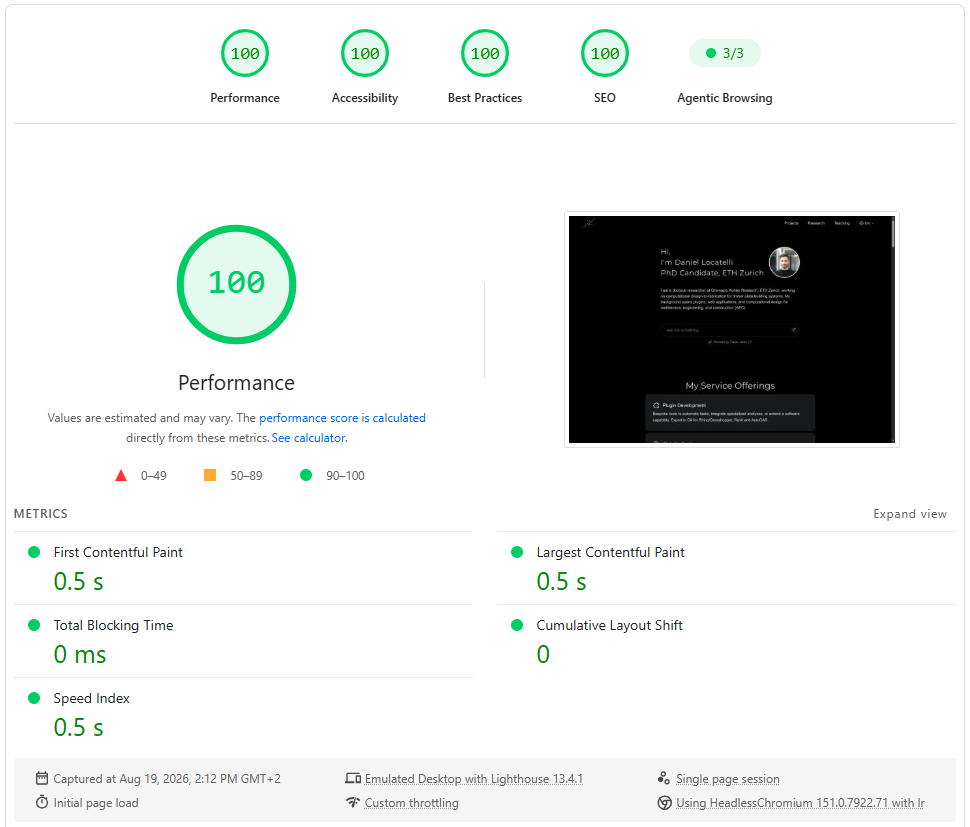
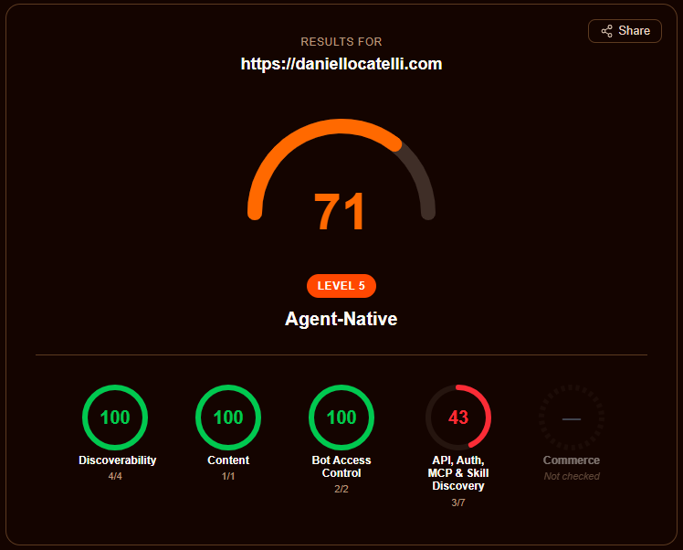
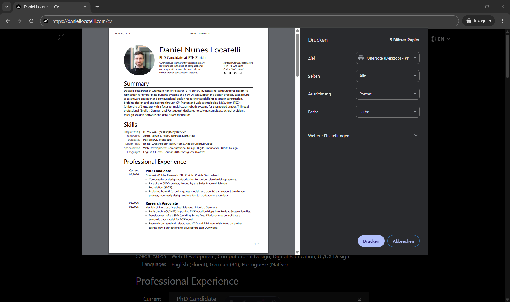

Das ist die Website, die Sie gerade lesen. Sie begann im April 2024 als kleine Website, und eine Entscheidung hat seitdem alles geprägt: Sämtliche Inhalte liegen als einfache Textdateien neben dem Code. Deshalb kann ein KI-Agent die Website bearbeiten wie Code, sie in drei Sprachen übersetzen und zu einem Profil verdichten, aus dem der Chat auf der Startseite antwortet, und andere KI-Agenten können die Website lesen, ohne die Seiten auszulesen. Diese Seite geht diese Punkte der Reihe nach durch und endet mit den Werkzeugen, auf denen alles aufbaut.

## Claude Code als Content-Management-System

Sämtliche Inhalte liegen als einfache Textdateien (geschrieben in [Markdown](https://commonmark.org/help/)) am selben Ort wie der Code, im [öffentlichen Repository auf GitHub](https://github.com/daniel-locatelli/daniellocatelli). Es gibt eine kleine Datei pro Projekt, Forschungseintrag, Publikation, Lehrbeitrag oder Lebenslaufabschnitt. Jede beginnt mit einem kurzen Kopf, der die Fakten festhält (Titel, Daten, Tags), darauf folgt der Seitentext, und jede gibt es einmal pro Sprache. Hinter den Seiten steht weder eine Datenbank noch ein separates Inhaltssystem.

Ein Content-Management-System (CMS) ist das Werkzeug, in das man sich normalerweise einloggt, um eine Seite hinzuzufügen oder einen Tippfehler zu korrigieren. Hier übernimmt diese Rolle [Claude Code](https://claude.com/claude-code), ein KI-Agent, der direkt mit den Dateien eines Projekts arbeitet. Weil die Inhalte einfach Dateien neben dem Code sind, kann er Einträge genauso lesen, bearbeiten, anlegen und gegenprüfen, wie er mit Quellcode arbeitet. Ich beschreibe ein neues Projekt oder eine Korrektur in einem Satz, und er schreibt oder aktualisiert die Dateien, hält die Kopfdaten konsistent und prüft die zugehörigen Einträge in den anderen Sprachen. Genau diese Seite wurde so geschrieben. Alles auf dieser Website ist in Zusammenarbeit entstanden, vom Code bis zum Inhalt.

## Übersetzung durch Claude Code

Die Website ist auf Englisch, Portugiesisch und Deutsch verfügbar. Es gibt keinen Übersetzungsdienst im Ablauf: Wenn sich eine Inhaltsdatei in einer Sprache ändert, übersetzt Claude Code sie und aktualisiert die entsprechenden Dateien in den beiden anderen. Fakten wie Daten, Links und Orte bleiben in allen drei identisch, Namen und Texte werden übersetzt. Dasselbe gilt für die Beschriftungen und Schaltflächen der Benutzeroberfläche.

Übersetzt wird nach dem Sinn, nicht Wort für Wort, und nach einem Stilleitfaden pro Sprache, der im Repository liegt: Tonfall, ein Glossar fester Begriffe und eine Tabelle mit Korrekturen. Jede Korrektur, die ich an einer Übersetzung vornehme, kommt mit Vorher und Nachher in diese Tabelle, sodass die nächste Übersetzung schon weiß, was die letzte falsch gemacht hat.

## KI-Chat auf der Startseite

Dass die Inhalte als reiner Text vorliegen, hat noch einen Nutzen: Es ist einfach, sie zu verdichten und einem Sprachmodell zu übergeben. Genau das macht den Chat auf der Startseite möglich.

Die Startseite ist bewusst kurz: mein Name, eine Zeile dazu, woran ich forsche, ein Chat mit Claude und eine Liste von Essays. Der Chat ist der Hauptzugang. Vier Startfragen stehen über dem Eingabefeld, sodass Besucher mit einem Klick fragen können, worum es in meiner Promotion geht oder welche KI-Agent-Skills ich für die Architektur geschrieben habe, und jede Antwort stützt sich auf die tatsächlichen Inhalte dieser Website, statt allgemein zu bleiben.

Sobald eine Frage abgeschickt ist, reduziert sich die Seite auf das Gespräch, ähnlich wie bei claude.ai: Einleitung und Essays treten zurück, das Eingabefeld wandert an den unteren Bildschirmrand, und die Antwort erscheint Stück für Stück, während Claude sie schreibt. Das Gespräch bleibt für die Dauer der Browsersitzung erhalten: Wer einem Link aus einer Antwort folgt und zurückkommt, findet es wieder vor. Nennt eine Antwort Seiten der Website, endet sie mit einer Vorschau dieser Seiten in der Sprache des Besuchers: dem Titelbild der ersten Seite in voller Breite mit ihrem Titel als Link und kleinen Vorschaubildern der übrigen in einer Reihe.

Im Hintergrund verdichtet ein Skript die Website zu einem Profil pro Sprache: jede Stelle mit dem, was ich dort gemacht habe, eine kurze Zusammenfassung mit Link zu jedem Forschungseintrag, Projekt, jeder Publikation und jedem Vortrag, die Kompetenzen und eine chronologische Zeitleiste. Das Profil umfasst etwa 13.000 Tokens pro Sprache (Tokens sind die Einheiten, in denen ein Sprachmodell liest; das entspricht rund 10.000 Wörtern). Jede Frage geht zusammen mit dem vollständigen Profil in der Sprache der Seite an Claude, sodass eine weit gefasste Frage wie „Woran haben Sie vorher gearbeitet?“ meine ganze Laufbahn auf einmal sieht. Da das Profil für alle Besucher gleich ist, hält Claude es zwischen den Fragen im Cache (Prompt-Caching): Nach der ersten Frage kostet es nur einen Bruchteil seiner Größe und verzögert die Antwort nicht.

Eine frühere Version ging den umgekehrten Weg: Sie suchte in den Inhalten die wenigen Passagen, die der Frage am nächsten kamen, und schickte nur diese (Retrieval, mit Embeddings von Voyage AI und einem Vektorspeicher in Supabase). Eng gefasste Fragen beantwortete sie gut, die Antwort auf weit gefasste Fragen baute sie aber manchmal um einen Nebeneintrag herum, deshalb habe ich sie ersetzt.

Das Profil wird bei jedem Build der Website aus den Inhalten neu erzeugt, sodass eine neue Seite mit der nächsten Veröffentlichung im Chat ankommt. Ein Benchmark-Skript stellt dem Chat danach einen festen Satz häufiger Fragen und prüft jede Antwort, sodass eine Änderung, die eine davon verschlechtert, auffällt, bevor Besucher sie sehen.

## Essays

Vieles von dem, was ich früher als Dienstleistung verkauft habe (Plugins, Web-Apps, Dashboards), schreibt heute ein Sprachmodell an einem Nachmittag. Deshalb listet die Startseite keine Dienstleistungen mehr auf; wer wissen möchte, was ich anbiete, kann den Chat fragen. Stattdessen listet sie Essays: einige längere Texte darüber, was in Architektur und Ingenieurwesen wertvoll bleibt, wenn Code billig ist, veröffentlicht etwa einmal im Monat. Jeder Essay ist wie alles andere eine einfache Markdown-Datei, sodass das Veröffentlichen eine einzige Änderung im Repository ist, und der Chat kann Fragen zum Essay beantworten, sobald dieser online ist.

## Präsentationsmodus

Zu einer Lehrseite kann eine Folienpräsentation gehören, die neben der Seite im selben Ordner liegt. Um eine zu öffnen, gehen Sie auf eine Lehrseite wie [Computergestützte Architektur in Deutschland](/de/teaching/computational-architecture-in-germany-uft) und klicken auf die grüne Schaltfläche **Folien öffnen** unter dem Titel. Die Präsentation läuft im Browser: Mit den Pfeiltasten wechseln Sie die Folien, **O** zeigt eine Übersicht aller Folien, **P** öffnet eine Referentenansicht mit Notizen, **F** schaltet in den Vollbildmodus, und **?** listet die übrigen Tastenkürzel auf.

Die Präsentationen werden in MDX geschrieben (Markdown, das auch Komponenten aufnehmen kann), mit einer kurzen YAML-Schreibweise für die gängigen Folientypen: Titel, Text, Bild, Bildreihe, Video und Überlagerungen. Ich nutze das für Lehre und Vorträge, damit eine Vorlesung und ihre Folien gemeinsam veröffentlicht, gemeinsam versioniert und gemeinsam übersetzt werden.

## Für Menschen und Agenten gebaut

Die Website hat zwei Arten von Besuchern: Menschen im Browser und KI-Agenten, die sie im Auftrag von jemandem lesen. Für beide braucht es eigene Arbeit, und beide werden mit einem öffentlichen Werkzeug geprüft.

### Für Menschen: Geschwindigkeit

Astro rendert die Website zu überwiegend statischem HTML, sodass die meisten Seiten überhaupt kein JavaScript brauchen. Der Rest ergibt sich daraus, nichts zu laden, was der Besucher noch nicht braucht:

- Bilder werden in responsiven Größen mit expliziten Abmessungen ausgeliefert und erst geladen, kurz bevor sie in den sichtbaren Bereich gelangen; Schriften werden auf die Zeichensätze reduziert, die die Website braucht, und früh geladen.
- Die Gesprächsansicht des Chats wird erst geladen, wenn ein Besucher Interesse am Chat zeigt (beim Überfahren einer Startfrage oder beim Klick ins Eingabefeld), sodass die Startseite selbst nur wenige Kilobyte JavaScript mitbringt.

[Lighthouse](https://developer.chrome.com/docs/lighthouse/overview), das Prüfwerkzeug von Google für die Qualität von Webseiten, bewertet die Website mit 100 für Performance, Barrierefreiheit, Best Practices und SEO.

### Für Agenten: Zugang

Ein großer Teil der Zugriffe auf eine solche Website wird von KI-Agenten statt von Browsern kommen, deshalb stellt die Website ihre Inhalte in den Formaten bereit, die Agenten erwarten:

- einen `llms.txt`-Index pro Sprache, eine einfache Liste der Seiten für Sprachmodelle, die beim Build erzeugt wird;
- eine Markdown-Fassung jeder Inhaltsseite (einfach `.md` an die URL anhängen), die auch automatisch an jede Anfrage ausgeliefert wird, die Markdown verlangt (`Accept: text/markdown`);
- eine `robots.txt`, die KI-Crawler ausdrücklich willkommen heißt, eine Sitemap mit Bildeinträgen und Änderungsdaten und einen API-Katalog unter `/.well-known/`;
- einen kleinen, schreibgeschützten [MCP](https://modelcontextprotocol.io/)-Server (MCP ist das Protokoll, über das Agenten externe Werkzeuge aufrufen), damit Agenten die Inhalte der Website direkt abfragen können, darunter dasselbe Profil, aus dem der Chat antwortet, vollständig oder über eine Stichwortsuche;
- [DNS-AID](https://datatracker.ietf.org/doc/draft-mozleywilliams-dnsop-dnsaid/)-Discovery-Einträge im DNS der Domain, mit DNSSEC signiert, damit ein Agent den MCP-Server allein über den Domainnamen findet;
- einen Skills-Index unter `/.well-known/agent-skills/`, nach Cloudflares [Agent-Skills-Discovery-RFC](https://github.com/cloudflare/agent-skills-discovery-rfc), mit zwei `SKILL.md`-Dateien im [Agent-Skills](https://agentskills.io/specification)-Format, die einem Agenten erklären, wie er die Website per MCP abfragt oder als Markdown liest.

Auf [isitagentready.com](https://isitagentready.com/), dem Prüfwerkzeug zu Cloudflares [Leitfaden zur Agentenfähigkeit](https://blog.cloudflare.com/agent-readiness/), stieg die Website von 25/100 auf 71/100, „Level 5, Agent-Native“, mit voller Punktzahl bei Auffindbarkeit, Inhalt und Bot-Zugriffskontrolle.

Die fehlenden Punkte bleiben bewusst offen. Sie betreffen alle Anmeldungen und Dienste: OAuth-Discovery, Protected-Resource-Metadaten und eine `auth.md` ergeben nur Sinn, wenn es etwas gibt, bei dem man sich anmelden kann, eine A2A-Agent-Card beschreibt einen Agenten, der anderen Agenten Dienste anbietet, und WebMCP stellt Aktionen innerhalb der Seite bereit, etwa Formulare oder Bestellvorgänge. Ein schreibgeschütztes Portfolio hat nichts davon, also führt das Prüfwerkzeug diese Punkte weiter auf, und die Website verzichtet weiter darauf.

## Ein persönlicher Werkzeugkasten hinter den öffentlichen Seiten

Die Website enthält auch Seiten, die nicht in der Navigation stehen und vor allem meinem eigenen Gebrauch dienen. Der [Kurzlebenslauf](/de/cv), der [vollständige Lebenslauf](/de/full-cv) und der [auf die Promotion ausgerichtete Lebenslauf](/de/phd-cv) werden aus denselben Inhalten erzeugt wie der Rest der Website, sodass eine Erfahrung oder Publikation nur ein einziges Mal eingetragen werden muss. Sie bringen Druckstile mit, sodass das Speichern als PDF jederzeit ein sauberes, aktuelles Dokument ergibt. Ein paar ähnliche Seiten dienen als Titelkarten für aufgezeichnete Vorlesungen.

## Kleinere Details

- **Link-Vorschauen zur Build-Zeit.** Externe Links, die auf einer Seite aufgeführt sind, werden als Vorschaukarten dargestellt. Titel, Beschreibungen, Bilder und Symbole werden einmal abgerufen und im Repository gespeichert, sodass der Build immer dasselbe Ergebnis liefert und beim Laden der Seite keine Anfrage an Dritte erfolgt.
- **Keine toten Links.** Jeder Link innerhalb der Website wird vor der Veröffentlichung gegen den fertigen Build geprüft, sodass nichts Defektes online geht. Links auf andere Websites werden einmal pro Woche geprüft und gemeldet, denn sie können jederzeit ins Leere laufen.
- **Zuletzt aktualisiert, aus der Historie.** Jede Inhaltsseite zeigt, wann sie sich zuletzt geändert hat, entnommen aus der Historie des Repositorys, und dasselbe Datum steht in der Sitemap und in den Metadaten der Seite für Suchmaschinen.
- **Bildquellen an einem Ort.** Bilder Dritter, die mehrere Seiten verwenden, etwa die Tafeln von Ernst Haeckel, liegen nur einmal vor, in einem Ordner pro Urheber. Der Build findet alle Seiten, die sie verwenden, und erzeugt für jeden Urheber eine Quellenseite; die Liste muss also nie von Hand gepflegt werden, und der Bildnachweis verlinkt darauf. Bildnachweise erhalten das © automatisch, außer bei gemeinfreien Werken.
- **Tooltips überall.** Ein einziges kleines Tooltip-System ist für alle Tooltips der Website zuständig: Fußnoten zeigen ihre Anmerkung beim Überfahren mit der Maus, sodass Leser nicht ans Seitenende springen müssen; die Social-Icons im Footer und im Kopf des Lebenslaufs nennen ihr Ziel; und die Bedienelemente der Foliensätze zeigen ihr Tastenkürzel.
- **Markdown für Agenten auf statischen Seiten.** Markdown an Agenten auszuliefern, obwohl die Seiten vorab erzeugt werden, erforderte eine genauere Untersuchung, wie Cloudflare und Astro Anfragen verarbeiten; die Lösung ist ein kleines Cloudflare-Snippet, das die Adresse umschreibt, bevor die Anfrage die Website erreicht.

## Tech-Stack

- [**Astro**](https://astro.build/) mit TypeScript für die Website selbst, [**React**](https://react.dev/) für die wenigen interaktiven Teile und [**Tailwind CSS**](https://tailwindcss.com/) für das Styling.
- [**Astro Content Collections**](https://docs.astro.build/en/guides/content-collections/) für sämtliche Inhalte, geschrieben in Markdown und MDX, mit Kopfdaten, deren Felder beim Build geprüft werden.
- [**Claude**](https://www.anthropic.com/claude) (Anthropic) für den Chat auf der Startseite.
- [**Cloudflare Workers**](https://workers.cloudflare.com/) mit Static Assets für das Hosting: Vorab erzeugte Seiten werden direkt aus dem Netzwerk von Cloudflare ausgeliefert, und Code läuft nur für den Chat und den MCP-Server.

All das ruht auf denselben einfachen Dateien. Claude Code bearbeitet und übersetzt sie, der Build verdichtet sie für den Chat, und Agenten lesen sie als Markdown. Eine Seite hinzuzufügen heißt weiterhin, eine Textdatei anzulegen, und der Rest ergibt sich daraus.
