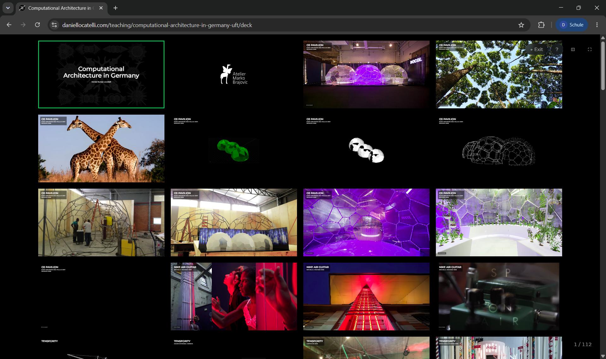
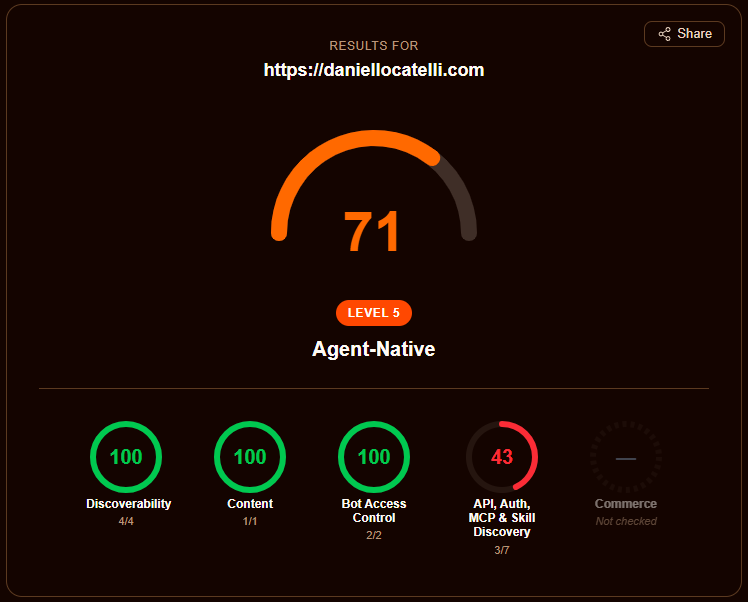
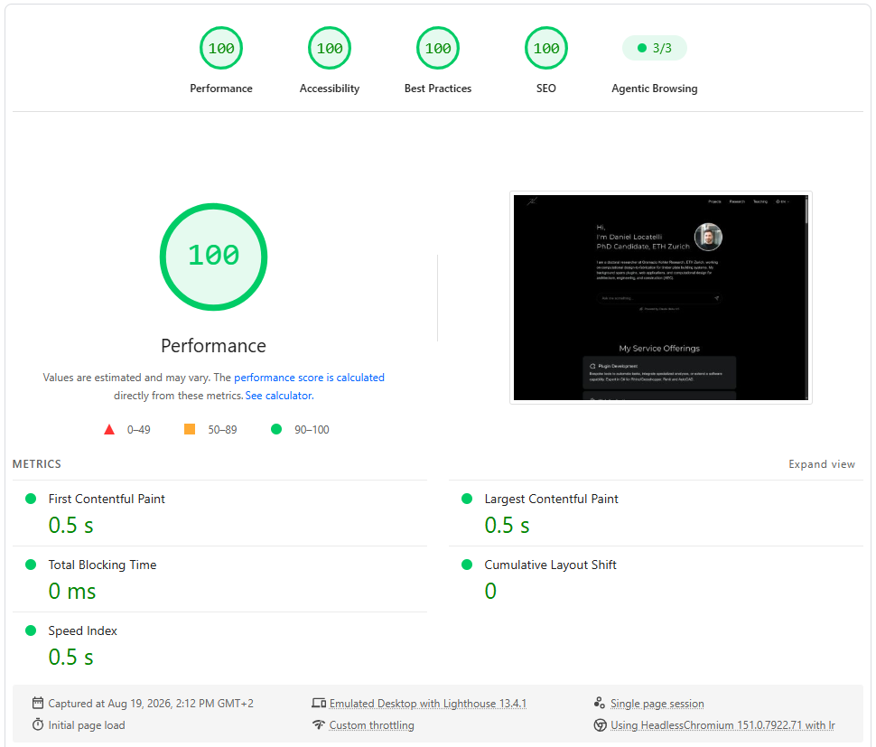
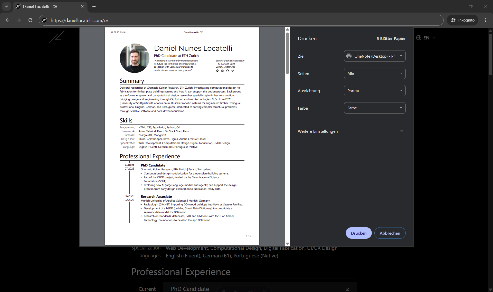

Das ist die Website, die Sie gerade lesen. Sie begann im April 2024 als kleine Astro-Seite und ist seitdem zu einer Spielwiese für die Art geworden, wie ich gerne Dinge baue: schnelle statische Seiten, Inhalte, die sowohl für Menschen als auch für KI-Werkzeuge leicht lesbar sind, und ein paar interaktive Elemente, die das Ganze&nbsp;würzen.

## Tech-Stack

- [**Astro**](https://astro.build/) mit TypeScript für die Website selbst, [**React**](https://react.dev/) für die wenigen Inseln, die Interaktivität brauchen, und [**Tailwind CSS**](https://tailwindcss.com/) für das Styling.
- [**Astro Content Collections**](https://docs.astro.build/en/guides/content-collections/) für sämtliche Inhalte, geschrieben in Markdown und MDX mit typisiertem Frontmatter, das beim Build validiert wird.
- [**Claude**](https://www.anthropic.com/claude) (Anthropic) für den Chat auf der Startseite, der bei jeder Frage ein verdichtetes Profil der gesamten Website liest.
- [**Cloudflare Workers**](https://workers.cloudflare.com/) mit Static Assets für Hosting, Edge-Caching und die Endpunkte für Agenten; vorgerenderte Seiten werden direkt von der Edge ausgeliefert, der Worker läuft nur für die Chat- und MCP-Endpunkte.

## Claude Code als Content-Management-System

Sämtliche Inhalte liegen als einfache Textdateien (geschrieben in [Markdown](https://commonmark.org/help/)) am selben Ort wie der Code, im [öffentlichen Repository auf GitHub](https://github.com/daniel-locatelli/daniellocatelli): eine kleine Datei pro Projekt, Forschungseintrag, Publikation, Lehrbeitrag oder Lebenslaufabschnitt, mit einem kurzen Kopf, der die Fakten (Titel, Daten, Tags) über dem Seitentext festhält, und einer Kopie in jeder der drei Sprachen. Hinter den Seiten steht weder eine Datenbank noch ein separates Inhaltssystem.

Sinn dieses Aufbaus ist, die Inhalte für KI-Harnesse wie [Claude Code](https://claude.com/claude-code) direkt zugänglich zu machen. Weil die Inhalte einfach Dateien neben dem Code sind, kann Claude Code Einträge genauso lesen, bearbeiten, anlegen und gegenprüfen, wie es mit Quellcode arbeitet. In der Praxis heißt das: Ich nutze Claude Code als Content-Management-System (CMS), also als das Werkzeug, in das man sich normalerweise einloggt, um eine Seite hinzuzufügen oder einen Tippfehler zu korrigieren. Ich beschreibe ein neues Projekt oder eine Korrektur in einem Satz, und es schreibt oder aktualisiert die Dateien, hält die Kopfdaten konsistent und prüft die zugehörigen Einträge in den anderen Sprachen. Genau diese Seite ist so entstanden. Alles auf dieser Website ist gemeinsam entstanden, vom Code bis zum Inhalt.

Dass alle Inhalte als reiner Text im Repository liegen, hat einen zweiten Nutzen: Es ist einfach, sie zu verdichten und einem Sprachmodell zu übergeben. Genau das macht den KI-Chat auf der Startseite möglich (mehr dazu weiter unten).

## Übersetzung durch Claude Code

Die Website ist auf Englisch, Portugiesisch und Deutsch verfügbar. Es gibt keinen Übersetzungsdienst in der Pipeline: Wenn sich eine Inhaltsdatei in einer Sprache ändert, übersetzt Claude Code sie und aktualisiert die entsprechenden Dateien in den beiden anderen. Strukturelle Felder wie Daten, Links und Orte werden synchron gehalten, während übersetzbare Felder wie Länder- und Städtenamen lokalisiert werden. Dasselbe gilt für die Texte der Benutzeroberfläche, die als typisierte Objekte pro Sprache vorliegen.

## KI-Chat auf der Startseite

Die Startseite ist bewusst kurz: mein Name, eine Zeile dazu, woran ich forsche, ein Chat mit Claude und eine Liste von Essays. Der Chat ist der Hauptzugang. Drei Startfragen stehen über dem Eingabefeld, sodass Besucher mit einem Klick fragen können, worum es in meiner Promotion geht oder welche KI-Agent-Skills ich für die Architektur geschrieben habe, und jede Antwort beruht auf den tatsächlichen Inhalten dieser Website statt auf einer generischen Antwort. Sobald eine Frage abgeschickt ist, reduziert sich die Seite auf das Gespräch, ähnlich wie bei claude.ai: Einleitung und Essays treten zurück, das Eingabefeld wandert an den unteren Bildschirmrand, und die Antwort erscheint Stück für Stück, während Claude sie schreibt. Das Gespräch bleibt für die Browsersitzung erhalten, sodass man nach einem Link aus einer Antwort wieder dorthin zurückkehrt. Verlinkt eine Antwort Seiten der Website, endet sie mit dem Titelbild der ersten Seite in voller Breite, das sich im Vollbild öffnen lässt, darunter der Seitentitel als Link, und kleinen Vorschaubildern der übrigen, jeweils in der Sprache des Besuchers.

Im Hintergrund verdichtet ein Skript die Content Collections zu einem Profil pro Sprache: jede Stelle mit dem, was ich dort gemacht habe, eine kurze Zusammenfassung mit Link zu jedem Forschungseintrag, Projekt, jeder Publikation und jedem Vortrag, die Kompetenzen und eine chronologische Zeitleiste. Das sind etwa 13.000 Tokens pro Sprache, gebündelt in den Worker. Jede Frage geht zusammen mit dem vollständigen Profil in der Sprache der Seite an Claude, sodass eine breite Frage wie "Was hast du vorher entwickelt?" meine ganze Laufbahn auf einmal sieht statt einer Handvoll abgerufener Fragmente. Da das Profil für alle Besucher gleich ist, wird es per Prompt-Caching zwischengespeichert: Nach der ersten Frage kostet es nur einen Bruchteil seiner Größe und verzögert die Antwort nicht. Eine frühere Version arbeitete mit Retrieval (Embeddings mit Voyage AI und einem Vektorspeicher in Supabase); sie beantwortete enge Fragen gut, baute die Antwort auf breite Fragen aber manchmal um einen Nebeneintrag herum, deshalb habe ich sie ersetzt. Das Profil wird bei jedem Build aus den Inhalten neu erzeugt, sodass eine neue Seite mit dem nächsten Deploy im Chat ankommt, und ein Benchmark-Skript stellt dem Chat einen festen Satz häufiger Fragen, um sicherzustellen, dass er sie weiterhin alle korrekt beantwortet.

## Essays

Vieles von dem, was ich früher als Dienstleistung verkauft habe, also Plugins, Web-Apps und Dashboards, schreibt heute ein Sprachmodell an einem Nachmittag. Deshalb listet die Startseite keine Dienstleistungen mehr auf, sondern Essays: einige längere Texte darüber, was in Architektur und Ingenieurwesen wertvoll bleibt, wenn Code billig ist, veröffentlicht etwa einmal im Monat. Jeder Essay ist eine einfache Markdown-Datei in einer eigenen Content Collection, sodass das Veröffentlichen ein einziger Commit ist, und der Chat kann Fragen dazu beantworten, sobald er veröffentlicht ist.

## Präsentationsmodus

Inhaltselemente können eine Folienpräsentation mitführen, die neben dem Text liegt, im selben Ordner und im selben Repository. Die Präsentationen werden in MDX geschrieben, mit einer kleinen YAML-Kurzschreibweise für die gängigen Folientypen (Titel, Text, Bild, Bildreihe, Video, Überlagerungen), und im Browser gerendert, mit Tastaturnavigation, einer Übersicht aller Folien und einem Präsentatorfenster. Ich nutze das für Lehre und Vorträge, damit eine Vorlesung und ihre Folien gemeinsam veröffentlicht, gemeinsam versioniert und gemeinsam übersetzt werden.

## Agentenfähig auf Cloudflare

Da ein wachsender Teil des Verkehrs auf einer solchen Website künftig von KI-Agenten statt von Browsern kommen wird, stellt die Website ihre Inhalte in den Formaten bereit, die Agenten erwarten:

- einen `llms.txt`-Index pro Sprache, der beim Build aus den Content Collections erzeugt wird;
- eine Markdown-Fassung jeder Inhaltsseite (einfach `.md` an die URL anhängen) sowie Content Negotiation, sodass eine Anfrage mit `Accept: text/markdown` direkt Markdown erhält;
- eine `robots.txt`, die KI-Crawler ausdrücklich willkommen heißt, eine Sitemap mit Bildeinträgen und `lastmod`-Daten pro URL aus der Git-Historie (dasselbe Datum erscheint als "Zuletzt aktualisiert" auf jeder Inhaltsseite sowie als `article:modified_time` und `dateModified` in den strukturierten Daten des Head) und einen API-Katalog unter `/.well-known/`;
- einen kleinen, schreibgeschützten [MCP](https://modelcontextprotocol.io/)-Server, damit Agenten die Inhalte der Website als Werkzeuge abfragen können, auch dasselbe Profil, aus dem der Chat antwortet, vollständig oder über eine Stichwortsuche;
- [DNS-AID](https://datatracker.ietf.org/doc/draft-mozleywilliams-dnsop-dnsaid/)-Discovery-Einträge (SVCB-Einträge `_mcp._agents` und `_index._agents`, DNSSEC-signiert), damit Agenten den MCP-Endpunkt allein über den Domainnamen finden;
- einen Skills-Index unter `/.well-known/agent-skills/`, nach Cloudflares [Agent-Skills-Discovery-RFC](https://github.com/cloudflare/agent-skills-discovery-rfc), mit zwei `SKILL.md`-Dateien im [Agent-Skills](https://agentskills.io/specification)-Format, die einem Agenten erklären, wie er die Website per MCP abfragt oder als Markdown liest.

Die Content Negotiation auf vorgerenderten Seiten zum Laufen zu bringen, erforderte einiges Graben darin, wie die Anfrage-Pipeline von Cloudflare, Workers Static Assets und die Build-Zeit-Middleware von Astro zusammenspielen; die Lösung ist ein Cloudflare-Snippet auf Zonenebene, das die URL umschreibt, bevor sie den Worker erreicht. Auf [isitagentready.com](https://isitagentready.com/), dem Prüfwerkzeug zu Cloudflares [Leitfaden zur Agentenfähigkeit](https://blog.cloudflare.com/agent-readiness/), stieg die Website von 25 % auf 71/100, "Level 5, Agent-Native", mit voller Punktzahl bei Auffindbarkeit, Inhalt und Bot-Zugriffskontrolle. Die restlichen Punkte liegen in der Kategorie API und Authentifizierung und bleiben bewusst offen: OAuth-Discovery, Protected-Resource-Metadaten und eine `auth.md` ergeben nur Sinn, wenn es etwas gibt, bei dem man sich anmelden kann, eine A2A-Agent-Card beschreibt einen Agenten, der anderen Agenten Dienste anbietet, und WebMCP stellt Aktionen innerhalb der Seite bereit, etwa Formulare oder Bestellvorgänge. Ein schreibgeschütztes Portfolio hat nichts davon, also führt das Prüfwerkzeug diese Punkte weiter auf, und die Website verzichtet weiter darauf.

## Performance und Lighthouse

Astro rendert die Website zu überwiegend statischem HTML, was ihr bereits einen Vorsprung verschafft. Die Lighthouse-Werte von 100 für Performance, Barrierefreiheit, Best Practices und SEO ergeben sich dann daraus, nichts zu laden, was der Besucher noch nicht braucht:

- Bilder kommen in responsiven Größen mit expliziten Abmessungen und werden kurz vor dem sichtbaren Bereich nachgeladen; Schriften werden auf die benötigten Zeichen reduziert und vorgeladen.
- Die Gesprächsansicht wird erst geladen, wenn ein Besucher Interesse am Chat zeigt (beim Überfahren einer Startfrage oder beim Klick ins Eingabefeld), sodass das Eingabefeld selbst nur wenige Kilobyte JavaScript mitbringt.

## Ein persönlicher Werkzeugkasten hinter den öffentlichen Seiten

Die Website enthält auch Seiten, die nirgends verlinkt sind und vor allem meinem eigenen Gebrauch dienen. Der [Kurzlebenslauf](/de/cv), der [vollständige Lebenslauf](/de/full-cv) und der [auf die Promotion ausgerichtete Lebenslauf](/de/phd-cv) liegen unter nicht gelisteten URLs, werden aus denselben Content Collections gerendert wie der Rest der Website (sodass eine Erfahrung oder Publikation nur ein einziges Mal eingetragen werden muss) und bringen Druckstile mit, sodass das Speichern der Seite als PDF jederzeit ein sauberes, aktuelles Dokument ergibt. Ein paar ebenfalls nicht gelistete Seiten dienen als Titelkarten für aufgezeichnete Vorlesungen. So ist die Website zugleich ein kleiner Arbeitsbereich und nicht nur ein Schaufenster für Besucher.

## Kleinere Details

- **Link-Vorschauen zur Build-Zeit.** Externe Links, die auf einer Seite aufgeführt sind, werden als Vorschaukarten dargestellt. Titel, Beschreibungen, Bilder und Favicons werden einmal abgerufen und im Repository zwischengespeichert, sodass der Build reproduzierbar ist und beim Laden der Seite keine Anfrage an Dritte erfolgt.
- **Keine toten Links.** Jeder Link der Website, auf ihre eigenen Seiten, auf die Dateien, die jede Seite lädt, und auf die Symbole und Fußnoten, auf die jede Seite in sich selbst verweist, wird gegen den fertigen Build geprüft, sodass nichts Kaputtes online geht. Links auf andere Websites werden einmal pro Woche überprüft und gemeldet, denn die brechen nach ihrem eigenen Rhythmus.
- **Tooltips überall.** Ein einziges kleines Tooltip-System (ein Popover-Panel mit Pfeil, das wenige Zeilen JavaScript positionieren und bei Bedarf umklappen) bedient jeden Tooltip der Website: Markdown-Fußnoten zeigen die Anmerkung beim Überfahren mit der Maus direkt an Ort und Stelle, sodass Leser nicht ans Seitenende springen müssen; die Social-Icons im Footer und im Kopf des Lebenslaufs nennen ihr Ziel; und die Bedienelemente der Foliensätze zeigen ihr Tastenkürzel. Native Browser-Tooltips gibt es nicht mehr.
