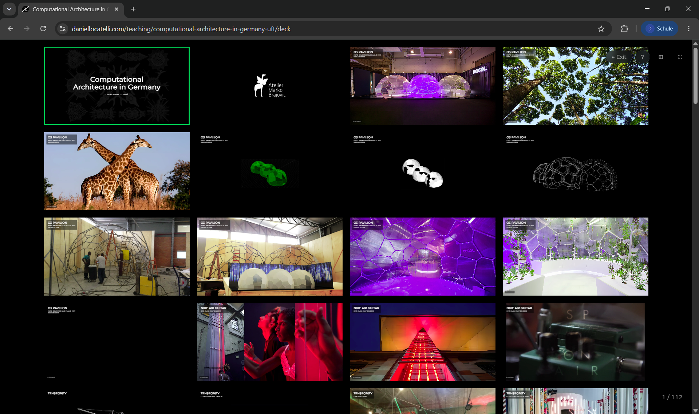
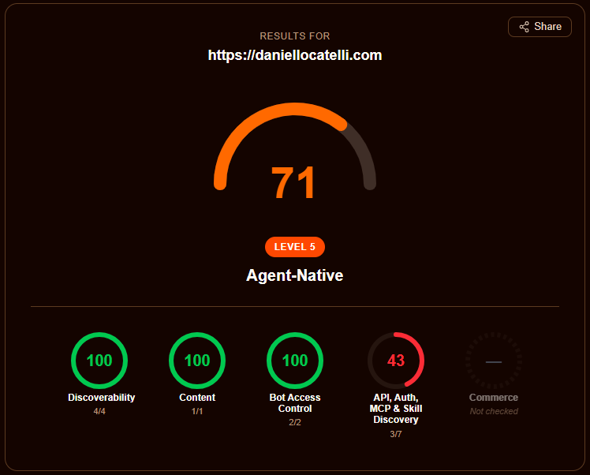
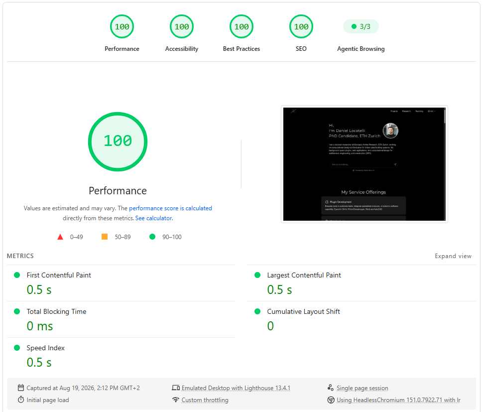
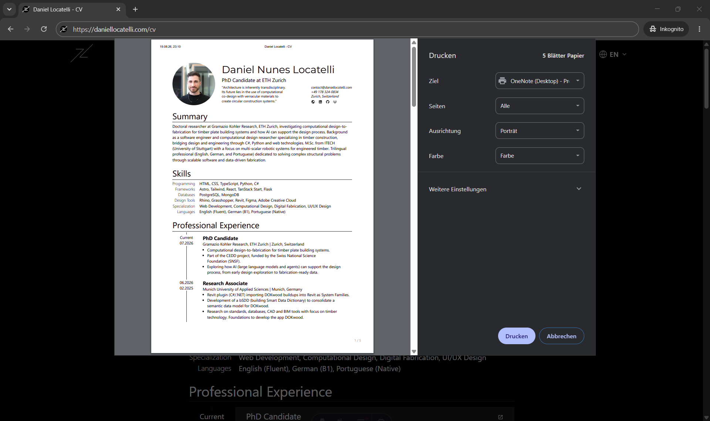

This is the website you are reading right now. It started in April 2024 as a small Astro site and has since grown into a playground for the way I like to build things: fast static pages, content that is easy for both humans and AI tools to read, and a few interactive pieces to spice things&nbsp;up.

## Tech Stack

- [**Astro**](https://astro.build/) with TypeScript for the site itself, [**React**](https://react.dev/) for the few islands that need interactivity, and [**Tailwind CSS**](https://tailwindcss.com/) for styling.
- [**Astro Content Collections**](https://docs.astro.build/en/guides/content-collections/) for all content, written as markdown and MDX with typed frontmatter and validated at build time.
- [**Claude**](https://www.anthropic.com/claude) (Anthropic) for the homepage chat, which reads a condensed profile of the whole site with every question.
- [**Cloudflare Workers**](https://workers.cloudflare.com/) with Static Assets for hosting, edge caching, and the agent-facing endpoints; prerendered pages are served straight from the edge, and the Worker only runs for the chat and MCP endpoints.

## Claude Code as content management system

All the content lives as plain text files (written in [markdown](https://commonmark.org/help/)) in the same place as the code, the [public repository on GitHub](https://github.com/daniel-locatelli/daniellocatelli): one small file per project, research entry, publication, teaching item, or CV section, with a short header that holds the facts (title, dates, tags) above the text of the page, and a copy in each of the three languages. There is no database and no separate content system behind the pages.

The point of this setup is to make the content directly accessible to AI harnesses such as [Claude Code](https://claude.com/claude-code). Because the content is just files next to the code, Claude Code can read, edit, create, and cross-check entries the same way it works on source code. In practice this means I use Claude Code as the content management system (CMS), the tool you would normally log into to add a page or fix a typo: I describe a new project or a correction in a sentence, and it writes or updates the files, keeps the headers consistent, and checks the related entries in the other languages. This very page was written that way. Everything on this site is co-created, from the code to the content.

Keeping the content in the repository as plain text has a second payoff: it is straightforward to condense it and hand it to a language model. That is what makes the AI chat on the homepage possible (more on it below).

## Translation by Claude Code

The site is available in English, Portuguese, and German. There is no translation service in the pipeline: when a content file changes in one locale, Claude Code translates it and updates the corresponding files in the other two. Structural fields such as dates, links, and places are kept in sync, while translatable fields such as country and city names are localised. The same applies to the interface strings, which live as typed objects per locale.

## AI chat on the homepage

The homepage is deliberately short: my name, one line on what I research, a chat powered by Claude, and a list of essays. The chat is the main way in. Three starter questions sit above the input, so a visitor can ask what my PhD is about, or which AI agent skills I made for architecture, with a single click, and every answer is grounded in the actual content of this site rather than a generic reply. Once a question is sent, the page clears down to the conversation, much like claude.ai: the intro and essays step aside, the input slides to the bottom of the screen, and the answer streams in as Claude writes it. The conversation is kept for the browser session, so following a link from an answer and coming back returns to it.

Under the hood, a script condenses the content collections into one profile per language: every role with what I did there, a short summary and link for every research page, project, publication and talk, the skills, and a chronological timeline. It comes to about 13,000 tokens per language and is bundled into the Worker. Each question goes to Claude together with the whole profile for the page's language, so a broad question such as "what did you build before?" sees my entire career at once instead of a handful of retrieved fragments. Because the profile is identical for every visitor, it is prompt-cached, so after the first question it costs a fraction of its size and does not slow the answer down. An earlier version used retrieval (embeddings with Voyage AI and a vector store in Supabase); it answered narrow questions well but sometimes built answers to broad ones around a minor entry, so I replaced it. Whenever content changes, a single command regenerates the profile, and a benchmark script runs a fixed set of common questions against the chat to make sure it still answers all of them correctly.

## Essays

Most of what I used to sell as a service, plugins, web apps, dashboards, can now be written by a language model in an afternoon. So the homepage no longer lists services. It lists essays instead: a few long pieces on what stays valuable in architecture and engineering once code is cheap, published about once a month. Each essay is a plain markdown file in its own content collection, so publishing one is a single commit, and the chat can answer questions about it as soon as the profile has been regenerated.

## Presentation mode

Content items can carry a slide deck that lives alongside the writeup, in the same folder and the same repository. Decks are authored in MDX with a small YAML shorthand for the common slide types (title, text, image, image row, video, overlays), and rendered in the browser with keyboard navigation, an overview of all slides, and a presenter window. I use this for teaching and talks, so that a lecture and its slides are published together, versioned together, and translated together.

## Agent-ready on Cloudflare

Since much of the traffic to a site like this will increasingly come from AI agents rather than browsers, the site exposes its content in the formats agents expect:

- an `llms.txt` index per locale, generated from the content collections at build time;
- a markdown companion for every content page (append `.md` to the URL), plus content negotiation so that a request with `Accept: text/markdown` receives markdown directly;
- a `robots.txt` that explicitly welcomes AI crawlers, a sitemap with image entries and per-URL `lastmod` dates taken from git history (the same date appears as "Last updated" on every content page and as `article:modified_time` and `dateModified` structured data in its head), and an API catalog under `/.well-known/`;
- a small read-only [MCP](https://modelcontextprotocol.io/) server, so that agents can query the site's content as tools, including the same profile the chat answers from, whole or through a keyword search;
- [DNS-AID](https://datatracker.ietf.org/doc/draft-mozleywilliams-dnsop-dnsaid/) discovery records (`_mcp._agents` and `_index._agents` SVCB records, DNSSEC-signed), so that agents can find the MCP endpoint from the domain name alone;
- a skills index under `/.well-known/agent-skills/`, following Cloudflare's [Agent Skills discovery RFC](https://github.com/cloudflare/agent-skills-discovery-rfc), with two `SKILL.md` files in the [Agent Skills](https://agentskills.io/specification) format that teach an agent how to query the site via MCP or read it as markdown.

Getting content negotiation to work on prerendered pages took some digging into how Cloudflare's request pipeline, Workers Static Assets, and Astro's build-time middleware interact; the solution is a zone-level Cloudflare Snippet that rewrites the URL before it reaches the Worker. On [isitagentready.com](https://isitagentready.com/), the checker that accompanies Cloudflare's [agent-readiness guide](https://blog.cloudflare.com/agent-readiness/), the site went from a 25% score to 71/100, "Level 5, Agent-Native", with full marks for discoverability, content, and bot access control. The remaining points sit in the API and auth category and are deliberately left open: OAuth discovery, protected-resource metadata, and an `auth.md` only make sense when there is something to log in to, an A2A agent card describes an agent that offers services to other agents, and WebMCP exposes in-page actions such as forms or checkouts. A read-only portfolio has none of these, so the checker keeps listing them and the site keeps declining them.

## Performance and Lighthouse

Astro renders the site to mostly static HTML, which already gives it a head start. Lighthouse scores of 100 for performance, accessibility, best practices, and SEO then come from not loading what the visitor does not need yet:

- Images ship in responsive sizes with explicit dimensions, lazy-loaded just ahead of the viewport; fonts are subset and preloaded.
- The conversation view is fetched only once a visitor shows intent to chat (hovering a starter question or focusing the input), so the hero input itself ships a few kilobytes of JavaScript.

## A personal toolbox behind the public pages

The site also hosts pages that are not linked from anywhere and exist mainly for my own use. The [short CV](/cv), the [full CV](/full-cv), and the [PhD-oriented CV](/phd-cv) live at unlisted URLs, are rendered from the same content collections as the rest of the site (so an experience or publication only ever needs to be entered once), and carry print styles so that saving the page as a PDF produces a clean, up-to-date document whenever one is needed. A couple of similarly unlisted pages serve as title cards for recorded lectures. In this way the site doubles as a small workspace, not only a showcase for visitors.

## Smaller details

- **Link previews at build time.** External links listed on a page are rendered as preview cards. Their titles, descriptions, images, and favicons are fetched once and cached in the repository, so the build is reproducible and no third-party request happens at page load.
- **No broken links.** Every link on the site, to its own pages, to the files each page loads, and to the icons and footnotes each page points at inside itself, is checked against the finished build, so nothing broken gets deployed. Links to other sites are swept once a week and reported, since those break on their own schedule.
- **Tooltips everywhere.** One small tooltip system (a popover panel with an arrow, positioned and flipped by a few lines of JavaScript) serves every tooltip on the site: markdown footnotes show the note inline on hover so readers do not have to jump to the bottom of the page; the social icons in the footer and the CV header name their destination; and the slide-deck controls show their keyboard shortcut. No native browser tooltips remain.
