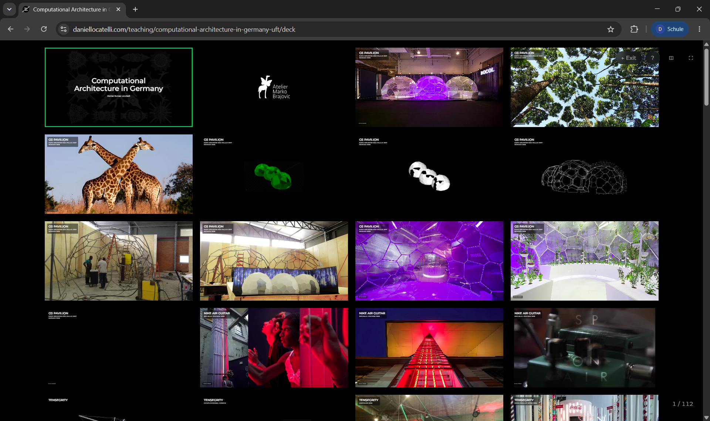
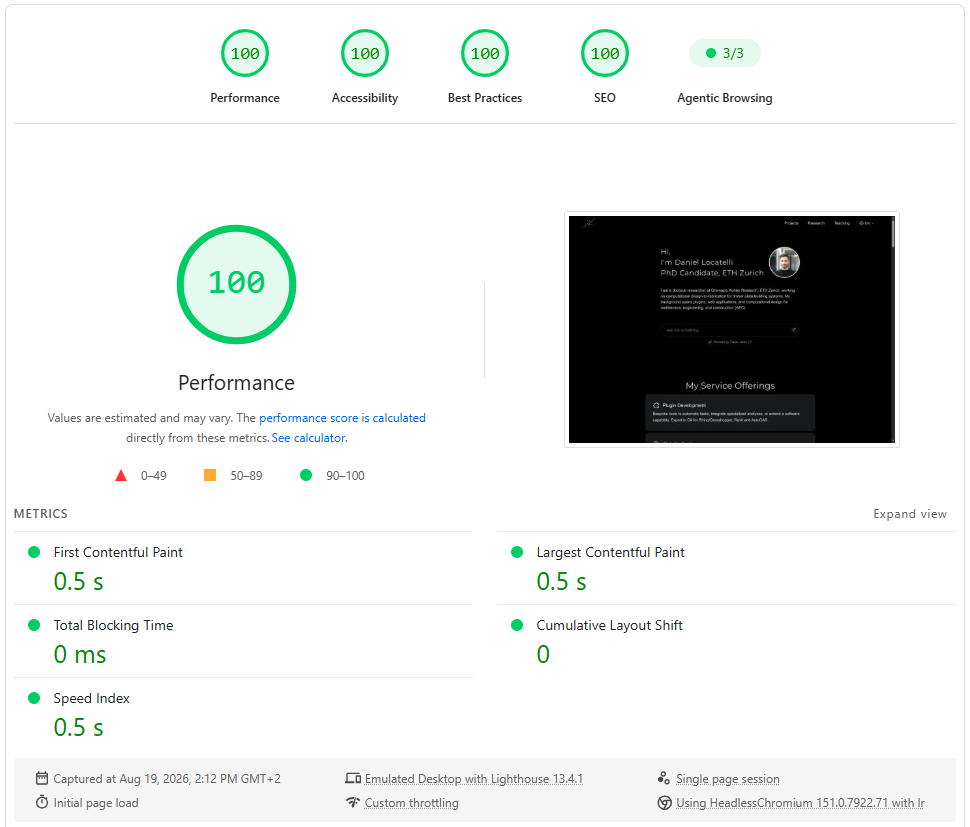
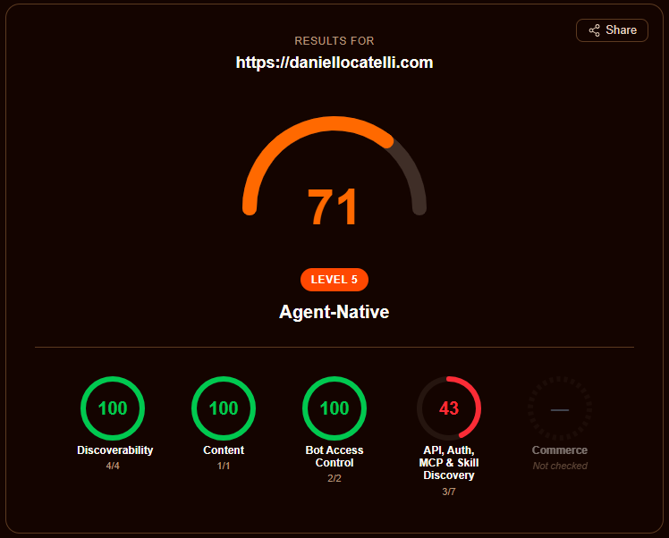
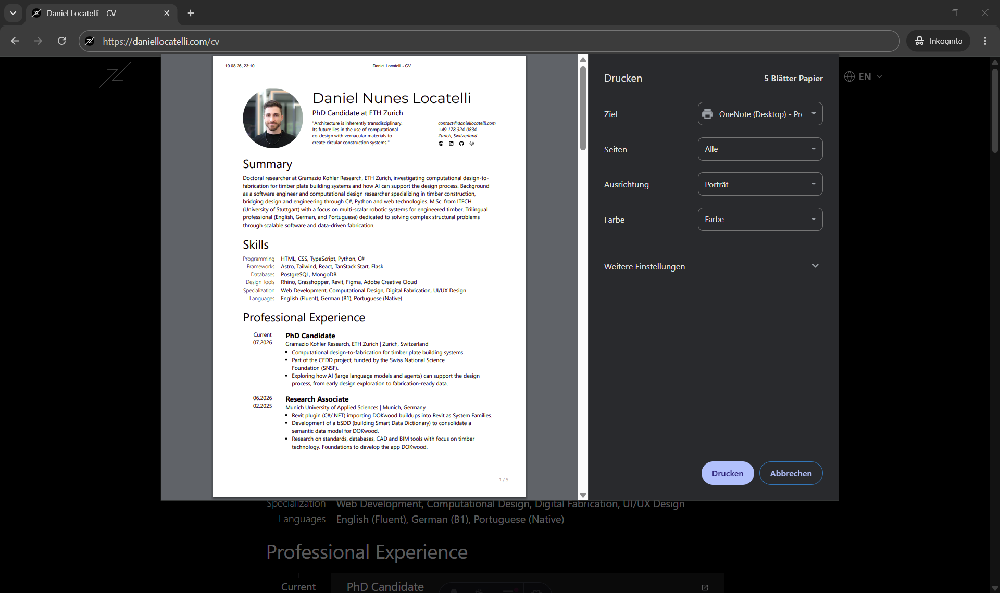

This is the website you are reading right now. It started in April 2024 as a small site, and one decision has shaped everything since: all of its content lives as plain text files, next to the code. Because of that, an AI agent can edit the site the way it edits code, translate it into three languages, and condense it into a profile that the chat on the homepage answers from, and other AI agents can read the site without scraping it. This page goes through each of those in turn and ends with the tools underneath.

## Claude Code as content management system

All the content lives as plain text files (written in [markdown](https://commonmark.org/help/)) in the same place as the code, the [public repository on GitHub](https://github.com/daniel-locatelli/daniellocatelli). There is one small file per project, research entry, publication, teaching item, or CV section. Each starts with a short header that holds the facts (title, dates, tags), followed by the text of the page, and each exists once per language. There is no database and no separate content system behind the pages.

A content management system (CMS) is the tool you would normally log into to add a page or fix a typo. Here that role is taken by [Claude Code](https://claude.com/claude-code), an AI agent that works directly on the files of a project. Because the content is just files next to the code, it can read, edit, create, and cross-check entries the same way it works on source code. I describe a new project or a correction in a sentence, and it writes or updates the files, keeps the headers consistent, and checks the related entries in the other languages. This very page was written that way. Everything on this site is co-created, from the code to the content.

## Translation by Claude Code

The site is available in English, Portuguese, and German. There is no translation service in the pipeline: when a content file changes in one language, Claude Code translates it and updates the matching files in the other two. Facts such as dates, links, and places stay identical across the three, while names and text are translated. The same applies to the labels and buttons of the interface.

Translations are written from the meaning rather than word by word, following a style guide for each language that lives in the repository: tone, a glossary of fixed terms, and a table of corrections. Whenever I correct a translation, the before and after go into that table, so the next translation starts from what the last one got wrong.

## AI chat on the homepage

Keeping the content as plain text has another payoff: it is straightforward to condense it and hand it to a language model. That is what makes the chat on the homepage possible.

The homepage is deliberately short: my name, one line on what I research, a chat powered by Claude, and a list of essays. The chat is the main way in. Four starter questions sit above the input, so a visitor can ask what my PhD is about, or which AI agent skills I made for architecture, with a single click, and every answer is grounded in the actual content of this site rather than a generic reply.

Once a question is sent, the page clears down to the conversation, much like claude.ai: the intro and essays step aside, the input moves to the bottom of the screen, and the answer appears as Claude writes it. The conversation is kept for the browser session, so following a link from an answer and coming back returns to it. When an answer mentions pages of the site, it ends with a preview of them in the visitor's language: the first page's cover image at full width with its title as a link, and small thumbnails of the others in a row.

Under the hood, a script condenses the site into one profile per language: every role with what I did there, a short summary and link for every research page, project, publication and talk, the skills, and a chronological timeline. It comes to about 13,000 tokens (the units a language model reads, roughly 10,000 words) per language. Each question goes to Claude together with the whole profile for the page's language, so a broad question such as "what did you build before?" sees my entire career at once. Because the profile is identical for every visitor, Claude keeps it cached between questions (prompt caching), so after the first question it costs a fraction of its size and does not slow the answer down.

An earlier version worked the other way round: it searched the content for the few passages closest to the question and sent only those (retrieval, with embeddings from Voyage AI and a vector store in Supabase). It answered narrow questions well, but sometimes built the answer to a broad one around a minor entry, so I replaced it.

The profile is regenerated from the content every time the site is built, so a new page reaches the chat with the next release. A benchmark script then sends a fixed set of common questions to the chat and checks every answer, so a change that breaks one of them shows up before visitors see it.

## Essays

Most of what I used to sell as a service (plugins, web apps, dashboards) can now be written by a language model in an afternoon. So the homepage no longer lists services; a visitor who wants to know what I offer can ask the chat. The homepage lists essays instead: a few long pieces on what stays valuable in architecture and engineering once code is cheap, published about once a month. Each essay is a plain markdown file like everything else, so publishing one is a single change to the repository, and the chat can answer questions about it as soon as it is live.

## Presentation mode

Teaching pages can carry a slide deck, stored next to the page in the same folder. To open one, go to a teaching page such as [Computational Architecture in Germany](/teaching/computational-architecture-in-germany-uft) and click the green **Open slide deck** button below the title. The deck runs in the browser: the arrow keys move between slides, **O** shows an overview of all slides, **P** opens a presenter window with notes, **F** goes fullscreen, and **?** lists the other shortcuts.

Decks are written in MDX (markdown that can also hold components), with a short YAML notation for the common slide types: title, text, image, image row, video, and overlays. I use them for lectures and talks, so that a lecture and its slides are published together, versioned together, and translated together.

## Built for people and agents

The site has two kinds of visitors: people in a browser, and AI agents that read it on someone's behalf. Each is served by its own kind of work, and the result of each is measured by a public tool.

### For people: speed

Astro renders the site to mostly static HTML, so most pages need no JavaScript at all. Beyond that, the rule is not to load what the visitor does not need yet:

- Images ship in responsive sizes with explicit dimensions, and load just before they scroll into view; fonts are reduced to the character sets the site needs and loaded early.
- The chat's conversation view is fetched only once a visitor shows intent to chat (hovering a starter question or clicking into the input), so the homepage itself ships a few kilobytes of JavaScript.

[Lighthouse](https://developer.chrome.com/docs/lighthouse/overview), Google's page-quality audit, scores the site 100 for performance, accessibility, best practices, and SEO.

### For agents: access

Much of the traffic to a site like this will come from AI agents rather than browsers, so the site offers its content in the formats agents expect:

- an `llms.txt` index per language, a plain list of the site's pages for language models, generated at build time;
- a markdown version of every content page (append `.md` to the URL), also served automatically to any request that asks for markdown (`Accept: text/markdown`);
- a `robots.txt` that explicitly welcomes AI crawlers, a sitemap with image entries and last-modified dates, and an API catalog under `/.well-known/`;
- a small read-only [MCP](https://modelcontextprotocol.io/) server (MCP is the protocol agents use to call outside tools), so that agents can query the site's content directly, including the same profile the chat answers from, whole or through a keyword search;
- [DNS-AID](https://datatracker.ietf.org/doc/draft-mozleywilliams-dnsop-dnsaid/) discovery records in the domain's DNS, signed with DNSSEC, so that an agent can find the MCP server from the domain name alone;
- a skills index under `/.well-known/agent-skills/`, following Cloudflare's [Agent Skills discovery RFC](https://github.com/cloudflare/agent-skills-discovery-rfc), with two `SKILL.md` files in the [Agent Skills](https://agentskills.io/specification) format that teach an agent how to query the site through MCP or read it as markdown.

On [isitagentready.com](https://isitagentready.com/), the checker that accompanies Cloudflare's [agent-readiness guide](https://blog.cloudflare.com/agent-readiness/), the site went from 25/100 to 71/100, "Level 5, Agent-Native", with full marks for discoverability, content, and bot access control.

The missing points are left open on purpose. They all belong to logins and services: OAuth discovery, protected-resource metadata, and an `auth.md` only make sense when there is something to log in to, an A2A agent card describes an agent that offers services to other agents, and WebMCP exposes in-page actions such as forms or checkouts. A read-only portfolio has none of these, so the checker keeps listing them and the site keeps declining them.

## A personal toolbox behind the public pages

The site also hosts pages that are not in its navigation and exist mainly for my own use. The [short CV](/cv), the [full CV](/full-cv), and the [PhD-oriented CV](/phd-cv) are rendered from the same content as the rest of the site, so an experience or publication only ever needs to be entered once. They carry print styles, so saving one as a PDF produces a clean, up-to-date document whenever I need one. A couple of similar pages serve as title cards for recorded lectures.

## Smaller details

- **Link previews at build time.** External links listed on a page are rendered as preview cards. Their titles, descriptions, images, and icons are fetched once and stored in the repository, so the build always gives the same result and no third-party request happens when the page loads.
- **No broken links.** Every link inside the site is checked against the finished build before it is published, so nothing broken goes live. Links to other sites are checked once a week and reported, since those break on their own schedule.
- **Last updated, from history.** Every content page shows when it last changed, taken from the repository's history, and the same date goes into the sitemap and the page's metadata for search engines.
- **Image sources in one place.** Third-party images that several pages share, such as Ernst Haeckel's plates, are stored once in a folder per author. The build finds every page that uses them and generates a sources page for each author, so the list never needs updating by hand; the image credit links to it. Credits get a © automatically, except for works in the public domain.
- **Tooltips everywhere.** One small tooltip system serves every tooltip on the site: footnotes show their note on hover, so readers do not have to jump to the bottom of the page; the social icons in the footer and the CV header name their destination; and the slide-deck controls show their keyboard shortcut.
- **Markdown for agents on static pages.** Serving markdown to agents from pages that are built in advance took some digging into how Cloudflare and Astro handle requests; the solution is a small Cloudflare Snippet that rewrites the address before the request reaches the site.

## Tech stack

- [**Astro**](https://astro.build/) with TypeScript for the site itself, [**React**](https://react.dev/) for the few interactive parts, and [**Tailwind CSS**](https://tailwindcss.com/) for styling.
- [**Astro Content Collections**](https://docs.astro.build/en/guides/content-collections/) for all content, written as markdown and MDX, with headers whose fields are checked at build time.
- [**Claude**](https://www.anthropic.com/claude) (Anthropic) for the homepage chat.
- [**Cloudflare Workers**](https://workers.cloudflare.com/) with Static Assets for hosting: pages built in advance are served straight from Cloudflare's network, and code only runs for the chat and the MCP server.

Everything above rests on the same plain files. Claude Code edits them and translates them, the build condenses them for the chat, and agents read them as markdown. Adding a page to the site is still one text file, and the rest follows from it.
