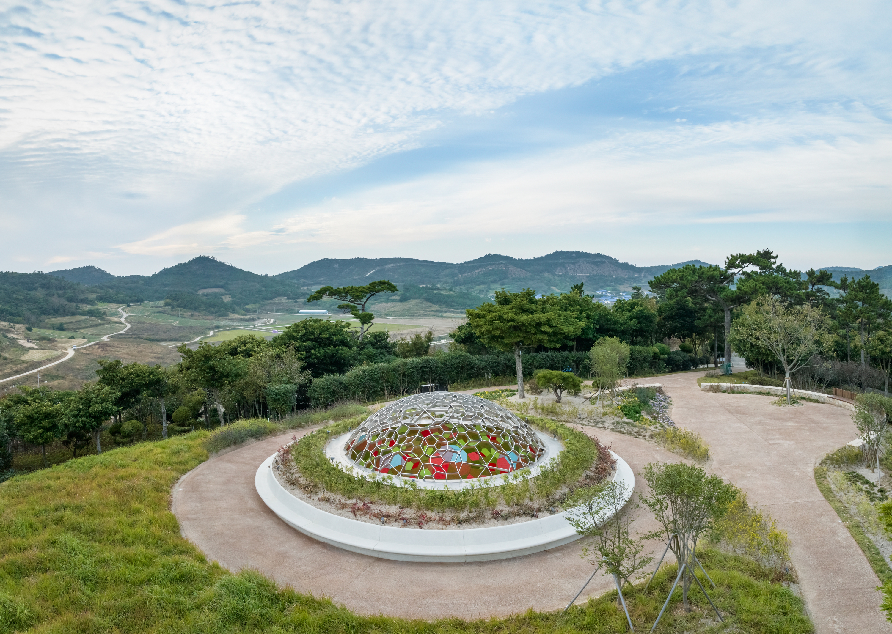
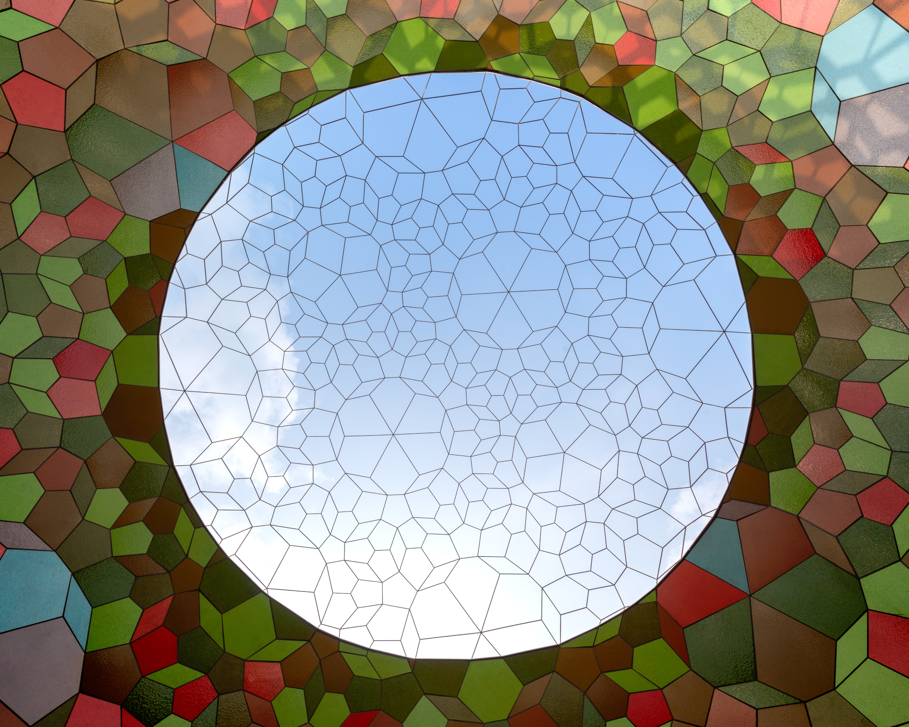
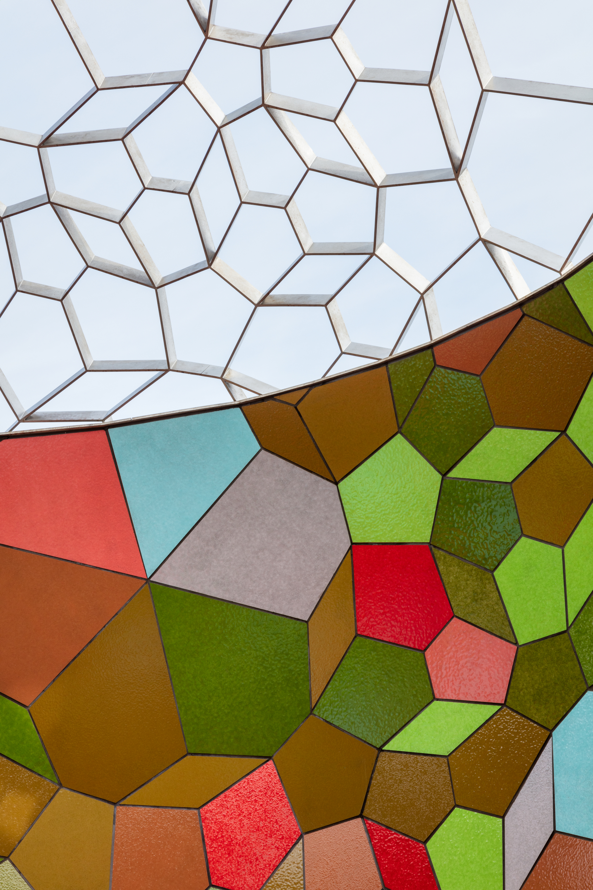
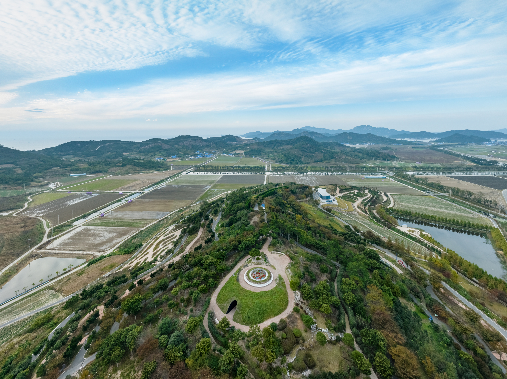
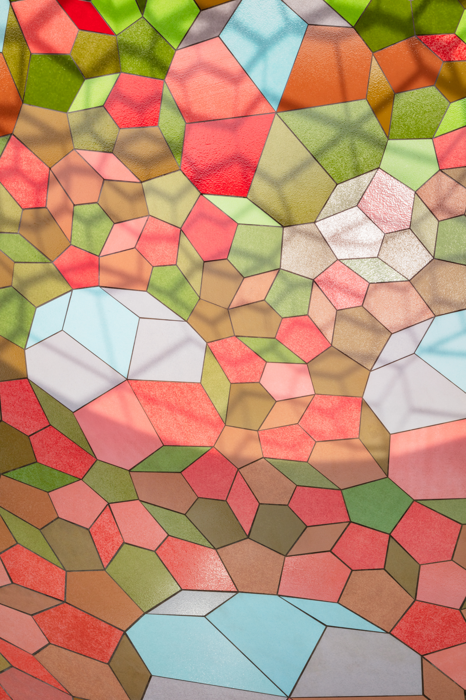
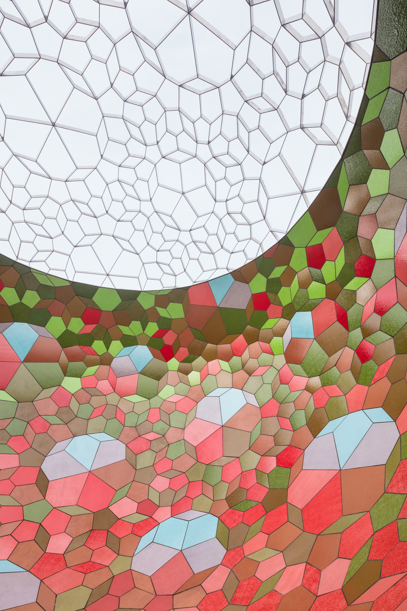
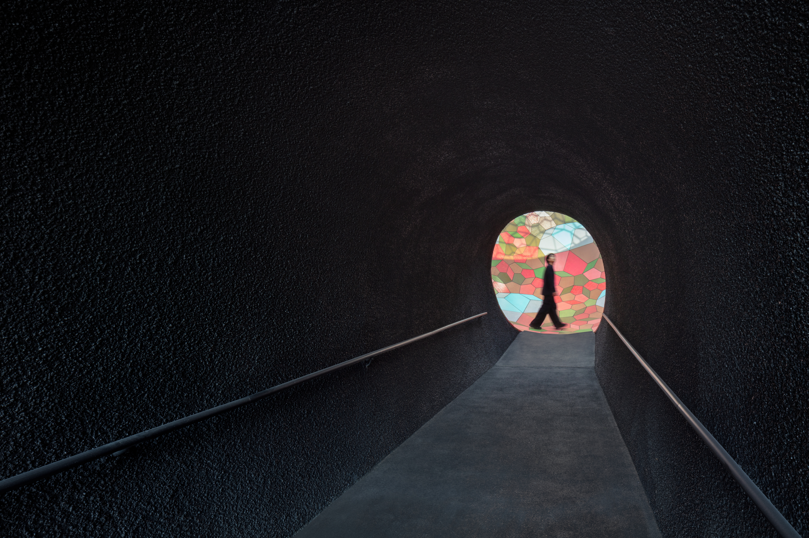
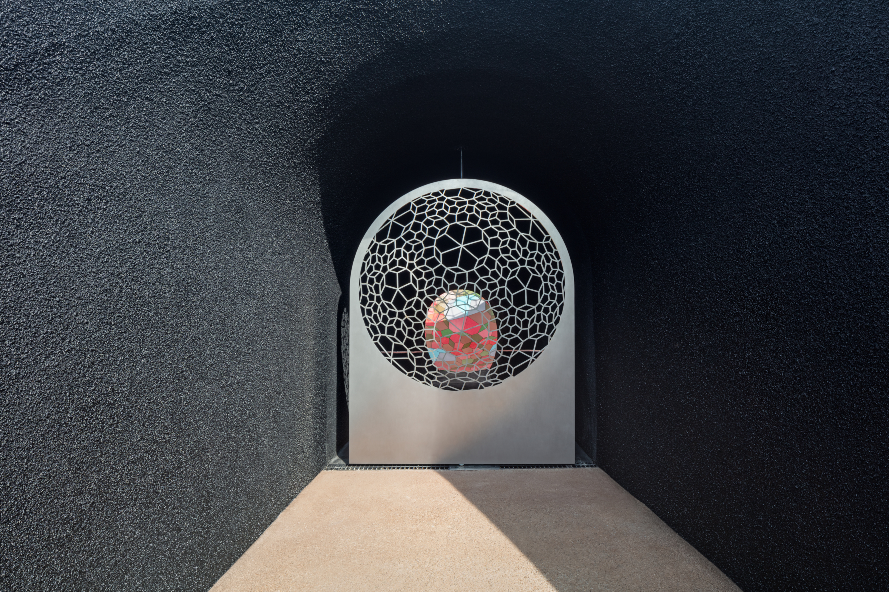

## Intro
[Olafur Eliasson](https://olafureliasson.net/) contatou a ArtEngineering para a engenharia computacional, fabricação digital e logística da Breathing earth sphere. Foi minha chance de acompanhar o fluxo de trabalho completo da ArtEngineering: do conceito à engenharia computacional, fabricação digital e logística.

## Engenharia
Meu foco foi a análise por elementos finitos (FEA) no SOFiSTiK, que é ótimo para geometrias complexas e fora do padrão como esta. Partimos do modelo base do estúdio de Eliasson e fizemos uma análise e uma documentação bem detalhadas: vento, sismo e até cargas "acidentais" (porque alguém inevitavelmente tentará escalar uma cúpula de 10 metros).
O desafio técnico mais interessante foram as juntas de dilatação. Como a estrutura superior da cúpula é inteiramente em aço inoxidável, ela é essencialmente um organismo vivo que respira com a temperatura. Tivemos que projetar conexões precisas que permitissem expansão e contração térmica significativas sem comprometer a integridade estrutural ou estética.

## O quebra-cabeça logístico
Um grande desafio, no entanto, surgiu após a finalização do modelo digital. Precisávamos descobrir como levar uma cúpula enorme, de 10 metros, de uma oficina na Alemanha até um local remoto na Ilha de Docho, na Coreia do Sul. Para isso, desmontei a cúpula, como um quebra-cabeça 3D gigante, em peças modulares que coubessem perfeitamente em contêineres padrão.

## Resultado
O trabalho foi feito em 2022, mas a instalação foi concluída em 2024, quando eu já não fazia parte da equipe. Mesmo assim, foi incrível ver o projeto sair de uma malha do SOFiSTiK na minha tela a um marco arquitetônico em uma ilha sul-coreana.

