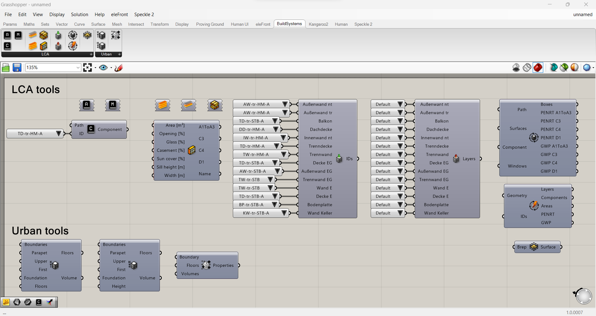
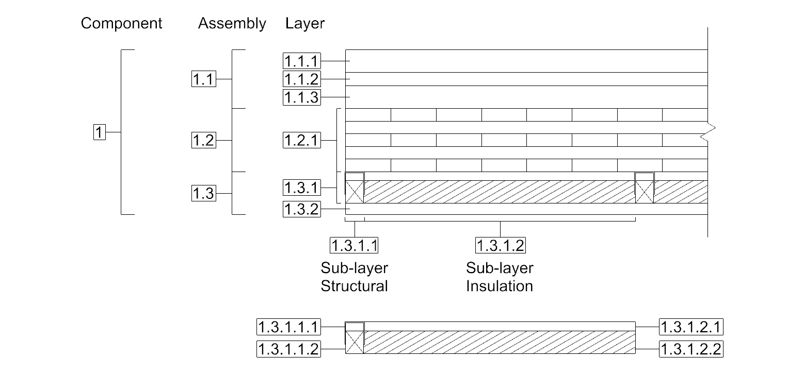

Na BuildSystems, liderei o desenvolvimento de um plugin para o Grasshopper com o objetivo de otimizar o processo de projeto arquitetônico. Com esse conjunto de ferramentas, o usuário define e analisa o projeto do edifício de forma paramétrica e recebe, em tempo real, um retorno sobre o uso de materiais e o impacto ambiental por meio de uma Avaliação do Ciclo de Vida (ACV) integrada.

Entre os principais resultados:
- **Detalhamento de componente construtivo**: Implementamos uma funcionalidade para definir e gerenciar componentes construtivos individuais com suas respectivas propriedades de material.
- **Análise de ACV integrada**: Com o plugin, era possível avaliar rapidamente a pegada ambiental dos projetos com base em dados de materiais extraídos de Declarações Ambientais de Produto (DAPs).
- **Gerenciamento de dados via JSON**: Criamos um banco de dados estruturado em JSON para armazenar e recuperar dados de componentes construtivos. Essa estrutura também seria utilizada em um aplicativo web chamado *Circular Component Creator*, uma ideia que, infelizmente, não avançou.
- **Interface intuitiva no Grasshopper**: A interface aproveitava a programação visual do Grasshopper e se encaixava com naturalidade nos fluxos de trabalho existentes.

## Desafios
Existem duas linguagens principais para desenvolver plugins para o Grasshopper: Python e C#. No entanto, para uma aparência mais nativa, maior desempenho e integração mais profunda, C# é a opção preferida. Isso porque o próprio Grasshopper foi escrito em C# por David Rutten.
O principal desafio foi que a McNeel, empresa por trás do Rhino e do Grasshopper, estava migrando do *.NET Framework 4.8* para o *.NET Core*.
### .NET Framework 4.8
- **Prós**
    - Ainda compatível com o Rhino 8
    - Funciona nas versões anteriores do Rhino/Grasshopper
    - Funciona com o Rhino.Inside Revit, que ainda depende do .NET Framework
    - Há mais material online, o que facilita a depuração e o desenvolvimento
- **Contras**
    - Está sendo descontinuado: o plugin teria de ser migrado em breve
    - Não é multiplataforma: seriam necessários plugins separados para Windows e macOS
    - Desempenho menor

### .NET Core
- **Prós**
    - Preparado para o futuro: é a base das próximas versões do Rhino/Grasshopper
    - Multiplataforma: o mesmo plugin funciona no Windows e no macOS
    - Desempenho maior
- **Contras**
    - Não funciona nas versões mais antigas do Rhino/Grasshopper
    - Incompatível com a versão atual do Rhino.Inside Revit
    - Menos material e exemplos online
A McNeel recomenda o [multi-targeting](https://learn.microsoft.com/en-us/nuget/create-packages/multiple-target-frameworks-project-file), ou seja, compilar o plugin para as duas versões do .NET. Isso deixou o projeto ainda mais complexo.

## BuildSystems Object Model (BSoM)
O **BuildSystems Object Model (BSoM)** foi parte essencial do projeto: o modelo de dados compartilhado que sustentava a extensibilidade e a manutenção do plugin.

### Fase conceitual
Mapeamos a ontologia em que o plugin se apoiaria.

### Fase de implementação
Em seguida, implementamos o BSoM em C#, para que o Grasshopper pudesse consumi-lo nativamente. Parte desse trabalho consistiu em definir a estrutura de dados de um componente construtivo.

## Resultado
Apesar de totalmente funcional, o projeto foi descontinuado devido a uma mudança de foco da então startup BuildSystems. Na época, a economia alemã enfrentava dificuldades e não havia projetos de construção em andamento nos quais pudéssemos testar o plugin adequadamente. Decidimos mudar de rumo e dedicar nosso tempo a um simulador de financiamento para habitação sustentável.
