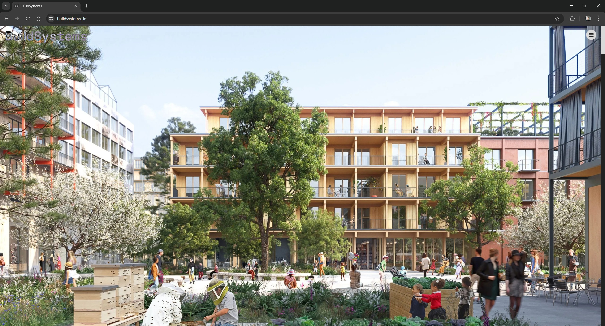
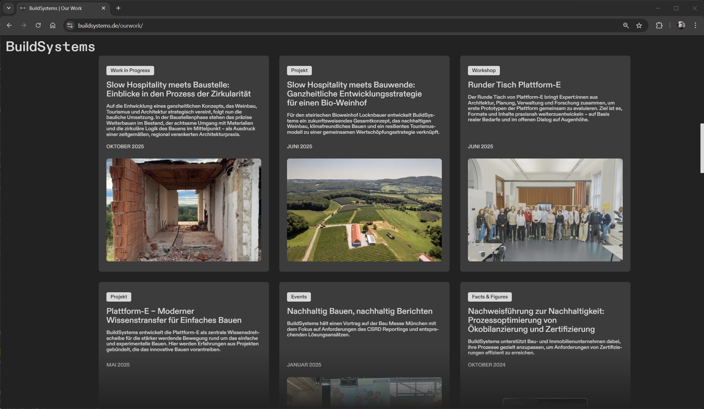

import Video from '@/components/Video.astro'

Desenvolvi o site corporativo da [BuildSystems](https://buildsystems.de), uma consultoria de sustentabilidade que ajuda a construção civil e o mercado imobiliário a chegar à neutralidade de carbono. O site é a vitrine digital da empresa, com os serviços, o portfólio de projetos, a equipe e o blog, tudo gerenciado no Notion como CMS.

O design foi criado pela [HAND](https://www.hand.international/). Meu papel foi implementar o design e a funcionalidade com uma stack moderna, focada em desempenho, para garantir um ótimo SEO.

## Stack tecnológica

- [**Astro**](https://astro.build/): Gerador de sites estáticos com TypeScript, escolhido por priorizar o desempenho e não enviar JavaScript ao navegador por padrão.
- [**Tailwind CSS**](https://tailwindcss.com/): Estilização utility-first com variáveis CSS customizadas para tipografia responsiva em quatro breakpoints.
- [**API do Notion**](https://developers.notion.com/): Integração CMS headless. A equipe gerencia todo o conteúdo (posts do blog, membros da equipe, parceiros, portfólio) diretamente pelo Notion.
- [**Cloudflare Pages**](https://pages.cloudflare.com/): Deploy com cache de borda, HTTPS automático e proteção contra DDoS.

## Por que o Notion como CMS?

A BuildSystems já utilizava o Notion intensamente para documentação interna e gerenciamento de projetos. Em vez de introduzir um CMS separado que exigiria que a equipe aprendesse uma nova ferramenta, integrei a API do Notion diretamente no pipeline de build. Assim, a equipe escreve e publica posts, atualiza os perfis e gerencia o portfólio direto no Notion.

Na hora do build, o site busca o conteúdo em vários bancos de dados do Notion (posts, membros da equipe, parceiros e organizações) e monta as páginas com mais de 30 componentes, um para cada tipo de bloco do Notion: títulos, parágrafos, imagens, blocos de código, tabelas, embeds e outros.

A camada de CMS começou como um fork do [astro-notion-blog](https://github.com/otoyo/astro-notion-blog) de Hiroki Toyokawa (com licença MIT), que forneceu a estrutura inicial para buscar conteúdo do Notion e renderizar blocos. A partir daí, estendi os renderizadores de blocos, adicionei bancos de dados para membros da equipe, parceiros e organizações, e reconstruí a UI para refletir a marca e o design system da BuildSystems.

## Principais recursos

### Animações em CSS puro
Originalmente, a agência de design desenvolveu a capa da página inicial e as seções dos "Três Pilares" com animações Lottie. Depois da integração, as notas do Lighthouse despencaram porque as animações Lottie inflavam o DOM muito além do tamanho recomendado, prejudicando o desempenho de renderização. Reconstruí ambas as animações com `@keyframes` puro de CSS, com os "Três Pilares" adaptados para funcionar em layouts horizontal e vertical. Isso preservou a fidelidade visual e manteve a página leve e performática.

<Video src="/media/projects/buildsystems-website/three-pillars-animation.mp4" caption="Animação da homepage" autoplay /> 

### Carrossel com arraste
No carrossel de posts do blog, programei uma rolagem por arraste com inércia e scroll-snap suave. Os usuários podem arrastar o carrossel com mouse ou toque, e ele se ajusta suavemente ao card mais próximo quando solto.

<Video src="/media/projects/buildsystems-website/drag-to-scroll-carousel.mp4" caption="Carrossel com arraste" autoplay />

### Posts do blog no Notion
Cada post é escrito no Notion e renderizado no site em tempo de build. Além de texto, os posts podem ter mídia incorporada (Instagram, TikTok, YouTube, CodePen), equações LaTeX com KaTeX, blocos de código com destaque de sintaxe (Prism.js) e prévias de links (metascraper).

## Arquitetura

O projeto segue uma abordagem puramente Astro, sem React ou outros frameworks JavaScript. Toda a interatividade é feita com TypeScript puro e CSS, então o navegador do visitante baixa pouquíssimo JavaScript.

Um pipeline de build customizado cuida do cache de conteúdo do Notion. O comando `npm run cache:fetch` baixa do Notion todo o conteúdo e as imagens, processa as imagens com o Sharp (removendo dados EXIF e otimizando formatos) e salva tudo localmente. Isso garante builds rápidos e evita chamadas desnecessárias à API durante o desenvolvimento.

## Design responsivo

O site usa CSS Custom Properties para tipografia fluida que escala em quatro breakpoints: mobile, tablet, desktop e ultra-wide.

Fontes ABC Diatype auto-hospedadas são pré-carregadas para evitar Flash of Unstyled Text (FOUT), e o site usa SVG sprites para ícones, minimizando requisições HTTP.
