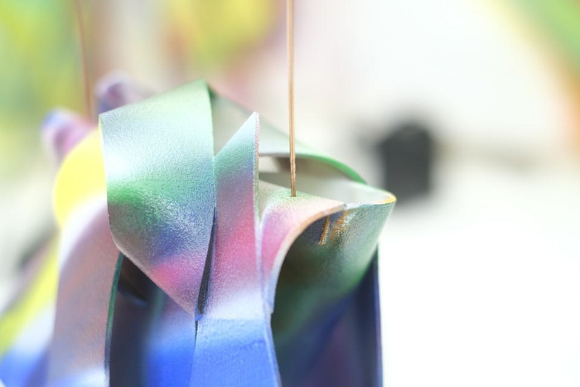
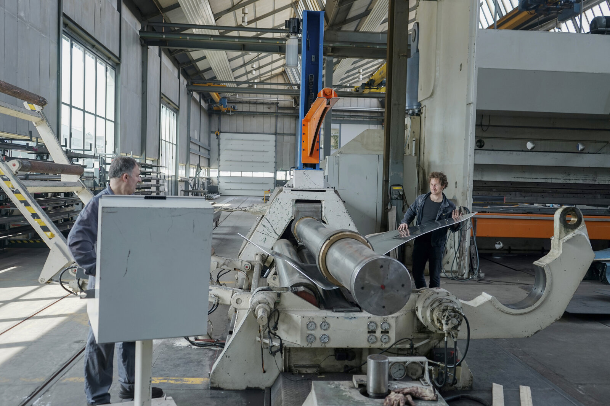
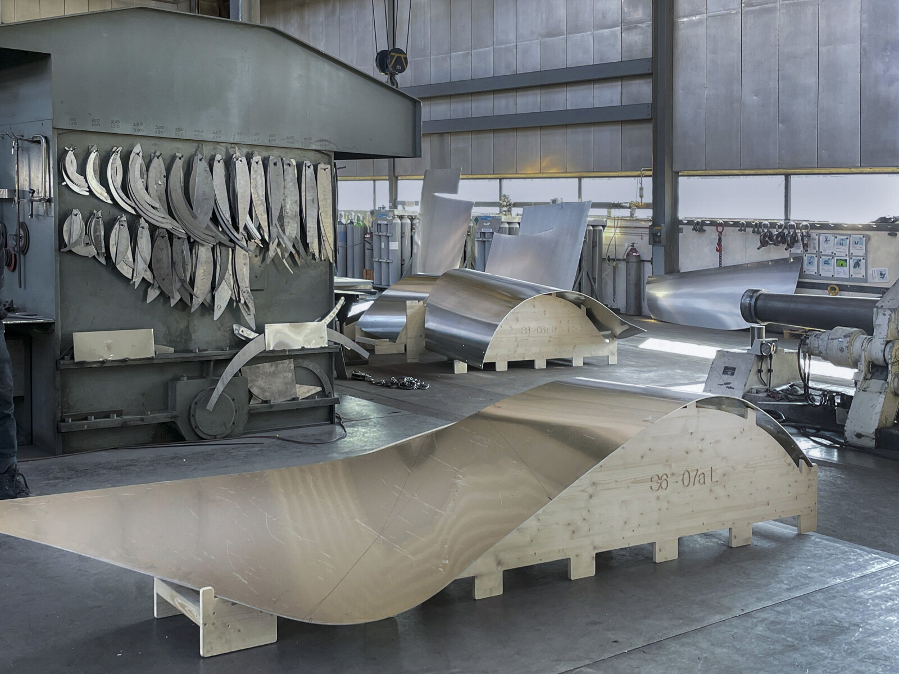
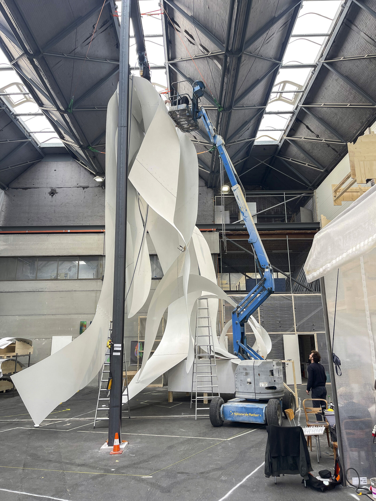
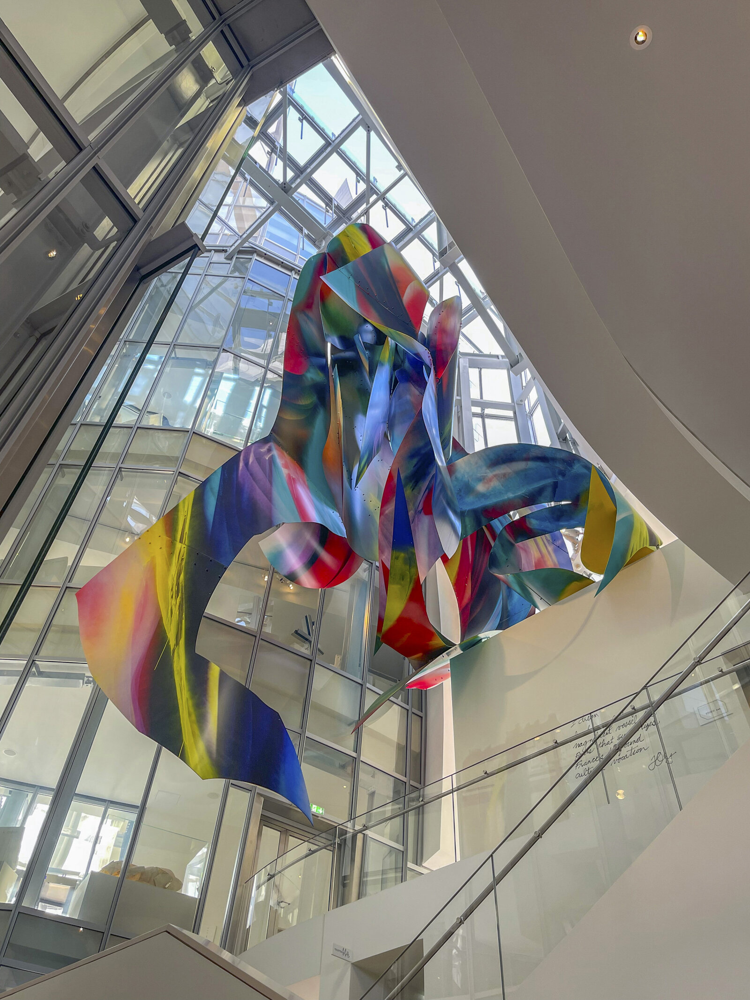

import Figure from '@/components/Figure.astro'

## Intro
Na ArtEngineering, às vezes um cliente aparecia em cima da hora, com pouquíssimo tempo para entregar um projeto que parecia simples, mas era extremamente complexo.
Canyon foi um deles. Para este projeto, Katharina Grosse escolheu [esculpir com couro](https://www.katharinagrosse.com/blog/drawings_mock_ups_amp_preparations_for_canyon). O desafio: ela queria transformar tiras orgânicas de couro em chapas de aço curvadas.

<Figure credit="Katharina Grosse">
  
</Figure>

O que o contratante original não descobriu a tempo foi que o aço não se comporta como couro. O couro pode dobrar e torcer em qualquer direção porque é flexível. Já o aço só curva em uma direção. A solução foi uma estratégia já usada na produção de barcos há milênios: [superfícies desenvolvíveis](https://en.wikipedia.org/wiki/Developable_surface).
## Design computacional
Testei e comparei várias ferramentas, entre elas o comando nativo de superfícies desenvolvíveis do Rhino, definições do Kangaroo 2 e outras ferramentas pagas. Mas, no fim, a melhor foi o [D.Loft](https://web.archive.org/web/20240918135700/https://www.food4rhino.com/en/app/dloft), um plugin pago do Rhino/GH. Usamos a versão de teste e depois decidimos comprá-lo.
Embora eu tivesse apenas um fim de semana para chegar a uma solução, no geral, o projeto foi um desafio muito divertido. E ainda pude viajar com o Herwig à Suíça para acompanhar a produção na [Kunstgiesserei St. Gallen](https://www.kunstgiesserei.ch/), um ateliê e laboratório de fabricação digital superinteressante.

<Figure credit="Kunstgiesserei">
  
</Figure>

<Figure credit="Kunstgiesserei">
  
</Figure>

<Figure credit="Kunstgiesserei">
  
</Figure>

<Figure credit="Kunstgiesserei">
  
</Figure>
