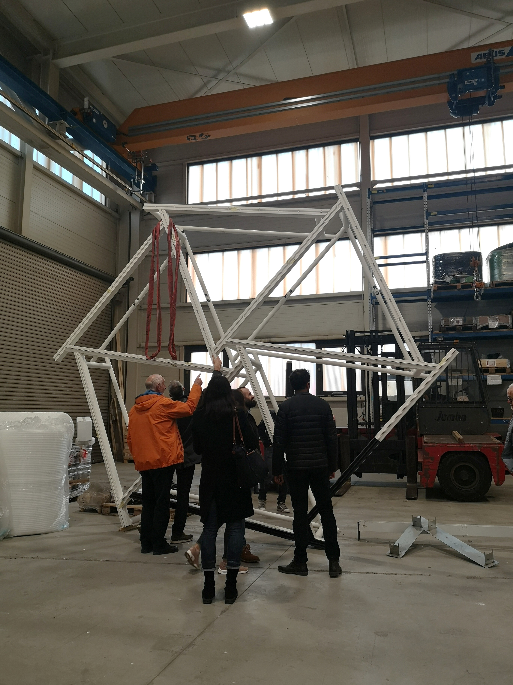
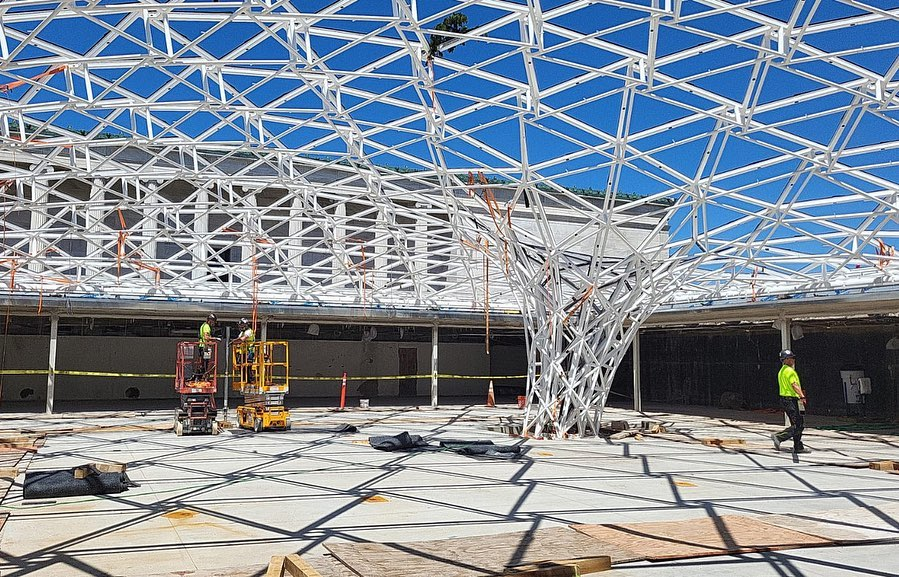
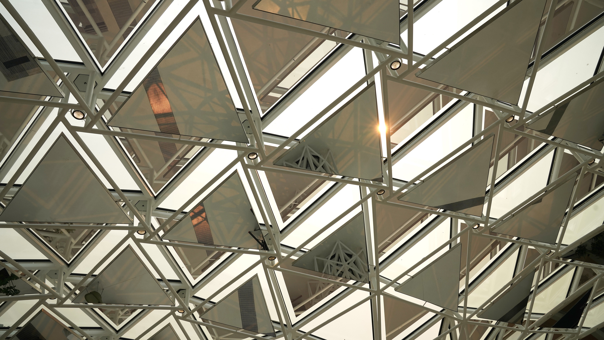
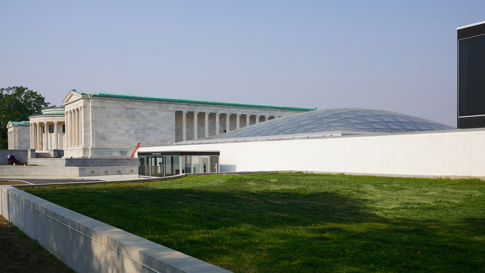

import Figure from '@/components/Figure.astro'

[Studio Other Spaces](https://studiootherspaces.net/) procurou a ArtEngineering para a engenharia computacional, a fabricação digital e a logística. Eu entrei no projeto no meio do desenvolvimento, depois que a fabricação digital já havia começado. Foi esse mesmo projeto que garantiu minha contratação na ArtEngineering.
## Design computacional
Inicialmente, eles precisavam de alguém para exportar rapidamente cerca de 1,5 mil desenhos 2D do Rhino/Grasshopper que iriam para a fabricação digital, em corte a plasma.
Essa primeira tarefa foi concluída em 2 dias. Eles adoraram e me ofereceram uma vaga em tempo integral. Na época, eu estava terminando meu mestrado ITECH e ainda estava trabalhando como estagiário para outra empresa. A oferta veio na hora certa, e aceitar foi uma decisão fácil.
Quando entrei, Alexander Spänig era o gerente de projeto, então trabalhei lado a lado com ele nos seis meses seguintes.
Usei principalmente o Grasshopper e o plugin [Sandbox Topology](https://www.food4rhino.com/en/app/sandbox-topology) de Tobias Schwinn, que, por coincidência, tinha sido meu tutor no mestrado ITECH.

<Figure>
  
</Figure>

<Figure credit="Studio Other Spaces">
  
</Figure>

<Figure credit="Studio Other Spaces">
  
</Figure>

<Figure credit="Studio Other Spaces">
  
</Figure>
