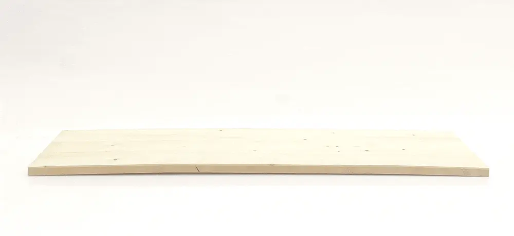
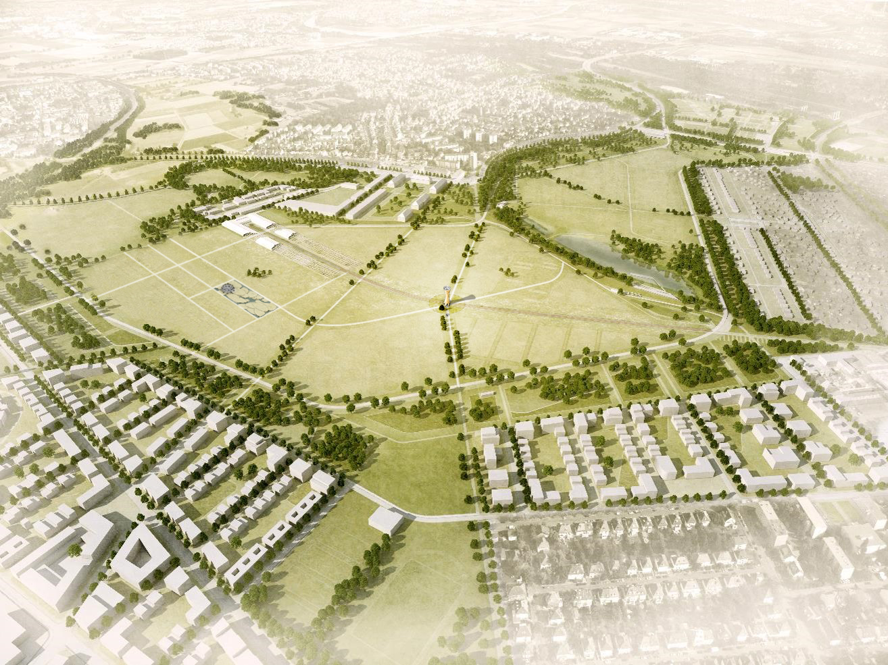
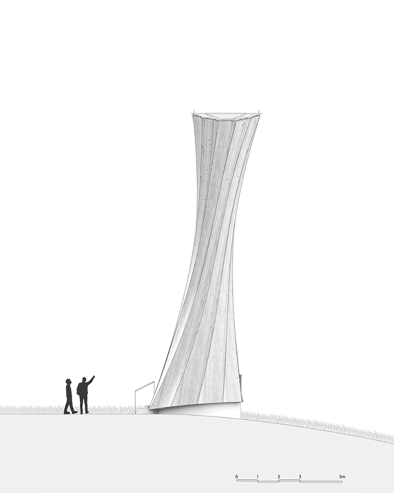

import YouTube from '@/components/YouTube.astro'
import Figure from '@/components/Figure.astro'

Fui o designer computacional de um projeto semelhante à [Torre Urbach](https://www.icd.uni-stuttgart.de/projects/remstal-gartenschau-2019-urbach-turm/). A proposta não avançou, imagino que por causa da pandemia.
Mesmo assim, foi interessante entender a estratégia computacional para gerar a geometria de uma placa de madeira laminada cruzada autocurvante. O truque aqui é trabalhar com cilindros, porque a curvatura natural da madeira acontece perpendicularmente à direção das fibras.

<Figure credit="University of Stuttgart, ICD/ITKE">
  
</Figure>

<Figure credit="University of Stuttgart, ICD/ITKE">
  
</Figure>

Também trabalhei em alguns desenhos as-built para a própria Torre Urbach. Assim, o Dylan me explicou todos os detalhes construtivos do projeto e como a equipe instalou vários sensores para monitorar o comportamento da estrutura diante das condições ambientais.

<Figure credit="University of Stuttgart, ICD/ITKE">
  
</Figure>

A pesquisa de Dylan Wood no ICD foi sobre as propriedades naturais de automoldagem da madeira quando seca. Para entender melhor o processo, assista à palestra TED do Dylan Wood:

<YouTube id="yvPW5Q69GFc" title="TED Talk de Dylan Wood sobre madeira que se automolda" />
