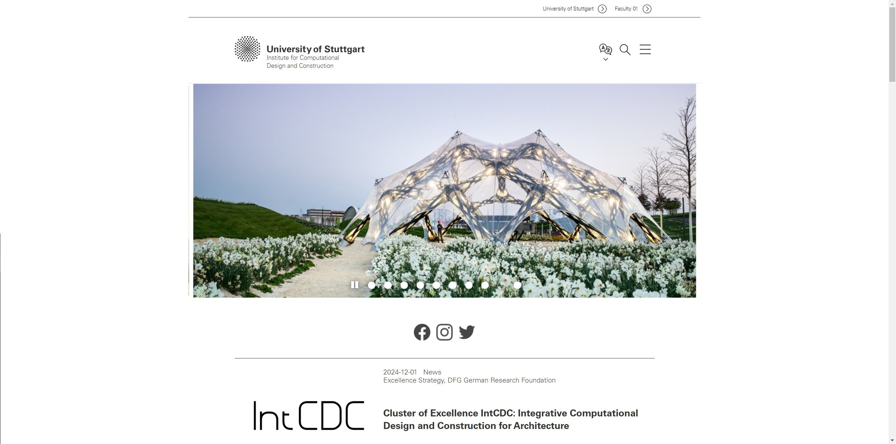

A Universidade de Stuttgart estava implementando um template padronizado em OpenCMS para todos os seus institutos e departamentos. Na prática, era preciso pegar o site atual do ICD, com anos de projetos de pesquisa, publicações, documentação de pavilhões e perfis da equipe, e reorganizar tudo para caber no layout e no modelo de conteúdo do novo template.

O trabalho foi metódico: página por página, migrei textos, imagens e metadados do sistema antigo para a nova estrutura do CMS. Em cada projeto de pesquisa, era preciso reformatar a descrição, reenviar as imagens nas dimensões certas e classificar os metadados (autores, datas, tags) nos tipos de conteúdo do OpenCMS.

## Aprender alemão com a pesquisa

O que tornou este projeto especial para mim foi a imersão inesperada no idioma. Muitas das descrições de projetos, press releases e páginas administrativas do ICD existiam em alemão. Como brasileiro que havia acabado de chegar à Alemanha para o mestrado, me vi traduzindo e adaptando textos em alemão diariamente, não de um livro didático, mas de documentação real de pesquisa sobre construção em madeira, fabricação robótica e estruturas biomiméticas.

## Aprendizados

Este projeto pode parecer modesto comparado à fabricação robótica ou à busca computacional da forma, mas me ensinou algo valioso: a importância de como a pesquisa é comunicada. O pavilhão mais inovador ou o método de fabricação mais revolucionário vale pouco se ninguém conseguir encontrá-lo, entendê-lo e citá-lo. Um bom gerenciamento de conteúdo é a infraestrutura que torna o conhecimento acessível.

Foi também minha primeira experiência profissional com um CMS, algo que depois seria fundamental quando desenvolvi o site da BuildSystems com Astro e a API do Notion e, mais tarde, este portfólio.
