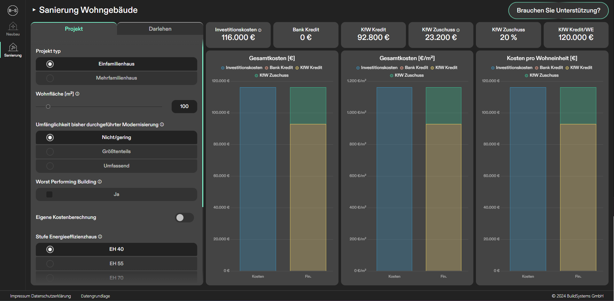

### Recursos
- **Estimativa de preço de um edifício**: O aplicativo estima o custo de uma construção ou reforma com base em dados disponíveis publicamente da [Arge e.V.](https://arge-ev.de/arge-ev/publikationen/studien/)
- **Simulação de empréstimo**: Simulação precisa de empréstimos com base na estimativa de preço e eficiência energética de um edifício.
- **Métricas de energia:** influenciam as opções de subsídio e de empréstimo.
- **Segurança de dados**: Os dados dos usuários ficam protegidos, de acordo com as normas da União Europeia.
- **Design responsivo**: O aplicativo funciona perfeitamente em todos os dispositivos.
### Stack tecnológica
- [**GitHub**](https://github.com/build-systems/toolbox): Para o repositório Git.
- [**Angular**](https://angular.dev/): Um framework JavaScript moderno apoiado pelo Google e usado para aplicações de grande escala.
- [**ng2-charts**](https://www.npmjs.com/package/ng2-charts): Wrapper Angular para a biblioteca Chart.js. É usado para criar gráficos responsivos e interativos.
- [**Cloudflare**](https://www.cloudflare.com/): Hospedagem confiável e escalável, sem investimento inicial.
## Por que desenvolvemos este app?
A Alemanha é conhecida por impulsionar tecnologias verdes, como painéis solares e turbinas eólicas, por meio de subsídios públicos. Mas você sabia que também existem muitos subsídios para construções energeticamente eficientes? Embora esses subsídios sejam atrativos, enfrentar a burocracia pode ser bem difícil.
Este aplicativo desenvolvido pela [BuildSystems](https://buildsystems.de/) facilita a simulação de um empréstimo do banco nacional [KfW](https://kfw.de/). Com uma interface simples, incorporadoras e proprietários entendem suas opções de financiamento de forma rápida e fácil.
## Processo de desenvolvimento
O desenvolvimento do aplicativo aconteceu em três fases principais: planejamento e design, desenvolvimento do frontend, e testes e garantia de qualidade.
### Planejamento e design
Para começar o projeto, toda a equipe definiu os requisitos e variáveis para a lógica do aplicativo. Com isso definido, esbocei a arquitetura do frontend e a UI/UX.
#### Lógica do aplicativo
Daniel Dieren desenvolveu a lógica do aplicativo no Excel. Minha função era revisá-la, fazer engenharia reversa das fórmulas para garantir que tudo estivesse correto e sugerir melhorias. Esta etapa se sobrepôs a todo o processo de desenvolvimento de software porque, conforme avançávamos, percebíamos que podíamos adicionar mais informações relevantes.
Criei uma documentação simples no Notion a partir do arquivo do Excel para entender cada fórmula completamente e facilitar a transferência para o TypeScript posteriormente.
#### Arquitetura do frontend
Como a equipe já usa o [Figma](https://www.figma.com/), decidi permanecer dentro desse ecossistema. Então, usei o [FigJam](https://www.figma.com/figjam/) para esboçar um diagrama inicial de arquitetura de software, pensando em quais componentes seriam necessários e na relação entre eles.

#### Design de UI e UX
Conceitualmente, minha abordagem para o design foi criar um dashboard completo com todas as variáveis acessíveis pelo usuário, sem muita abstração. Numa próxima fase, a ideia é oferecer outro fluxo, com um passo a passo para simular os empréstimos.
Prototipei no Figma, e a experiência foi bem agradável. Dá para simular o que acontece ao passar o mouse sobre um elemento (mouse over, mouse in e mouse out). Além disso, o plano pago facilita a cópia de estilos CSS e SVGs com o Modo Dev. Mas mesmo com o plano gratuito, é muito fácil exportar SVGs.

### Desenvolvimento da interface
Com este projeto, virei de vez desenvolvedor de software. Para isso, precisei aprender [Angular](https://angular.dev/), um framework JavaScript com uma estrutura bem opinativa, que era perfeita para o meu caso.
#### Por que escolhemos o Angular?
Muitas pessoas acreditam que o Angular é um dos frameworks mais difíceis para desenvolvimento web. Se compararmos com React ou Vue, por exemplo, parece mais difícil no começo. Mas a verdade é que, como o Angular tem muitos recursos integrados (o que significa que é "opinativo"), ele elimina a necessidade de tomar muitas decisões mais tarde. Então, eu pude pular a parte mais dolorosa para quem aprende sozinho: a exaustão mental que pode vir de fazer muitas escolhas. E, acredite, a [fadiga de decisão](https://en.wikipedia.org/wiki/Decision_fatigue) existe!
Além disso, o Angular usa uma linguagem de programação chamada [TypeScript](https://en.wikipedia.org/wiki/TypeScript). Pense nele como um JavaScript com um verificador de código que ajuda a detectar erros antes que eles se tornem problemas. Como eu era a única pessoa escrevendo o código, o TypeScript foi uma grande rede de segurança. Na verdade, eu só confiaria em mim mesmo para desenvolver este aplicativo com as proteções que o TypeScript cria. Lembre-se de que eu não tinha nenhum revisor de código; no software, eu era uma equipe de uma pessoa só.
Outro motivo para escolher o Angular é sua reputação de confiabilidade e facilidade de manutenção, especialmente em aplicações de grande escala. É mantido pelo Google, que já desenvolveu mais de 2.600 soluções com ele; fica claro que dá conta de projetos complexos e será mantido por um longo tempo.
Com minha formação em arquitetura e engenharia, sei como as coisas ficam complexas rápido nessa área também; embora a Calculadora KfW pareça simples à primeira vista, a primeira versão já tinha cerca de duzentas variáveis e mais de cem funções. Como a BuildSystems queria um aplicativo escalável, que evoluísse para uma ferramenta completa de planejamento nas fases iniciais, os pontos fortes do Angular eram ideais para o projeto.
#### Ferramentas de IA como copiloto
Este aplicativo foi construído entre o final de 2023 e meados de 2024, quando os assistentes de IA para programação ainda eram uma novidade, e não uma parte padrão das ferramentas de qualquer desenvolvedor. Ainda assim, o ChatGPT foi essencial para converter as fórmulas do Excel em TypeScript. Para recursos de ponta, no entanto, essas ferramentas não davam boas respostas, porque os dados de treinamento simplesmente ainda não existiam.
#### Processo
Durante o processo de desenvolvimento, tentei criar um único componente que acomodasse tanto a calculadora de Nova Construção (Neubau) quanto a de Renovação (Sanierung), para que o código fosse menos repetitivo, seguindo o princípio [DRY](https://en.wikipedia.org/wiki/Don%27t_repeat_yourself) (don't repeat yourself).
Isso, no entanto, tornou o componente muito complexo porque havia muitas variáveis e requisitos exclusivos para cada calculadora. Então, no final, decidi dividi-lo em dois componentes. Ficou algum código redundante, mas o desenvolvimento ganhou velocidade.

As estratégias usadas para implementar os recursos também variaram ao longo do desenvolvimento porque, à medida que avançava, eu aprendia formas novas e melhores de chegar ao mesmo resultado. Por exemplo, a implementação dos formulários já mudou duas vezes. Na primeira vez, decidi refatorar todo o código para deixar tudo homogêneo e o código mais claro.
Isso, no entanto, acabou sendo uma decisão ruim de gerenciamento de produto, porque os recursos já estavam funcionando e, embora o código fosse um pouco confuso, mexer na parte interna não faria diferença nenhuma para o usuário final. Por isso, na segunda mudança, feita para a segunda versão do aplicativo, não vou refatorar o resto do código.
Se você quiser saber mais sobre como estou implementando os formulários atualmente, confira [este artigo de Zoaib Khan](https://zoaibkhan.com/blog/how-to-use-signals-with-angular-forms/).

### Testes e garantia de qualidade
Também mergulhei de cabeça nos [testes unitários](https://en.m.wikipedia.org/wiki/Unit_testing), com o [Karma](http://karma-runner.github.io/6.4/intro/how-it-works.html), a ferramenta padrão.
Esse tipo de teste verifica pequenas partes (unidades) do software para garantir que cada uma funcione corretamente por si só. Infelizmente, só aprendi isso tarde, e tive que refatorar o código para que os testes unitários funcionassem.
Além disso, se eu tivesse que começar de novo, eu concentraria minhas energias em [testes de ponta a ponta](https://en.m.wikipedia.org/w/index.php?title=System_testing&diffonly=true) (E2E) usando [Cypress](https://docs.cypress.io/guides/overview/why-cypress). Este teste verifica todo o sistema simulando a interação do usuário, garantindo que as entradas e saídas correspondam ao que esperamos.
## Implantação
Inicialmente, implantamos o aplicativo no Netlify porque a experiência de uso é muito tranquila. O modelo de negócios deles é "pague conforme você escala", sem custos iniciais. Além disso, é uma solução de implantação sem código; você apenas conecta seu repositório GitHub e eles fazem o resto!
No entanto, alguns usuários do Netlify começaram a contar que saíram do plano gratuito direto para cobranças de dezenas de milhares de dólares, ou até [US$ 104 mil em um mês](https://www.reddit.com/r/webdev/comments/1b14bty/netlify_just_sent_me_a_104k_bill_for_a_simple/). Tudo por causa de um ataque DDOS que poderia acontecer com qualquer um. Como o Netlify não tinha um mecanismo de prevenção de ataques DDOS, decidimos mudar para o Cloudflare.
O Cloudflare é parecido com o Netlify: mesmo modelo de negócios e deploy automático pelo GitHub, mas com um sistema antibot mais robusto.
A implantação é automática e bem simples:

## Desenvolvimento do aplicativo: principais insights e estratégias
- **Segurança em primeiro lugar**: Priorize a segurança dos dados desde o início para evitar problemas de conformidade mais tarde.
- **Planejamento antecipado**: Invista tempo no planejamento e entenda os requisitos necessários antes de iniciar o desenvolvimento.
- **Ferramentas de IA**: Em 2023 recorrer à IA ainda não era o padrão que é hoje, mas a lição deste projeto é clara: use copilotos de código desde o primeiro dia e deixe a IA gerar um primeiro rascunho da interface para começar.
- **Flexibilidade**: O aplicativo vai evoluir, então não siga à risca o princípio [DRY](https://en.wikipedia.org/wiki/Don%27t_repeat_yourself).
- **Seleção de framework**: Escolha um framework que atenda às necessidades do seu projeto e continue com ele. Normalmente, o melhor framework é aquele que você já conhece.
- **Teste contínuo**: Concentre os testes nos de ponta a ponta.
Um dos principais desafios era deixar o aplicativo ágil, ou seja, enquanto o usuário move um controle deslizante, todos os valores e gráficos são atualizados em tempo real. Além disso, fomos cautelosos com os dados dos usuários por causa das regulamentações super-restritivas da União Europeia.
A primeira decisão foi não fazer nenhum cálculo no servidor. O aplicativo inteiro funciona apenas do lado do cliente, o que significa que, uma vez carregado, ele não precisa enviar dados para lugar nenhum; o cálculo acontece diretamente no dispositivo. Assim, também não precisamos nos preocupar com o armazenamento de dados para a primeira versão.
Projetar o aplicativo do zero foi uma experiência valiosa. Em 2023, as ferramentas de IA para design ainda estavam apenas começando a surgir, mas hoje eu começaria o design da interface com um assistente de IA. Ferramentas como [Galileo AI](https://www.usegalileo.ai/) ou [Rendition Create](https://www.renditioncreate.com/) podem produzir um primeiro rascunho agradável de interface a partir de prompts (Texto para UI). Começar com um rascunho de UI é sempre mais rápido, mesmo que o rascunho mude drasticamente.
## Backend com Supabase
Também lançamos a segunda versão do aplicativo, que trouxe outra calculadora junto com recursos como salvar um projeto e comparar dois projetos. A camada de dados foi construída no [Supabase](https://supabase.com/); o esquema abaixo mostra como projetos, usuários e histórico de edição são modelados.
![Esquema do Supabase: auth_users no topo; abaixo, as três tabelas de projetos neubau_projects, sanierung_projects e einzelmassnahmen_projects, cada uma com id, title, created_by, created_at, owned_by, last_edited_by, last_edited_at e valores do projeto, todas referenciando auth_users por created_by, owned_by e last_edited_by; uma tabela de junção user_*_projects (uma por calculadora) ligando usuários a seus projetos; e einzelmassnahmen_items e einzelmassnahmen_values pendurados em einzelmassnahmen_projects.](/assets/content/projects/kfw-funding-calculator-by-buildsystems/supabase-schema.svg "Esquema do Supabase: usuários, três tabelas de projetos, tabelas de junção, itens e valores de Einzelmassnahmen")
