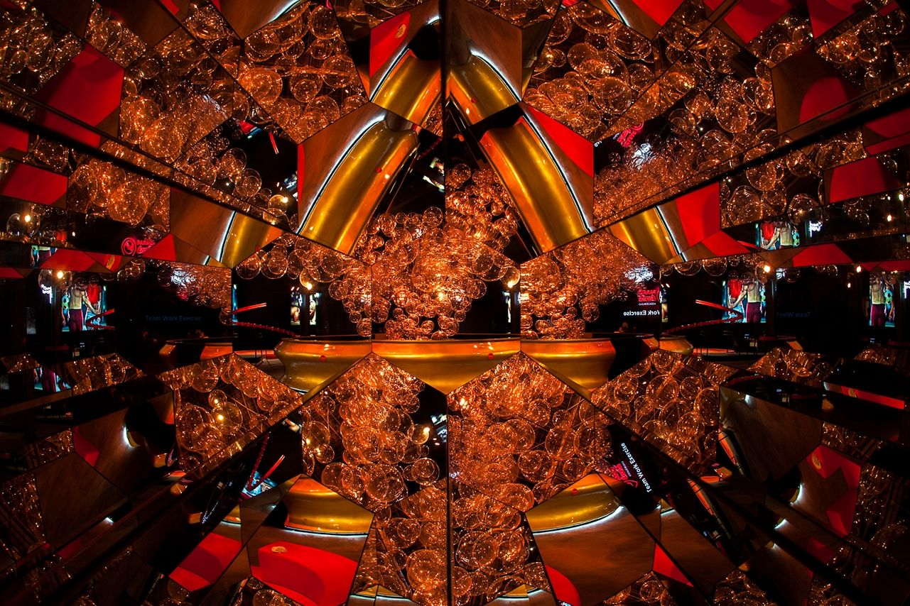
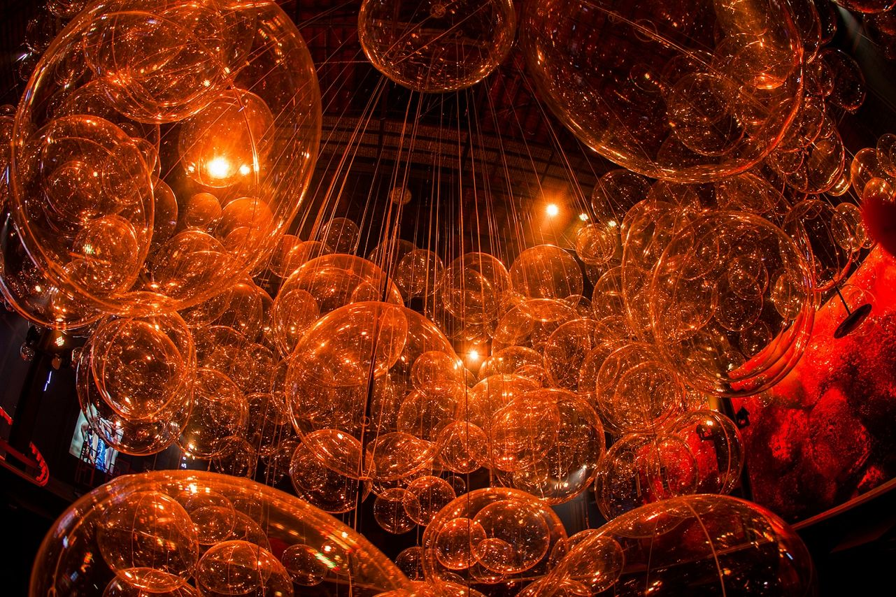
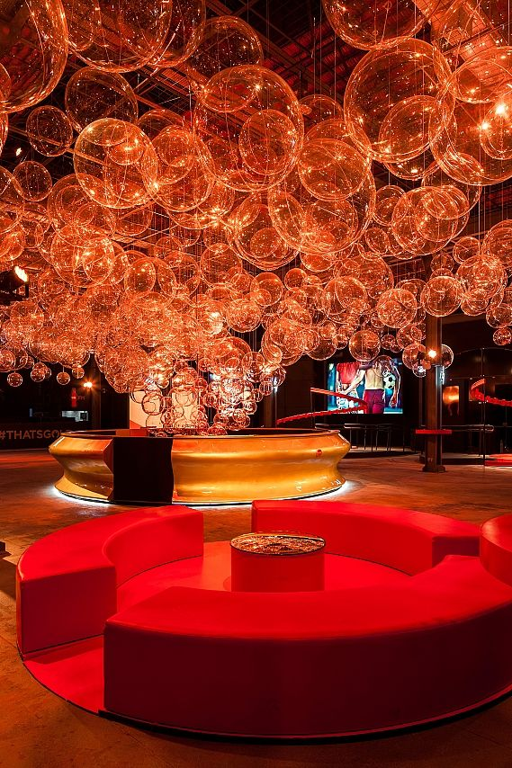

import Figure from '@/components/Figure.astro'

> Utilizamos mais de 500 esferas de acrílico transparente de diferentes tamanhos suspensas na estrutura do teto do armazém, cobrindo quase 1000m² e iluminadas para criar a sensação de uma efervescência que sobe. Sob a instalação principal de bolhas, diferentes ativações interativas e exposições entretêm o público e narram a história visual da empresa.

*Atelier Marko Brajovic*

A Parada Coca-Cola foi o primeiro projeto no qual apliquei design computacional. Essa experiência sensorial foi inspirada na garrafa da Coca-Cola, imitando as bolhas e cores da bebida. O evento também teve várias outras ativações, como se diz no marketing.

<Figure credit="Fernando Martins">
  
</Figure>

<Figure credit="Fernando Martins">
  
</Figure>

## Design computacional
Meu papel no projeto foi posicionar as esferas de plástico parametricamente, garantindo que nem as esferas nem os cabos que as suspendiam do teto colidissem entre si. Para isso, usei o Grasshopper e o Galapagos.
Depois, também gerei uma planilha com o comprimento de cada cabo e as tags, para organizar todo o material para o envio e a montagem. Bom, pelo menos essa era a ideia. Em algum momento, alguém achou que seria uma boa ideia tirar as tags 🤯. Foi um pesadelo para as meninas que coordenaram o evento.

<Figure credit="Fernando Martins">
  
</Figure>
