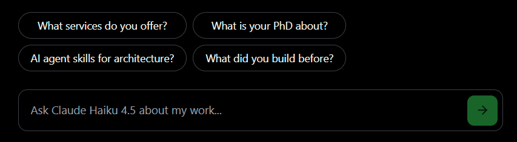
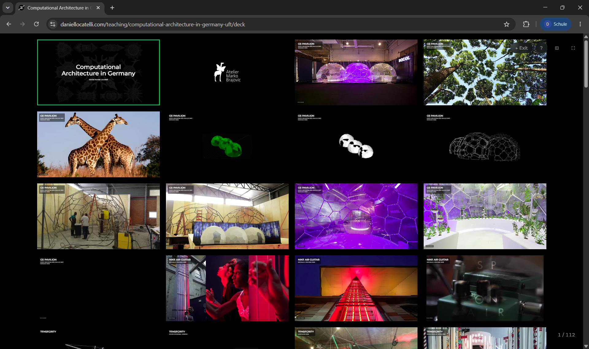
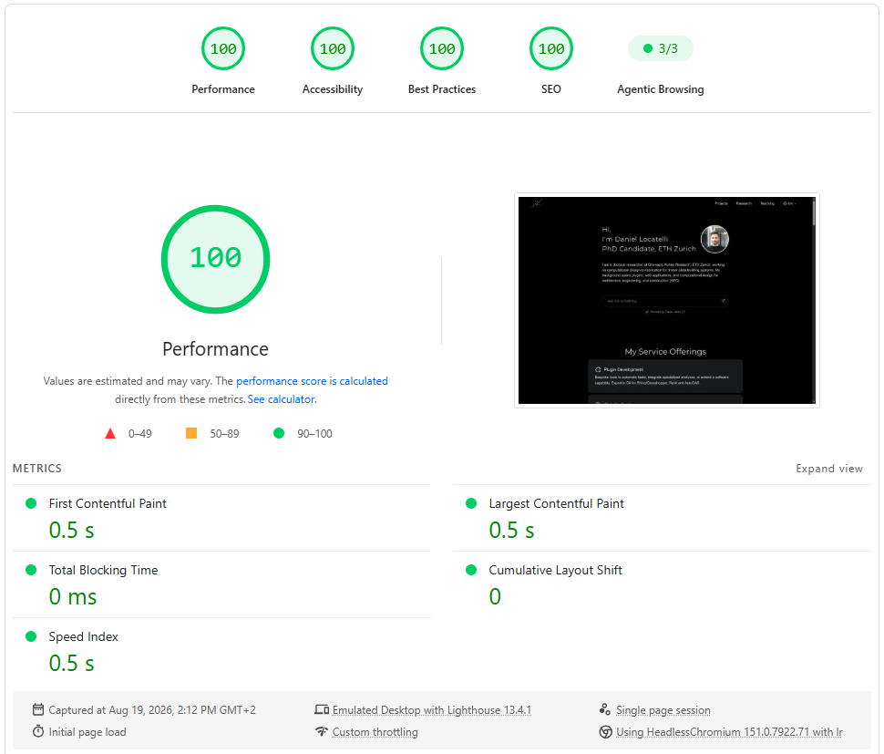
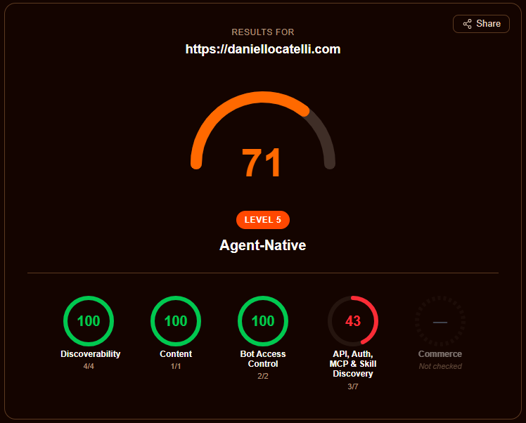

Este é o site que você está lendo agora. Ele começou em abril de 2024 como um site pequeno, e uma decisão orientou tudo o que veio depois: todo o conteúdo fica em arquivos de texto simples, ao lado do código. Por isso um agente de IA consegue editar o site como edita código, traduzi-lo para três idiomas e condensá-lo num perfil que o chat da página inicial usa para responder, e outros agentes de IA conseguem ler o site sem precisar raspar as páginas. Esta página passa por cada uma dessas partes e termina com as ferramentas que estão por baixo.

## Claude Code como sistema de gestão de conteúdo

Todo o conteúdo fica em arquivos de texto simples (escritos em [markdown](https://commonmark.org/help/)) no mesmo lugar que o código, o [repositório público no GitHub](https://github.com/daniel-locatelli/daniellocatelli). Há um arquivo pequeno para cada projeto, pesquisa, publicação, aula ou seção do currículo. Cada um começa com um cabeçalho curto que guarda os fatos (título, datas, tags), seguido do texto da página, e existe uma vez em cada idioma. Não há banco de dados nem sistema de conteúdo separado por trás das páginas.

Um sistema de gestão de conteúdo (CMS) é a ferramenta em que normalmente se faz login para adicionar uma página ou corrigir um erro de digitação. Aqui esse papel é do [Claude Code](https://claude.com/claude-code), um agente de IA que trabalha diretamente nos arquivos de um projeto. Como o conteúdo é apenas um conjunto de arquivos ao lado do código, ele consegue ler, editar, criar e cruzar entradas do mesmo jeito que trabalha com código-fonte. Descrevo um novo projeto ou uma correção em uma frase, e ele escreve ou atualiza os arquivos, mantém os cabeçalhos consistentes e confere as entradas relacionadas nos outros idiomas. Esta página, por exemplo, foi escrita assim. Tudo neste site é cocriado, do código ao conteúdo.

## Tradução feita pelo Claude Code

O site está disponível em inglês, português e alemão. Não há nenhum serviço de tradução no processo: quando um arquivo de conteúdo muda em um idioma, o Claude Code o traduz e atualiza os arquivos correspondentes nos outros dois. Fatos como datas, links e lugares ficam idênticos nos três, enquanto nomes e texto são traduzidos. O mesmo vale para os rótulos e botões da interface.

As traduções partem do sentido, não de cada palavra, e seguem um guia de estilo por idioma que fica no próprio repositório: o tom, um glossário de termos fixos e uma tabela de correções. Sempre que corrijo uma tradução, o antes e o depois entram nessa tabela, e a próxima tradução já começa sabendo o que a anterior errou.

## Chat com IA na página inicial

Manter o conteúdo em texto puro traz mais um ganho: é simples condensá-lo e entregá-lo a um modelo de linguagem. É isso que torna possível o chat da página inicial.

A página inicial é deliberadamente curta: meu nome, uma linha sobre o que pesquiso, um chat com o Claude e uma lista de ensaios. O chat é a principal porta de entrada. Quatro perguntas sugeridas ficam acima do campo de texto, para que o visitante possa perguntar, com um clique, do que trata o meu doutorado ou quais skills de agentes de IA criei, e toda resposta se baseia no conteúdo real deste site, e não em uma resposta genérica.

Quando a pergunta é enviada, a página se reduz à conversa, como no claude.ai: a apresentação e os ensaios saem de cena, o campo de texto desce para o pé da tela e a resposta aparece aos poucos, à medida que o Claude a escreve. A conversa fica guardada durante a sessão do navegador, então quem segue um link de uma resposta e volta encontra tudo onde deixou. Quando a resposta cita páginas do site, ela termina com uma prévia delas no idioma do visitante: a capa da primeira página em largura total, com o título como link, e miniaturas das demais numa fileira.

Por baixo dos panos, um script condensa o site em um perfil por idioma: cada cargo com o que eu fiz nele, um resumo curto e um link para cada pesquisa, projeto, publicação e palestra, as competências e uma linha do tempo cronológica. Dá cerca de 13.000 tokens por idioma (o token é a unidade que um modelo de linguagem lê; isso equivale a umas 10.000 palavras). Cada pergunta chega ao Claude junto com o perfil completo do idioma da página, então uma pergunta ampla como "em quais projetos você já trabalhou?" enxerga a minha carreira inteira de uma vez. Como o perfil é o mesmo para todos os visitantes, o Claude o mantém em cache entre uma pergunta e outra (cache de prompt): depois da primeira pergunta, ele custa uma fração do tamanho e não atrasa a resposta.

Uma versão anterior fazia o contrário: procurava no conteúdo os poucos trechos mais próximos da pergunta e enviava só esses (recuperação, com embeddings da Voyage AI e um banco vetorial no Supabase). Ela respondia bem a perguntas específicas, mas às vezes montava a resposta de uma pergunta ampla em torno de um item secundário, por isso a substituí.

O perfil é regenerado a partir do conteúdo sempre que o site é gerado, então uma página nova chega ao chat na próxima publicação. Depois, um script de benchmark faz ao chat um conjunto fixo de perguntas comuns e confere cada resposta, de modo que uma mudança que estrague alguma delas aparece antes de chegar aos visitantes.

## Ensaios

Boa parte do que eu vendia como serviço (plugins, aplicativos web, painéis) hoje um modelo de linguagem escreve em uma tarde. Por isso a página inicial não lista mais serviços; quem quiser saber o que ofereço pode perguntar ao chat. No lugar deles, a página inicial lista ensaios: alguns textos longos sobre o que continua valioso em arquitetura e engenharia quando o código fica barato, publicados cerca de uma vez por mês. Cada ensaio é um arquivo markdown simples, como todo o resto, então publicar um é uma única mudança no repositório, e o chat pode responder perguntas sobre ele assim que ele estiver no ar.

## Modo apresentação

As páginas de aulas podem ter uma apresentação de slides, guardada ao lado da página, na mesma pasta. Para abrir uma, entre em uma página de aula como [Arquitetura computacional na Alemanha](/pt/teaching/computational-architecture-in-germany-uft) e clique no botão verde **Abrir slides**, logo abaixo do título. A apresentação roda no navegador: as setas do teclado passam os slides, **O** mostra uma visão geral de todos eles, **P** abre uma janela do apresentador com as notas, **F** coloca em tela cheia e **?** lista os outros atalhos.

As apresentações são escritas em MDX (markdown que também aceita componentes), com uma notação curta em YAML para os tipos de slide mais comuns: título, texto, imagem, fileira de imagens, vídeo e sobreposições. Uso isso em aulas e palestras, de modo que uma aula e seus slides sejam publicados juntos, versionados juntos e traduzidos juntos.

## Feito para pessoas e para agentes

O site recebe dois tipos de visitante: pessoas num navegador e agentes de IA que o leem a pedido de alguém. Cada um pede um tipo de trabalho, e cada um é verificado com uma ferramenta pública.

### Para pessoas: velocidade

O Astro renderiza o site em HTML majoritariamente estático, então a maioria das páginas não precisa de JavaScript nenhum. O resto vem de não carregar o que o visitante ainda não precisa:

- As imagens chegam em tamanhos responsivos com dimensões explícitas e carregam pouco antes de entrarem na área visível; as fontes são reduzidas aos conjuntos de caracteres que o site usa e carregadas cedo.
- A conversa do chat só é baixada quando o visitante demonstra interesse em conversar (ao passar o mouse por uma pergunta sugerida ou clicar no campo de texto), de modo que a página inicial carrega apenas alguns kilobytes de JavaScript.

O [Lighthouse](https://developer.chrome.com/docs/lighthouse/overview), a auditoria de qualidade de páginas do Google, dá ao site 100 em desempenho, acessibilidade, boas práticas e SEO.

### Para agentes: acesso

Boa parte do tráfego de um site como este virá de agentes de IA, e não de navegadores, então o site oferece seu conteúdo nos formatos que os agentes esperam:

- um índice `llms.txt` por idioma, uma lista simples das páginas do site para modelos de linguagem, gerada no build;
- uma versão em markdown de cada página de conteúdo (basta acrescentar `.md` à URL), que também é entregue automaticamente a qualquer requisição que peça markdown (`Accept: text/markdown`);
- um `robots.txt` que dá boas-vindas explícitas aos crawlers de IA, um sitemap com entradas de imagens e datas da última modificação, e um catálogo de API em `/.well-known/`;
- um pequeno servidor [MCP](https://modelcontextprotocol.io/) somente leitura (o MCP é o protocolo que os agentes usam para chamar ferramentas externas), para que agentes possam consultar o conteúdo do site diretamente, inclusive o mesmo perfil que o chat usa para responder, inteiro ou por busca de palavras-chave;
- registros de descoberta [DNS-AID](https://datatracker.ietf.org/doc/draft-mozleywilliams-dnsop-dnsaid/) no DNS do domínio, assinados com DNSSEC, para que um agente encontre o servidor MCP apenas a partir do nome de domínio;
- um índice de skills em `/.well-known/agent-skills/`, seguindo o [RFC de descoberta de Agent Skills](https://github.com/cloudflare/agent-skills-discovery-rfc) da Cloudflare, com dois arquivos `SKILL.md` no formato [Agent Skills](https://agentskills.io/specification) que ensinam um agente a consultar o site via MCP ou a lê-lo como markdown.

No [isitagentready.com](https://isitagentready.com/), o verificador que acompanha o [guia de prontidão para agentes](https://blog.cloudflare.com/agent-readiness/) da Cloudflare, o site saiu de 25/100 para 71/100, "Nível 5, Agent-Native", com nota máxima em descoberta, conteúdo e controle de acesso de bots.

Os pontos que faltam ficam em aberto de propósito. Todos dizem respeito a login e a serviços: descoberta OAuth, metadados de recurso protegido e um `auth.md` só fazem sentido quando há algo em que fazer login, um agent card A2A descreve um agente que oferece serviços a outros agentes, e o WebMCP expõe ações dentro da página, como formulários ou checkouts. Um portfólio somente leitura não tem nada disso, então o verificador continua listando esses itens e o site continua sem eles.

## Uma caixa de ferramentas pessoal por trás das páginas públicas

O site também hospeda páginas que não aparecem na navegação e existem sobretudo para meu próprio uso. O [currículo resumido](/pt/cv), o [currículo completo](/pt/full-cv) e o [currículo voltado ao doutorado](/pt/phd-cv) são gerados a partir do mesmo conteúdo que o resto do site, de modo que uma experiência ou publicação só precisa ser cadastrada uma vez. Eles trazem estilos de impressão, então salvar um deles como PDF gera um documento limpo e atualizado sempre que eu preciso. Algumas páginas parecidas servem de cartões de abertura para aulas gravadas.

## Detalhes menores

- **Prévias de links no build.** Links externos listados em uma página são exibidos como cartões de prévia. Títulos, descrições, imagens e ícones são buscados uma única vez e guardados no repositório, de modo que o build sempre dá o mesmo resultado e nenhuma requisição a terceiros acontece ao carregar a página.
- **Sem links quebrados.** Todo link interno do site é conferido no build final antes da publicação, de modo que nada quebrado vai para o ar. Links para outros sites são conferidos uma vez por semana e reportados, já que esses quebram no seu próprio ritmo.
- **Última atualização pelo histórico.** Cada página de conteúdo mostra quando mudou pela última vez, a partir do histórico do repositório, e a mesma data vai para o sitemap e para os metadados da página usados pelos buscadores.
- **Fontes das imagens num só lugar.** Imagens de terceiros usadas em várias páginas, como as pranchas de Ernst Haeckel, ficam guardadas uma única vez, numa pasta por autor. O build encontra todas as páginas que as usam e gera, para cada autor, uma página de fontes, então a lista nunca precisa ser atualizada à mão; o crédito da imagem leva até ela. Os créditos recebem o © automaticamente, menos as obras em domínio público.
- **Tooltips em toda parte.** Um único sistema de tooltip atende todos os tooltips do site: as notas de rodapé mostram a nota ao passar o mouse, para que o leitor não precise pular até o fim da página; os ícones sociais do rodapé e do cabeçalho do CV indicam seu destino; e os controles das apresentações de slides mostram seu atalho de teclado.
- **Markdown para agentes em páginas estáticas.** Entregar markdown a agentes a partir de páginas geradas com antecedência exigiu investigar como a Cloudflare e o Astro tratam as requisições; a solução é um pequeno Snippet da Cloudflare que reescreve o endereço antes de a requisição chegar ao site.

## Stack tecnológica

- [**Astro**](https://astro.build/) com TypeScript para o site em si, [**React**](https://react.dev/) para as poucas partes interativas e [**Tailwind CSS**](https://tailwindcss.com/) para os estilos.
- [**Astro Content Collections**](https://docs.astro.build/en/guides/content-collections/) para todo o conteúdo, escrito em markdown e MDX, com cabeçalhos cujos campos são verificados no build.
- [**Claude**](https://www.anthropic.com/claude) (Anthropic) para o chat da página inicial.
- [**Cloudflare Workers**](https://workers.cloudflare.com/) com Static Assets para a hospedagem: as páginas geradas com antecedência saem direto da rede da Cloudflare, e o código só roda para o chat e o servidor MCP.

Tudo isso se apoia nos mesmos arquivos de texto. O Claude Code os edita e traduz, o build os condensa para o chat, e os agentes os leem como markdown. Acrescentar uma página ao site continua sendo um arquivo de texto, e o resto vem a partir dele.
