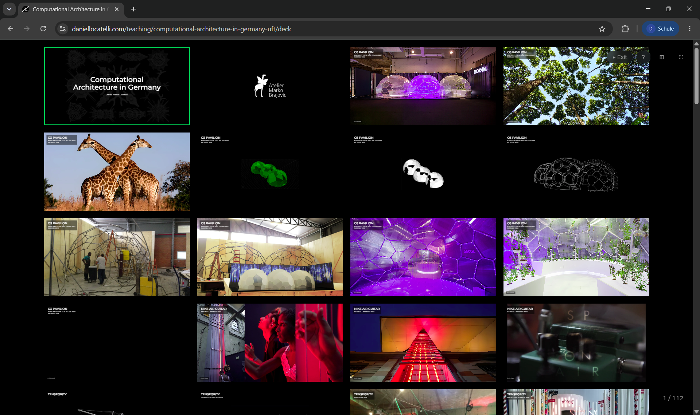
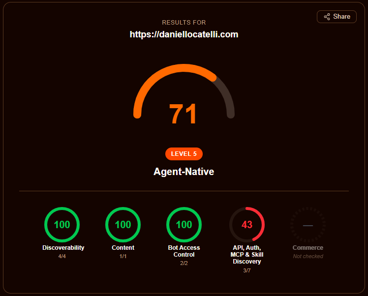
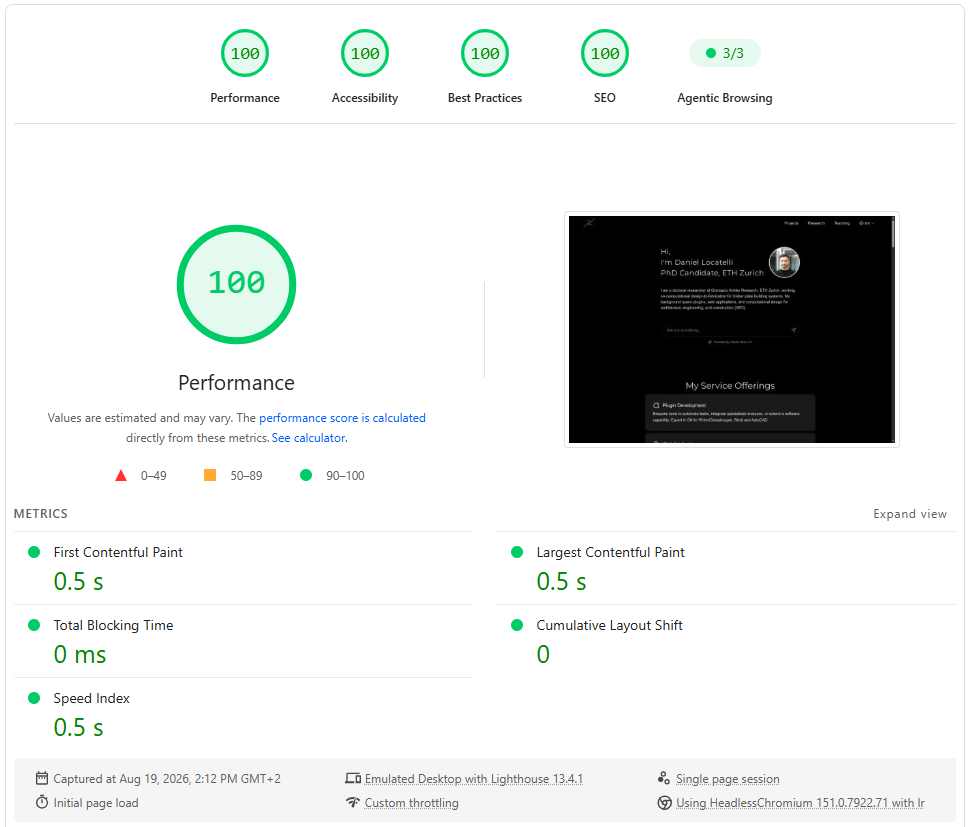

Este é o site que você está lendo agora. Ele começou em abril de 2024 como um pequeno site em Astro e, desde então, virou um campo de testes para o jeito como gosto de construir as coisas: páginas estáticas rápidas, conteúdo fácil de ler tanto para pessoas quanto para ferramentas de IA, e algumas peças interativas para apimentar as&nbsp;coisas.

## Stack Tecnológico

- [**Astro**](https://astro.build/) com TypeScript para o site em si, [**React**](https://react.dev/) para as poucas ilhas que precisam de interatividade e [**Tailwind CSS**](https://tailwindcss.com/) para os estilos.
- [**Astro Content Collections**](https://docs.astro.build/en/guides/content-collections/) para todo o conteúdo, escrito em markdown e MDX com frontmatter tipado e validado no momento do build.
- [**Claude**](https://www.anthropic.com/claude) (Anthropic) para o chat da página inicial, que lê um perfil condensado do site inteiro a cada pergunta.
- [**Cloudflare Workers**](https://workers.cloudflare.com/) com Static Assets para hospedagem, cache na borda e os endpoints voltados a agentes; as páginas pré-renderizadas são servidas direto da borda, e o Worker só roda para os endpoints de chat e MCP.

## Claude Code como sistema de gestão de conteúdo

Todo o conteúdo vive como arquivos de texto simples (escritos em [markdown](https://commonmark.org/help/)) no mesmo lugar que o código, o [repositório público no GitHub](https://github.com/daniel-locatelli/daniellocatelli): um arquivo pequeno por projeto, entrada de pesquisa, publicação, item de ensino ou seção do currículo, com um cabeçalho curto que guarda os fatos (título, datas, tags) acima do texto da página, e uma cópia em cada um dos três idiomas. Não há banco de dados nem sistema de conteúdo separado por trás das páginas.

O objetivo dessa configuração é tornar o conteúdo diretamente acessível a harnesses de IA como o [Claude Code](https://claude.com/claude-code). Como o conteúdo é apenas um conjunto de arquivos ao lado do código, o Claude Code consegue ler, editar, criar e cruzar entradas do mesmo jeito que trabalha com código-fonte. Na prática, isso significa que uso o Claude Code como sistema de gestão de conteúdo (CMS), a ferramenta em que normalmente se faria login para adicionar uma página ou corrigir um erro de digitação: descrevo um novo projeto ou uma correção em uma frase, e ele escreve ou atualiza os arquivos, mantém os cabeçalhos consistentes e confere as entradas relacionadas nos outros idiomas. Esta própria página foi escrita assim. Tudo neste site é cocriado, do código ao conteúdo.

Manter o conteúdo no repositório em texto puro tem um segundo ganho: é simples condensá-lo e entregá-lo a um modelo de linguagem. É isso que torna possível o chat com IA na página inicial (mais sobre ele abaixo).

## Tradução feita pelo Claude Code

O site está disponível em inglês, português e alemão. Não há nenhum serviço de tradução no pipeline: quando um arquivo de conteúdo muda em um idioma, o Claude Code o traduz e atualiza os arquivos correspondentes nos outros dois. Campos estruturais como datas, links e lugares são mantidos em sincronia, enquanto campos traduzíveis como nomes de países e cidades são localizados. O mesmo vale para os textos da interface, que vivem como objetos tipados por idioma.

## Chat com IA na página inicial

A página inicial é deliberadamente curta: meu nome, uma linha sobre o que pesquiso, um chat baseado no Claude e uma lista de ensaios. O chat é a principal porta de entrada. Três perguntas sugeridas ficam acima do campo de texto, para que o visitante possa perguntar do que trata o meu doutorado ou que skills de agentes de IA criei para arquitetura com um único clique, e toda resposta se baseia no conteúdo real deste site, e não em uma resposta genérica. Quando a pergunta é enviada, a página se reduz à conversa, como no claude.ai: a apresentação e os ensaios saem de cena, o campo de texto desce para o pé da tela e a resposta aparece aos poucos, à medida que o Claude a escreve. A conversa fica guardada durante a sessão do navegador, então quem segue um link de uma resposta e volta encontra tudo onde deixou.

Por baixo dos panos, um script condensa as coleções de conteúdo em um perfil por idioma: cada cargo com o que eu fiz nele, um resumo curto e um link para cada pesquisa, projeto, publicação e palestra, as competências e uma linha do tempo cronológica. Dá cerca de 13.000 tokens por idioma, e o perfil vai empacotado no Worker. Cada pergunta chega ao Claude junto com o perfil completo do idioma da página, então uma pergunta ampla como "o que você construiu antes?" enxerga a minha carreira inteira de uma vez, e não meia dúzia de trechos recuperados. Como o perfil é o mesmo para todos os visitantes, ele fica no cache de prompt: depois da primeira pergunta, custa uma fração do tamanho e não atrasa a resposta. Uma versão anterior usava recuperação (embeddings com a Voyage AI e um banco vetorial no Supabase); ela respondia bem perguntas específicas, mas às vezes montava a resposta de uma pergunta ampla em torno de um item secundário, por isso a substituí. Sempre que o conteúdo muda, um único comando regenera o perfil, e um script de benchmark roda um conjunto fixo de perguntas comuns contra o chat para garantir que ele continua respondendo todas corretamente.

## Ensaios

Boa parte do que eu vendia como serviço, plugins, aplicativos web, painéis, hoje um modelo de linguagem escreve em uma tarde. Por isso a página inicial não lista mais serviços. Ela lista ensaios: algumas peças longas sobre o que continua valioso em arquitetura e engenharia quando o código fica barato, publicadas cerca de uma vez por mês. Cada ensaio é um arquivo markdown simples em sua própria coleção de conteúdo, então publicar um é um único commit, e o chat pode responder perguntas sobre ele assim que o perfil for regenerado.

## Modo apresentação

Itens de conteúdo podem carregar uma apresentação de slides que vive junto do texto, na mesma pasta e no mesmo repositório. As apresentações são escritas em MDX com um pequeno atalho em YAML para os tipos de slide mais comuns (título, texto, imagem, fileira de imagens, vídeo, sobreposições) e são renderizadas no navegador com navegação por teclado, uma visão geral de todos os slides e uma janela do apresentador. Uso isso para aulas e palestras, de modo que uma aula e seus slides sejam publicados juntos, versionados juntos e traduzidos juntos.

## Pronto para agentes na Cloudflare

Como boa parte do tráfego de um site como este virá cada vez mais de agentes de IA em vez de navegadores, o site expõe seu conteúdo nos formatos que os agentes esperam:

- um índice `llms.txt` por idioma, gerado a partir das coleções de conteúdo no momento do build;
- uma versão em markdown de cada página de conteúdo (basta acrescentar `.md` à URL), além de negociação de conteúdo para que uma requisição com `Accept: text/markdown` receba markdown diretamente;
- um `robots.txt` que dá boas-vindas explícitas aos crawlers de IA, um sitemap com entradas de imagens e datas `lastmod` por URL obtidas do histórico do git (a mesma data aparece como "Última atualização" em cada página de conteúdo e como `article:modified_time` e `dateModified` nos dados estruturados do cabeçalho), e um catálogo de API em `/.well-known/`;
- um pequeno servidor [MCP](https://modelcontextprotocol.io/) somente leitura, para que agentes possam consultar o conteúdo do site como ferramentas;
- registros de descoberta [DNS-AID](https://datatracker.ietf.org/doc/draft-mozleywilliams-dnsop-dnsaid/) (registros SVCB `_mcp._agents` e `_index._agents`, assinados com DNSSEC), para que agentes encontrem o endpoint MCP apenas a partir do nome de domínio;
- um índice de skills em `/.well-known/agent-skills/`, seguindo o [RFC de descoberta de Agent Skills](https://github.com/cloudflare/agent-skills-discovery-rfc) da Cloudflare, com dois arquivos `SKILL.md` no formato [Agent Skills](https://agentskills.io/specification) que ensinam um agente a consultar o site via MCP ou a lê-lo como markdown.

Fazer a negociação de conteúdo funcionar em páginas pré-renderizadas exigiu investigar como o pipeline de requisições da Cloudflare, o Workers Static Assets e o middleware de build do Astro interagem; a solução é um Snippet da Cloudflare no nível da zona que reescreve a URL antes de ela chegar ao Worker. No [isitagentready.com](https://isitagentready.com/), o verificador que acompanha o [guia de prontidão para agentes](https://blog.cloudflare.com/agent-readiness/) da Cloudflare, o site saiu de uma pontuação de 25% para 71/100, "Nível 5, Agent-Native", com nota máxima em descoberta, conteúdo e controle de acesso de bots. Os pontos restantes estão na categoria de API e autenticação e ficam deliberadamente em aberto: descoberta OAuth, metadados de recurso protegido e um `auth.md` só fazem sentido quando há algo em que fazer login, um agent card A2A descreve um agente que oferece serviços a outros agentes, e o WebMCP expõe ações dentro da página, como formulários ou checkouts. Um portfólio somente leitura não tem nada disso, então o verificador continua listando esses itens e o site continua dispensando-os.

## Desempenho e Lighthouse

O Astro renderiza o site em HTML majoritariamente estático, o que já lhe dá uma vantagem inicial. As pontuações de 100 no Lighthouse em desempenho, acessibilidade, boas práticas e SEO vêm então de não carregar o que o visitante ainda não precisa:

- As imagens chegam em tamanhos responsivos com dimensões explícitas, carregadas sob demanda pouco antes de entrarem na área visível; as fontes são reduzidas ao subconjunto necessário e pré-carregadas.
- A conversa só é baixada quando o visitante demonstra interesse em conversar (ao passar o mouse por uma pergunta sugerida ou clicar no campo de texto), de modo que o campo de entrada da abertura carrega apenas alguns kilobytes de JavaScript.

## Uma caixa de ferramentas pessoal por trás das páginas públicas

O site também hospeda páginas que não são linkadas de lugar nenhum e existem sobretudo para meu próprio uso. O [currículo resumido](/pt/cv), o [currículo completo](/pt/full-cv) e o [currículo voltado ao doutorado](/pt/phd-cv) ficam em URLs não listadas, são renderizados a partir das mesmas coleções de conteúdo que o resto do site (de modo que uma experiência ou publicação só precisa ser cadastrada uma vez) e trazem estilos de impressão, para que salvar a página como PDF gere um documento limpo e atualizado sempre que for preciso. Algumas páginas igualmente não listadas servem de cartões de abertura para aulas gravadas. Assim, o site funciona também como um pequeno espaço de trabalho, e não apenas como vitrine para visitantes.

## Detalhes menores

- **Prévias de links no build.** Links externos listados em uma página são exibidos como cartões de prévia. Títulos, descrições, imagens e favicons são buscados uma única vez e guardados em cache no repositório, de modo que o build é reprodutível e nenhuma requisição a terceiros acontece ao carregar a página.
- **Sem links quebrados.** Todos os links do site, para suas próprias páginas, para os arquivos que cada página carrega e para os ícones e notas de rodapé que cada página aponta dentro de si mesma, são verificados contra o build final, de modo que nada quebrado vai para o ar. Links para outros sites são varridos uma vez por semana e reportados, já que esses quebram no seu próprio ritmo.
- **Tooltips em toda parte.** Um único sistema de tooltip (um painel popover com seta, posicionado e invertido por poucas linhas de JavaScript) atende todos os tooltips do site: notas de rodapé em markdown mostram a nota no próprio lugar ao passar o mouse, para que o leitor não precise pular até o fim da página; os ícones sociais do rodapé e do cabeçalho do CV indicam seu destino; e os controles das apresentações de slides mostram seu atalho de teclado. Não resta nenhum tooltip nativo do navegador.
