## Zusammenfassung

Dieses Paper untersucht, wie sich digitale Werkzeuge beim Entwerfen und Herstellen textiler Geflechte einsetzen lassen, indem Formfindung mit der traditionellen Klöppeltechnik kombiniert wird. Die Arbeit erforscht, wie eine traditionelle Handwerksmethode zu einem neuen Ansatz im Bereich des parametrischen und generativen Designs in Verbindung mit digitalen Fertigungstechnologien führen könnte. Die gesamte Untersuchung basiert auf mehreren Fallstudien zu renommierten Architekten, deren Arbeit von der Natur inspiriert ist, etwa Buckminster Fuller und Frei Otto. In diesen Fallstudien wurde versucht, ihre Arbeiten mit einer verbreiteten visuellen Programmiersprache, die den meisten Fachleuten zugänglich ist, per Reverse Engineering nachzubauen. Da digitale Prozesse wegen ihrer schnellen und optimierten Ergebnisse im Entwurf immer wichtiger werden, ist es unerlässlich, dass sich Architekten auf diese neue Arbeitsweise einstellen. Die Arbeit versucht zu zeigen, wie Computational Design ein traditionelles und unerwartetes Thema mit großer räumlicher Kontrolle einbeziehen könnte. Sie führt außerdem in das Verfahren der dynamischen Relaxation und in eine mögliche Anwendung eines evolutionären Algorithmus in Architektur und Design ein. Mit dem entwickelten Algorithmus wurde schließlich ein Prototyp für einen hängemattenähnlichen Stuhl entworfen.

## Einleitung

Seit vielen Jahrzehnten verbraucht die Stadtentwicklung Rohstoffe in einem Ausmaß, das sich nicht mehr lange aufrechterhalten lässt (Fry [4]). Schätzungen zufolge erzeugt beispielsweise allein das Bauwesen in Brasilien etwa 50 bis 70 % der gesamten Masse der festen Siedlungsabfälle des Landes, so Fernandes [3].

Wie Kieran und Timberlake [5] in ihrem Buch *Refabricating Architecture* beobachten, ähnelt die heutige Arbeitsweise stark den Prozessen, mit denen die Architektur einer früheren Epoche entstand. Denn nach Ansicht dieser Autoren dauern Entwurf und Bau in der Architektur auch heute noch viele Jahre. Darüber hinaus erfordert das Bauen immer noch eine enorme Menge an Materialien, was zur Erschöpfung von Ressourcen führen könnte.

Die Autoren stellen fest, dass Architekten, die diesen Zusammenhang erkennen, ihn mit den Fortschritten in Entwurf und Fertigung von Automobilen, Flugzeugen und Schiffen vergleichen. In diesen Bereichen eröffnen neue Materialien und Verfahren enorme Möglichkeiten: Abfall, Kosten und Fertigungszeit sinken, während die Qualität steigt.

Algorithmische Architektur ist ein sich rasch entwickelndes Feld, das diesen technologischen Rückstand in der Architektur-, Ingenieur- und Baubranche (AEC) aufholen will. Traditionell bezeichnet das Wort Algorithmus ein Verfahren, das ein Problem in endlich vielen Schritten löst. Heutzutage kann ein Algorithmus jedoch als Vermittler zwischen dem menschlichen Geist und der Rechenleistung des Computers verstanden werden (Terzidis [9]).

In diesem Paper schlagen wir mit Methoden des Computational Design eine Installation an der Fakultät für Architektur und Städtebau der Universität São Paulo vor. Damit dies umsetzbar blieb, wählten wir eine einfache Aufgabenstellung, sodass im Laufe der Forschung viele Algorithmen entwickelt und verbessert werden konnten.

Die Bibliographie wurde so ausgewählt, dass sie einen Überblick über die neuesten Studien im Bereich der Computational-Design-Technologie ermöglicht. Bei der Recherche nach Referenzprojekten zeigte sich, dass sich die meisten Entwürfe an der Biomimetik orientierten. Die vorliegende Studie verfolgt daher denselben Ansatz, denn sie stützt sich auf dieselben philosophischen und logischen Grundlagen wie renommierte Architekten: Achim Menges, Buckminster Fuller, Frei Otto und Tomas Saraceno.

Buckminster Fuller und Frei Otto waren für diese Studie besonders wichtig. Fuller versuchte mit seinen Studien zur synergetischen Geometrie, das Potenzial der Optimierung im Entwurf zu erforschen, was zu Erfindungen wie der geodätischen Kuppel und der Jitterbug-Transformation führte, die „mit dem Wenigsten das Meiste erreichen“ (Krausse und Lichtenstein [6]). Frei Otto hingegen baute seine berühmten Formfindungsmodelle, mit denen er physikalische Eigenschaften von Seifenhäuten, Gummi und zugbeanspruchten Tragwerken untersuchte (Barthel [1]).

import ImageRow from '@/components/ImageRow.astro'

## Architektur und Biomimetik

<ImageRow>
  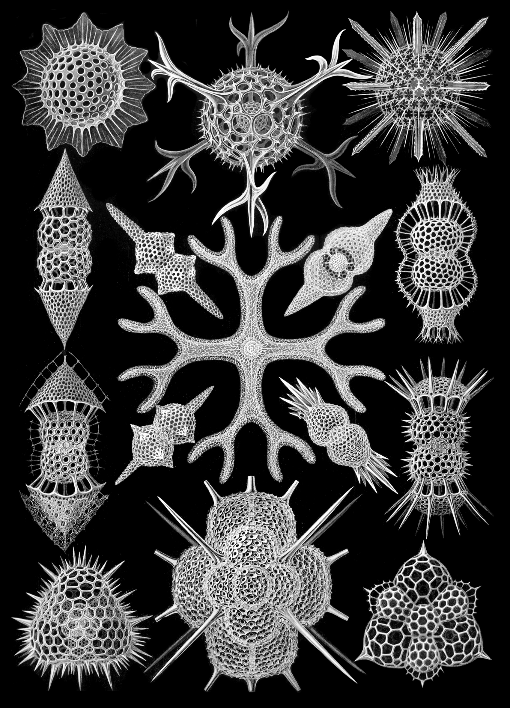

  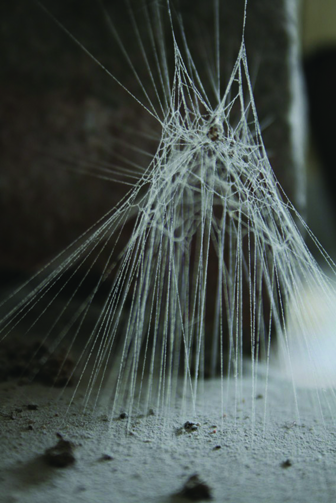
</ImageRow>

Laut Benyus [2] nutzt die Biomimetik die Natur als wichtigste Designrichtlinie und kann in drei Ebenen unterteilt werden. Die erste, eher oberflächliche Ebene versucht lediglich, Formen und Muster der Natur nachzuahmen, unabhängig von der verwendeten Methode. Die zweite Ebene untersucht die Wege, die die Natur bis zu ihrem Endergebnis durchläuft: den Prozess. Die dritte und umfassendste Ebene ahmt natürliche Ökosysteme nach, ausgehend von der Einsicht, dass alle Individuen und Elemente eine einzige nachhaltige, vernetzte und wechselseitig abhängige Biosphäre bilden.

In der Natur werden einfach wirkende Strukturen wie Spinnennetze, Bienenwaben und Termitenhügel durch die DNA des Tieres bestimmt, das sie baut, also durch seine genetische Information. Doch selbst dort, wo es eine klar definierte formale Identität gibt, sind noch spezifische Anpassungen an die unmittelbare Umgebung nötig, in der die Struktur gebaut wird: Jedes Spinnennetz fällt zum Beispiel etwas anders aus als die übrigen (Kull [7]).

Algorithmische Architektur funktioniert ähnlich und erforscht ebenfalls diese natürlichen Mechanismen; der Entwurf geht jedoch nicht von genetischer Information aus, sondern wird durch einen Algorithmus bestimmt. Kurz gesagt: Ein vollständiger Algorithmus würde alle Informationen enthalten, die für die Ausführung eines Bauwerks nötig sind, einschließlich der verschiedenen Anpassungen, die die jeweilige Aufgabenstellung verlangt.

## Die Aufgabenstellung

<ImageRow>
  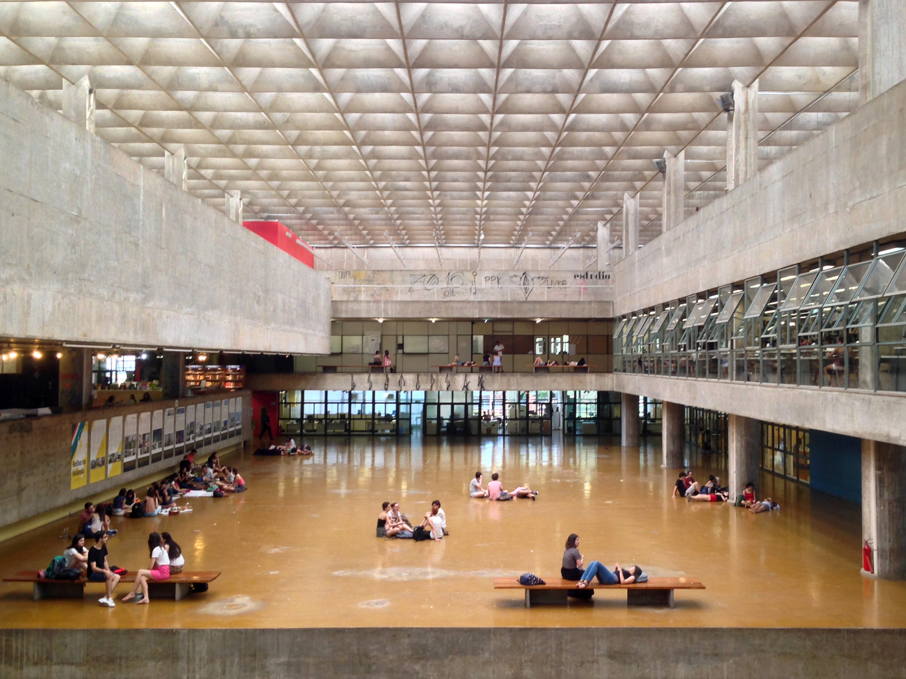

  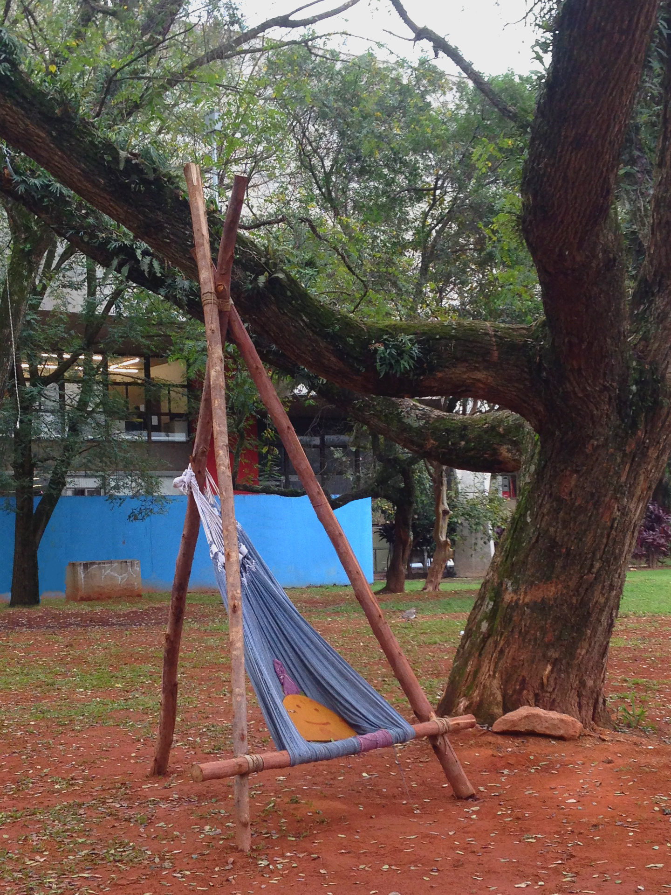
</ImageRow>

Bei der Erkundung der Räume der FAU-USP wurde deutlich, dass es an Aufenthaltsräumen für Studierende mangelte. Außerdem zeigt die Untersuchung, dass Studierende im Gebäude regelmäßig Hängematten aufhängen, um diesen Bedarf zu decken. Die Idee, die übliche Gestaltung von Hängematten auf den Kopf zu stellen, bot großes Potenzial im Bereich der Formfindung. Durch die Verbindung von Computational Design mit einer traditionellen textilen Handwerkstechnik verlagerte sich die Ausrichtung des Projekts hin zu einem neuen Entwurfssystem.

Bevor jedoch mit der Studie begonnen wurde, war es wichtig, eine Strategie festzulegen:

### Biomimetik
Der Entwurf sollte einen von der Natur inspirierten Ansatz verfolgen, der mindestens der zweiten Ebene der Biomimetik (Prozesse) entspricht.

### Komfort
Das Endergebnis sollte aus einem bequemen Material bestehen und Variationen zulassen, sodass Nutzer verschiedene Haltungen einnehmen können: sitzend, angelehnt und liegend.

### Herstellbarkeit
Entscheidend ist, dass das Projekt die an der FAU-USP vorhandenen Maschinen und Werkzeuge nutzt.

### Identität
Das Endergebnis sollte auf das Logo der FAU-USP verweisen und es mit einer anderen Denkweise jenseits des etablierten Leitbilds der Moderne verbinden.

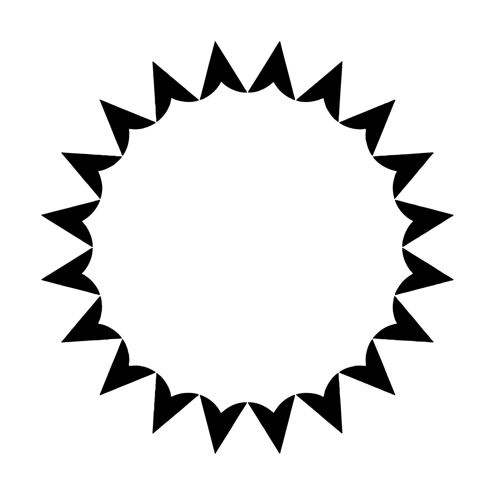

### Standort
Die vorgesehene Fläche ist ein mit Rasen bedecktes Quadrat von 12 Metern Seitenlänge (144 m²) zwischen dem Hauptgebäude der FAU-USP und dem Modell- und Versuchslabor (LAME).

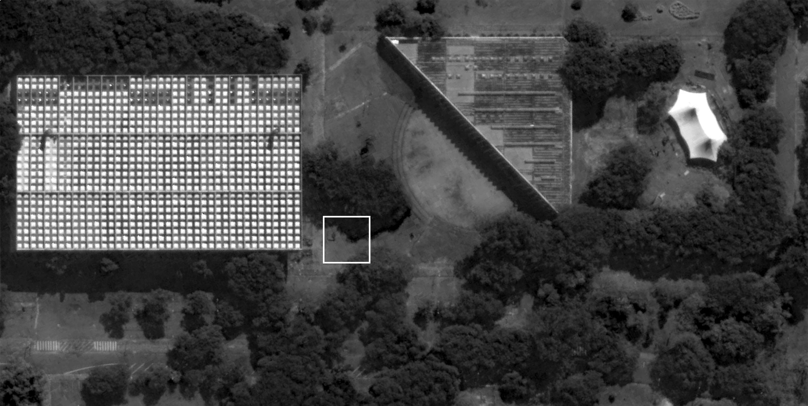

### Optimierung
Der Entwurf muss die Optimierung von Form und Tragwerk berücksichtigen.

### Denkmalschutz
Die Installation muss temporär sein, da das Gebäude der FAU-USP unter Denkmalschutz steht und daher keine dauerhaften Eingriffe zulässt.

## Technik

Die Studie wurde hauptsächlich mit Rhinoceros 3D und dessen Plugin Grasshopper entwickelt. Entscheidend waren außerdem Grasshopper-Plugins wie Kangaroo Physics, Lunchbox, Starling und Weaverbird. Galapagos, ein Algorithmus, der auf Darwins Evolutionstheorie beruht, ist weit verbreitet und im Gegensatz zu diesen Plugins bereits in Grasshopper integriert.

Der endgültige Algorithmus soll ein vorgegebenes Mesh-Muster manipulieren. Für die technische Studie wurden in diesem Fall ein kubischer Rahmen und ein kugelförmiges Mesh verwendet.

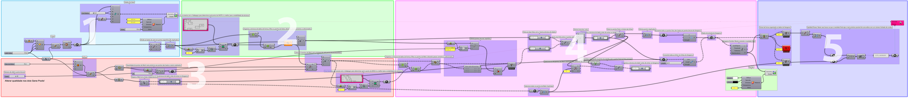

Der Algorithmus arbeitet in fünf Schritten. Im ersten wird ein kubischer Rahmen mit 1 Meter Kantenlänge erzeugt, und alle Kanten werden in 116 gleichmäßig verteilte Punkte unterteilt.

Im zweiten Schritt werden aus den 116 Ausgangspunkten des kubischen Rahmens 1 bis 40 Ankerpunkte ausgewählt. Diese Auswahl steuert Galapagos; sie wird im letzten Schritt beschrieben.

Im dritten Schritt wird eine Kugel mit 0,80 Metern Durchmesser erzeugt und ihr Mesh so lange überarbeitet, bis ein bestimmtes vorgegebenes Muster erreicht ist. Für jeden im vorherigen Schritt ausgewählten Ankerpunkt gibt es 16 Möglichkeiten, ihn über ein Seil mit dem Kugel-Mesh zu verbinden. Aus diesen 16 Optionen wählt Galapagos für jeden Ankerpunkt nur ein einziges Seil.

Ist die Struktur vorbereitet, kann im vierten Schritt endlich der Physiksimulator Kangaroo aktiviert werden. Dabei werden die Linien und das Kugel-Mesh in elastische Seile umgewandelt. Ist die Steifigkeit der Seile angepasst, lässt sich das System stabilisieren. Anschließend werden die Abstände zwischen den ursprünglichen Eckpunkten der statischen Kugel und den Eckpunkten der „relaxierten“ Kugel berechnet.

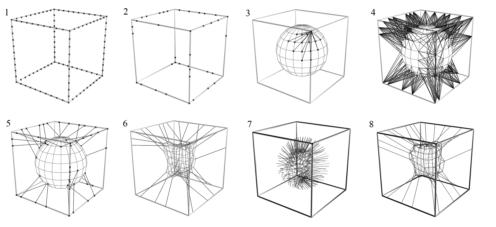

Im fünften Schritt wird Galapagos eingesetzt. Dieser Algorithmus erzeugt zunächst 50 mögliche Zufallsergebnisse, also 50 Individuen auf Grundlage des Genpools, der hier aus den 116 Punkten entlang des kubischen Rahmens und den 190 Eckpunkten im Kugel-Mesh besteht. Mit diesen Daten kann er unter den 50 anfänglichen Individuen suchen und das beste bestimmen. Dabei kommt die sogenannte Fitnessfunktion zum Einsatz: Sie wählt die Individuen aus, deren Eckpunkte am Ende den Eckpunkten der ursprünglichen Kugelform am nächsten liegen.

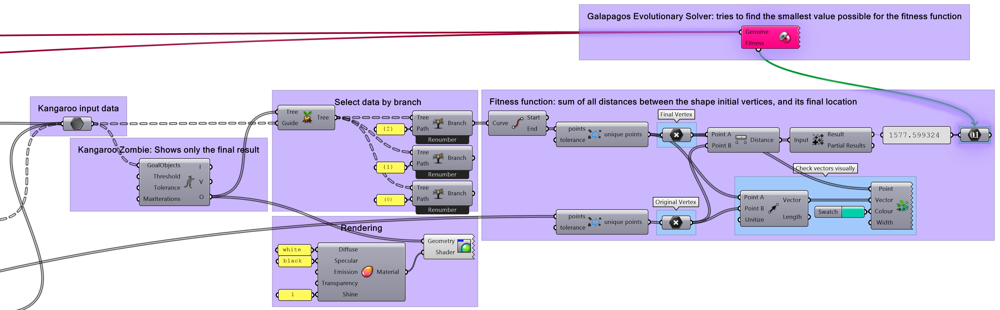

Die besten Individuen der ersten Generation von Datenpunkten kombinieren ihre genetischen Merkmale und erzeugen so 50 neue Datenpunkte, die eine eigene neue Generation bilden. Dies wird wiederholt, bis das günstigste Ergebnis erreicht ist. In diesem Beispiel stabilisierte sich der Algorithmus bei der hundertsten Generation.

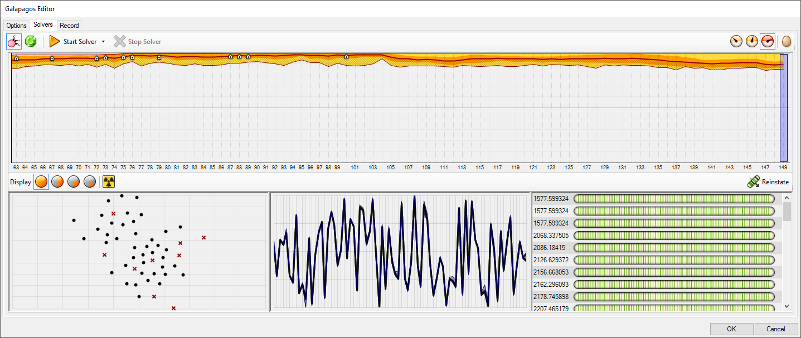

Danach wurden sieben weitere Studien durchgeführt, in denen jedoch nur das anfängliche Mesh-Muster der Kugel geändert und ihr Verhalten analysiert wurde.

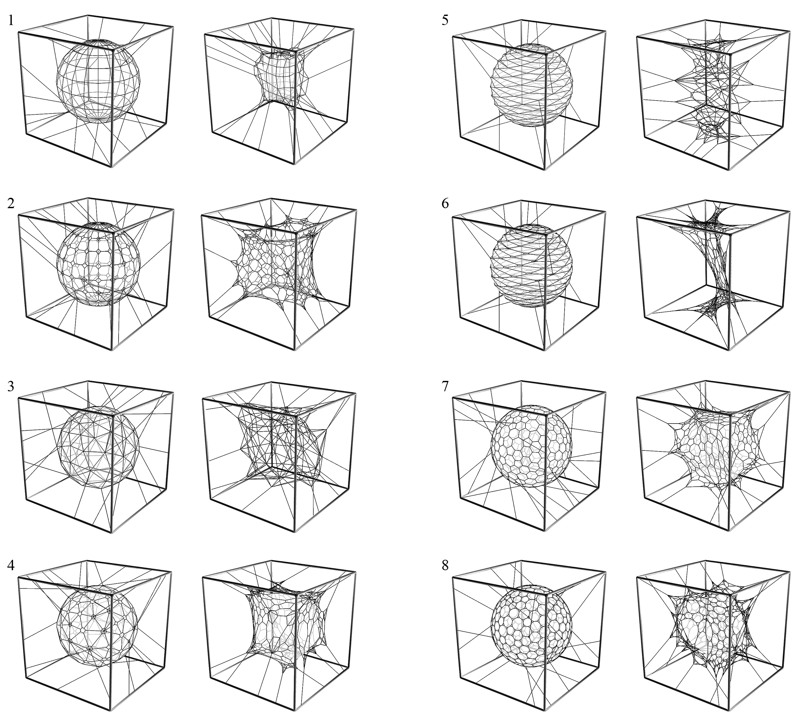

Die Ergebnisse führten zu dem Schluss, dass sich das „abgestumpfte hexagonale Mesh“ am besten für die Entwicklung des endgültigen Vorschlags eignet, da es die beste Kontrolle über die endgültige Form bietet und sich zugleich mit vertretbarem Aufwand herstellen lässt.

## Detaillierung

Um alle Punkte der Aufgabenstellung zu erfüllen, wurde eine Struktur entwickelt, die sich direkt auf eines der Module bezieht, aus denen das Logo der FAU-USP besteht. Ausgehend von diesem Metallskelett aus vier Stäben wurde ein breites Spektrum von 20 Lösungen erzeugt.

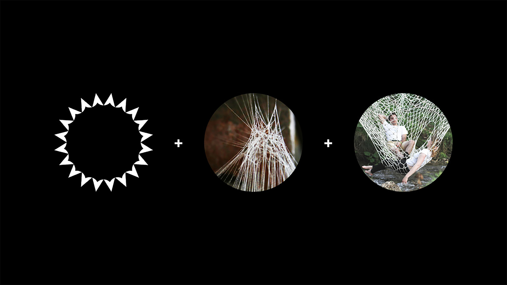

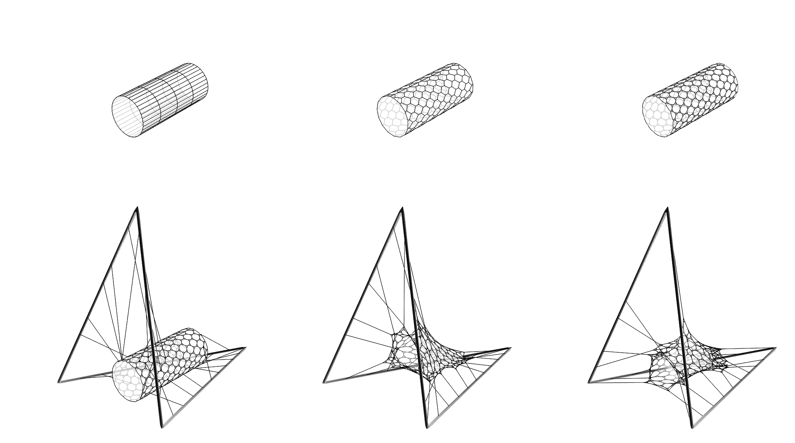

Wie bei der Evolution in der Biologie entsteht dabei keine „perfekte Lösung“, das Ziel wird aber erreicht. Für den Entwurf ist das besonders wichtig, weil es so zu einem Mittel wird, durch das Mensch und Computer zusammenarbeiten können. Menschen stellen den Algorithmus zusammen, Computer verarbeiten ihn und liefern eine große Zahl von Ergebnissen. Daraus kann ein Mensch dann jene auswählen, die Qualitäten berücksichtigen, die sich im Algorithmus nur schwer festlegen lassen, etwa Ästhetik oder Komfort.

### Konstruktionsmethode

Um das vorgeschlagene hexagonale Mesh herzustellen, wurde die traditionelle Klöppeltechnik gewählt. Die Struktur soll aus vier Stahlrohren mit 5 Zentimetern Durchmesser und 2,5 Metern Länge bestehen, verbunden durch vier vorgefertigte Rohrbögen mit Winkeln von 34 und 71,9 Grad.

### Fertigung

Die Montage würde in drei Schritten erfolgen: Herstellen des Netzes, Aufbau des tragenden Skeletts und schließlich Befestigen und Spannen des Netzes mit Seilen. Alle Maße und Befestigungspunkte lassen sich mit Grasshopper dokumentieren; so werden widersprüchliche Angaben vermieden und die Montage beschleunigt.

Klöppeln ist eine textile Handarbeitstechnik, mit der sich komplexe Muster mit einfachsten Werkzeugen herstellen lassen. Traditionell werden dabei Fäden nacheinander verflochten und verdreht: Holzstäbchen (Klöppel) führen die Fäden, Nadeln halten das Muster stabil, und ein Klöppelkissen dient als Unterlage.

<ImageRow>
  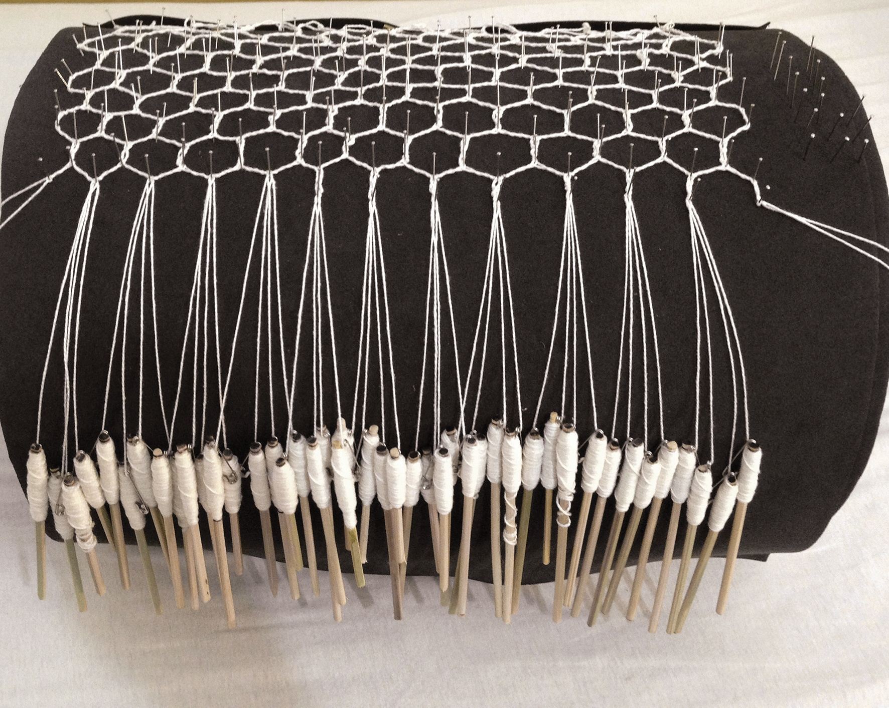

  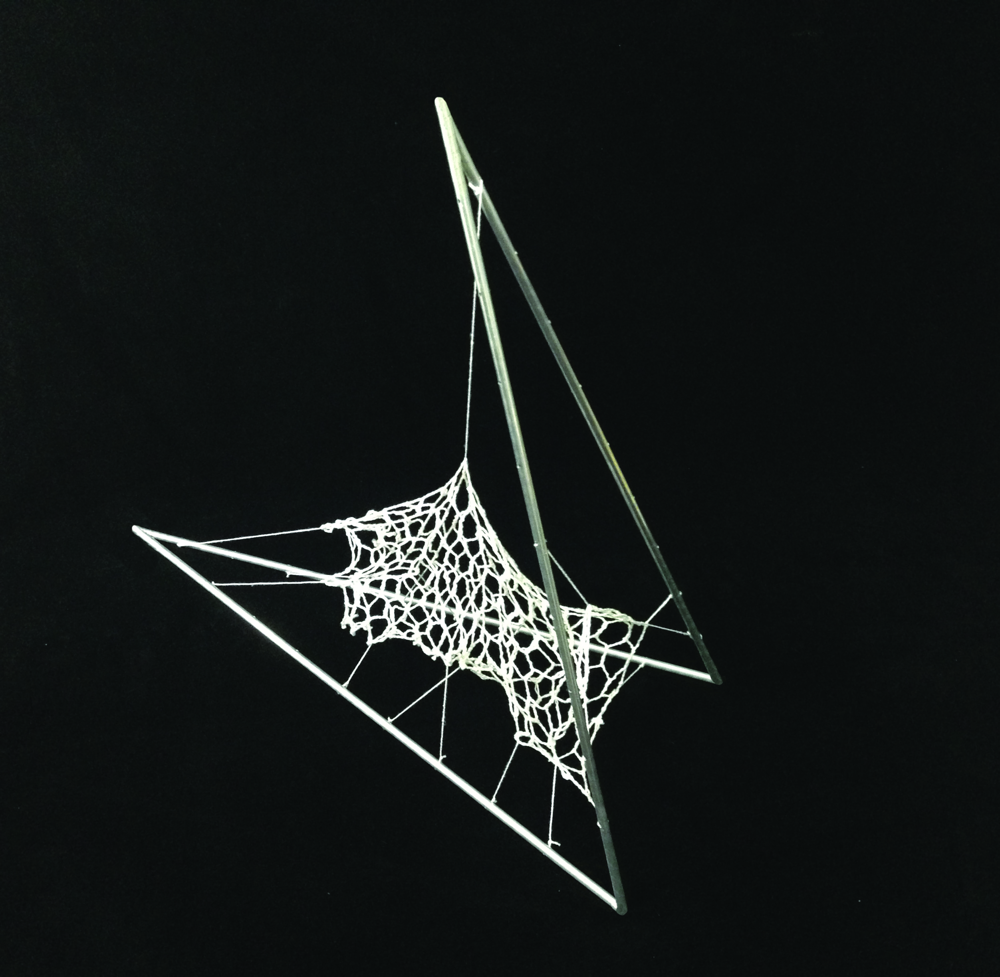
</ImageRow>

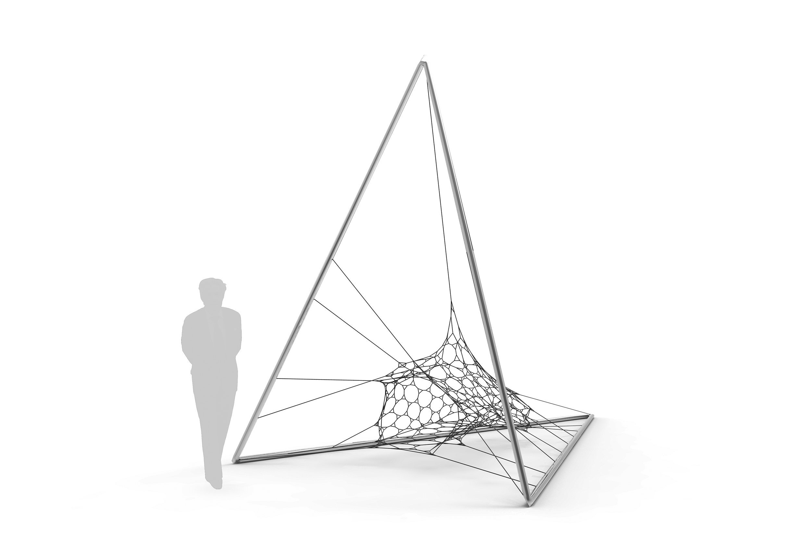

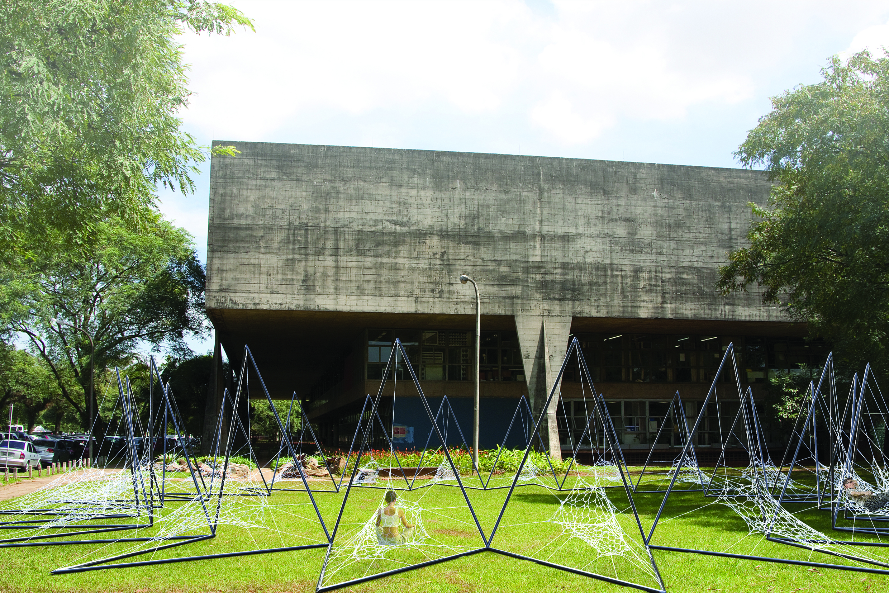

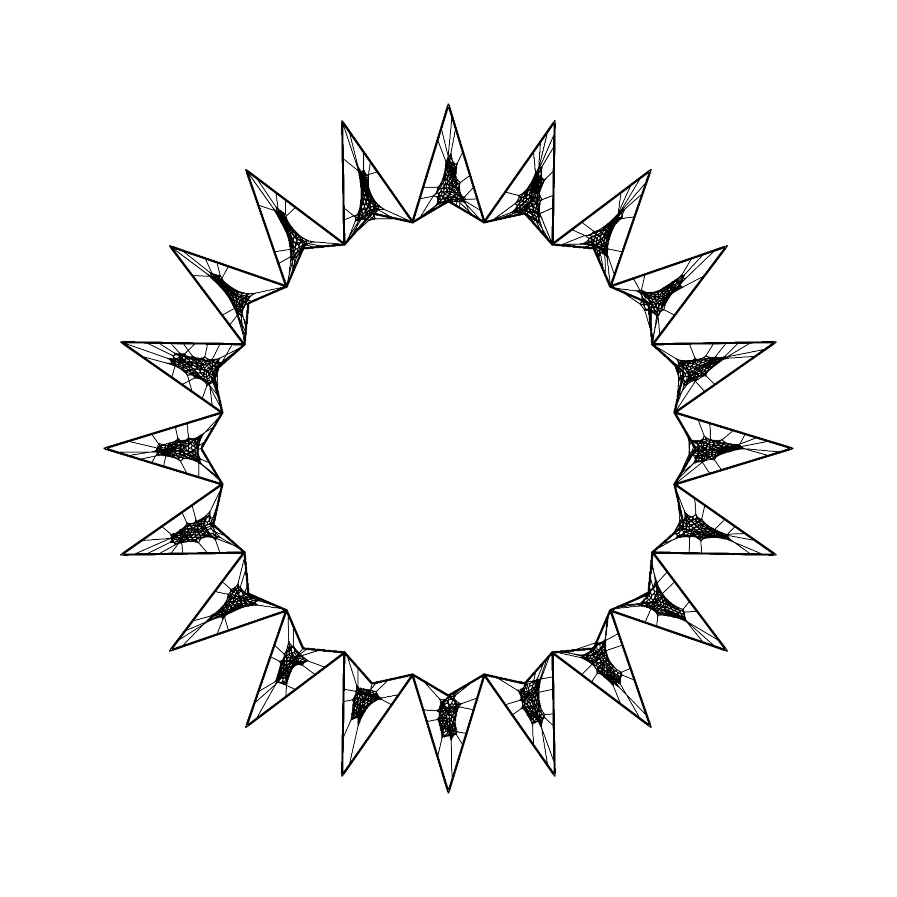

## Schlussfolgerung

Diese Studie wollte einige Möglichkeiten ausloten, eine traditionelle textile Handwerkstechnik in das Computational Design einzubeziehen, um den Prototyp eines hängemattenähnlichen Stuhls zu entwickeln. Der Algorithmus liefert auch einige unerwartete Ergebnisse, die die Vorstellung des Designers vom endgültigen Entwurf verändern. Mit anderen Worten: Dieses System ermöglicht es dem Algorithmus und dem Designer, als Team zusammenzuarbeiten.

Letztlich wirkt der endgültige Algorithmus als kreative Erweiterung des menschlichen Geistes und erzeugt ein Spektrum vielfältiger Lösungen.

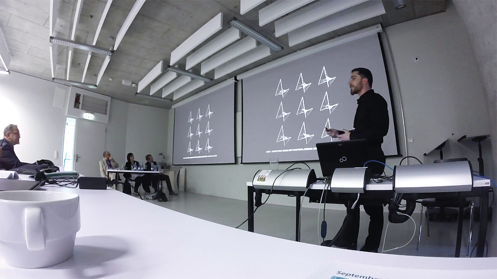

### Literaturverzeichnis
[1] Barthel R. Natural Forms - Architectural Forms. In: FREI OTTO - *Lightweight Construction*, Natural Design, Birkhauser - Publishers for Architecture, 2005.
[2] Benyus J. M. *A Biomimicry Primer*. Biomimicry guide, 2009.
[3] Fernandes J. A. B. *Caderno de Diagnóstico, Resíduos da Construção Civil*. IPEA, 2011.
[4] Fry T., Design Futuring: Sustainable, Ethics and New Practice (Oxford: Berg, 2008), p.2
[5] Kieran S. e Timberlake J. *Refabricating Architecture: How manufacturing methodologies are poised to transform building construction*, McGraw-Hill, 2004.
[6] Krausse J. and Lichtenstein C., Your Private Sky: R. Buckminster Fuller: The Art of Design Science, Lars Müller Publishers, 1999.
[7] Kull U., Frei Otto and Biology, in Frei Otto - Lightweight Construction, Natural Design ([Basel, Switzerland]: Birkhauser - Publishers for Architecture, 2005), p.51
[8] Stabile H., *Entre o físico e o digital. Processos paramétricos, de interação e de fabricação digital aplicados ao design*, São Paulo, 2015.
[9] Terzidis K., *Algorithmic Architecture*, Architectural Press (Elsevier), 2006.
