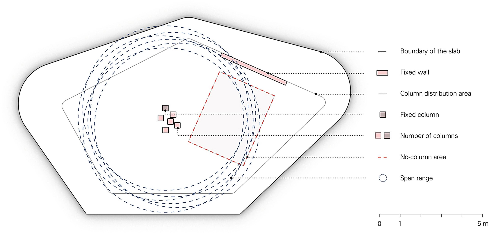
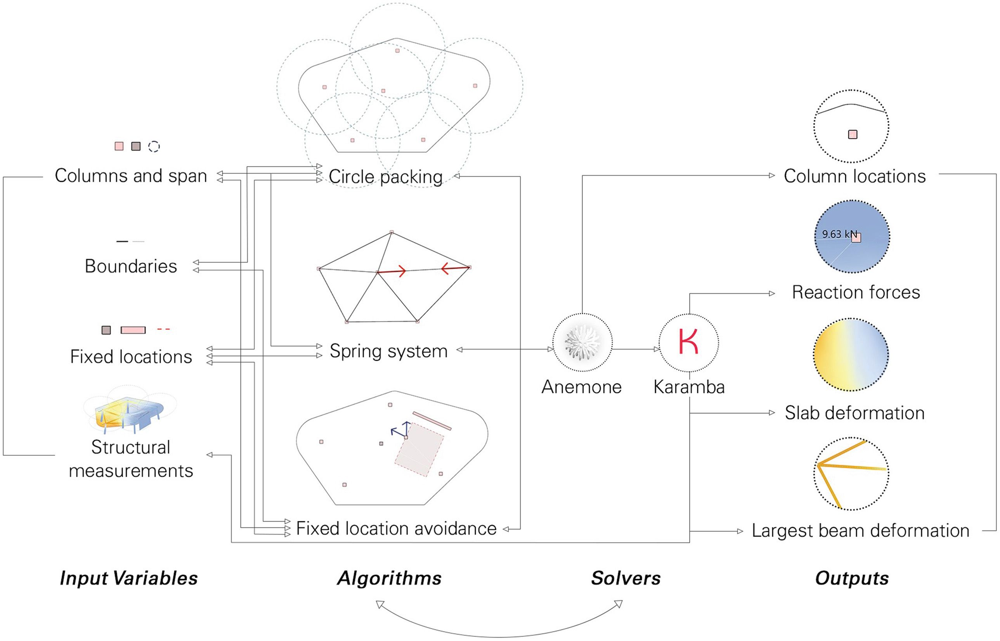
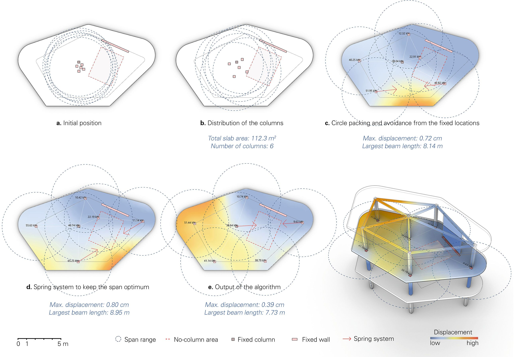
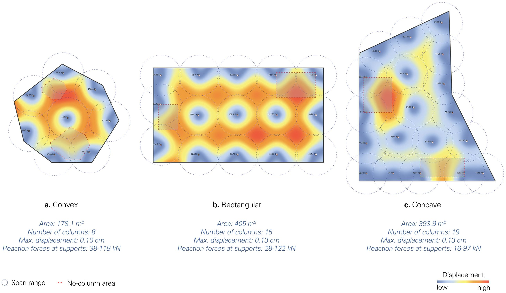
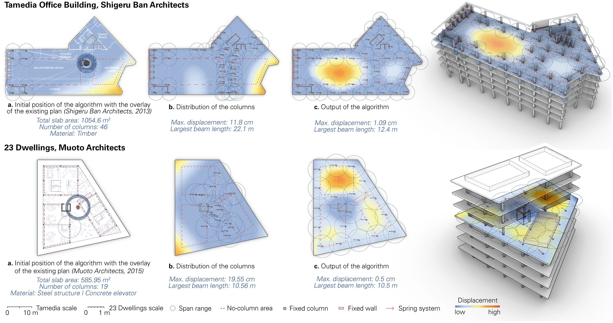

import Video from '@/components/Video.astro'

## Feedback-Based Design Method for Spatially-Informed and Structurally-Performative Column Placement in Multi-Story Construction
Dieses Paper präsentiert eine feedbackbasierte, computergestützte Methode zur Platzierung von Stützen in der frühen Entwurfsphase komplexer Mehrgeschossbauten. Die Methode verbindet einen Circle-Packing-Algorithmus, ein Federsystem und Tragwerkssimulationen in einem einzigen Skript, um Stützen wechselseitig abgestimmt und informationsbasiert im Raum anzuordnen. Sie ermöglicht den Nutzern ein exploratives Vorgehen und erschließt zugleich vielfältige Potenziale im Mehrgeschossbau: zusätzliche auskragende Flächen am Rand, höhere Raumqualitäten durch große Spannweiten, multidirektionale Tragwerksanordnungen und eine Mehrzwecknutzung des Raums. Der entwickelte Algorithmus bietet so Flexibilität: Er nutzt die Entwurfsmöglichkeiten rasterbasierter und unregelmäßiger Stützenanordnungen und fördert die Integration tragwerks- und entwurfsbezogener Randbedingungen in die räumliche Organisation verschiedener Gebäudetypologien.

<Video src="/media/publications/automatic-column-placement/parcticle-spring-system-column-placement.mp4" />

