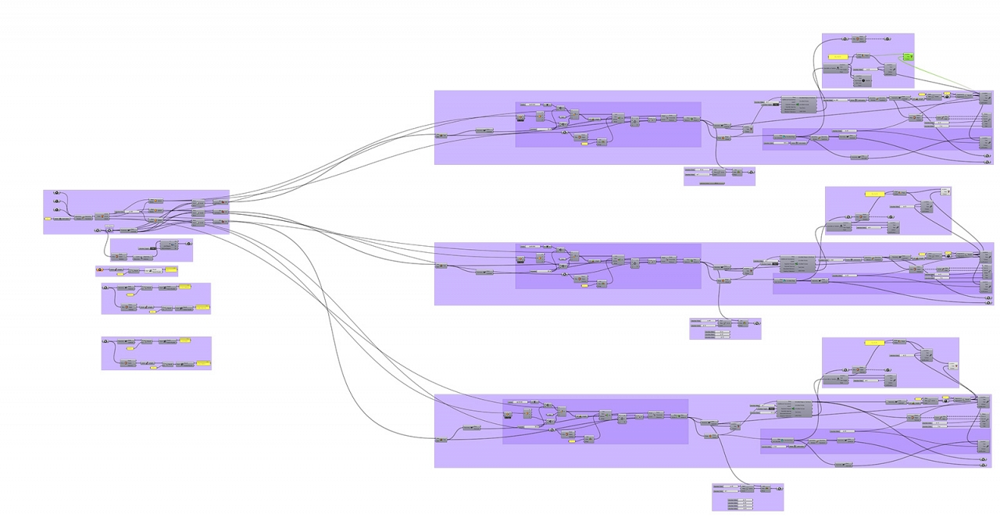
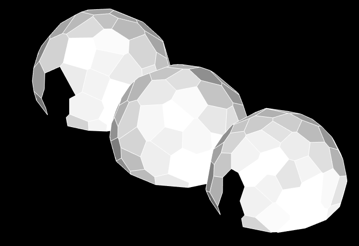
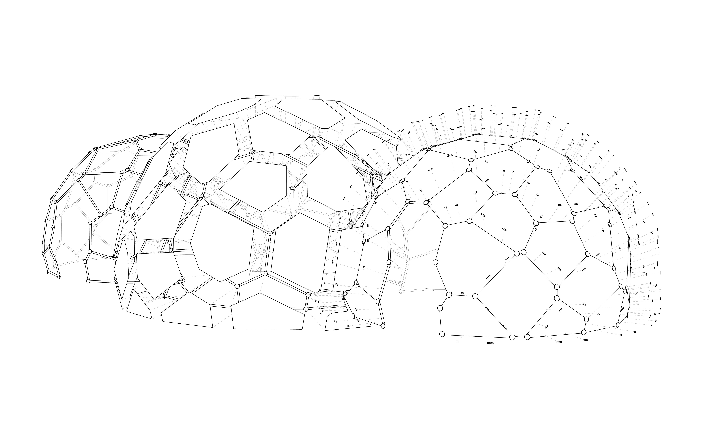
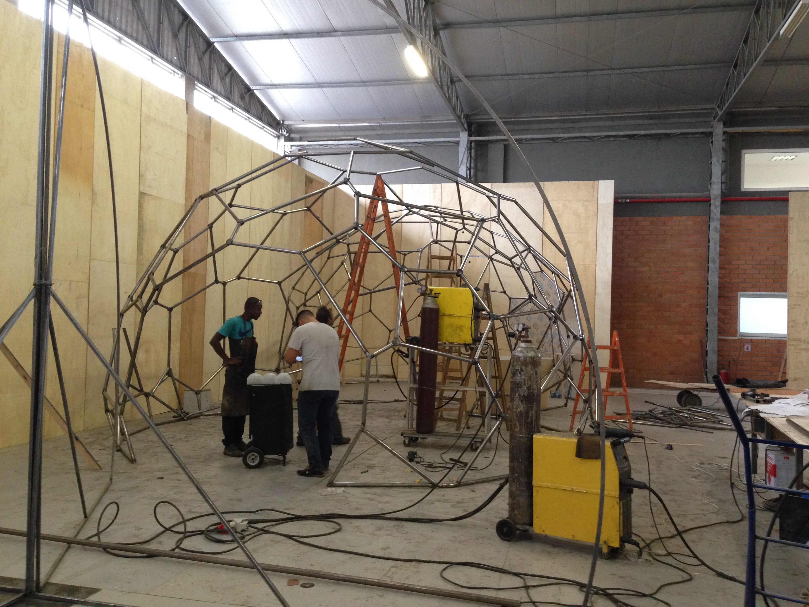
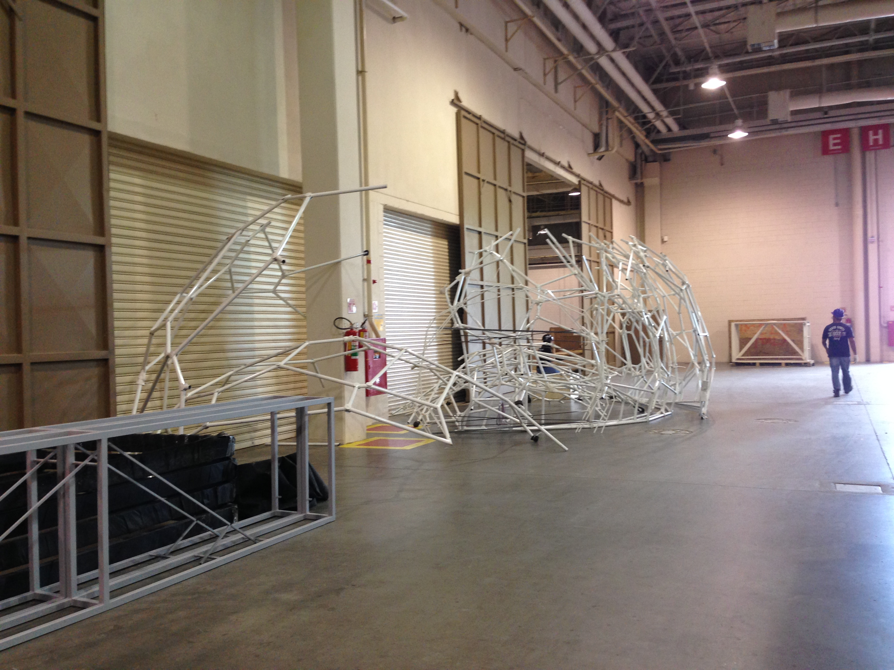
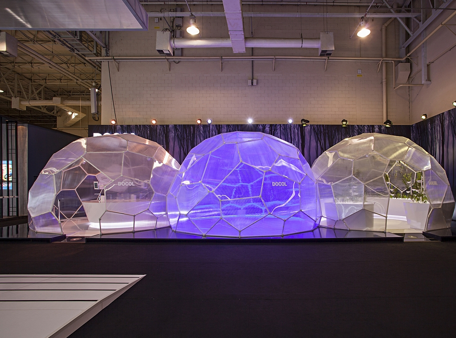
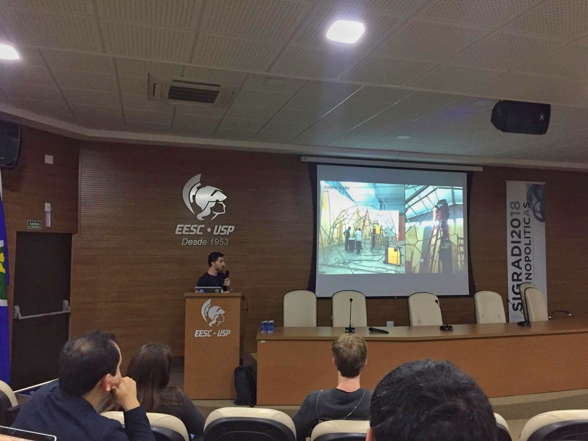
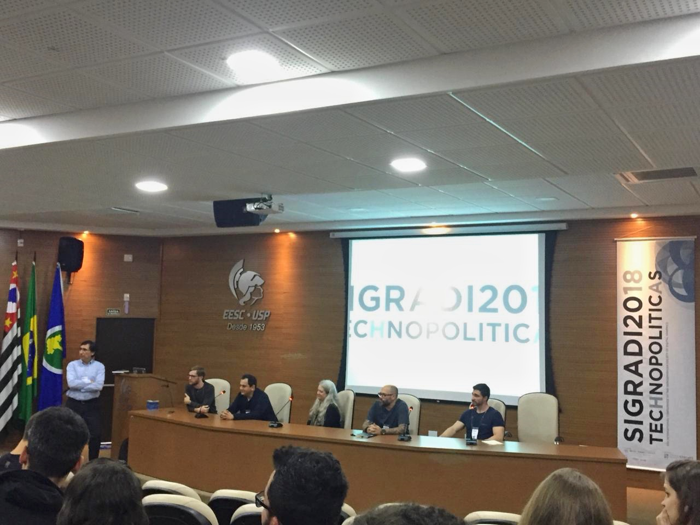

import Video from '@/components/Video.astro'

## Zusammenfassung

Dieses Paper ist aus einer Untersuchung hervorgegangen, die anhand des Konzepts High-Low den Einfluss digitaler Prozesse auf das Design und ihre Bedeutung für Innovationen in der ephemeren Architektur betrachtet. Die ephemere Architektur hat das Potenzial, akademisches und künstlerisches Wissen mit der kommerziellen Produktion in Brasilien zu verbinden. Vorgestellt wird eine experimentelle Fallstudie, die 2017 für Docol zur Expo Revestir entworfen wurde und das Paradigma des Computational Design mit dem akademischen Umfeld und tragfähigen kommerziellen Anwendungen in Einklang bringt.

## Einleitung

Die Art, zu leben und die Welt zu bewohnen, hat sich im Laufe der Geschichte stark gewandelt, da sich Innovationen in der globalisierten Welt mit der lokalen Kultur verbanden. In jüngerer Zeit, nach der Mitte des zwanzigsten Jahrhunderts, veränderte die Bevölkerungsexplosion den städtischen Raum mit neuen Produktionstechnologien, die die aufkommenden Probleme lösen sollten. Als Folge einer globalisierten Welt voller Innovationen lassen sich auch Entwurf und Ausführung von Architektur als Prozesse nennen, die sich durch die verfügbaren Technologien weiterentwickelt haben.

Wie Rivka Oxman[^oxman-2006] in „Theory and Design in the First Digital Age“ darlegt, wurde der klassische Entwurfsprozess früher als Analyse, Synthese, Evaluation und Entscheidung verstanden, während er in einer digital vermittelten Umgebung die Phasen Generierung, Repräsentation, Evaluation und Performance durchläuft. Dieser Wandel des Mediums, in dem entworfen wird, folgt auf große Umbrüche in der Fertigung: die Einführung numerisch gesteuerter Maschinen, die später die gesamte Produktionslinie der Luftfahrt-, Schiffbau- und Automobilindustrie steuern sollten. Wie sich diese Technologien in der Architektur konkret niederschlagen, hängt jedoch von der politischen, sozialen, wirtschaftlichen und kulturellen Realität der jeweiligen Region ab.

Seit den 1950er-Jahren unterstützen Computer die Herstellung komplexer Flugzeugteile. Für Gabriela Carneiro[^carneiro-2014] ist der Computer wie ein Partner des Architekten bei der Formulierung und Generierung von Räumen. „Über die Modellierung der äußeren Erscheinung von Formen hinaus ging es dem Architekten stets darum, das Potenzial des Computers zur Simulation natürlicher Prozesse für die Architektur zu nutzen“ (Carneiro, S. 87)[^carneiro-2014]. Die ersten Generationen von CAD-Software (*Computer Aided Design*), mit denen der Computer in die architektonische Praxis Einzug hielt, nutzten die digitale Umgebung als eine Art elektronisches Zeichenbrett (der Computer unterstützte nicht den kreativen Prozess, sondern diente lediglich als Werkzeug der grafischen Darstellung), wie Araújo[^araujo-2018] feststellte.

Laut Sedrez[^sedrez-martino-2018] wurden komplexe Formen vor der Industrialisierung des Bauens geschätzt, als handwerkliche Methoden die Architektur bestimmten; in der Nachkriegszeit veränderte sich die Fertigung von Architektur jedoch stark, und eben dieser Wandel wurde als eine der Grundlagen der Moderne bezeichnet. In dieser Zeit kamen ideologische Leitlinien auf, die für einfache Formen eintraten (weil diese die Fertigung von Architektur vereinfachten und beschleunigten). Dies war somit ein prägender Faktor, der das Verschwinden komplexer Formen beschleunigte.

Als die Computer leistungsfähiger wurden und Daten schneller und in größerem Umfang verarbeiten konnten, begann die digitale Umgebung, auch Entwurfsprozesse zu unterstützen; dies wurde als *Digital Design* bekannt. Vorreiter wie William Mitchell mit seinem antitektonischen Manifest sowie Rivka und Robert Oxman, die den neuen Strukturalismus vertraten, setzten sich neben mehreren anderen, ebenso bedeutenden Autoren für dieses neue Forschungsgebiet ein. Der neue Strukturalismus kehrte die Reihenfolge des Entwurfsprozesses um: statt von der Form über die Struktur zum Material nun vom Material über die Struktur zur Form.

In diesem neuen Verständnis des digitalen Entwurfsprozesses diente der Computer nicht nur dazu, Zeichnungen zu erstellen, sondern auch dazu, logische Probleme zu lösen, die mit dem Entwerfen verbunden sind. Diese Softwarewerkzeuge für den architektonischen Entwurf eröffneten neue Möglichkeiten: Mit ihnen ließen sich komplexe Formen entwerfen und bauen, deren Entwurf, Herstellung und Montage mit traditionellen Bautechniken bis vor Kurzem schwierig und teuer waren. Über vier industrielle Revolutionen hinweg (die Dampfmaschine, die Massenproduktion, die Mass Customization mit CNC-Maschinen und die Industrie 4.0) hat sich mit den digitalen Technologien eine neue Tradition herausgebildet, die den Entwurf direkt mit der Baustelle verbindet.

Bevor der kreative Prozess in der Architektur digitalisiert wurde, war die Entwurfspraxis sowohl auf die manuelle als auch auf die maschinelle Fertigung ausgerichtet. Mit digitalem Entwurf und digitaler Fertigung, hier definiert als die Herstellung physischer Objekte aus digitalen Modellen (Tramontano)[^tramontano-2016], gewann die Architektur eine hybride Ebene der Materialisierung, die sich nicht der endlosen Wiederholung unterwerfen muss, um die Produktion zu erleichtern. Damit übernimmt man die Idee einer Produktion, bei der die digitale Entwurfsdatei direkt an die Industrie geschickt und dort gefertigt wird; dieses Verfahren ist als *File-to-Factory* bekannt (Tramontano; Soares)[^tramontano-soares-2012]. In diesem Rahmen wird jede handwerkliche Technik mithilfe von Prozessoren und Maschinen neu gedacht, um die Formgebung zu optimieren und ihre Möglichkeiten zu erweitern. So erreicht die digitale Fertigung ein extrem hohes Maß an Formdefinition, das die menschlichen Fähigkeiten weit übertrifft, wenn es um komplexe Geometrien geht, die präzise in Serie gefertigt werden.

Andererseits ist die Architekturausbildung in Brasilien sehr breit angelegt und eröffnet ein weites Tätigkeitsfeld. Der Hochbau, einer ihrer Schwerpunkte, ist von langen Ausführungszeiten geprägt und wenig offen dafür, neue Techniken und Entwurfsmethoden zu erkunden und zu erproben. Gegenwärtig gibt es jedoch „eine langsame, aber unumkehrbare Veränderung in den Produktionsprozessen des Bauens, die aus der Expansion industrieller Prozesse resultiert, nun verstärkt durch das Aufkommen der Computerisierung“ (Tramontano, S. 01)[^tramontano-2016]. Technologie wurde stets autonom und isoliert gedacht, als Avantgarde von Zukünften und offensichtlichen Lösungen für Probleme, die wir noch nicht kennen. In diesem Umfeld gelingt es der ephemeren Architektur daher, digitale Entwurfsmethoden aufzunehmen, weil sie in der Regel Einzelstücke hervorbringt, die im Vergleich zum traditionellen Bauen sehr komplex sind. Außerdem sind die Zeiträume für Planung und Bau in diesem Bereich mit einem bis sechs Monaten tendenziell kürzer, und die Budgets sind hoch. Bei einem typischen Projekt ephemerer Architektur für Veranstaltungen stehen wegen der kurzen Frist und der hohen Kosten alle Entwicklungsphasen unter Effizienzdruck. Damit erweist sich dieser Bereich als von Natur aus fruchtbares Feld für die Entwicklung und Anwendung digitaler Entwurfs- und Fertigungsmethoden.

## High-Low

Laut SUBdV[^subdv-2017] verbindet der Begriff *High-Low* zwei Konzepte: *High* steht für die Technologie, mit der Architektur computergestützt generiert wird, und *Low* für die dabei erzeugten Anleitungen, mit denen ungelernte Arbeitskräfte mithilfe digitaler Fertigung bauen können. In einem ihrer Projekte, CoBLOgó, wurden beispielsweise Positionierschablonen für die Bauteile aus einem parametrischen Skript exportiert. Diese Schablonen wurden per Laser aus Karton geschnitten und auf ein Regal gesetzt, das ebenfalls digital mit einer CNC-Fräse gefertigt war; der Polier musste dann nur noch die Blöcke an die Schablonen setzen und für die strukturelle Stabilität Bewehrungsstäbe dazwischenlegen. Kurz gesagt: Dieses Vorgehen, das parametrisches Design und digitale Fertigung mit einfachen Bautechniken und lokalen Materialien auf der Baustelle verbindet, veranschaulicht, was mit High-Low gemeint ist (SUBdV)[^subdv-2017]. Dieser Kunstgriff, der Hightech (parametrische Computation und digitale Fertigung) mit Lowtech-Bauweisen und günstigen lokalen Materialien kombiniert, kann eine neue brasilianische Identität im digitalen Design schaffen und so der zunehmend allgegenwärtigen, generischen Tendenz der zeitgenössischen parametrischen Ästhetik entkommen (SUBdV, zit. nach Rojas)[^rojas-2017].

Folgt man Anne Save de Beaurecueil[^celani-sedrez-responsiva], so ist die geringe Zahl der Universitäten, die mit digitaler Fertigung und parametrischer Architektur arbeiten, eines der Probleme der Architekturausbildung in Brasilien, das den Rückstand bei der Industrialisierung eines präzisen Bauens verursacht. „Wenn Architekten keine neuen Techniken verwenden, werden sie die Bauindustrie nicht unter Druck setzen, sich zu verändern. [...] also denke ich, dass man, um wirklich im Bauwesen voranzukommen, bei den Studierenden beginnen muss, denn sie werden die Industrie unter Druck setzen, sie werden die Industrie inspirieren“ (Celani, Sedrez)[^celani-2013]. High-Low ist somit ein Weg zur Innovation, der nicht nur wiederholt, was auf der internationalen Bühne geschieht, sondern brasilianische Architektur und Kultur mit der neuen Technologie aus dem Ausland verbindet.

## Fallstudie: Docol-Pavillon 2017

### Konzeptentwurf

In der ersten Phase, dem Konzeptentwurf, wurden die Produktneuheiten des Unternehmens und ihre Marktpositionierung untersucht. So entstand die Idee, die neue Serie von Ozonarmaturen mit dem Konzept zu verknüpfen. Mit Wasser gemischt, wirkt Ozon hygienisch: Es bekämpft etwa Mikroorganismen und beseitigt starke Gerüche, ohne dabei die Umwelt zu schädigen. Daraufhin wurde festgelegt, dass die endgültige Struktur des Docol-Pavillons auf das Ozonmolekül verweisen sollte, also auf drei miteinander verbundene Sauerstoffatome. Die endgültige Form sollte demnach aus drei sich durchdringenden Kuppeln bestehen und die Hülle aus Polycarbonat-Stegplatten; die Kuppeln sollten ein Voronoi-Diagramm nachbilden, das heißt, die Oberflächen dieser drei Kuppeln sollten mit Voronoi-Zellen „überzogen“ sein. Das Konzept ist somit das Ergebnis des Dialogs zwischen einer Idee, die an die Marke anknüpft, und einem effizienten Konstruktionssystem.

Erreicht wurde dieses Ergebnis in einem nichtlinearen Entwurfsprozess, der mehrere Iterationen bis zum Endprodukt durchlief. Das heißt, verschiedene Einflussfaktoren wurden untersucht und durch die Rückmeldungen aus mehreren Zwischentests schrittweise miteinander verknüpft. Im Atelier Marko Brajovic geht man davon aus, dass es im Entwurfsprozess „keine Rolle spielt, ob man von oben nach unten oder von unten nach oben beginnt. Wenn man den gesamten Zyklus durchläuft, muss er beide Ansätze kombinieren“ (Wallisser, 2018, S. 198 bis 205). Dadurch ist die Hierarchie der Geometrien hier klar, und sie kann sich je nach den Anforderungen der nächsten Phase ändern.

<Video autoplay src="/media/publications/high-low-as-expression-of-the-brazilian-digital-fabrication/o3-pavilion-kangaroo-relaxation-upscaled.mp4" caption="Parametrisches Modell nach Kangaroo-Relaxation" />

### Generatives System

Nachdem das Konzept feststand, ging es in dieser Phase darum, einen realisierbaren Entwurf zu generieren, der den Anforderungen des Kunden entsprach. Grundlegend dafür waren die Software Rhinoceros und ihr Plugin für visuelle Programmierung, Grasshopper[^tedeschi-2014]. Die Modellierung begann mit drei parametrisierten Halbkugeln, die durch das für die Veranstaltung vorgesehene Volumen begrenzt waren und sich teilweise überlappten; über Parameter ließen sich unter anderem der Radius, der Abstand der Kugeln zum Boden und die Position jeder Kugel ändern.

Für die Entwicklung der Hülle wurden die Halbkugeln mit einem 3D-Voronoi-Muster verschnitten. Dies erzeugte ein gekrümmtes Voronoi-Muster, das der Form der drei Halbkugeln folgte. Für den nächsten Schritt musste dieses Voronoi-Muster planarisiert werden, um ebene Platten zu erhalten, die exakt zusammenpassten und für den Laserschnitt bereit waren. Dazu diente das Grasshopper-Plugin Kangaroo[^piker-2013], das mit dem Verfahren der dynamischen Relaxation die erforderlichen Abmessungen jeder Kuppelkante berechnet, sodass alle Voronoi-Zellen planar wurden.

Dabei zeigte sich jedoch, dass die Kanten dort, wo sich die Kugeln durchdringen, dieselbe Größe und Lage behalten müssen, ohne dass die Form ihren fließenden Charakter oder das Voronoi-Muster verliert. Der Algorithmus wurde daher so angelegt, dass die Kanten an den Durchdringungen beim Planarisieren der Zellen gezwungen wurden, sich einander anzugleichen.

Aus dieser Basisgeometrie wurden die dreidimensionalen Elemente erstellt. Die Platten erhielten eine Dicke, die Stäbe einen Durchmesser. Außerdem ließen sich Verbindungselemente entwerfen, die digital gefertigt werden konnten, etwa im 3D-Druck.

<Video autoplay src="/media/publications/high-low-as-expression-of-the-brazilian-digital-fabrication/o3-pavilion-assembly-sequence-padded.mp4" caption="Montagesequenz der Paneele" />

### Fertigung

Die dritte Phase war der eigentliche Bau des Projekts. In dieser Phase wurde ein weiteres Unternehmen beauftragt: Paleta Stands mit Sitz in Joinville, Santa Catarina. Das Unternehmen übernahm Prototypenbau und Fertigung des Pavillons; damit ging die Kontrolle über den Fertigungsprozess verloren, wie er bei der Programmierung und der Konsolidierung der Geometrie im digitalen Entwurf vorgesehen war. Es verfügte über die gesamte Dokumentation und alle Dateien, die nötig waren, um den Pavillon ausschließlich mit digitalen Fertigungsmethoden herzustellen. Die mitgelieferten Anweisungen ließen ihm jedoch viel Spielraum, das Projekt unter Berücksichtigung der verfügbaren Technik, der Kosten und der Arbeitskräfte bestmöglich umzusetzen.

Bei Ortsterminen, mit denen die Umsetzung begleitet wurde, zeigte sich, dass im Fertigungsprozess eine Vielzahl von Methoden kombiniert worden war. Die Polycarbonat-Stegplatten wurden mit Laserschneidmaschinen zugeschnitten, die hohe Präzision und eine hochwertige Oberfläche garantierten.

Mit dem Metallskelett wurde ein Team traditioneller Metallbauer beauftragt, die es nicht gewohnt waren, ein formal so komplexes Projekt herzustellen. Sie erhielten lediglich die Abmessungen der Metallstäbe und perspektivische Zeichnungen, in denen die Stäbe entsprechend beschriftet waren. Die Metallbauer begannen damit, die Teile der Basis zu verschweißen, die im Gesamtgrundriss genau angegeben waren; für die folgenden Stäbe fehlten ihnen jedoch räumliche Bezugspunkte, an denen sie sich beim Schweißen hätten orientieren können. So wurde daraus eine enorm aufwendige Arbeit nach dem Prinzip Versuch und Irrtum, denn beim Schweißen stellten sie fest, dass die jeweils nächsten Stäbe auf der Liste nicht genau so passten, wie es die Zeichnungen vorsahen. Die vorherigen Teile mussten dann wieder aufgesägt und neu angeordnet werden, damit die nächsten an den vorgesehenen Stellen passten. Erst als wir den Metallbauern bei einem der Ortstermine ein physisches Modell im Maßstab 1:10 zeigten, verstanden sie das Projekt besser.

Dieses Vorgehen, das einem Puzzle glich, führte schließlich zu Verzerrungen der Voronoi-Zellen, die in der Entwurfsphase planarisiert worden waren. Am Ende war jede Zelle doppelt gekrümmt, was die Biegsamkeit der Polycarbonat-Stegplatten ausglich. Dadurch entstanden auf der Hülle verzerrte Spiegelungen, die auf dem Foto des fertigen Pavillons weiter unten zu erkennen sind. Dieses ästhetische Ergebnis war ursprünglich nicht vorgesehen, wurde aber als natürlicher Aspekt dieser Art handwerklicher Fertigung aufgenommen und akzeptiert.

Zu den Unregelmäßigkeiten, die das Schweißen auf der Hülle hinterließ, kam hinzu, dass der Pavillon segmentiert werden musste, damit er in einem Lkw mit maximalen Abmessungen von 8,5 m × 2,4 m × 2,5 m (Länge, Breite und Höhe) transportiert werden konnte. Dadurch entstanden im weiteren Verlauf noch einige kleine Ungenauigkeiten, aber nichts, was das Endergebnis wirklich beeinträchtigt hätte.

## Fazit

Architekten erleben einen radikalen Wandel in der Art, wie Gebäude entworfen und gefertigt werden. Die Frage ist nicht mehr, ob der Berufsstand diese neuen Technologien übernimmt oder nicht, sondern wie wir sie einbinden und nutzen können, ohne die verfügbaren traditionellen Methoden zu ignorieren. So wie Gaudí physische Modelle nutzte, um sich mit seinen Handwerkern zu verständigen, erwies sich in dieser Studie der didaktische Ansatz, traditionellen Metallbauern die digitale Umgebung näherzubringen, als sehr nützlich.

Das Entwerfen mit einem generativen System bot in dieser Fallstudie große Flexibilität, sowohl bei Entscheidungen als auch beim Ändern der Abmessungen jeder Kuppel und jeder Voronoi-Zelle mit nur wenigen Klicks. Das bedeutet, dass die Dokumentation automatisch aktualisiert wurde: Form und Abmessungen jeder Polycarbonatplatte, die Länge jedes Metallstabs und die Lage der Fußpunkte auf dem Boden wurden dynamisch erzeugt, ohne manuelle Nacharbeit.

Schließlich wird deutlich, dass Architekten nach innovativen Lösungen dafür suchen müssen, wie Architektur gemacht wird. Denn diese Nachfrage entscheidet darüber, ob es Zulieferer und Arbeitskräfte mit dem nötigen Wissen geben wird, um die Architektur in Brasilien über ihren heutigen Stand hinauszubringen.

### Literaturverzeichnis

[^oxman-2006]: OXMAN, Rivka (2006) "Theory and Design in the First Digital Age" Design Studies, Vol. 27 No. 3 pp. 229 - 265.

[^carneiro-2014]: CARNEIRO, Gabriela. Arquitetura interativa: contextos, fundamentos e design. 2014. Tese (Doutorado em Design e Arquitetura) - Faculdade de Arquitetura e Urbanismo, Universidade de São Paulo, São Paulo, 2014.

[^araujo-2018]: ARAÚJO, A. L. Autômatos celulares: Definição e aplicações na arquitetura. In: CELANI, M. G. C.; SEDREZ, M. (Orgs.). Arquitetura contemporânea e automação: prática e reflexão. São Paulo: ProBooks, 2018. P. 68 a 84.

[^sedrez-martino-2018]: SEDREZ, M. e MARTINO, J. A. Sistemas Generativos. In: CELANI, M. G. C.; SEDREZ, M. (Orgs.). Arquitetura contemporânea e automação: prática e reflexão. São Paulo: ProBooks, 2018. P. 55 a 68.

[^tramontano-2016]: TRAMONTANO, Marcelo. Quando pesquisa e ensino se conectam. Design paramétrico, fabricação digital e projeto de arquitetura. Arquitextos, São Paulo, ano 16, n. 190.01, Vitruvius, mar. 2016. Disponível em: [https://doi.org/10.5151/despro-sigradi2015-100144](https://doi.org/10.5151/despro-sigradi2015-100144). Acesso em: 21 jun. 2016.

[^tramontano-soares-2012]: TRAMONTANO, Marcelo; SOARES, João Paulo. Arquitetura emergente, design paramétricos e o representar através de modelos de informação. V!RUS, São Carlos, n. 8, dez. 2012. Disponível em: [https://revistas.usp.br/virus/en/article/view/228727](https://revistas.usp.br/virus/en/article/view/228727). Acesso em: 26 jul. 2016.

[^subdv-2017]: SUBdV. "CoBLOgó / SUBdV" 26 Jun 2017. ArchDaily Brasil. Disponível em: [https://www.archdaily.com.br/br/874036/coblogo-subdv](https://www.archdaily.com.br/br/874036/coblogo-subdv) ISSN 0719-8906. Acesso 16 Jun. 2018.

[^rojas-2017]: ROJAS, Cristobal. "CoBLOgó / SUBdV" 5 Ago. 2017. Download CAD Blocks, Drawings, Details, 3D, PSD Blocks. Disponível em: [https://www.caddownloadweb.com/coblogo-subdv/](https://www.caddownloadweb.com/coblogo-subdv/). Acesso em 23 Jun. 2018.

[^celani-2013]: CELANI, Gabriela; SEDREZ, Maycon. Entrevista com Anne Save de Beaurecueil. Entrevista, São Paulo, ano 14, n. 055.01, Vitruvius, jul. 2013. Disponível em: [http://www.vitruvius.com.br/revistas/read/entrevista/14.055/4776](http://www.vitruvius.com.br/revistas/read/entrevista/14.055/4776).

[^celani-sedrez-responsiva]: CELANI, M. G. C.; SEDREZ, M. Arquitetura responsiva. Entrevista com Anne Save de Beaurecueil. In: CELANI, M. G. C.; SEDREZ, M. (Organizadores). Arquitetura contemporânea e automação: prática e reflexão. São Paulo: ProBooks, 2018. p. 174 a 181.

[^tedeschi-2014]: TEDESCHI, A. AAD\_Algorithms-Aided Design: Parametric Strategies using Grasshopper, Italy: Le Penseur, 2014.

[^piker-2013]: PIKER, Daniel. Kangaroo: Form finding with computational physics. Architectural Design, 2013; 83(2); 136-137.
