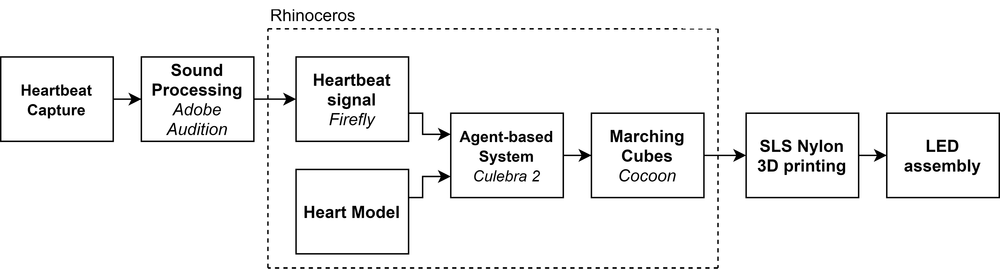
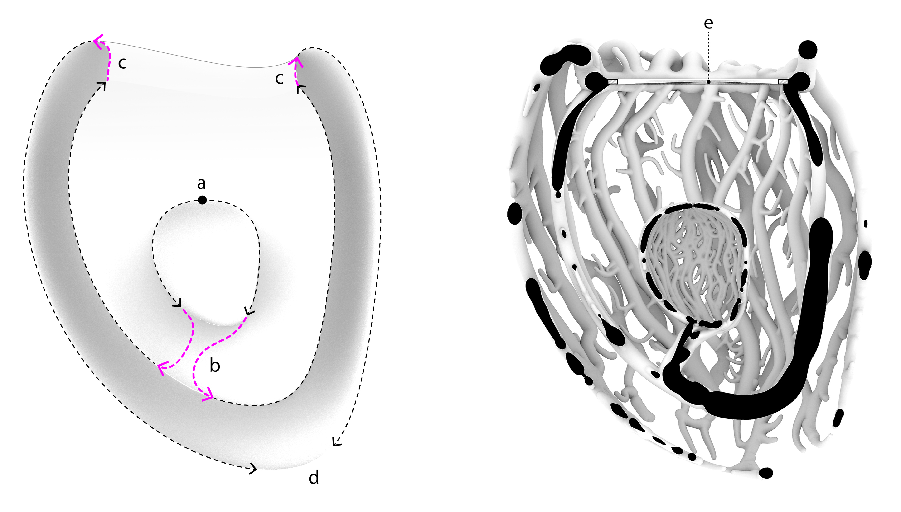

import Video from '@/components/Video.astro'

Life Lamp war zugleich ein Projekt und ein Forschungsvorhaben. Als Freiberufler arbeitete ich nachmittags mit dem Estúdio Guto Requena zusammen und trug zur computergestützten Strategie bei, mit der das bereits feststehende Konzept umgesetzt wurde. Der Designprozess verbindet Top-down- und Bottom-up-Ansätze. Wir arbeiteten sowohl mit vordefinierten herzförmigen 3D-Modellen als Designgrundlage als auch mit agentenbasierter Modellierung, die in den 1980er Jahren von Craig Reynolds umfassend erforscht wurde.

Programmiert wurde in Grasshopper 3D, mit dem damals erst zwei Wochen alten Plugin Culebra v2.0 für die agentenbasierte Modellierung und dem Plugin Firefly zur Erfassung der Herzschläge. Diese Arbeit wurde später als Paper auf der eCAADe 2020 vorgestellt: [Connecting Design and People Through Emotion](http://papers.cumincad.org/data/works/att/ecaade2020_389.pdf)

Heute lassen sich mit Technologie emotionsorientierte Produkte schaffen, die an die Nutzererfahrung anknüpfen. Ziel dieses Papers ist es, eine Entwurfsstudie vorzustellen, die algorithmische Modellierung nutzt, um ein Design zu schaffen, das durch emotionale Bindungen zu Menschen Bedeutung ausdrücken soll. Life Lamp wurde geschaffen, um einen Lebenszyklus als sinnlich erfahrbares Objekt darzustellen. Es besteht aus drei Schichten, deren einzigartiger Schatten ein komplexes Bild erzeugt und die Wege und Überraschungen unserer Existenz ausdrückt. Die Designer arbeiteten sowohl mit einem vordefinierten herzförmigen 3D-Modell als Designgrundlage als auch mit agentenbasierter Modellierung, die in den 1980er Jahren von Craig Reynolds umfassend erforscht wurde. Life Lamp ist ein Produkt, das aus der Forschung des Estúdio Guto Requena hervorging; diese untersucht mit den Mitteln des Designs den Einfluss der digitalen Kultur und will dabei Technologie und Zuneigung verbinden.

<Video src="/media/publications/life-lamp-connecting-design-and-people-through-emotion/life-lamp-animation-01.mp4" caption="Agenten erzeugen die Struktur anhand des Herzschlags eines Ungeborenen." />

<Video src="/media/publications/life-lamp-connecting-design-and-people-through-emotion/life-lamp-animation-02.mp4" caption="Zwischenschritt: Verbindung der Form des Ungeborenen mit der Form des Erwachsenen." />

<Video src="/media/publications/life-lamp-connecting-design-and-people-through-emotion/life-lamp-animation-03.mp4" caption="Agenten erzeugen die Struktur anhand des Herzschlags eines Erwachsenen." />

