## Resumo

Este artigo investiga como ferramentas digitais podem apoiar o projeto e a fabricação de tramas têxteis, combinando a busca da forma (form finding) com a técnica tradicional de renda de bilro. O trabalho explora como um método artesanal tradicional poderia levar a uma nova abordagem de design paramétrico e generativo, aliada às tecnologias de fabricação digital. A investigação se baseia em diversos estudos de caso de arquitetos renomados cuja obra se inspira na natureza, como Buckminster Fuller e Frei Otto. Nesses estudos de caso, buscamos fazer a engenharia reversa dessas obras com uma linguagem de programação visual popular, acessível à maioria dos profissionais. Considerando a crescente importância dos processos digitais no design devido aos seus resultados rápidos e otimizados, é imperativo que os arquitetos se adaptem a esse novo fluxo de trabalho. Esta é uma tentativa de mostrar como o design computacional pode incorporar um tema tradicional e inesperado com grande controle espacial. É também uma introdução ao processo de relaxação dinâmica e uma possível aplicação de um algoritmo evolutivo em arquitetura e design. Por fim, o algoritmo desenvolvido foi utilizado para propor um protótipo de cadeira tipo rede.

## Introdução

Por muitas décadas, o desenvolvimento urbano tem utilizado recursos naturais de tal forma que não será possível continuar sustentando esses excessos por muito tempo (Fry [4]). Segundo estimativas de Fernandes [3], por exemplo, só a construção civil no Brasil produz cerca de 50 a 70% de toda a massa de resíduos sólidos urbanos do país.

Como observam Kieran e Timberlake [5] no livro *Refabricating Architecture*, a arquitetura ainda hoje é feita de modo muito semelhante ao de períodos anteriores. Segundo esses autores, isso acontece porque projetar e construir um edifício ainda leva muitos anos. Além disso, a construção ainda demanda uma enorme quantidade de materiais, o que pode levar ao esgotamento de recursos.

Esses autores afirmam que os arquitetos capazes de compreender esse contexto o comparam com os avanços no projeto e na fabricação de automóveis, aviões e embarcações. Nesses campos existem enormes possibilidades de novos materiais e processos nos quais o desperdício, o custo e o tempo de fabricação diminuem ao mesmo tempo que a qualidade melhora.

A arquitetura algorítmica é uma área em pleno desenvolvimento que tenta suprir essa carência de tecnologia na indústria de arquitetura, engenharia e construção (AEC). Tradicionalmente, a palavra algoritmo se refere ao processo de lidar com um problema seguindo um número finito de passos. Contudo, nos dias de hoje, um algoritmo pode ser entendido como o mediador entre a mente humana e o poder de processamento do computador (Terzidis [9]).

Neste artigo, propomos uma instalação na Faculdade de Arquitetura e Urbanismo da Universidade de São Paulo, utilizando métodos de design computacional. Para tornar a instalação viável, adotamos um programa de necessidades simples, que permitisse criar e aprimorar diversos algoritmos ao longo da pesquisa.

A bibliografia foi selecionada de forma a permitir uma visão geral dos estudos mais recentes em tecnologia de design computacional. Após pesquisar precedentes, percebemos que a maioria dos projetos tinha a biomimética em comum. Por isso, este estudo adota essa abordagem e parte da mesma base filosófica e lógica de arquitetos renomados: Achim Menges, Buckminster Fuller, Frei Otto e Tomas Saraceno.

Buckminster Fuller e Frei Otto foram especialmente importantes para este estudo. Buckminster, com seus estudos de geometria sinergética, explorou o potencial da otimização no design, o que resultou em invenções como a cúpula geodésica e a Transformação Jitterbug, que "fazem o máximo com o mínimo" (Krausse e Lichtenstein [6]). Frei Otto, por sua vez, produziu seus famosos modelos experimentais de busca da forma, que exploravam as propriedades físicas de películas de sabão, borracha e estruturas tensionadas (Barthel [1]).

import ImageRow from '@/components/ImageRow.astro'

## Arquitetura e biomimética

<ImageRow>
  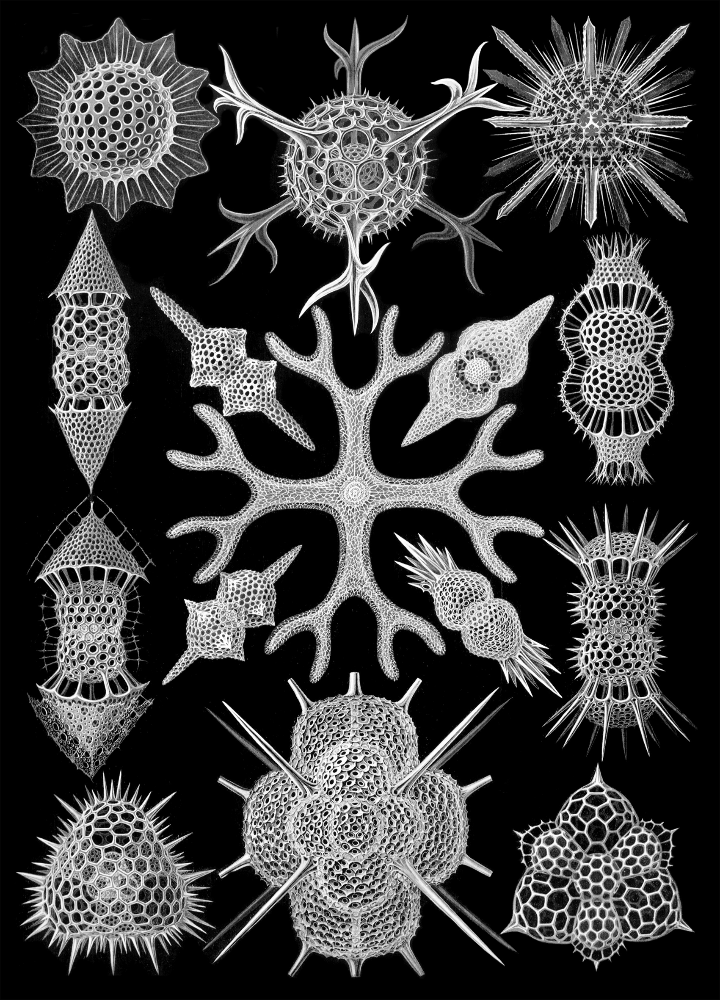

  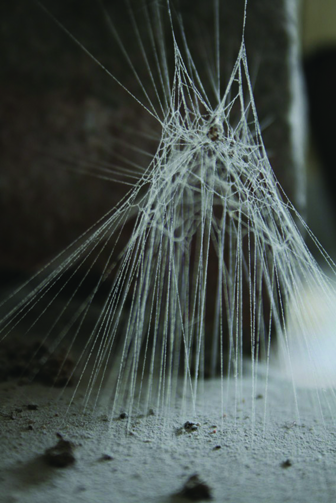
</ImageRow>

Segundo Benyus [2], a biomimética utiliza a natureza como principal diretriz de projeto e pode ser dividida em três níveis. O primeiro, mais superficial, é uma tentativa de simplesmente imitar formas e padrões da natureza, independentemente do método utilizado. O segundo nível explora os caminhos que a natureza percorre até atingir seu resultado final, o processo. E o terceiro e mais amplo nível é imitar ecossistemas naturais, compreendendo que todos os indivíduos e elementos compõem uma única biosfera sustentável, interconectada e interdependente.

Na natureza, estruturas que parecem simples, como teias de aranha, colmeias e cupinzeiros, são determinadas pelo DNA do animal que as constrói, ou seja, pela sua informação genética. Entretanto, mesmo nos casos em que há uma identidade formal claramente definida, cada estrutura ainda precisa se adaptar ao ambiente imediato em que é construída: nenhuma teia de aranha é exatamente igual a outra, por exemplo (Kull [7]).

A arquitetura algorítmica funciona de maneira semelhante e também explora esses mecanismos naturais, mas em vez de partir da informação genética, o projeto é determinado por um algoritmo. Em resumo, um algoritmo completo teria todas as informações necessárias para a execução de uma construção, incluindo diversas alterações exigidas de acordo com cada programa de necessidades.

## O programa de necessidades

<ImageRow>
  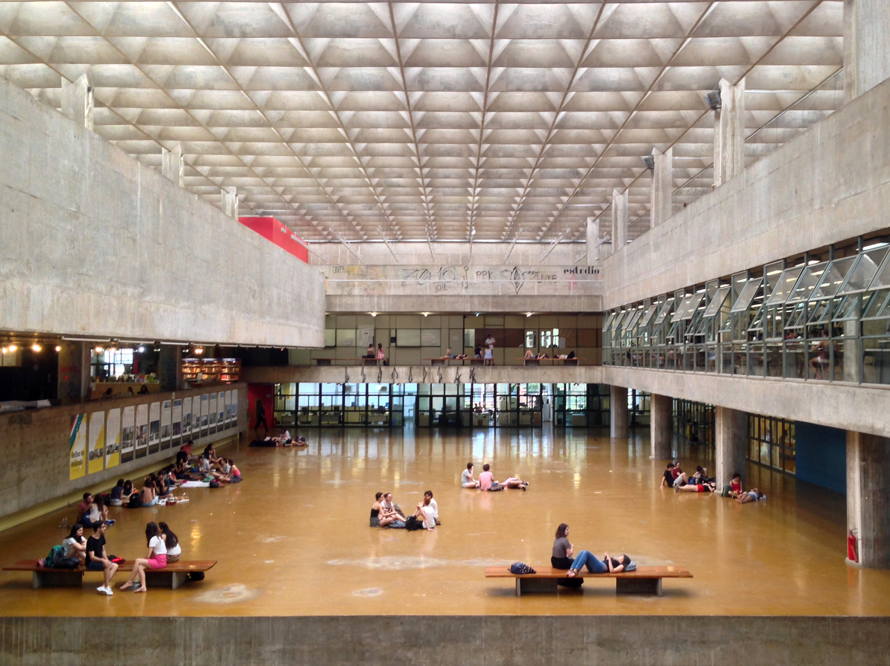

  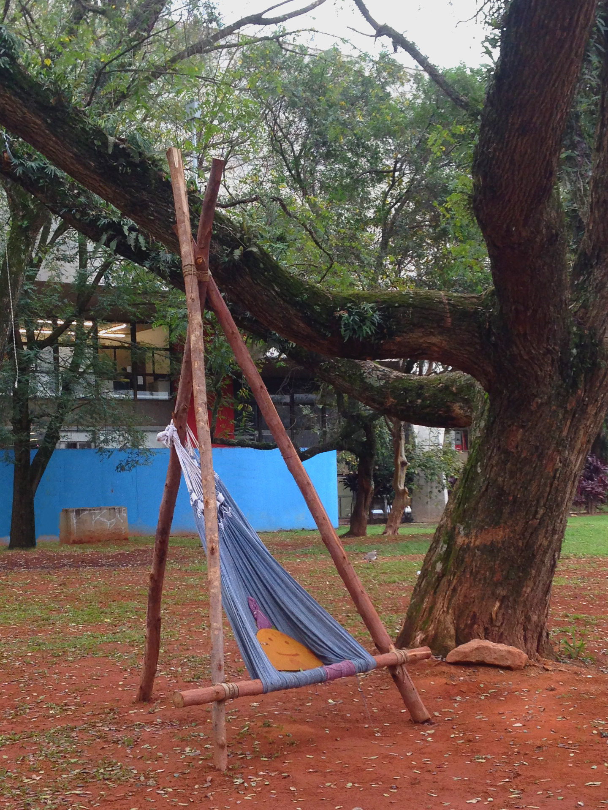
</ImageRow>

Na exploração dos espaços da FAU-USP, ficou evidente que faltavam espaços de convivência estudantil. Além disso, a pesquisa mostra que os estudantes têm o hábito de instalar redes pelo edifício para suprir essa necessidade. A ideia de subverter a maneira como as redes são projetadas mostrou grande potencial no campo da busca da forma. Ao combinar design computacional com um método tradicional de tecelagem, o projeto tomou o rumo de um novo sistema de design.

Contudo, antes de iniciar o estudo, era importante determinar uma estratégia:

### Biomimética
O projeto deve ter uma abordagem inspirada na natureza e se enquadrar ao menos no segundo nível da biomimética (processos).

### Conforto
O resultado final deve ter um material confortável e permitir variações para que os usuários possam permanecer em diversas posições: sentado, recostado e deitado.

### Fabricabilidade
É essencial que o projeto utilize as máquinas e ferramentas existentes e disponíveis na FAU-USP.

### Identidade
O resultado final deve fazer referência ao logotipo da FAU-USP, para associar o logotipo a outra forma de pensar, além da visão modernista estabelecida.

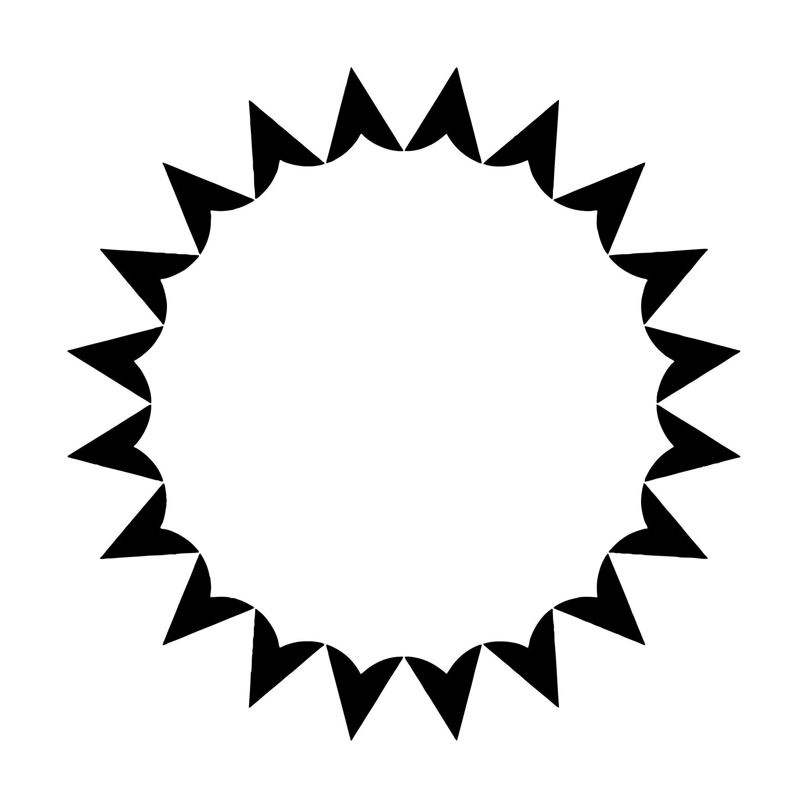

### Localização
A área proposta consiste em um quadrado de 12 metros de lado (144 m²) coberto por gramado, localizado entre o edifício principal da FAU-USP e o Laboratório de Modelos e Ensaios (LAME).

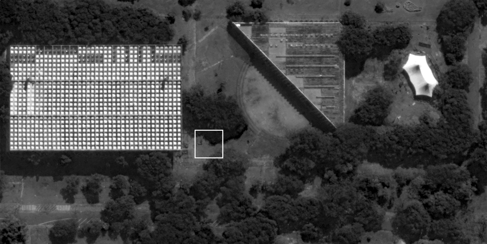

### Otimização
O projeto deve considerar a otimização da forma e da estrutura.

### Respeito ao patrimônio histórico
Esta instalação deve ser temporária, uma vez que a FAU-USP é um edifício tombado e, portanto, não permite nenhum tipo de intervenção permanente.

## Técnica

O principal software utilizado para desenvolver este estudo foi o Rhinoceros 3D e seu plugin Grasshopper. Também foram essenciais plugins para o Grasshopper, como Kangaroo Physics, Lunchbox, Starling e Weaverbird. O Galapagos, um algoritmo baseado na teoria da evolução de Darwin, é muito usado e, ao contrário desses plugins, já vem integrado ao Grasshopper.

O algoritmo final desenvolvido visa manipular um padrão de malha predeterminado. Neste caso, para o estudo técnico, foram usados um quadro cúbico e uma malha esférica.

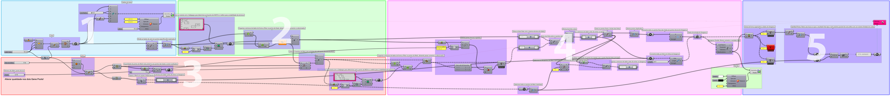

O algoritmo funciona em cinco etapas. A primeira cria um quadro cúbico de 1 metro de aresta e divide todas as arestas em 116 pontos equidistantes.

A segunda etapa seleciona de 1 a 40 vértices-âncora entre os 116 vértices iniciais do quadro cúbico. Esse processo de seleção é guiado pelo Galapagos e será descrito na última etapa.

Na terceira etapa, criamos uma esfera de 0,80 metro de diâmetro e refinamos sua malha até chegar a um padrão predeterminado. Para cada vértice-âncora selecionado na etapa anterior, existem 16 possibilidades de conexão à malha da esfera por cabos. Dessas 16 opções, o Galapagos escolhe apenas um cabo para cada vértice-âncora.

Na quarta etapa, com a estrutura preparada, o simulador físico Kangaroo pode finalmente ser ativado. Desta forma, as linhas e a malha da esfera são convertidas em cabos elásticos. Com a resistência dos cabos ajustada, é possível tornar o sistema estável. Em seguida, são calculadas as distâncias vetoriais entre os vértices originais da esfera estática e os vértices da esfera "relaxada".

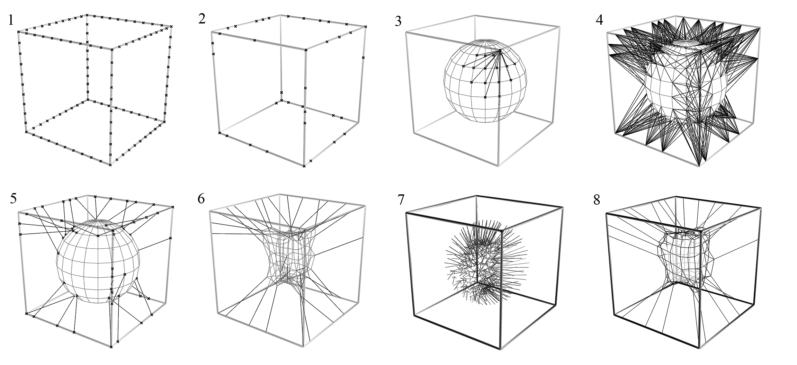

A quinta etapa utiliza o Galapagos. Esse algoritmo começa gerando 50 possíveis resultados aleatórios, ou seja, 50 indivíduos baseados no pool gênico, que neste caso são os 116 vértices encontrados ao longo do quadro cúbico e os 190 vértices na malha da esfera. Com esses dados, ele compara os 50 indivíduos iniciais e escolhe o melhor. Esse processo, chamado função de aptidão (fitness function), seleciona os indivíduos que têm seus vértices finais mais próximos dos vértices da forma esférica inicial.

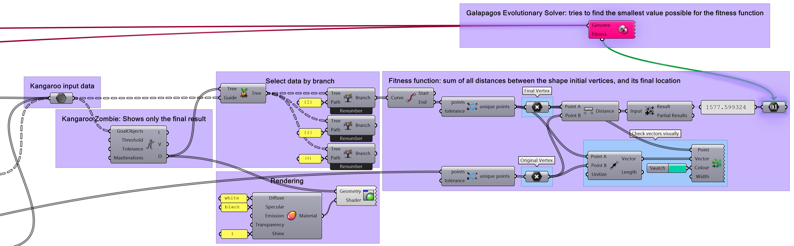

A partir da geração inicial de pontos de dados, os indivíduos ótimos combinam seus marcadores genéticos para criar 50 novos pontos de dados, que formam a geração seguinte. Isso se repete até que o resultado mais favorável seja alcançado. Neste exemplo, o algoritmo se estabilizou na centésima geração.

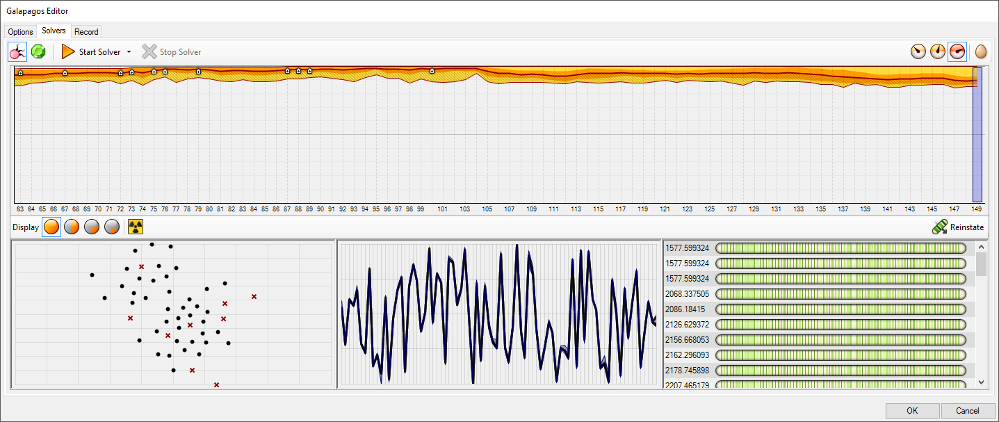

A partir daí, desenvolvemos outros sete estudos, alterando apenas o padrão inicial da malha da esfera, e analisamos o comportamento de cada um.

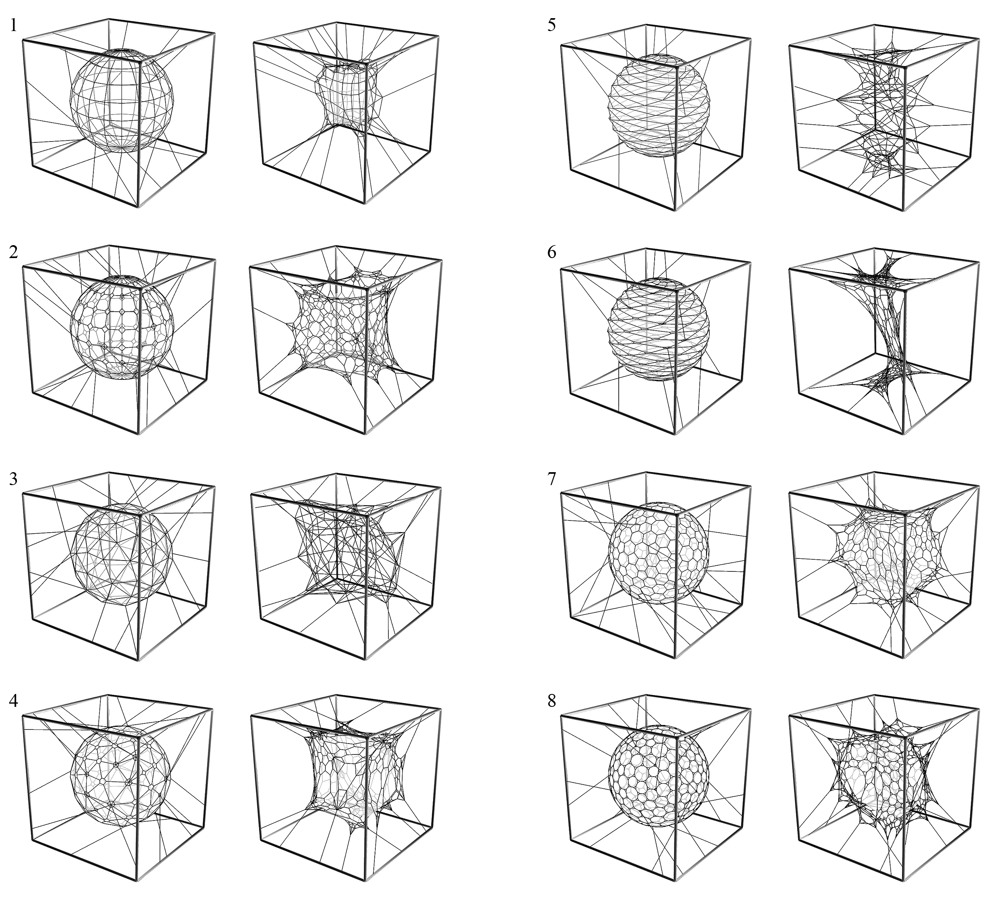

Com os resultados obtidos, concluímos que a melhor alternativa para desenvolver a proposta final era a "malha hexagonal truncada", pois oferece o melhor controle sobre a forma final e é de fabricação viável.

## Detalhamento

Para atender a todos os itens listados no programa de necessidades, foi desenvolvida uma estrutura que faz referência direta a um dos módulos que compõem o logotipo da FAU-USP. A partir desse esqueleto metálico de 4 barras, geramos um espectro de 20 soluções.

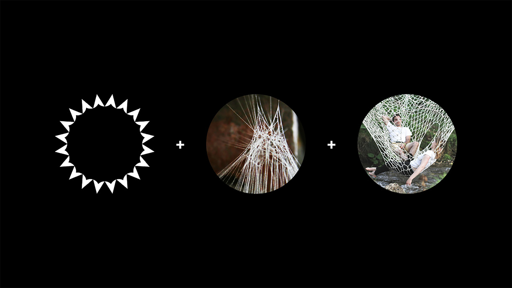

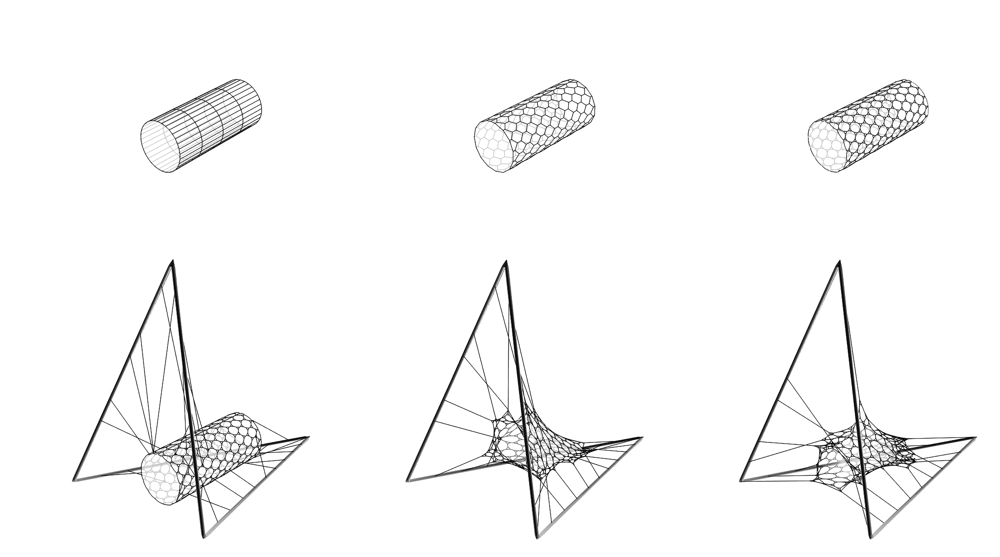

Assim como na evolução biológica, o processo não resulta em uma "solução perfeita", mas cumpre seu objetivo. Isso é especialmente importante no design, pois se torna um meio pelo qual humanos e computadores podem trabalhar juntos. Enquanto os humanos montam o algoritmo, os computadores o processam e acabam oferecendo um grande número de resultados, para que um humano possa então escolher aqueles que atendem a critérios difíceis de especificar no algoritmo, como estética ou conforto.

### Método construtivo

Para produzir a malha hexagonal proposta, foi adotada a técnica tradicional de renda de bilro. A estrutura será composta por 4 tubos de aço de 5 centímetros de diâmetro e 2,5 metros de comprimento, unidos por quatro cotovelos pré-fabricados com ângulos de 34 e 71,9 graus.

### Fabricação

A montagem aconteceria em 3 etapas: a produção da rede, a montagem do esqueleto estrutural e, por fim, a fixação e o tensionamento da rede com cordas. Todas as dimensões e todos os pontos de fixação podem ser documentados no Grasshopper, o que evita incompatibilidades de informação e acelera a montagem.

A técnica de renda de bilro consiste em uma produção manual de tecido que permite desenvolver padrões complexos com ferramentas rudimentares. No método tradicional, os fios são trançados e torcidos sucessivamente com bastões de madeira (os bilros); alfinetes mantêm o padrão estável e tudo é feito sobre uma almofada.

<ImageRow>
  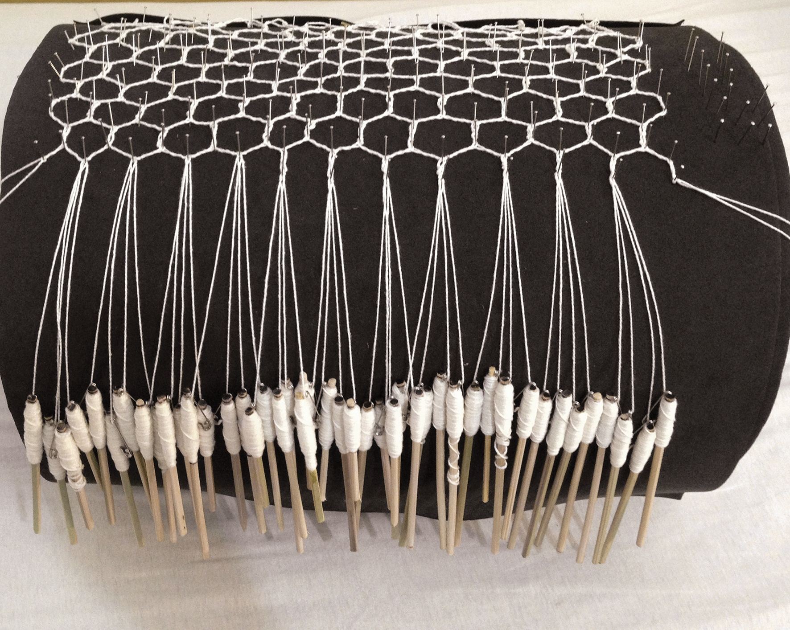

  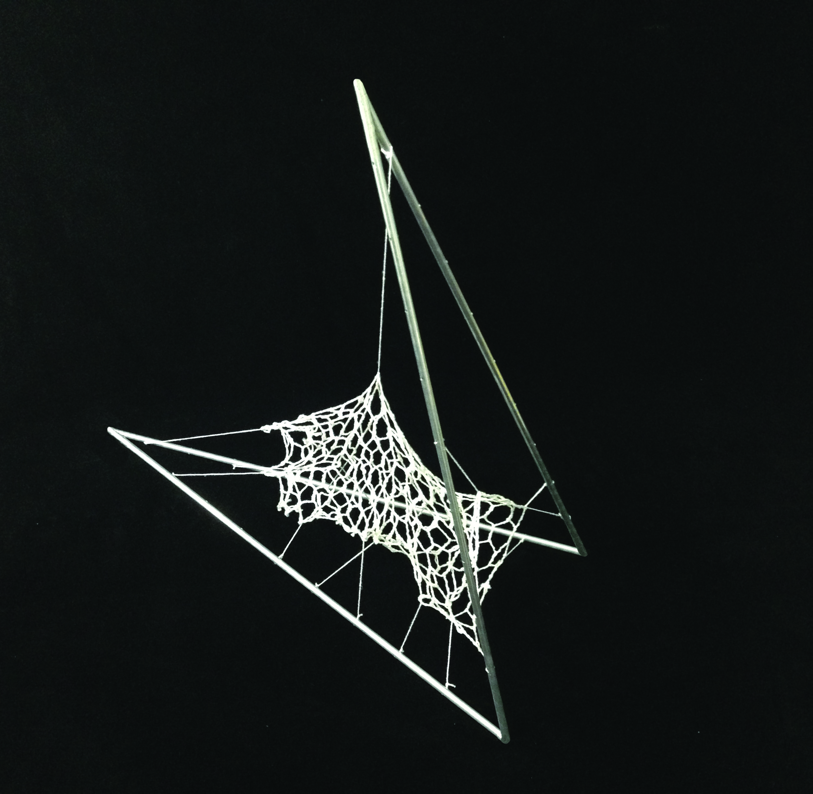
</ImageRow>

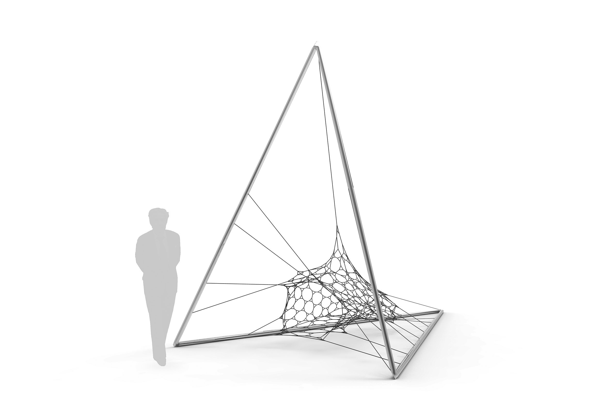

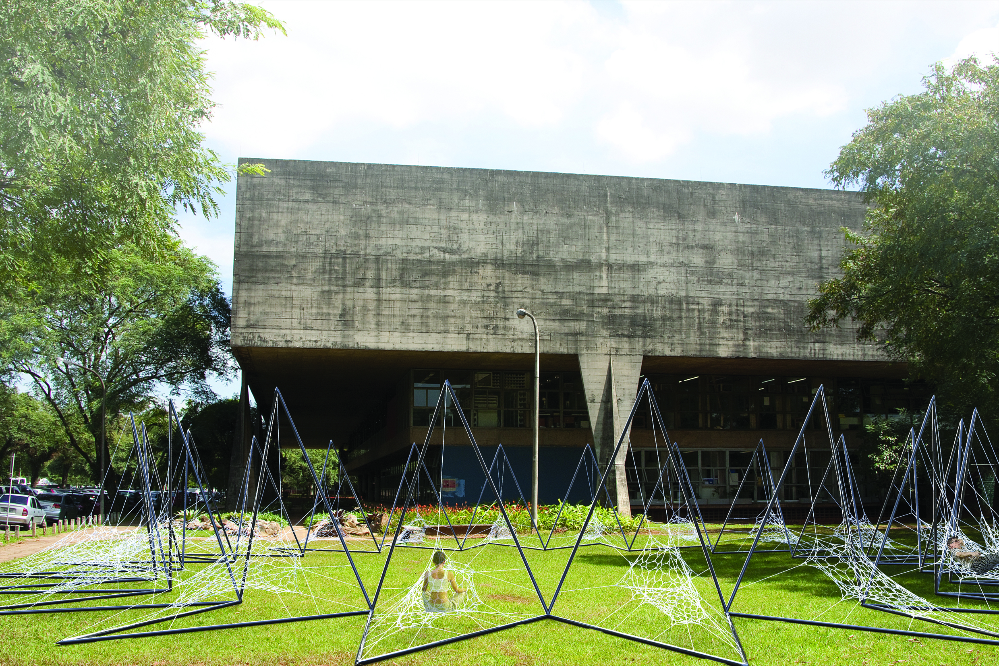

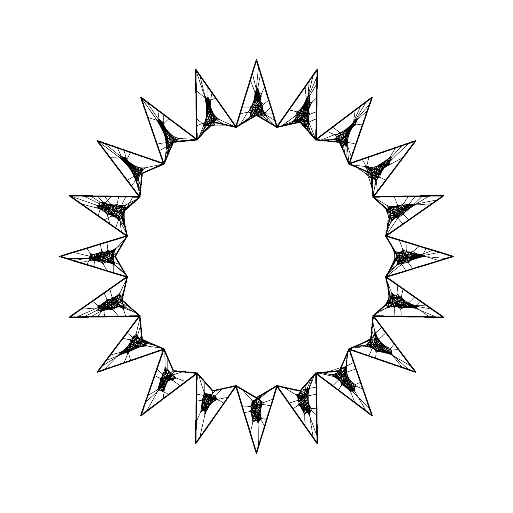

## Conclusão

Este estudo buscou explorar algumas possibilidades de incorporar uma técnica tradicional de tecelagem ao design computacional visando desenvolver um protótipo de cadeira tipo rede. O algoritmo também produz resultados inesperados, que mudam a forma como o projetista imagina o projeto final. Em outras palavras, esse sistema permite que o algoritmo e o projetista trabalhem juntos como uma equipe.

Por fim, o algoritmo final funciona como uma extensão criativa da mente humana, gerando um espectro de múltiplas soluções.

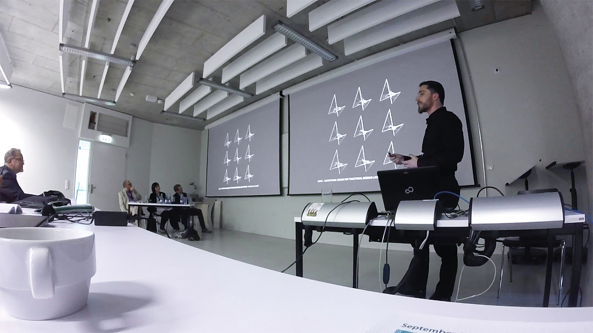

### Referências
[1] Barthel R. Natural Forms - Architectural Forms. In: FREI OTTO - *Lightweight Construction*, Natural Design, Birkhauser - Publishers for Architecture, 2005.
[2] Benyus J. M. *A Biomimicry Primer*. Biomimicry guide, 2009.
[3] Fernandes J. A. B. *Caderno de Diagnóstico, Resíduos da Construção Civil*. IPEA, 2011.
[4] Fry T., Design Futuring: Sustainable, Ethics and New Practice (Oxford: Berg, 2008), p.2
[5] Kieran S. e Timberlake J. *Refabricating Architecture: How manufacturing methodologies are poised to transform building construction*, McGraw-Hill, 2004.
[6] Krausse J. and Lichtenstein C., Your Private Sky: R. Buckminster Fuller: The Art of Design Science, Lars Müller Publishers, 1999.
[7] Kull U., Frei Otto and Biology, in Frei Otto - Lightweight Construction, Natural Design ([Basel, Switzerland]: Birkhauser - Publishers for Architecture, 2005), p.51
[8] Stabile H., *Entre o físico e o digital. Processos paramétricos, de interação e de fabricação digital aplicados ao design*, São Paulo, 2015.
[9] Terzidis K., *Algorithmic Architecture*, Architectural Press (Elsevier), 2006.
