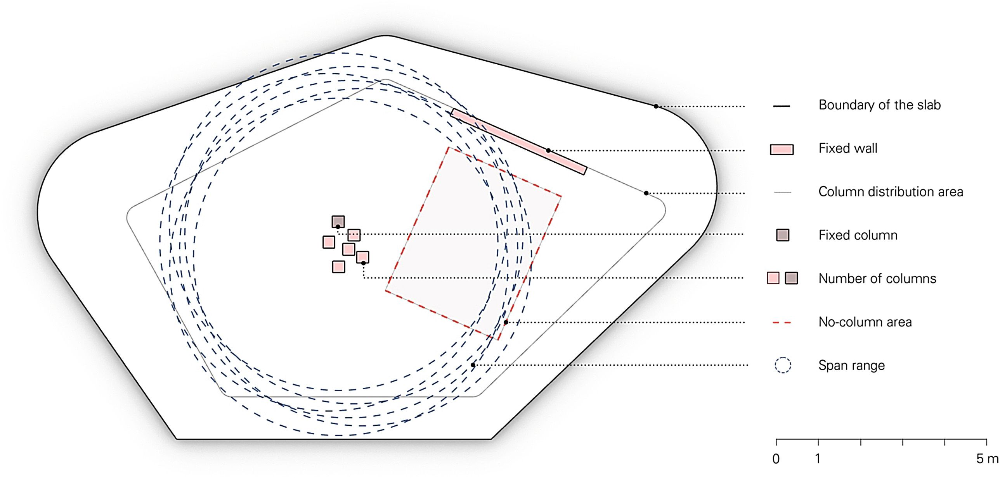
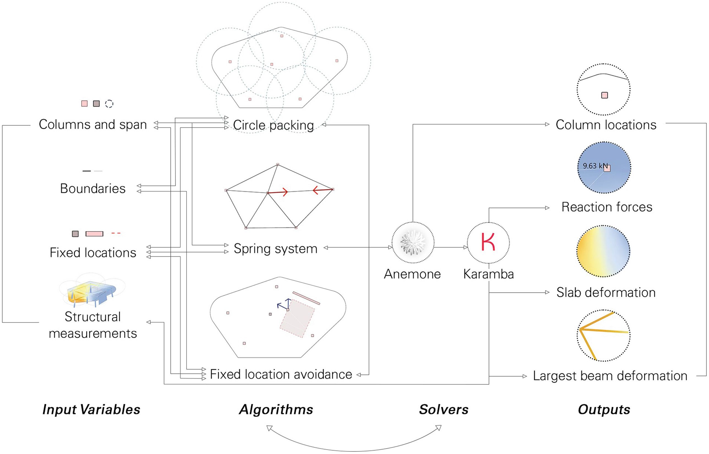
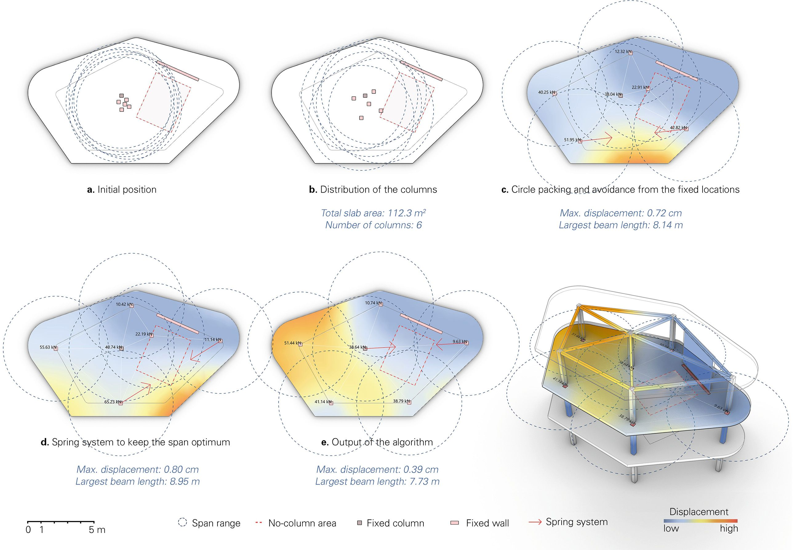
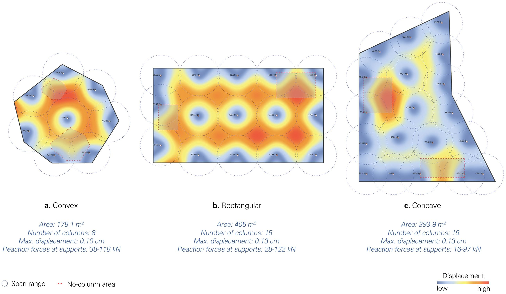
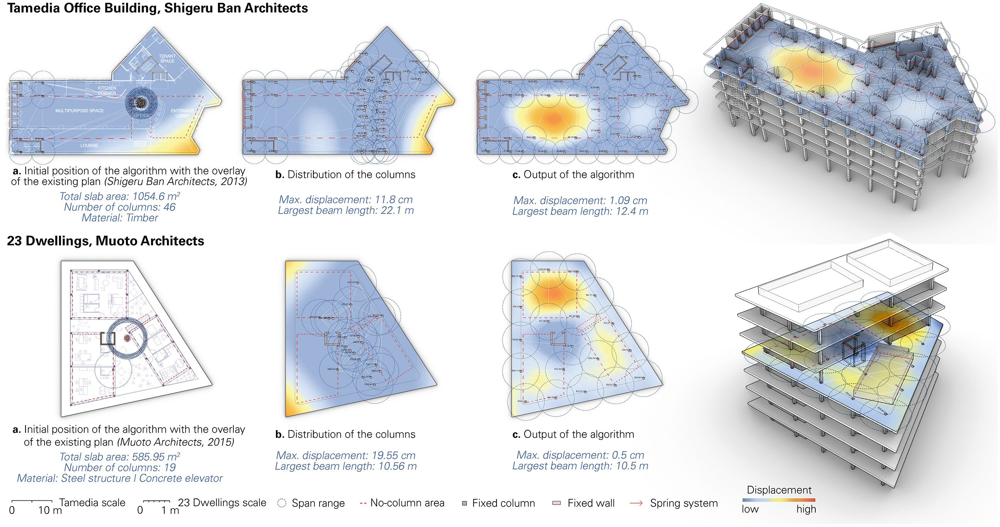

import Video from '@/components/Video.astro'

## Feedback-Based Design Method for Spatially-Informed and Structurally-Performative Column Placement in Multi-Story Construction
Este artigo apresenta um método computacional baseado em feedback para o posicionamento de pilares na fase inicial de projeto de estruturas complexas de vários pavimentos. O método integra um algoritmo de empacotamento de círculos, um sistema de molas e simulações de engenharia estrutural em um único script para o arranjo recíproco e informado de pilares no espaço. Além de permitir uma abordagem exploratória, o método abre diversas possibilidades em edifícios de vários pavimentos: espaços adicionais em balanço no perímetro, mais qualidade espacial graças a grandes vãos, arranjos estruturais multidirecionais e uso multifuncional do espaço. Assim, o algoritmo desenvolvido dá flexibilidade ao projeto, pois aproveita as possibilidades tanto de arranjos de pilares em malha quanto de arranjos irregulares, e promove a integração de restrições estruturais e de projeto na organização espacial de várias tipologias de edifícios.

<Video src="/media/publications/automatic-column-placement/parcticle-spring-system-column-placement.mp4" />

