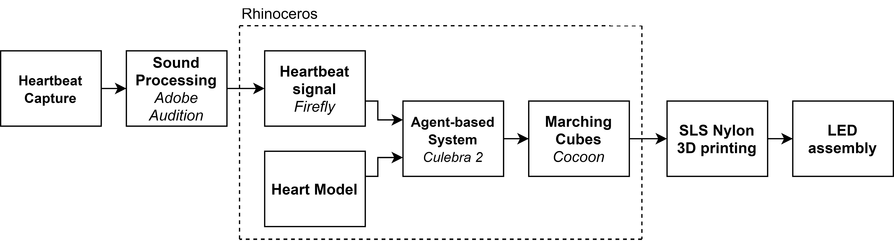
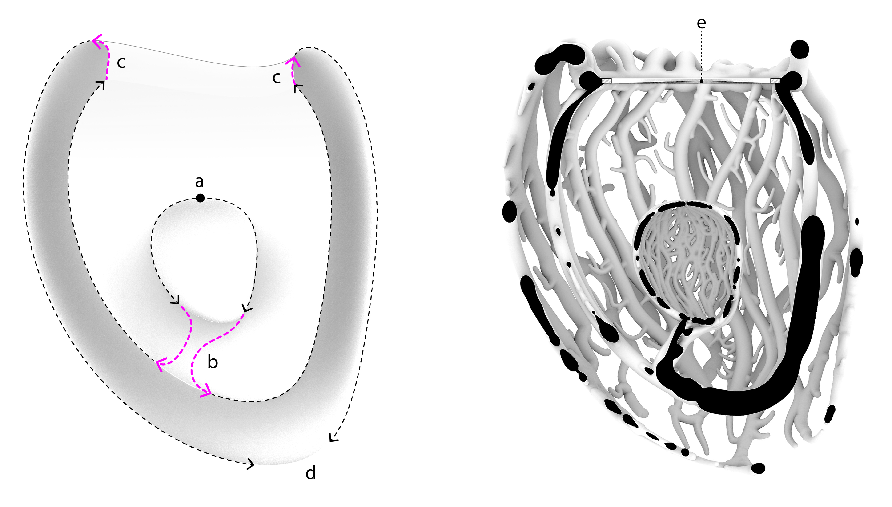

import Video from '@/components/Video.astro'

A Life Lamp foi, ao mesmo tempo, um projeto e uma pesquisa. Como freelancer, passei as tardes trabalhando com o Estúdio Guto Requena na estratégia computacional que daria vida ao conceito já definido. O processo de design é um híbrido entre abordagens top-down e bottom-up. Trabalhamos tanto com modelos 3D predefinidos em forma de coração, usados como base do design, quanto com modelagem baseada em agentes, amplamente explorada por Craig Reynolds na década de 1980.

A programação foi feita no Grasshopper 3D, com o plugin Culebra v2.0, lançado havia duas semanas, para a modelagem baseada em agentes, e com o plugin Firefly para captar os batimentos cardíacos. Mais tarde, o trabalho virou um artigo apresentado no eCAADe 2020: [Connecting Design and People Through Emotion](http://papers.cumincad.org/data/works/att/ecaade2020_389.pdf)

Hoje é possível usar a tecnologia para criar produtos voltados à emoção do usuário. Este artigo apresenta uma exploração de design que usa modelagem algorítmica para criar um objeto que busca expressar significado por meio de vínculos emocionais com as pessoas. A Life Lamp foi criada para representar um ciclo de vida como um objeto sensível, composto por três camadas, cuja sombra única produz uma imagem complexa, que expressa os caminhos e as surpresas da nossa existência. Os designers trabalharam tanto com um modelo 3D predefinido em forma de coração, usado como base do design, quanto com modelagem baseada em agentes, amplamente explorada por Craig Reynolds na década de 1980. A Life Lamp nasceu da pesquisa do Estúdio Guto Requena, que investiga, por meio do design, o impacto da cultura digital e busca fundir tecnologia e afeto.

<Video src="/media/publications/life-lamp-connecting-design-and-people-through-emotion/life-lamp-animation-01.mp4" caption="Agentes criando a estrutura a partir dos batimentos cardíacos de um bebê ainda no útero." />

<Video src="/media/publications/life-lamp-connecting-design-and-people-through-emotion/life-lamp-animation-02.mp4" caption="Etapa intermediária: a ligação entre a forma do bebê e a do adulto." />

<Video src="/media/publications/life-lamp-connecting-design-and-people-through-emotion/life-lamp-animation-03.mp4" caption="Agentes criando a estrutura a partir dos batimentos cardíacos de um adulto." />

