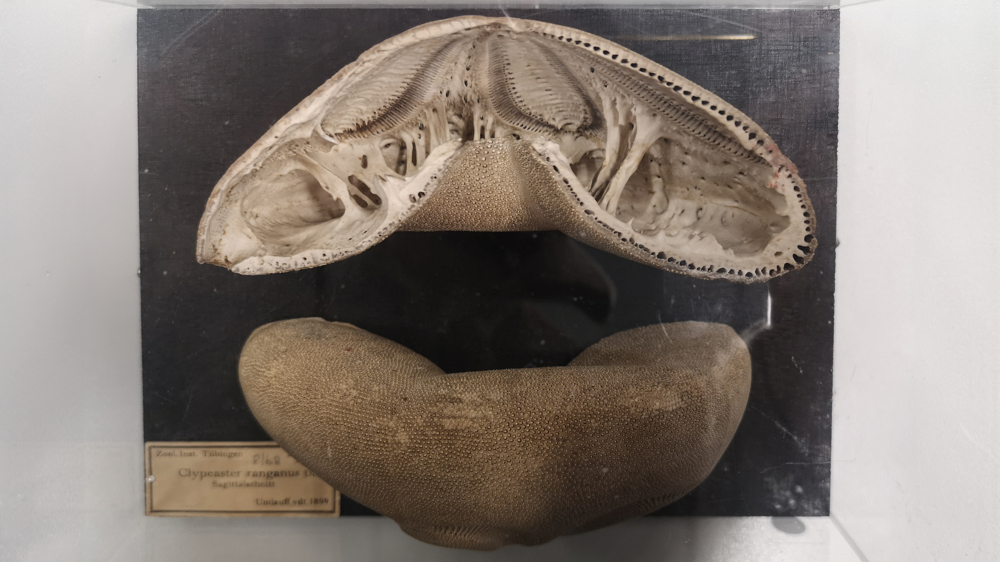
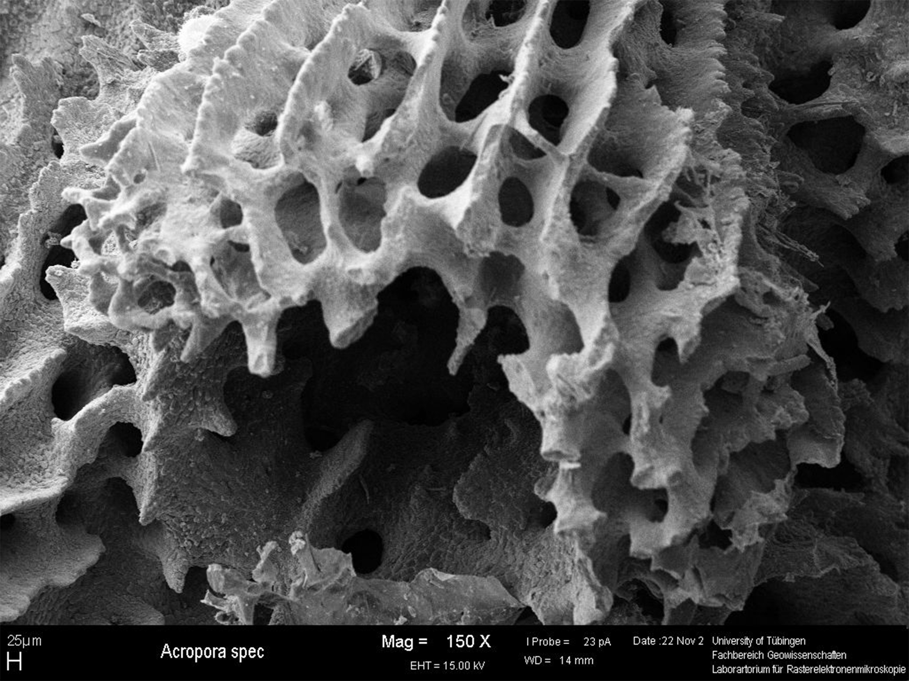
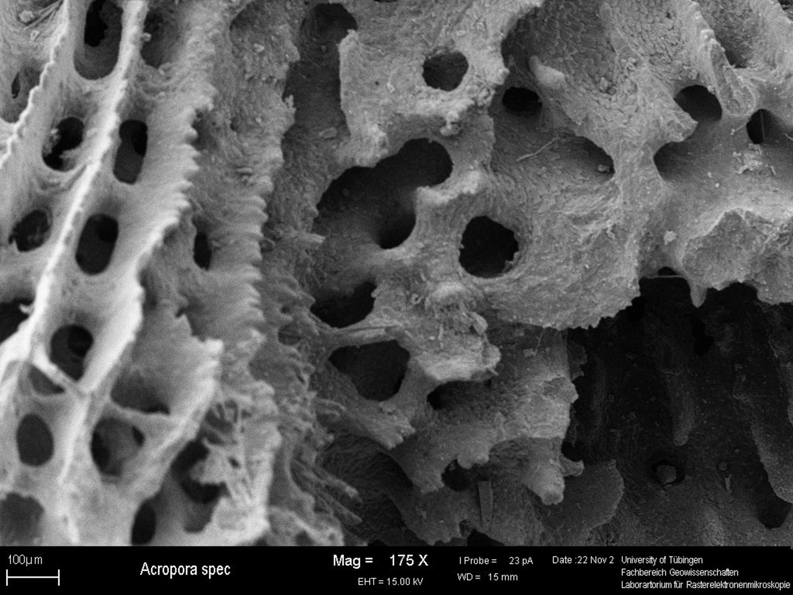
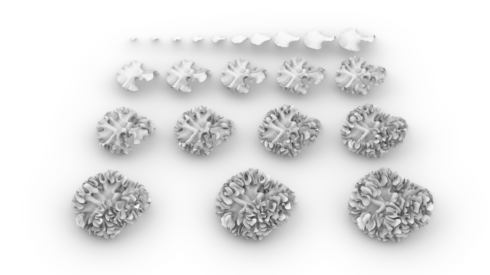
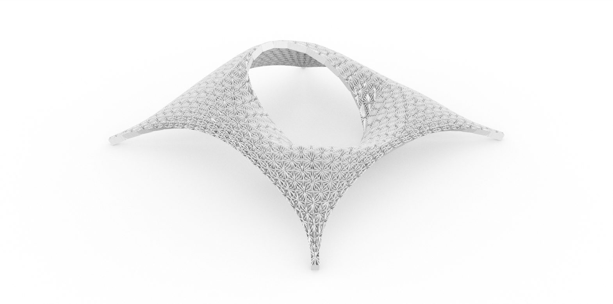
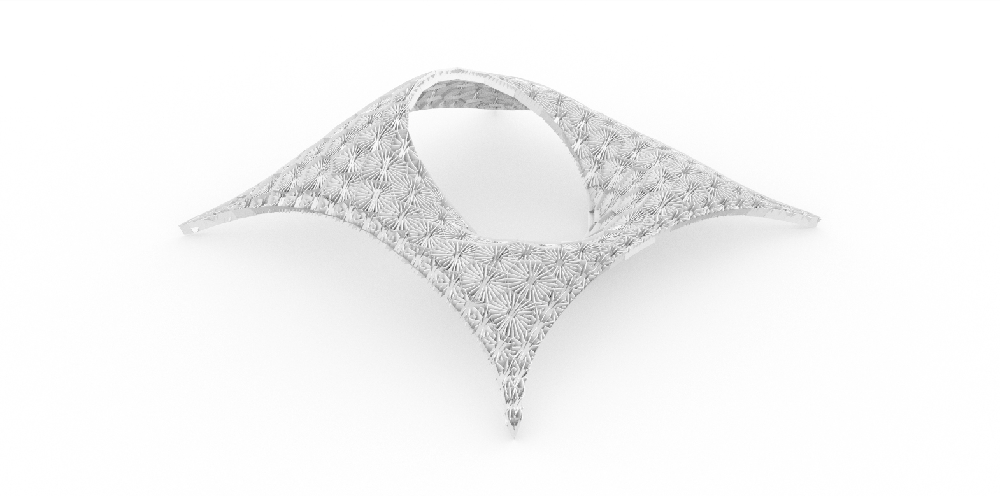
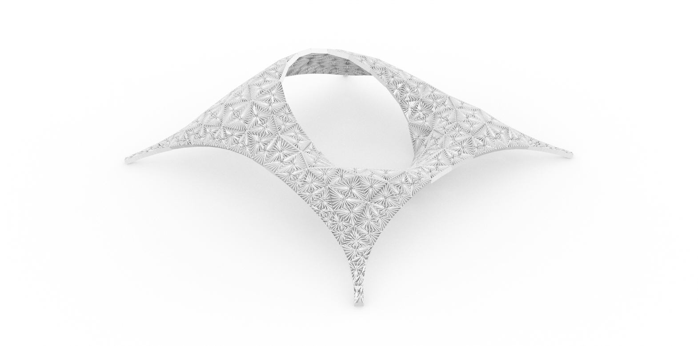
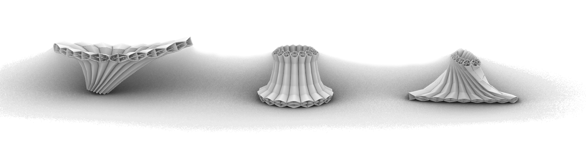
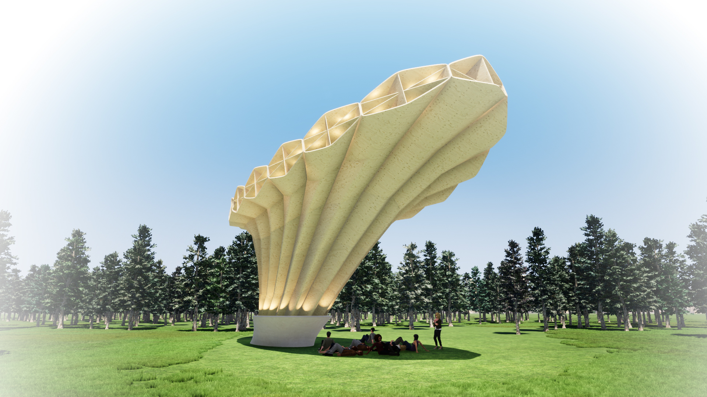

Jedes Tier hat eine einzigartige Morphologie, Anatomie und ein einzigartiges Verhalten. Die meisten dieser Eigenschaften sind hoch entwickelt und erfüllen ihre Funktionen nahezu perfekt. Biomimetik ist eine Strategie, die Lösungen der Natur für unsere Probleme untersucht.
Diese Forschung begann mit der Untersuchung statischer Strukturen. Dazu gehören alle Arten von Skeletten, Schalen und anderen weicheren, aber dennoch statischen Strukturen.
Weitere Untersuchungen galten allgemeinen Prinzipien, die sich bei vielen Arten von Steinkorallen und auf allen Maßstabsebenen finden: vom Polypen, dem einfachsten Baustein der Korallen, über die Koralle selbst bis zu den Riffen.
Daraus abstrahierte die Studie die Beziehung zwischen den einzelnen Polypen, die gemeinsam eine Koralle bilden. Diese Modularität wird dann für eine biomimetische Anwendung in der Architektur genutzt: den Acropora-Pavillon.

