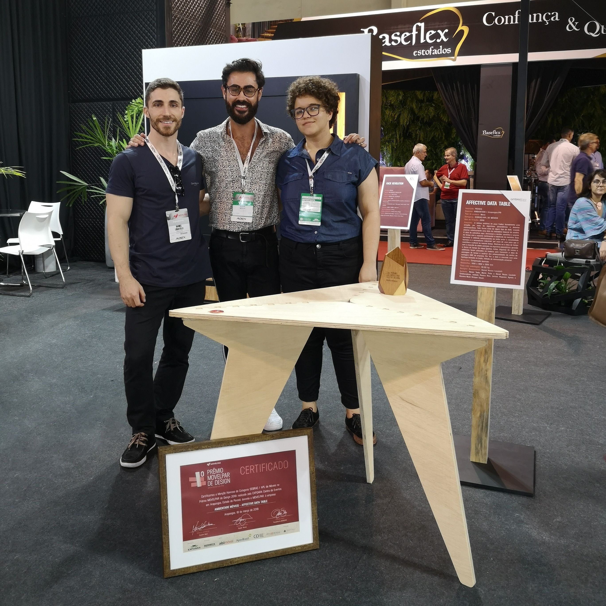
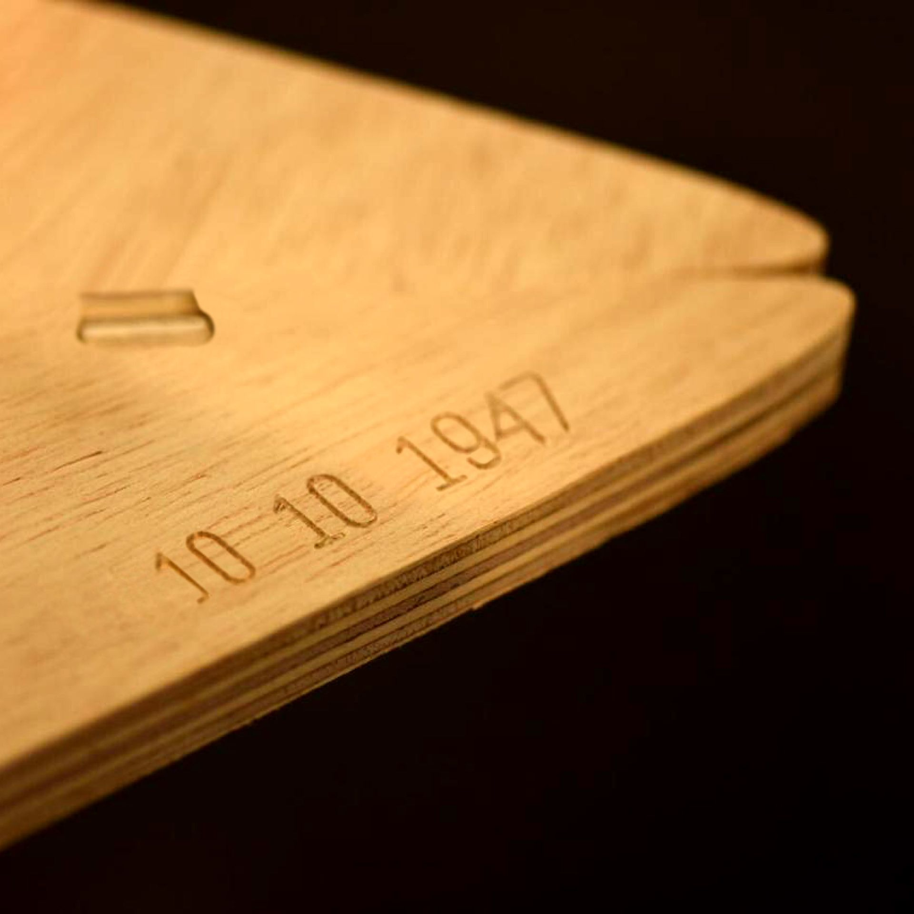
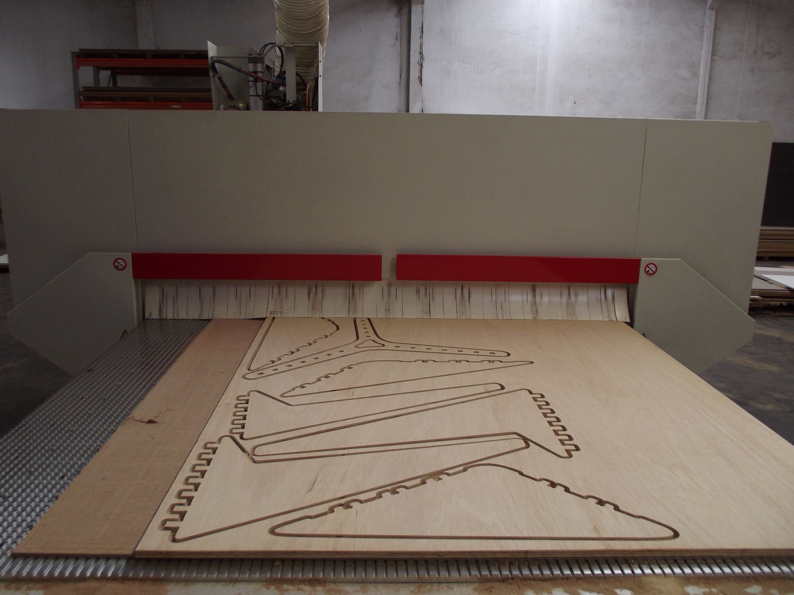
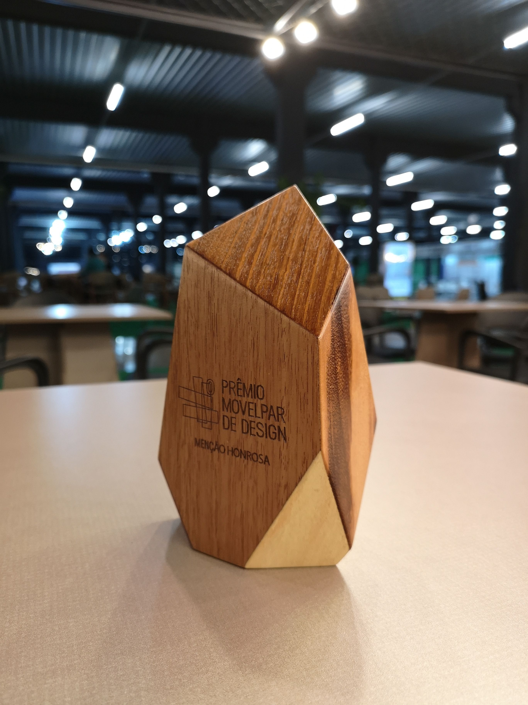

import YouTube from '@/components/YouTube.astro'

<YouTube id="tumc73ImLkg" title="Affective Data Table" />

Ich wurde eingeladen, die Studierenden der Universidade Estadual de Londrina (UEL) bei Konzept und Design eines Möbelstücks für einen Wettbewerb zu begleiten. Unser Team hatte das Glück, die CNC-Maschine eines Möbelherstellers aus der Region nutzen zu können. Vor diesem Hintergrund begannen wir, Ideen zur Mass Customization im Design zu sammeln, genauer: wie sich Menschen emotional an ihre Möbel binden lassen, damit weniger Abfall entsteht.

## Konzept

Ein Tisch, der den Nutzer einlädt, am Designprozess mitzuwirken. Seine Form entsteht aus einem Datum, das dem Nutzer viel bedeutet, sodass jeder Tisch einzigartig ist und eine emotionale Bindung entsteht.

Emotionales Design in Verbindung mit Computational Design zielt darauf ab, die gesamte industrielle Produktionskette zu überdenken und sich der Industrie 4.0 anzunähern: eine Transformation, die den gesamten Lebenszyklus des Produkts betrifft, vom Design über die Fertigung bis zum Verbraucherverhalten.

Die Idee der Zeit wurde abstrahiert, indem persönliche Daten in den Algorithmus einflossen, der die Form der Tischplatte erzeugte (Punkte, Linien, Winkel). Falten und Erhebungen im Holz vermitteln das Vergehen der Zeit, und die Maschine graviert das Datum ein.

Daten und Algorithmen als Erzeuger von Ästhetik zu verbinden, erweitert die Möglichkeiten, Verbraucher anzusprechen und zu erreichen. Verstärkt wird dies durch den Vorschlag, den Nutzer über eine E-Commerce-Anwendung an der Formgebung des Objekts mitwirken zu lassen. Damit nähern wir uns dem sogenannten Internet der Dienste (IoS), einer der Säulen der Industrie 4.0 (Hermann; Pentek; Otto, 2015).

Diese Innovation beruht auf einer mit MIT App Inventor entwickelten App sowie auf Rhinoceros mit dem Plugin Grasshopper, mit dem das Möbelstück parametrisiert wurde. Die Wahl von Hightech-Werkzeugen soll das Bestreben des Unternehmens unterstreichen, die Produktion in einem CNC-Bearbeitungszentrum technologisch voranzubringen. So machen wir die gesamte Technik sichtbar und rücken das Emotionale in den Vordergrund.

