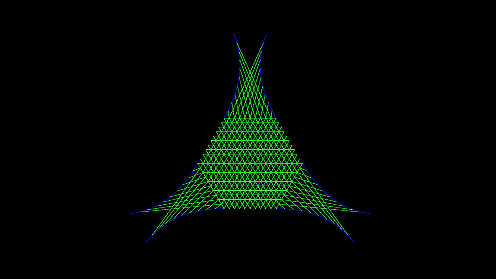
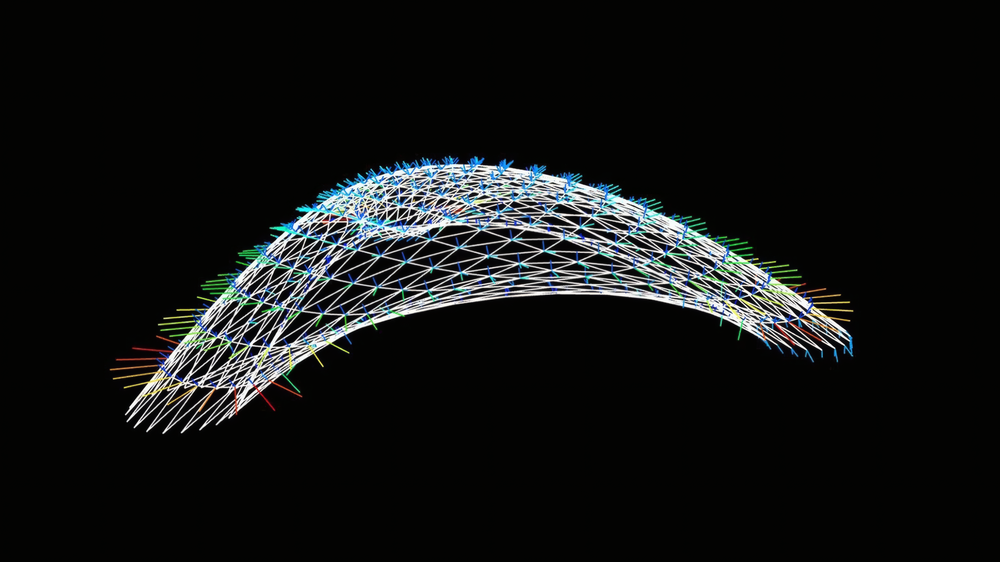
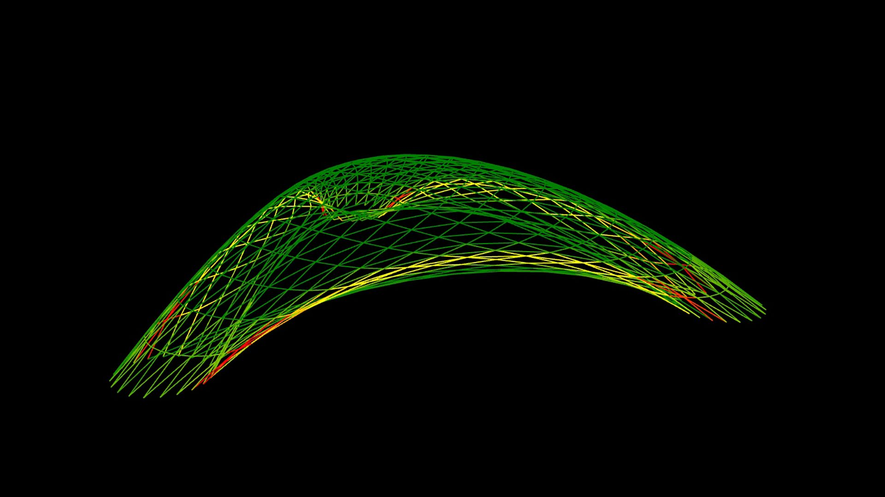
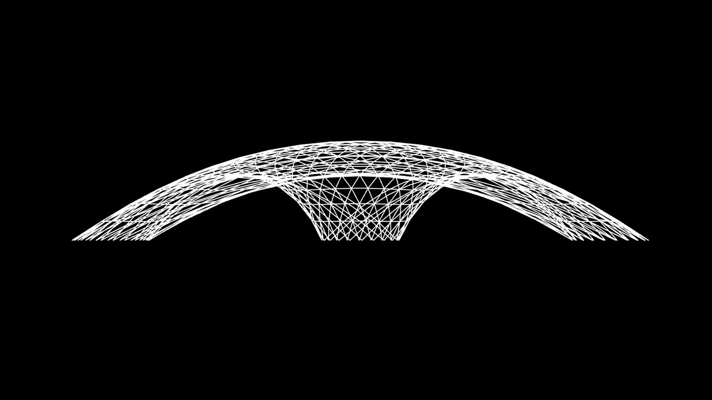
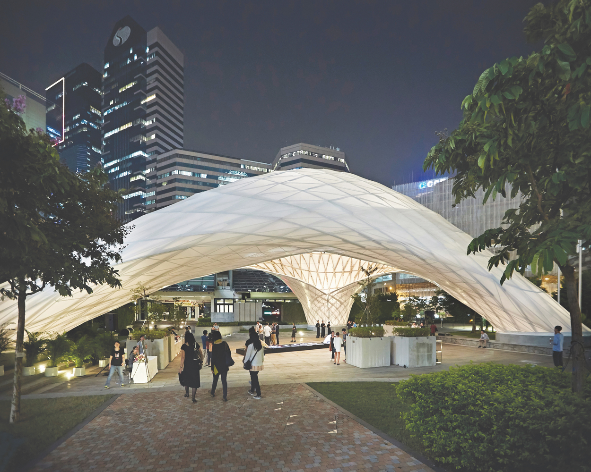

import Video from '@/components/Video.astro'

<Video autoplay src="/media/research/bending-active-bamboo/form-finding.mp4" caption="Formfindungsprozess." />

Diese Arbeit haben Lena Strobel und ich für den ITECH-Kurs Form und Struktur erstellt. Wir ließen uns vom ZCB Bamboo Pavilion inspirieren, entwickelten aber unseren eigenen Workflow mit Grasshopper, Kangaroo Physics und K2Engineering.

## Formfindung

Für die Ausgangsform legten wir in einem Dreiecksraster eine ebene Anordnung von Stäben an. Anschließend nutzten wir Kangaroo als Feder-Partikel-System; als Randbedingungen dienten Lasten, Auflager und die Stäbe als Biegestäbe. Die Form entsteht, indem die Stäbe versuchen, sich gerade zu richten.

Ursprünglich wollten wir den Bambuspavillon per Reverse Engineering nachvollziehen und mit diesem Wissen die Geometrie auf eine andere polygonale Grundform übertragen. Doch schon diese Studie beanspruchte unsere ganze Kraft.

K2Engineering war für diese Arbeit entscheidend. Mit den Materialeigenschaften von Bambus als Eingabe ließen sich Tragwerksanalysen durchführen, mit denen wir die Ergebnisse optimierten.

Eine große Herausforderung bestand darin, die Bögen zu entwerfen, die die geometrische Ausgangsform gliederten, und sie an den drei vorgegebenen kreisförmigen Auflagern zu verankern. Außerdem mussten später zusätzliche Kreuzungspunkte eingefügt werden, weil das erste Ergebnis statisch und ästhetisch nicht den Erwartungen entsprach. Wichtig war auch Kangaroo Zombie, mit dem die Optimierung schneller lief.

Weitere Informationen zum Originalpavillon finden Sie hier: [ZCB Bamboo Pavilion](https://www.archdaily.com/800173/zcb-bamboo-pavilion-the-chinese-university-of-hong-kong-school-of-architecture)

