import Figure from '@/components/Figure.astro'
import YouTube from '@/components/YouTube.astro'

<YouTube id="wCIK0eaNCC8" title="Building Across Scales: Video der Masterarbeit" />

## Zusammenfassung
**Building Across Scales: Ein robotisches Holzfertigungssystem für die Pressverleimung vor Ort**

Diese Arbeit schlägt ein heterogenes, maßstabsübergreifendes robotisches Bausystem vor, das den Holzbau auf der Baustelle weiter automatisiert. Als nächsten Schritt in der Automatisierung der Verklebung vor Ort stellt sie ein maßgeschneidertes robotisches Klemmgerät vor, das Holzelemente auf der Baustelle verpresst. Im Mittelpunkt steht daher die Entwicklung dieses Geräts, im Co-Design mit dem Material- und Bausystem, als Teil eines größeren robotischen Bauteams, zu dem ein Industrieroboter und ein Kran gehören.
Holzwerkstoffe haben neue Möglichkeiten für Entwurf und Bau moderner Holzkonstruktionen eröffnet. Werden Holzlamellen einfach aufeinandergestapelt und kreuzweise verleimt, entsteht ein fester Verbund zwischen den einzelnen Lagen. Wegen der Transportbeschränkungen ist die Größe dieser Holzelemente jedoch begrenzt, sodass modulare Bauteile entstehen. Ihre Stöße auf der Baustelle sind eine Schwachstelle: Sie beschränken das System auf eine einachsige Lastabtragung und führen zu einer rasterbasierten Architektur.
Diese Arbeit stellt ein Fertigungssystem für die Baustelle vor, mit dem sich diese Grenzen überwinden lassen. Indem Konstruktionslogiken in das Material selbst integriert werden, erreicht der Ansatz eine hohe Präzision bei der Montage und automatisiert den Kranbetrieb. Mithilfe des robotischen Klemmgeräts soll die Fertigungslogik der kreuzweisen Verleimung, die Holzwerkstoffen zugrunde liegt, auf der Baustelle fortgesetzt werden, sodass eine quasi-monolithische Platte entsteht. Das ermöglicht eine punktgestützte Holzplatte mit unbegrenzten Abmessungen, was mehr Gestaltungsflexibilität im Grundriss eröffnet und den architektonischen Entwurfsraum erweitert.

## Einleitung
> Ziel dieser Arbeit ist es, den Holzbau auf der Baustelle weiter zu automatisieren: durch die Entwicklung eines maßgeschneiderten robotischen Klemmgeräts, das In-situ-Klebeverbindungen verpresst.
Holzwerkstoffe haben neue Möglichkeiten für Entwurf und Bau moderner Holzkonstruktionen eröffnet[^kaufmann-2018]. Werden Holzlamellen einfach aufeinandergestapelt und kreuzweise verleimt, entsteht ein fester Verbund zwischen den einzelnen Lagen. Vor Ort wird diese Logik jedoch durchbrochen, da die einzelnen Elemente wie Balken, Platten und Wände lediglich nebeneinander platziert werden. Dadurch entstehen schwache Stöße zwischen den Bauteilen; sie beschränken das System auf eine einachsige Lastabtragung und führen zu einer rasterbasierten Architektur.
Diese Arbeit führt dagegen die Fertigungslogik der Holzwerkstoffe fort und überträgt sie in einen größeren Maßstab: Eine quasi-monolithische Platte, die das gesamte Geschoss überspannt, soll mehr architektonische Freiheit eröffnen.
Da ein ganzes Geschoss viel größer ist als ein einzelnes BSP-Element, gibt es derzeit keine Technologie, um diesen Ansatz zu automatisieren. Das soll ein maßgeschneidertes robotisches Klemmgerät leisten.

### Relevanz
Drei Faktoren begründen diese Arbeit: die steigende Nachfrage nach Wohnraum in Städten, die stagnierende Produktivität im Bausektor und die Eignung von Holz als Werkstoff für automatisierte Prozesse. Sie werden im Folgenden einzeln betrachtet.

#### Bauautomatisierung
Laut einem aktuellen UN-Bericht wird die Stadtbevölkerung in den kommenden Jahrzehnten stetig wachsen. Derzeit leben etwa 55 % der Weltbevölkerung in städtischen Gebieten, und bis 2050 wird erwartet, dass dieser Anteil auf 68 % steigt[^un-2019]. Dieser Trend unterstreicht die Notwendigkeit eines Bausystems, das sicher, erschwinglich, nachhaltig und automatisiert ist[^petersen-2019].
Obwohl der Bausektor einer der größten der Weltwirtschaft ist, hat er eine lange Geschichte niedriger Produktivität[^barbosa-mckinsey]. Studien zeigen, dass die Produktivität in den letzten Jahrzehnten kontinuierlich gesunken ist, während sie in anderen Branchen wie der Fertigungsindustrie stetig gewachsen ist[^bock-2015] (Abbildung 02).

<Figure credit="T. Bock, 2015">
  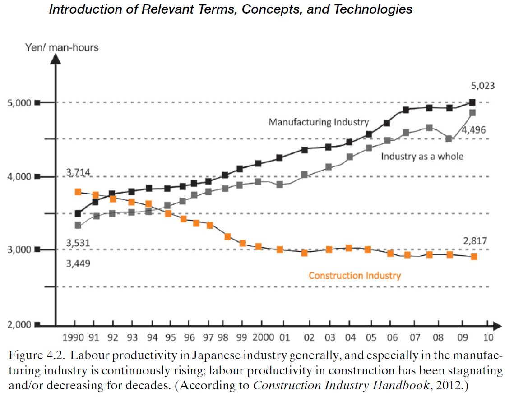
</Figure>

<Figure credit="B. Georgescu, in T. Bock, 2015">
  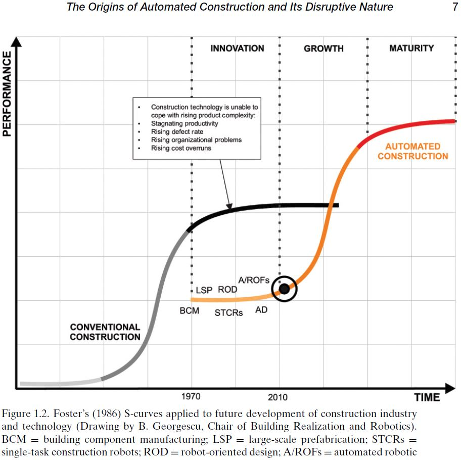
</Figure>

Für diese schwache Leistung gibt es viele Gründe. Die Branche unterliegt zahlreichen Vorschriften, hängt stark von öffentlichen Aufträgen ab und ist sehr fragmentiert[^barbosa-mckinsey]. Darin liegt jedoch eine Chance für neue Marktteilnehmer, und ein möglicher Weg aus dem Produktivitätsproblem ist der Einsatz von Automatisierung und Robotik[^bock-2015].
Obwohl Automatisierung und Robotik bereits seit 1970 im Bauwesen eingesetzt werden, haben sie noch nicht die notwendige Produktivitätssteigerung erreicht, um zu einer wirtschaftlich tragfähigen Alternative zu werden. Dies sollte jedoch nicht als Scheitern betrachtet werden, sondern als natürlicher Verlauf eines tiefgreifenden technologischen Wandels[^bock-linner-2015]. Wesentliche technologische Fortschritte wie Big Data, drahtlose Sensornetzwerke und Building Information Modeling schaffen ein günstiges Umfeld für effiziente Automatisierungs- und Robotersysteme im Bauwesen[^desoto-skibniewski-2020].

Laut Thomas Bock (2016) finden derzeit zwei bedeutende Technologiezyklen im Bauwesen statt. Einer umfasst die traditionellen Bausysteme, während der neue sich auf Digitalisierung, Automatisierung und Robotik bezieht (Abbildung 03). Technologiezyklen durchlaufen drei verschiedene Phasen: Innovation, Wachstum und Reife. Derzeit treten wir in die zweite Phase dieses neuen Zyklus ein, das Wachstum. In dieser Phase wird er die traditionellen Bausysteme schließlich übertreffen und sich in seiner letzten Phase, der Reife, in der gesamten Branche auf breiter Front durchsetzen[^bock-linner-2015].

#### Automatisierungsstrategien
Seit den Anfängen der Automatisierung im Bauwesen wurden viele Strategien erforscht, entwickelt und eingesetzt. Eine davon ist das Konzept der Vorfertigung, bei dem ein großer Teil des Bauprozesses in ein Werk verlagert wird, wo sich Bauteile leichter, sicherer und zuverlässiger in Serie fertigen lassen (Abbildung 04). Diese strukturierte Umgebung ähnelt den Fabriken vieler anderer Branchen, wie der Automobil- und der Fertigungsindustrie, die bekannt dafür sind, günstige Bedingungen für den Einsatz konventioneller Industrieroboter an festen Standorten zu bieten. In der Bauindustrie müssen die Teile jedoch noch zu ihrem Einbauort transportiert werden. Die Transportmodule sind in der Regel wesentlich größer als das Rohmaterial, wodurch Kosten, Logistik und lokale Vorschriften zu limitierenden Faktoren werden, die die endgültige Gestaltungsflexibilität beeinflussen[^melenbrink-2020].

<Figure credit="bau-welt.de">
  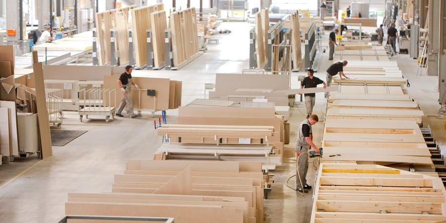
</Figure>

<Figure credit="T. Bock, 2015">
  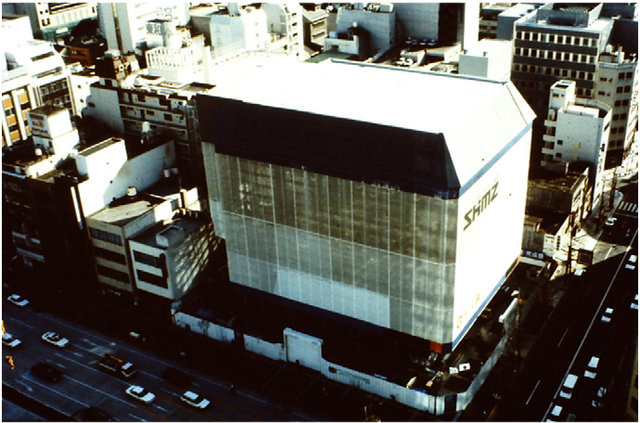
</Figure>

Eine weitere Strategie, die seit den 1970er Jahren erforscht wird, ist die Baustellenfabrik. Anstatt die Fertigung von Teilen in eine externe Fabrik zu verlagern, wird die Baustelle selbst zur Fabrik. So erhält die sonst unstrukturierte Baustelle einen Rahmen, in dem sich Roboter leichter zurechtfinden, was den Bau beschleunigt. Diese Strategie hat beispielsweise zur Entwicklung von „fliegenden Fabriken“ für Hochhaustypologien geführt, bei denen nach Fertigstellung jedes Stockwerks die gesamte Fabrik ein Stockwerk nach oben wandert (Abbildung 05). Diese Strategie ist jedoch teuer, erfordert vor Baubeginn zu viel Zeit für den Aufbau der Fabrik und eignet sich nur für repetitive Hochhaustypologien; das schränkt den Spielraum der Entwerfenden bei der Gesamtform ein[^vasey-2020][^melenbrink-2020].

Ein flexiblerer Ansatz für Baustellenfabriken ist die transportable robotische Holzbau-Plattform (Abbildung 06). Sie besteht aus einem Container, der mit Robotern und Werkzeugen ausgestattet ist und direkt zur Baustelle geliefert werden kann. Mit ihr lässt sich die robotische Montage in bestehende Bauverfahren integrieren. Die Stärke des Systems liegt darin, dass es standortunabhängig und rekonfigurierbar ist. Da sich die Plattform vielfältig anpassen lässt, ist sie sehr flexibel. So kann sie traditionelles Handwerk erweitern statt ersetzen und Qualität sowie Produktivität vor Ort steigern[^wagner-tim-2020].

<Figure credit="H. J. Wagner et al., 2020">
  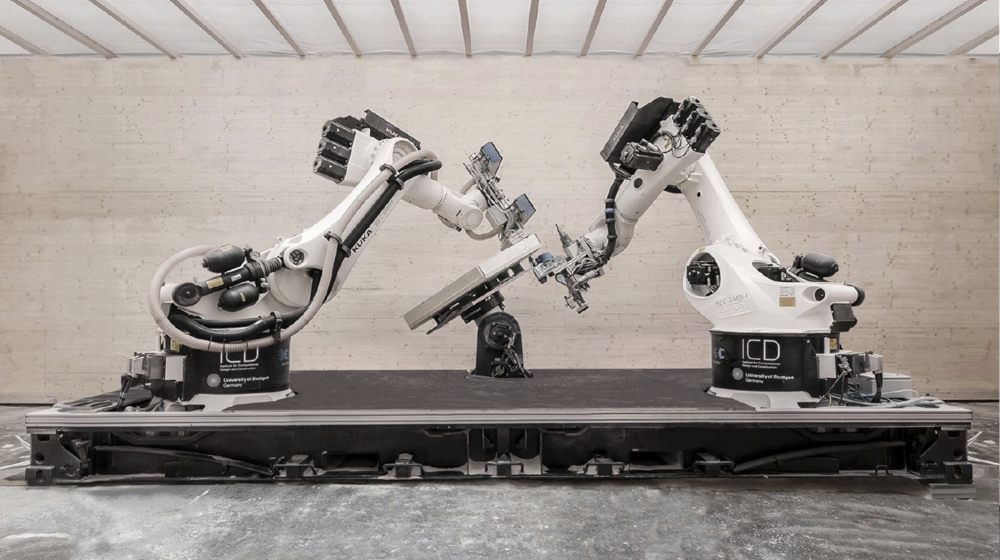
</Figure>

<Figure credit="S. Lut, T. Stark, L. Siriwardena et al., 2020">
  
</Figure>

Eine dritte Strategie, die vor allem in der Forschung untersucht wird, ist der Einsatz mobiler Roboter beim Bau des Tragwerks (Abbildung 07). Dieser Ansatz ist interessant, weil er die Idee der verteilten robotischen Montage verfolgt; daraus entstehen ausgefeilte Algorithmen für eine ausfallsichere, dezentrale Bauabfolge. Mit anderen Worten: Wenn bei einem Roboter etwas schiefgeht, springen die anderen ein, ohne die gesamte Montagelogik zu stören. Mobile Roboter sind zudem flexibler als Baustellenfabriken oder die transportable Plattform und erreichen Orte, die etwa für ein Portalsystem unerreichbar wären. Allerdings sind mobile Systeme wesentlich komplexer in Sensorik und Steuerung, weniger präzise und aufgrund ihrer geringen Traglast weniger energieeffizient[^melenbrink-2020].

Bislang ging es bei der Automatisierung im Bauwesen hauptsächlich um die Schaffung vollständig neuer Systeme. Deren Akzeptanz in der bestehenden Bauindustrie ist jedoch noch begrenzt. Wie bereits erwähnt, entwickelt sich die Baubranche langsamer als andere Branchen. Folglich ist es essenziell, bereits bestehende Bautechnologie zu integrieren, wenn man Montageprozesse automatisieren möchte.
Aufgrund der unstrukturierten und komplexen Natur des Bauwesens ist es entscheidend, die verschiedenen Aufgaben vor Ort zu betrachten, da einige besser für einen zentral gesteuerten großen Roboter wie einen Kran geeignet sein könnten. Andere hingegen könnten von einem Kollektiv aus Hunderten kleinerer Roboter profitieren[^melenbrink-2020].

Anstatt ein weiteres vollständig neues System zu entwickeln, könnte ein heterogenes Robotersystem einen großen Mehrwert bei der Automatisierung von Vor-Ort-Prozessen bieten. Laut Vasey et al. (2020) ist ein heterogenes Robotersystem ein „System bestehend aus Robotern mit unterschiedlichen Spezifikationen, Werkzeugen und Steuerungslogiken, die von verschiedenen Herstellern stammen oder aus handelsüblichen Komponenten und Steuerungen angepasst sein können"[^vasey-2020].
Ein Blick auf die Spitzenforschung zeigt, dass Roboter bereits in gewissem Maße kombiniert werden. Ein Beispiel ist das Sequential Roof der ETH Zürich: Seine Vorfertigung war hochgradig automatisiert (Abbildung 08), die Montage vor Ort dagegen noch Handarbeit[^willmann-2016] (Abbildung 09).

<Figure credit="Aleksandra Anna Apolinarska, ETH Zürich">
  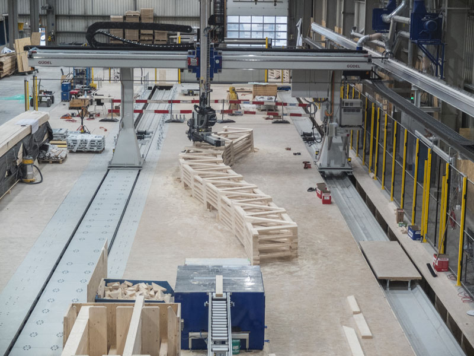
</Figure>

<Figure credit="Lüchinger Meyer, ETH Zürich">
  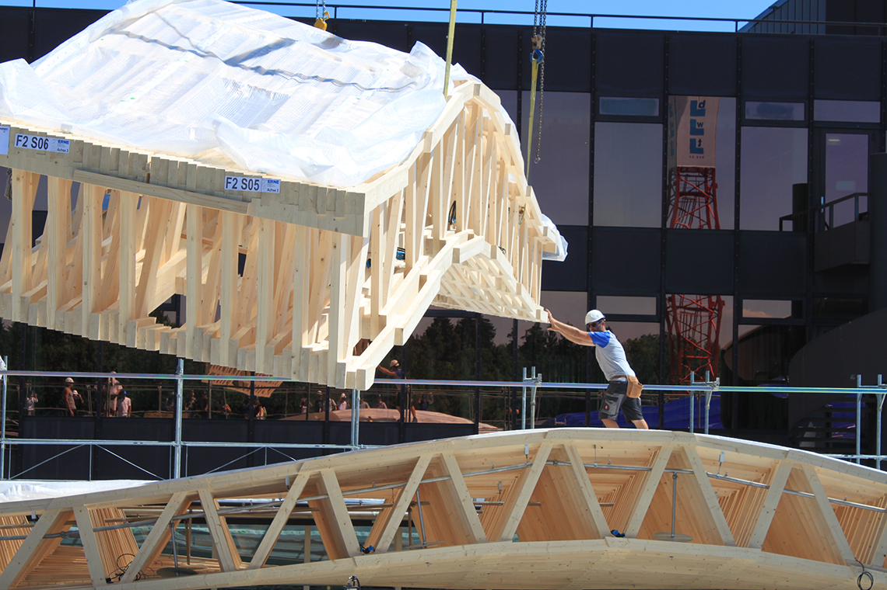
</Figure>

#### Holzbau
Holz eignet sich gut für automatisierte Prozesse auf der Baustelle, da es ein etablierter Baustoff mit einem hohen Verhältnis von Festigkeit zu Gewicht ist und sich leicht verarbeiten lässt[^ramage-2017]. Vor allem weil der Holzbau früh modernste Fertigungstechnik einführte und sich das Material leicht bearbeiten lässt, konnte die Vorfertigung automatisiert werden, etwa mit dem computergesteuerten Fräsen (CNC) in den 1970er Jahren[^menges-2015]. Neben den technischen und konstruktiven Vorteilen setzt sich mit dem wachsenden Bewusstsein für nachhaltiges Bauen auch die Politik stark für Holz ein. So schreibt beispielsweise die Holzbau-Offensive Baden-Württemberg vor, dass jedes neue öffentliche Gebäude nach Möglichkeit aus Holz gebaut werden soll (Abbildung 10)[^holzbau-offensive-bw]. Holzelemente sind jedoch aufgrund von Transportbeschränkungen in ihrer Größe begrenzt, was zu modularen Bauteilen führt, die vor Ort verbunden werden müssen. Die Stöße zwischen den Elementen sind eine Schwachstelle; sie führen zu einer einachsigen Lastabtragung und einer gerichteten, rasterbasierten Architektur (Abbildung 11).

<Figure credit="Holzbau-Offensive Baden-Württemberg, MLR">
  
</Figure>

<Figure credit="H. Kaufmann, S. Krötsch, S. Winter, 2018">
  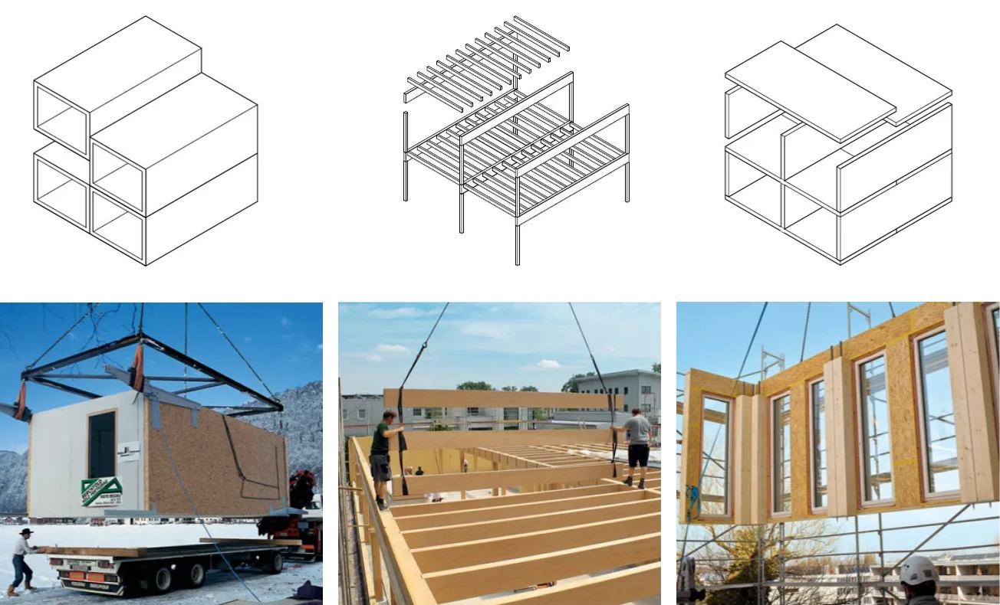
</Figure>

Die Verklebung vor Ort kann die Nachteile einer modularen Bauweise überwinden, weil sie die einzelnen Bauteile fest miteinander verbindet. Da bisher nur Klebstoff eine Verbindung herstellt, die für einen kontinuierlichen Steifigkeitsverlauf stark genug ist, sind Klebeverbindungen deutlich leistungsfähiger als traditionelle Verbindungen (Abbildung 12)[^ramage-2017] und eine mehrachsig lastabtragende Plattenanordnung ermöglichen könnten[^holz-zentralblatt-2021].

<Figure credit="M. H. Ramage et al., 2017">
  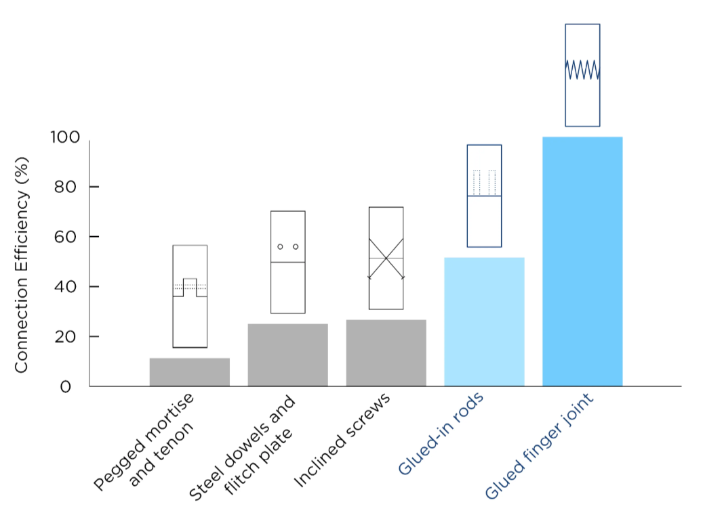
</Figure>

### Rahmen der Arbeit
Gegenstand der Arbeit ist die Automatisierung einer In-situ-Klebeverbindung als Teil eines Holzbausystems. Im Mittelpunkt steht daher die Entwicklung eines maßgeschneiderten robotischen Klemmgeräts, das die In-situ-Verbindung beim Verkleben verpresst. Das Co-Design von Gerät und Holz vereinfachte den Entwurf des Roboters und führte zu einem Materialsystem, das die vorgeschlagenen Technologien voll ausschöpft.
Darüber hinaus wird diskutiert, wie sich die gesamte Bauprozesskette automatisieren lässt, und zwar mit einer cyberphysischen Holzfertigungsplattform (TIM), die die Holzelemente auf der Baustelle vorfertigt. In das Gerät integrierte Sensorik ermöglicht die Lokalisierung und Überwachung der Montage in Echtzeit sowie die Abstimmung mit einem Kran, der die vorgefertigten Elemente automatisch in situ positioniert.
Die Arbeit gliedert sich in zwei Teile:
- Die Untersuchung eines Materialsystems, das Holzelemente und die Automatisierung einer In-situ-Verbindung nutzt.
- Die Entwicklung eines heterogenen Robotersystems, einschließlich der Koordination aller Akteure, von der Fertigung vor Ort bis zur In-situ-Fügung.
Beide Systeme müssen koordiniert entworfen werden, sodass Randbedingungen und Parameter einander laufend beeinflussen (Abbildung 13).

<Figure>
  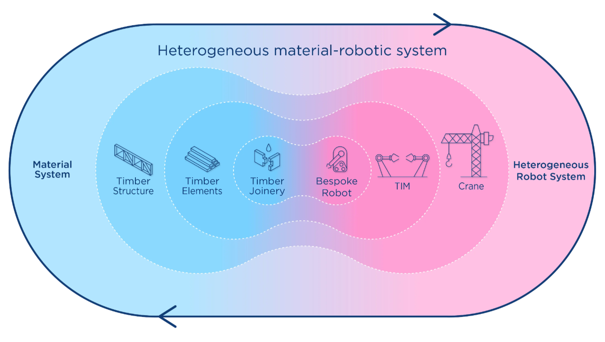
</Figure>

## Forschung
Die folgenden Abschnitte ordnen die Arbeit in den bestehenden Kontext ein: zuerst mit einem Überblick über die heutige Praxis der Verklebung vor Ort, dann mit Projekten auf dem Stand der Technik, die Teile der Holzmontage zu automatisieren versuchen.

### Kontext
Zwei industrielle Verfahren bilden heute die Randbedingungen für das In-situ-Kleben: das manuelle Klebesystem von TS3 und der Einsatz temporärer Schrauben als Pressmechanismus.

#### Kleben vor Ort
Üblicherweise müssen Klebeverbindungen in einer kontrollierten Umgebung hergestellt werden, da die Verarbeitung des Klebstoffs von Klimabedingungen wie Luftfeuchtigkeit und Temperatur abhängt. Neuere Forschung zu Holzklebstoffen und in der Materialwissenschaft weist jedoch in eine vielversprechende Richtung[^wagner-chai-2020].
Ein Beispiel für ein erfolgreiches Vor-Ort-Klebeverfahren ist die neue Technologie von TS3 (Abbildung 14), die es ermöglicht, verschiedene Holzelemente vor Ort zu verbinden, um mehrachsig lastabtragende Platten herzustellen (S. 3)[^ts3]. Der Nachteil: Der Klebstoff wird vollständig von Hand aufgetragen, was sehr arbeitsintensiv ist (Abbildung 15). Zudem vergrößert der Spalt zwischen den Holzelementen, der manchmal einige Millimeter breit ist, die benötigte Klebstoffmenge drastisch.

<Figure credit="ATP, presse.atp.ag">
  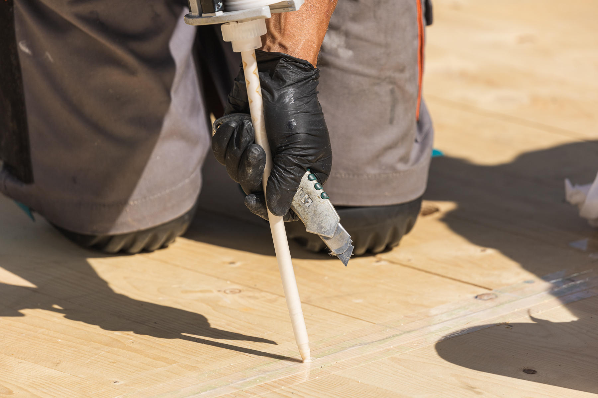
</Figure>

<Figure credit="TS3">
  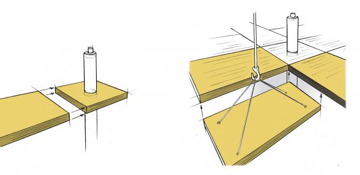
</Figure>

Eine Möglichkeit, die Klebstoffmenge zu verringern, ist der Einsatz von Schrauben (Abbildung 16). Denn steht die Klebefuge beim Aushärten unter Druck, entsteht eine feste Verbindung mit nur einem Bruchteil des sonst nötigen Klebstoffs[^kairi-2000].
Allerdings ist auch dieses Verfahren sehr arbeitsintensiv. Zudem erfüllen die Schrauben nur eine vorübergehende Funktion, bleiben aber meist im Holz, weil ihr Ausbau deutlich mehr kostet, als die Schraube selbst wert ist.

<Figure>
  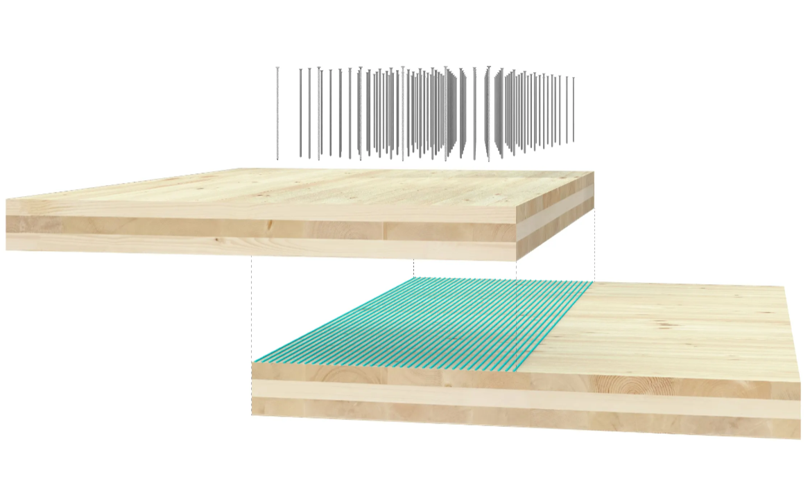
</Figure>

<Figure>
  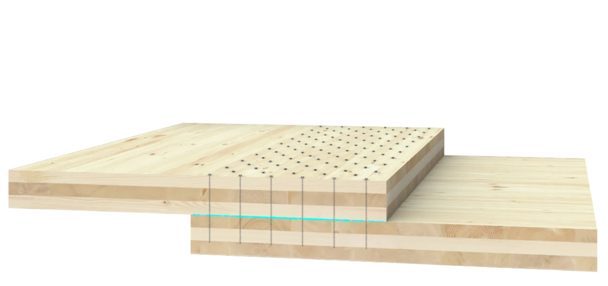
</Figure>
Abbildung 16: Ablauf der In-situ-Verklebung mit Schrauben, die den nötigen Pressdruck erzeugen.

### Stand der Technik
Drei Referenzprojekte zeigen genauer, welche Forschungslücke diese Arbeit schließen will: ein realisierter Pavillon mit kreuzweise gestapelten BSP-Platten, ein Versuch, das Verschrauben zu automatisieren, und ein robotisches Klemmsystem auf Verbindungsebene.

#### Chicago Horizon
Chicago Horizon[^schneider-2017] ist ein öffentlicher Pavillon im Grant Park mit Blick auf den Michigansee (Abbildung 17). Seine minimalistische Komposition verkörpert die Schönheit der Moderne: Eine ebene Dachscheibe aus Holz ruht einfach auf einem Feld aus Holzstützen.

<Figure credit="B. H. Schneider et al., 2017">
  
</Figure>
Ziel ist eine monolithische Holzplatte aus aufeinandergestapelten und miteinander verschraubten BSP-Platten. Die Lösung sind zwei rechtwinklig zueinander gestapelte Lagen aus BSP-Platten (Abbildung 18). BSP-Platten sind anisotrop und tragen nur in eine Richtung; rechtwinklig übereinander gestapelt, tragen sie jedoch zweiachsig.

<Figure credit="B. H. Schneider et al., 2017">
  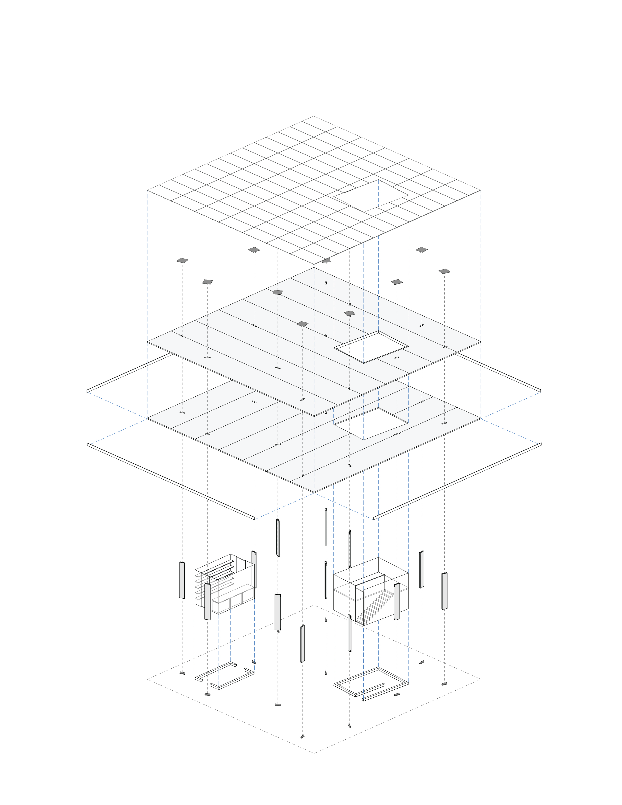
</Figure>

#### Mass Timber Fastening
Ein Versuch, das Verschrauben zu automatisieren, ist das Projekt Mass Timber Fastening[^swinerton-2020] mit robotischen Befestigungsmaschinen (Abbildung 19), mit denen sich viele Schrauben gleichzeitig eindrehen lassen. Die Maschinen werden jedoch weiterhin von Hand bedient, und weil sie samt ihren Kabeln von einem Bereich zum nächsten bewegt werden müssen, ist der Prozess kaum effizienter als das Verschrauben von Hand.

<Figure credit="Swinerton, 2021">
  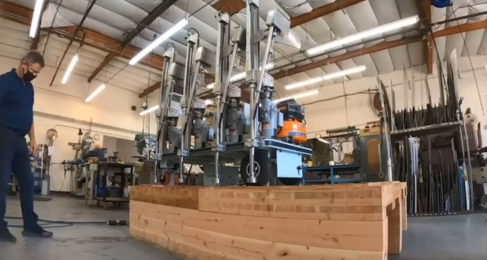
</Figure>

Jede der beiden Lagen besteht aus dreischichtigem BSP aus Schwarzfichte, 2,4 m × 17,0 m im Grundriss und 105 mm dick. In der ersten Lage sind die BSP-Platten an den Stößen über Sperrholzstreifen verschraubt. Die zweite Lage, quer zur ersten, wird auf dieselbe Weise verbunden und dann mit einem Schraubenraster an der unteren Lage befestigt. Auf diese Weise entsteht eine zweilagige BSP-Platte, deren Elemente miteinander verschraubt sind. Das Ergebnis ist eine Dachkonstruktion von 210 mm Dicke mit Spannweiten von bis zu 9 m zwischen den Stützen. Das ergibt eine insgesamt geringe Plattendicke und erlaubt sogar eine freie Stützenanordnung, ist statisch aber auf ein einziges Geschoss beschränkt. Zudem ist das System mit fast 50 Schrauben pro Quadratmeter kaum skalierbar.

#### Automatic Assembly of Jointed Timber Structure Using Distributed Robotic Clamps
Das Projekt der ETH Zürich[^leung-2021] verfolgt einen anderen Ansatz. Statt eine große Maschine zu entwickeln, die eine Bauaufgabe automatisiert, setzt das Team verteilte Klemmen ein, um die Verbindungen einer komplexen Holzkonstruktion zu fügen (Abbildung 20). Im Zusammenspiel mit einem Industrieroboter nehmen diese Klemmen dem Roboter ab, große Montagekräfte aufzubringen und Fehlstellungen beim Fügen zu korrigieren. Dem System fehlt jedoch die Skalierbarkeit, da es weiterhin auf die Reichweite eines Industrieroboters beschränkt ist.

<Figure credit="P. Y. V. Leung et al., ETH Zürich, 2021">
  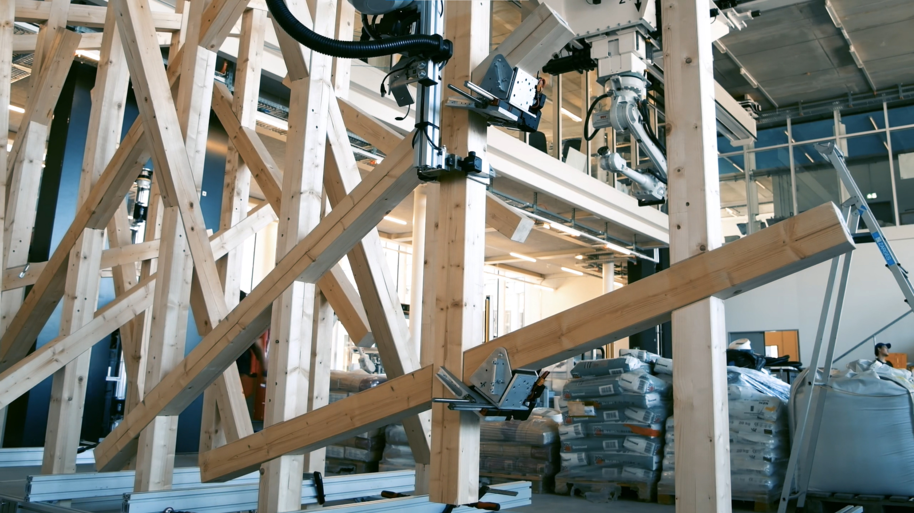
</Figure>

## Entwicklung
Aufbauend auf den zuvor identifizierten Lücken gliedert sich die Entwicklung in ein Materialsystem und ein heterogenes Robotersystem, die beide in kontinuierlichem Dialog miteinander entworfen wurden.

### Methode
Wie bereits erwähnt, lassen sich unsere Methoden in zwei Teile gliedern: zum einen die Untersuchung und Entwicklung eines Materialsystems aus Holzelementen und einer In-situ-Klebeverbindung, zum anderen die Entwicklung eines heterogenen Robotersystems einschließlich der Koordination aller Akteure, von der Fertigung vor Ort bis zur In-situ-Fügung.

<Figure>
  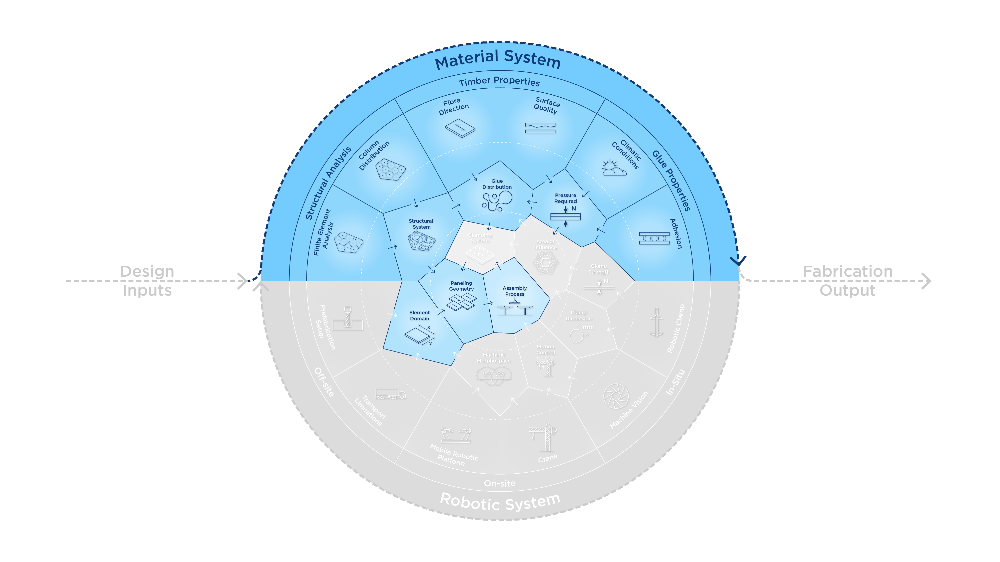
</Figure>

<Figure>
  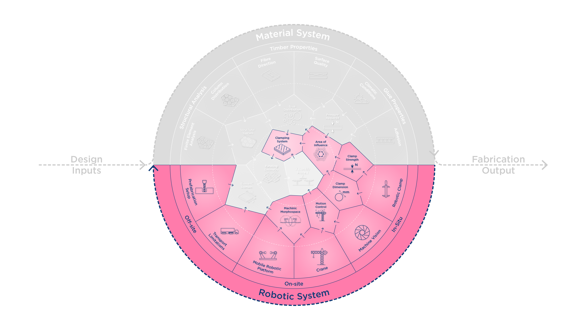
</Figure>

### Forschungsverlauf
Am Anfang stand eine Untersuchung akademischer und industrieller Akteure auf der Baustelle, die unter verschiedenen Gesichtspunkten verglichen wurden, um mögliche Kombinationen für ein kollaboratives Bauszenario zu finden. Es zeigte sich, dass keiner der Akteure alle Bereiche allein abdecken kann, aber durch die Kombination vieler Akteure können die Schwächen jedes Systems kompensiert werden. Während verteilte Roboter beispielsweise nicht die Traglasten eines traditionellen Krans erreichen können, punkten sie in anderen Bereichen wie der Präzision, da sie für eine spezifische Aufgabe angepasst werden können. Kombiniert man beide Systeme, Kran und verteilte Roboter, könnten sie voneinander profitieren und Aufgaben mit hoher Traglast bei gleichzeitig hoher Präzision ausführen. Eine mögliche Kombination aus Kran, TIM und verteilten Robotern bestimmte die nächsten Schritte dieser Forschung.

<Figure>
  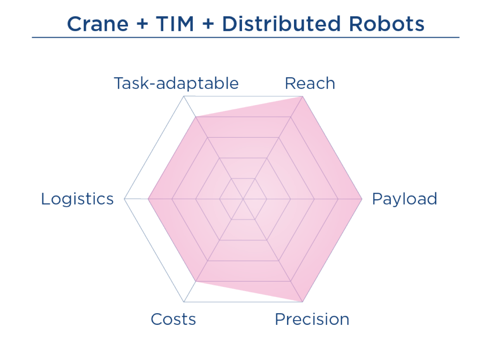
</Figure>
Abbildung 23: Vergleich verschiedener robotischer Akteure vor Ort.
#### Maßgeschneidertes robotisches Klemmgerät
Aufbauend auf verfügbarer Bautechnologie wurde eine neue robotische Spezies für die In-situ-Verbindung vorgeschlagen. Das Ziel war es, eine In-situ-Klebeverbindung zwischen den verschiedenen Holzelementen herzustellen. Anstatt eine große Maschine zum Verschrauben und Erzeugen des nötigen Drucks zu entwickeln, wie sie im Referenzprojekt „Mass Timber Fastening“ entwickelt wird (Abbildung 24), verfolgt unsere Forschung einen ähnlichen Ansatz wie das andere oben vorgestellte Referenzprojekt, „Automatic Assembly of Jointed Timber Structure Using Distributed Robotic Clamps“[^leung-2021]. Wir dachten: Warum nicht ein kleineres Gerät entwickeln, das den Druck ebenso gut aufbringen kann wie eine Vielzahl von Schrauben, aber danach automatisch entfernt werden kann (Abbildung 25)?

<Figure>
  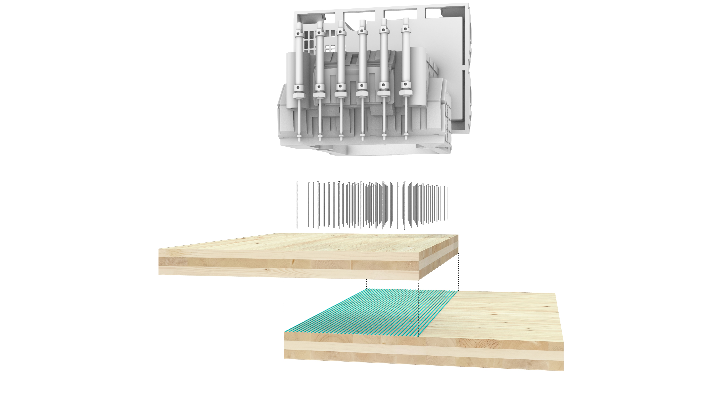
</Figure>

<Figure>
  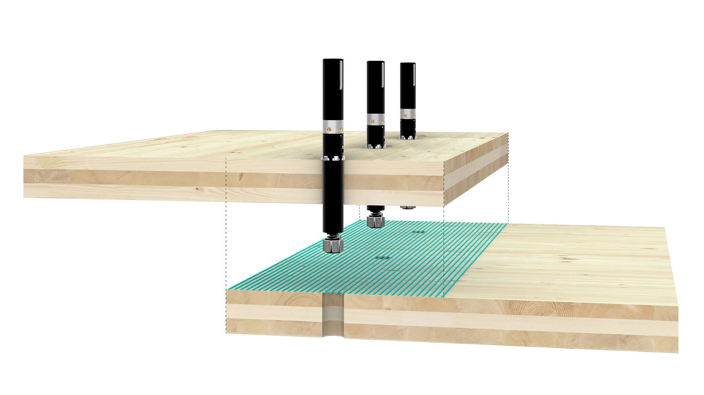
</Figure>
Das Gerät funktioniert so: Es wird vor Ort in vorgebohrte Löcher im Holz eingesetzt und baut dort seinen Druck auf. Dafür muss es zwei Dinge tun: Es muss sich im Holz verankern und den Pressdruck aufbringen, den der Klebstoff zum Aushärten braucht. Nach dem Einsatz baut das Gerät den Druck ab und fällt aus dem Loch zu Boden. Dies ermöglicht die Automatisierung der In-situ-Verbindung.
Weil das Gerät wiederverwendbar ist, bleibt zudem kein Metall im Bauwerk zurück; das eröffnet mehr Möglichkeiten für ein zweites Leben am Ende seiner Nutzungsdauer. Laut Jianmei Wu ist der Engpass bei der Demontage von Holzgebäuden das Lösen der Verbindungen. Daher kostet der Rückbau mehr Zeit als ein schneller Abriss[^wu-2017].

#### Heterogenes Robotersystem
Werden alle Akteure auf der Baustelle eng miteinander verknüpft, entsteht ein heterogenes Robotersystem, dessen Teile in verschiedenen Maßstäben arbeiten und einander ergänzen. Um das Gerät optimal zu nutzen, arbeitet das System in drei Schritten: Eine mobile Industrieroboterplattform bereitet die vorgefertigten Holzelemente vor und trägt dabei den Klebstoff auf die Platten auf, ein Kran transportiert sie, und schließlich fügt unser Gerät die Elemente in situ. Die Schritte sind eng aufeinander abgestimmt, sodass ein kollaborativer Arbeitsablauf entsteht.

<Figure>
  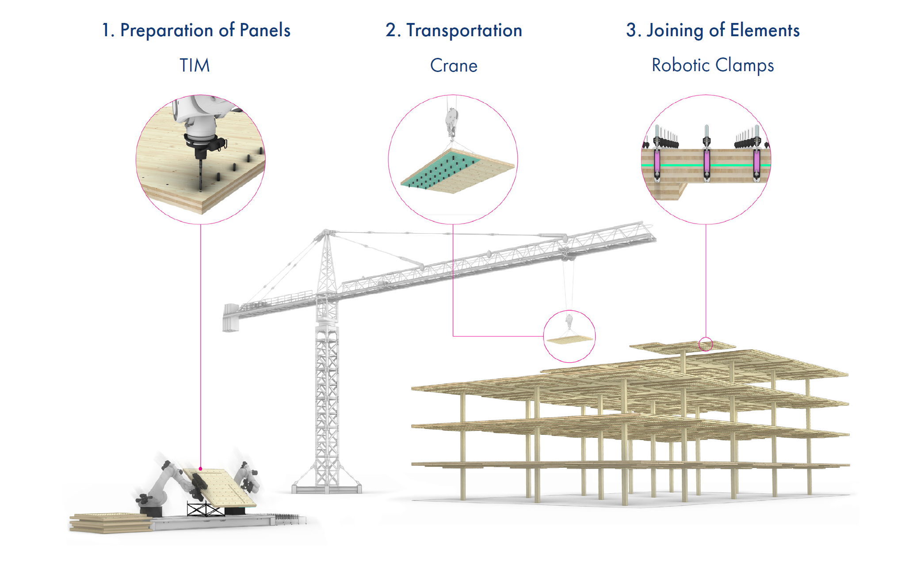
</Figure>

#### Bausystem
Da Entwurfsabsichten und Baustellenbedingungen variieren können, darf das Bausystem nicht starr sein, sondern muss ein anpassungsfähiger Rahmen sein, der darauf reagiert. Seine beiden Hauptbestandteile sind die Material- und die Roboterseite.
Aus etwas größerer Distanz zeigt sich, dass sich viele Unterparameter gegenseitig beeinflussen. Werden diese Parameter gemeinsam entworfen (Co-Design), entsteht ein Fertigungssystem, das auf einen Gesamtentwurf zugeschnitten ist.
Beispielsweise ist einer der kritischen Aspekte der Elementlogik die maximale montierbare Plattengröße, da sie durch den maschinellen Morphospace[^menges-2013] der mobilen Roboterplattform definiert wird. Mit dem Setup von TIM wären Platten von 3 × 2 m möglich[^wagner-tim-2020]. Je nach Konfiguration (z. B. mit einer zusätzlichen Linearachse) können sich diese Abmessungen ändern, sodass das System mit unterschiedlich feinen Plattenrastern arbeiten kann. Die folgenden Abschnitte zeigen den computergestützten Workflow des Bausystems unter dieser Randbedingung.

<Figure>
  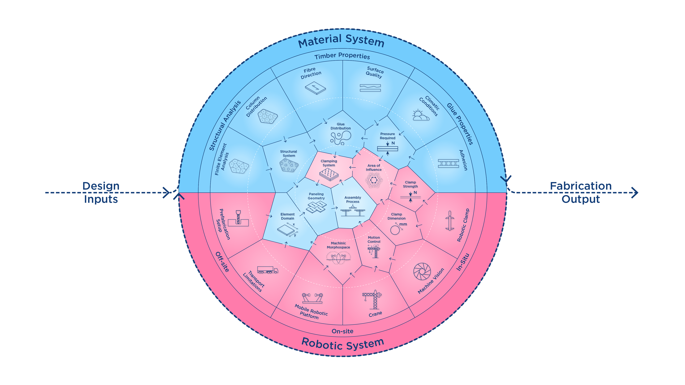
</Figure>

##### Elementierung
Ausgangspunkt der Elementierung ist der Mittelpunkt jeder Stütze. Die Stützenpositionen können je nach Entwurfsabsicht festgelegt werden. Alternativ kann bei vorgegebener Grundstücksgrenze ein Algorithmus die Stützen gleichmäßig verteilen. Mithilfe von Karamba3D wird dann das Biegemoment der Platte berechnet. Die Elemente werden so angeordnet, dass die Elementfugen die Bereiche hoher Biegemomente meiden. Daraus ergibt sich wie von selbst eine „Pilzstützen“-Ästhetik, da die größten Biegemomente üblicherweise über den Stützen und in Feldmitte auftreten. Die Elemente werden dann von der Stütze nach außen aufeinandergestapelt; ein letztes Element überbrückt die Feldmitte zwischen benachbarten Stützen. Neben der Statik bestimmen auch die Fertigung und, wie bereits erwähnt, baustellenspezifische Randbedingungen wie Transportbeschränkungen und der maschinelle Morphospace der mobilen Industrieplattform die Elementierung.

<Figure>
  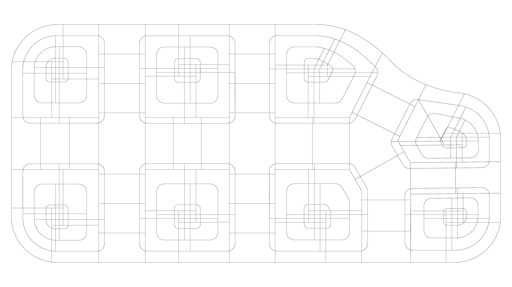
</Figure>

<Figure>
  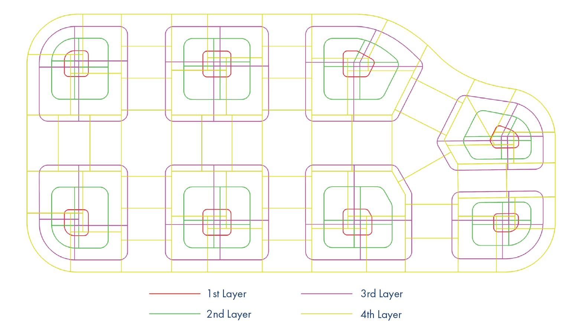
</Figure>

<Figure>
  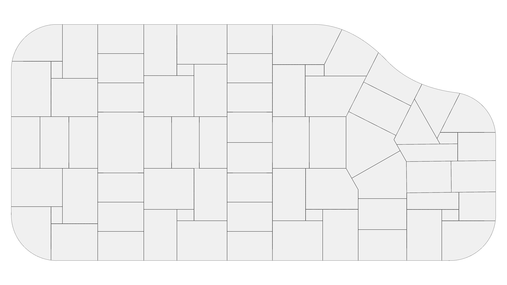
</Figure>

##### Klebstoffverteilungslogik
Steht die Elementierung fest, wird das statische Modell erneut berechnet; das Ergebnis bestimmt die Klebstoffverteilung, die letztlich den Abstand der Löcher für das In-situ-Verpressen festlegt. In diesem Entwicklungsschritt war eine zentrale Frage: Wie können wir den Klebstoffverbrauch reduzieren und den Arbeitsaufwand vor Ort minimieren?
Da der Klebstoff stets fester ist als das Holz und Kräfte nur über Schub übertragen kann, beginnt das Versagen meist mit dem Abscheren der Holzfasern in Plattenebene unmittelbar neben der Klebefuge. Daher werden die Querschnittsspannungen, die von der Platte in die Stütze fließen, berechnet und durch die Schubfestigkeit des BSP in Plattenebene geteilt. Daraus ergibt sich eine Heatmap, die Bereiche hervorhebt, in denen mehr Klebstoff benötigt wird. Abhängig von der Dimensionierung des robotischen Klemmgeräts ist es möglich, die entsprechende Gerätekraft und die resultierende Einflussfläche zu berechnen, die verpresst werden kann. Mit diesen Informationen kann die Heatmap dann mit der richtigen Anzahl an Geräten bestückt werden, sodass überall der erforderliche Pressdruck erreicht wird. Die Klebstoffraupen werden dann für den späteren Auftrag vor Ort ausgerichtet, um den robotischen Werkzeugpfad zu optimieren.
<Figure>
  
</Figure>

<Figure>
  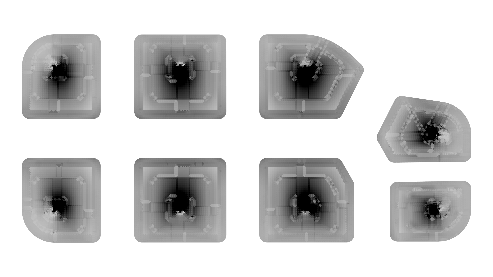
</Figure>

<Figure>
  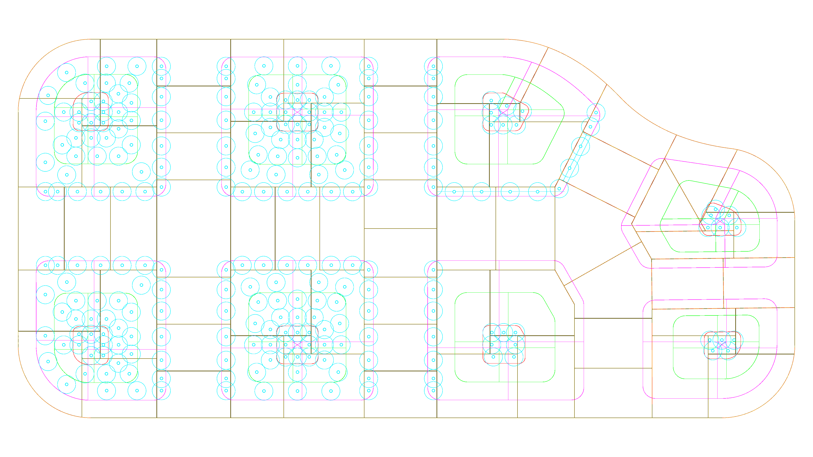
</Figure>

##### Ausrichtungskanäle
Um mit den Toleranzen des Krans arbeiten zu können, werden zusätzliche Informationen in das Material eingebettet, um den Prozess der automatisierten Montage effizienter zu gestalten. Dazu werden in das eine Element Ausrichtungskanäle eingefräst und in das andere Ausrichtungsdübel eingesetzt. Dieses System funktioniert ähnlich wie LEGO-Steine. Kanäle und Dübel werden abhängig von der Elementierung und der Montagereihenfolge der einzelnen Elemente generiert.
Die Sequenz ist wie folgt: Zuerst wird die Platte abgesenkt, bis die Dübel auf die darunterliegende Plattenoberfläche treffen; dann kann die Platte entlang der Oberfläche gezogen werden, bis die Holzdübel in die Ausrichtungskanäle gleiten. Damit ist die Bewegung der Platte auf eine Richtung eingeschränkt; sie kann dann durch den eingefrästen Kanal gezogen werden, bis die Dübel in ihre vorgesehenen Löcher gleiten.

<Figure>
  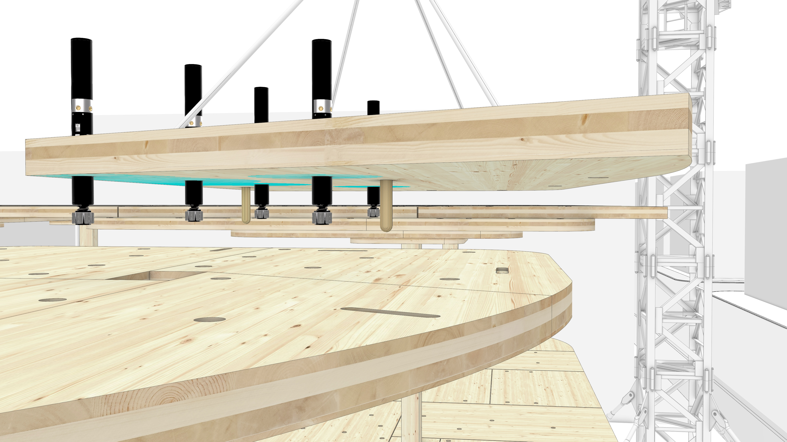
</Figure>

<Figure>
  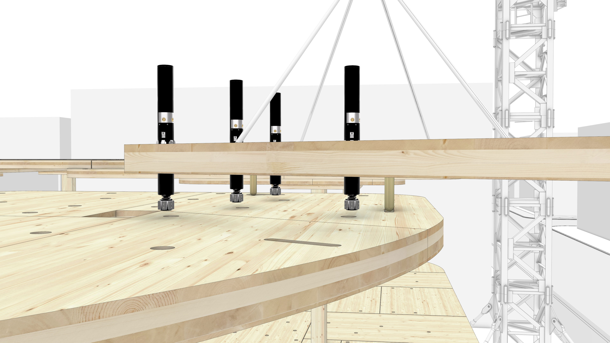
</Figure>

<Figure>
  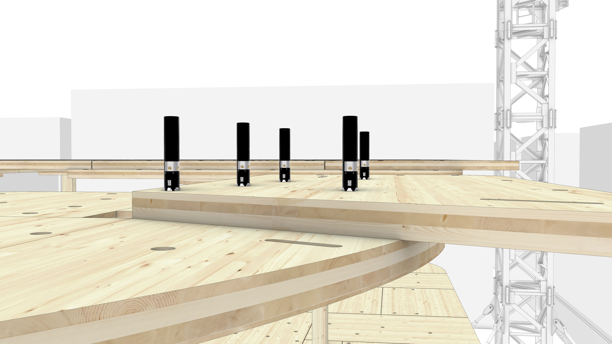
</Figure>

#### Bauszenario
Auf der Baustelle folgt die Montage den unten gezeigten Schritten. Zuerst bereitet die mobile Roboterplattform (TIM) die vorgefertigten Holzelemente vor, die anschließend in situ platziert werden.

<Figure>
  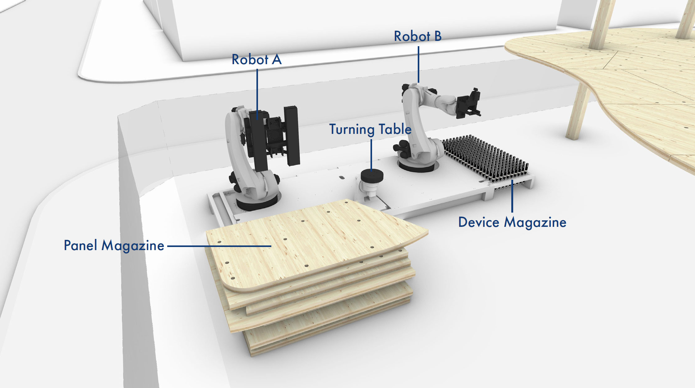
</Figure>

<Figure>
  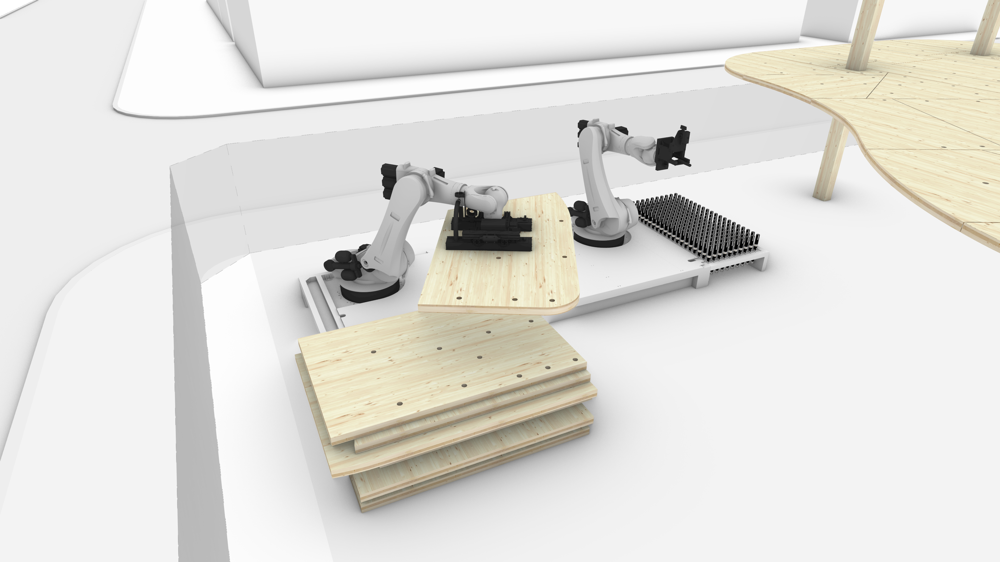
</Figure>

<Figure>
  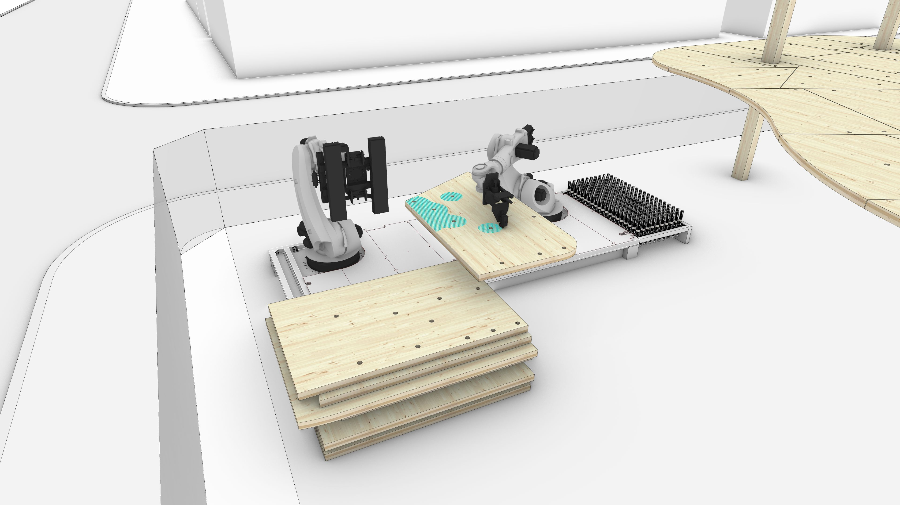
</Figure>

<Figure>
  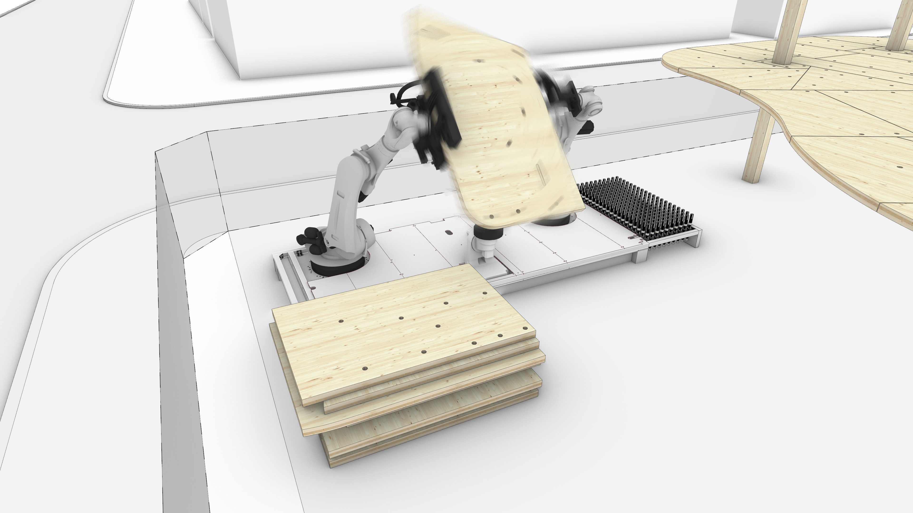
</Figure>

<Figure>
  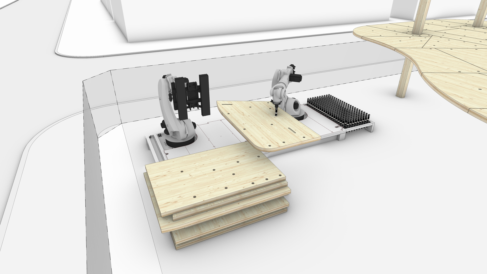
</Figure>

<Figure>
  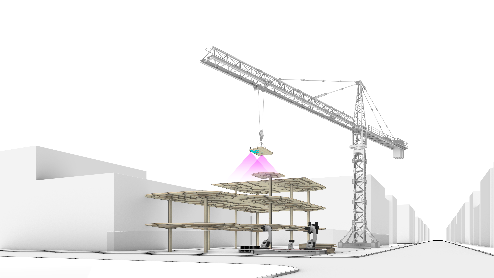
</Figure>

<Figure>
  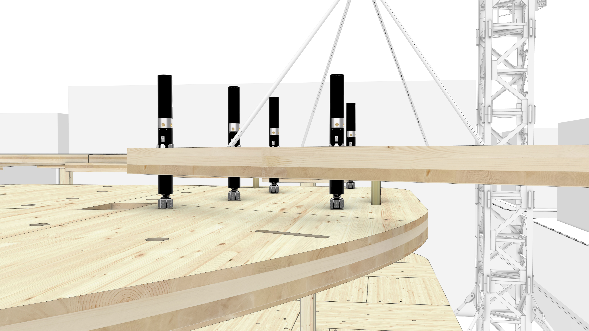
</Figure>

<Figure>
  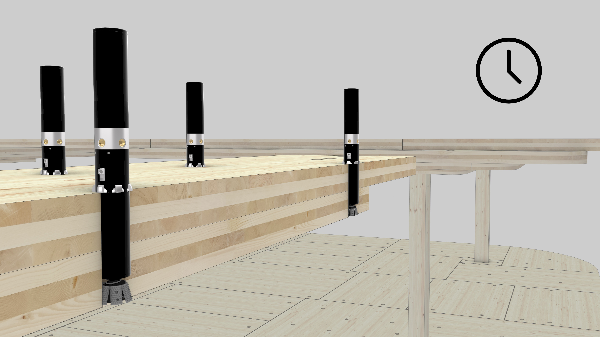
</Figure>

<Figure>
  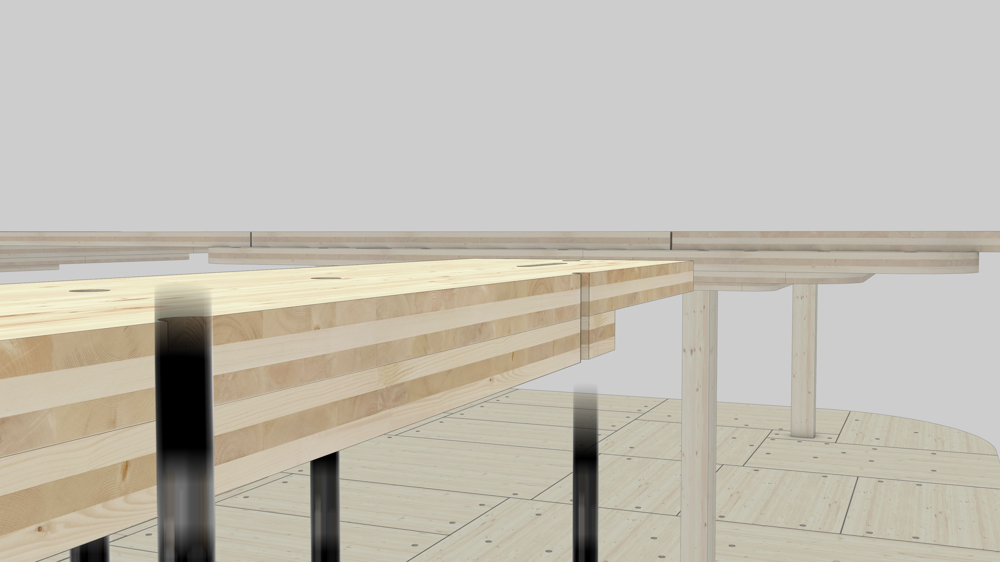
</Figure>

#### Hardware-Entwicklung
Das Gerät lässt sich in vier Komponenten gliedern: die Steuerung und ein Anker oben, der Kontraktionsmechanismus in der Mitte und ein weiterer Anker unten.
Grundsätzlich muss das Gerät zwei Dinge tun: Es muss sich im Holz verankern und den Pressdruck aufbringen, den der Klebstoff zum Aushärten braucht. Eine der größten Herausforderungen dabei ist, dass das Gerät so klein wie möglich sein und zugleich so viel Druck wie möglich aufbringen muss.

<Figure>
  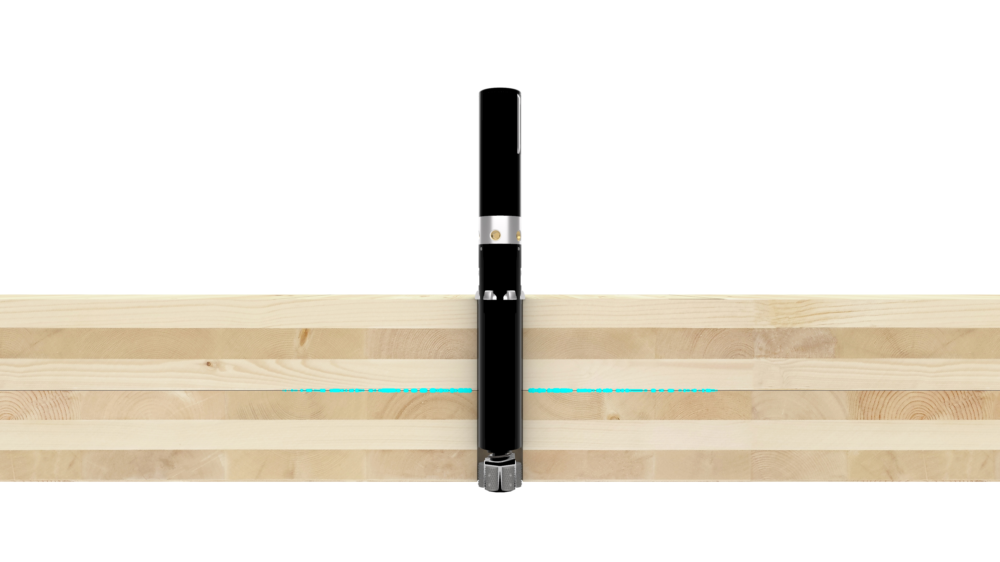
</Figure>

Wir haben uns daher für einen pneumatischen Ansatz entschieden, da diese Systeme ein hervorragendes Verhältnis von Leistung zu Gewicht aufweisen. Sie benötigen zudem wenig Wartung, sind kostengünstig und sehr robust, da sie feuer- und wasserbeständig sind. Um den erforderlichen Druck im Gerät bereitzustellen, verwenden wir eine nachfüllbare CO2-Patrone. Darin ist das CO2 flüssig gespeichert, sodass das gesamte Gerät auf einen Betriebsdruck von 6 bar gebracht werden kann.
In unserem Fall verwenden wir einen pneumatischen Muskel, der aktiviert werden kann, um eine lineare Zugbewegung auszuführen. Wenn der Muskel aufgeblasen wird, dehnt er sich radial aus und zieht sich in Längsrichtung zusammen, wodurch eine Zugkraft entsteht.
Diese Bewegung wird auf den unteren Anker übertragen. Eine Feder am unteren Ende wandelt die erste Bewegung des Muskels in eine Klappbewegung des Ankers um, mit der er sich im Holz einhakt.

Da beide Anker an den Außenseiten der Platten sitzen, erfasst das Gerät die größtmögliche Fläche. Abhängig von der Dicke der beiden verpressten Platten und der Kraft des Geräts kann die mögliche Einflussfläche mit den zuvor erklärten Methoden berechnet werden. Das Gerät selbst kann über eine WLAN-Verbindung gesteuert werden, sodass Zeitpunkt und Dauer des Aufblasens je nach offener Zeit und Presszeit des gewählten Klebstoffs angepasst werden können.
Nachdem der Klebstoff ausgehärtet ist, kann das CO2 aus dem System abgelassen werden, um den Druck auf die Anker zu lösen, sodass das Gerät für den nächsten Einsatz zu Boden fallen kann.
Wir haben auch verschiedene Möglichkeiten untersucht, das Gerät während des Verpressens des Klebstoffs zu schützen. Dazu gehörten Vaseline, gefräste Kanten um die Innenseite des Lochs und verschiedene Arten von Papier. Letztlich haben wir uns für ein dünnes Blatt Papier entschieden, das um das Gehäuse des Geräts gewickelt wird, da dies die einfachste Lösung zu sein schien. Je nach Klebstoff halten wir das jedoch nicht für zwingend nötig. So wurde bei einem nicht schäumenden Klebstoff wie 2K-PUR kein Klebstoff in das Loch gedrückt, wenn 1 cm Abstand zum Lochrand frei blieb.

<Figure>
  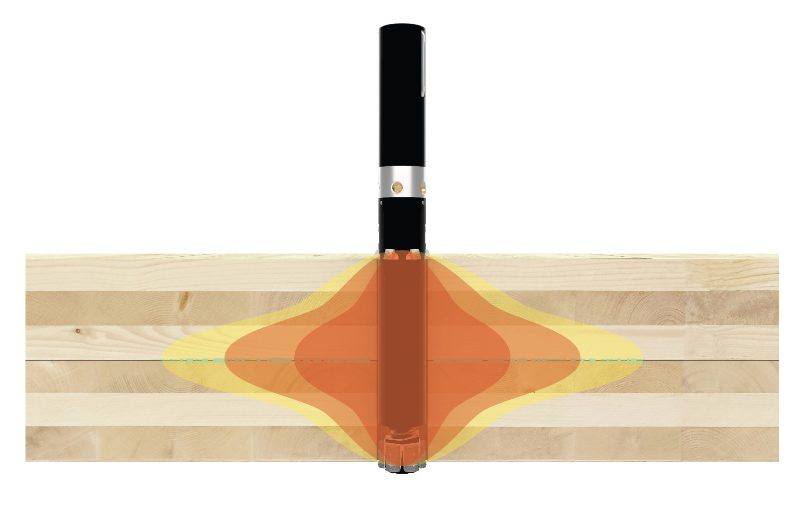
</Figure>

#### Zugkrafttest
Um die Kraft unseres Geräts zu bewerten, führten wir einen Zugkrafttest durch. Dazu wurde das Gerät zwischen Decke und Boden aufgehängt und der Muskel mit CO2 aufgeblasen.
Der Zugkrafttest wurde mit unterschiedlichen Kontraktionen wiederholt, von 5 % bis 25 % Gesamtkontraktion des pneumatischen Muskels. Eingestellt wurde dies über die Spannung der Seile, an denen der Muskel hing. Im aufgeblasenen Zustand bei 5 % Kontraktion erreichte unser kleiner Muskel ca. 500 N, während der große Muskel 2000 N erreichte; beides ist etwa die Hälfte der geschätzten Kraft, die in einem industriellen Aufbau theoretisch möglich wäre. Der Grund dafür ist, dass unsere CNC-gefrästen Teile nicht 100 % luftdicht waren, was es unmöglich machte, den maximalen Druck zu halten, für den der pneumatische Muskel ausgelegt war. Wir sind jedoch der Ansicht, dass mit einer überarbeiteten Ventilkonstruktion und präziserer Fertigung die geschätzte Kraft erreicht werden könnte.

<Figure>
  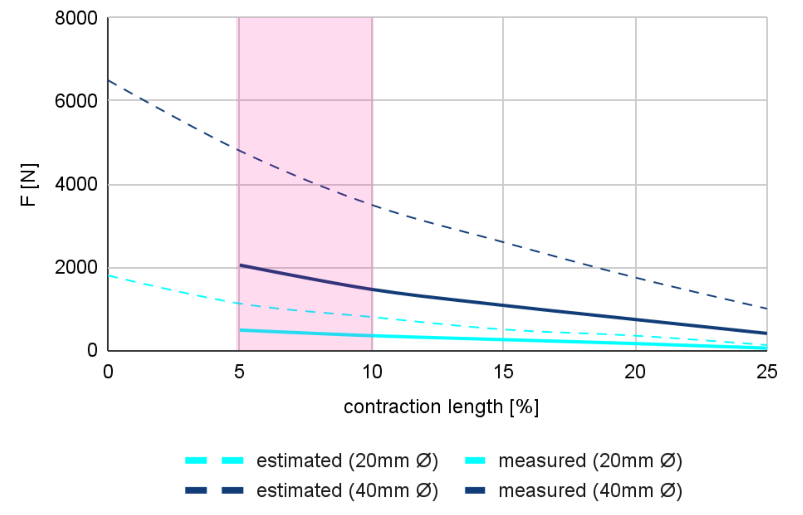
</Figure>

<Figure>
  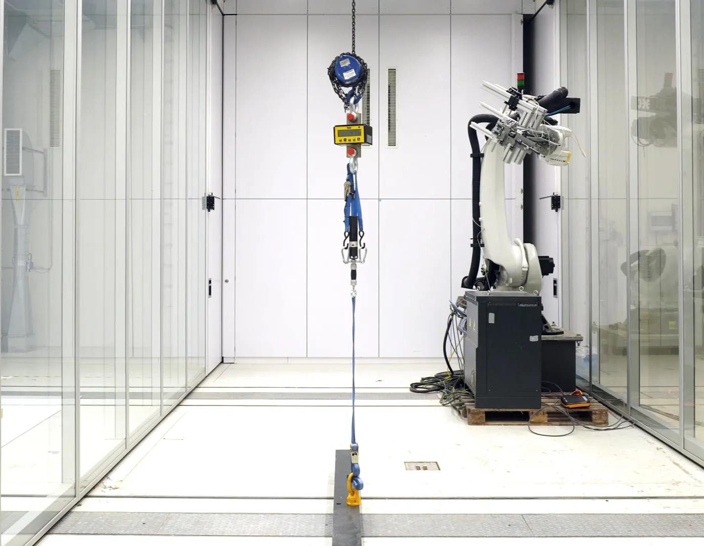
</Figure>

#### Berechnung des Lochabstands
Die Berechnung der Einflussfläche für das robotische Klemmgerät folgt der Berechnung des Schraubenabstands bei der Schraubenpressklebung. Alle Berechnungen wurden mit einer 200 mm dicken Fichtenplatte und einer Klebstoffmenge von 300 g/m² durchgeführt.
Die erste Studie basierte auf einem Mindestdruck von 0,1 N/mm², da dies die aktuelle Anforderung der DIN-Norm ist. Durch verschiedene Abstände zwischen den Geräten ändert sich die Einflussfläche und damit auch die erforderliche Kraft, die von jedem Gerät aufgebracht werden muss. Diese jeweils benötigte Kraft bestimmt dann die Dimensionierung und den Durchmesser des Geräts.
Die zweite Studie basiert auf einem Mindestdruck von 0,03 N/mm², nach einem Beitrag der Helsinki University of Technology[^kairi-2000], der über Versuche bei diesem Druck berichtet: Demnach lässt sich eine Klebefuge herstellen, deren Scherfestigkeit ebenso hoch ist wie bei Verpressung mit üblichem Druck. Voraussetzung ist, dass die zu verklebenden Flächen ausreichend glatt sind.
Die letzte Studie geht von einem optimistischeren Mindestdruck von 0,01 N/mm² aus; wie bereits erwähnt, weist die jüngste Forschung in der Materialwissenschaft aber in eine vielversprechende Richtung. Dies würde bereits eine Einflussfläche von 150.000 mm² für ein Gerät mit einem Durchmesser von 40 mm ergeben.

<Figure>
  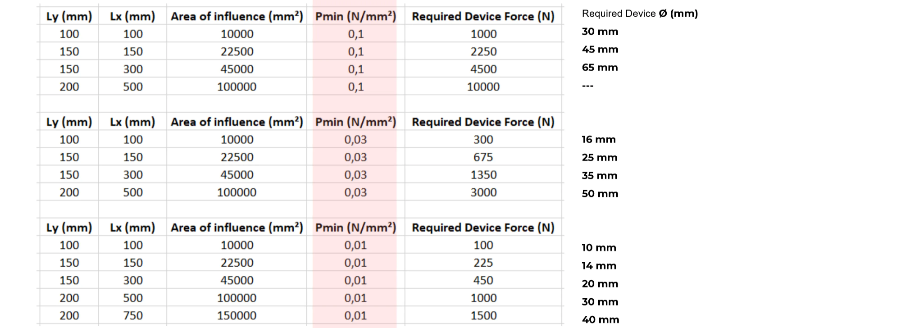
</Figure>

<Figure>
  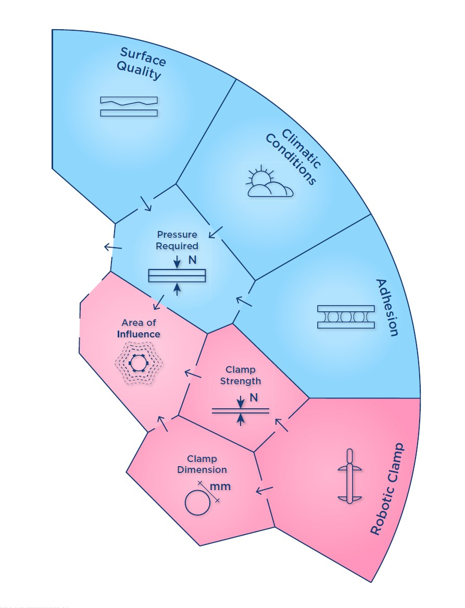
</Figure>

#### Ausrichtungsstrategie
Obwohl wir uns im aktuellen Entwicklungsschritt hauptsächlich auf den Verpressmechanismus konzentriert haben, haben wir auch über eine Erweiterung des Geräts nachgedacht, die das Fügen und Montieren der Elemente unterstützt. Während die Ausrichtungskanäle im Holz die Elemente auf den letzten Zentimetern ausrichten, könnte ein Kamerasystem den Kran so führen, dass er in den Toleranzbereich der Ausrichtungskanäle gelangt. Dazu ließe sich entweder eine Kamera in den unteren Anker des Geräts integrieren oder ein zusätzliches Gerät mit Kamera und höherer Rechenleistung entwickeln. Zusätzlich könnten stabilere Stifte für die passive Ausrichtung der Elemente verwendet werden. Alternativ könnten dies Holzdübel sein, die nach der Montage in der Struktur verbleiben.
Die Idee ist, dass die Platte abgesenkt wird, bis die Dübel auf die Oberfläche der Holzstruktur treffen, von wo aus die Platte dann entlang der Oberfläche gezogen werden kann, bis die Holzdübel in den Ausrichtungskanal gleiten. Damit ist die Bewegung der Platte auf eine Richtung eingeschränkt; sie kann dann durch den eingefrästen Kanal gezogen werden, bis die Dübel in ihre vorgesehenen Löcher gleiten.

Die Ausrichtungskanäle wurden in zwei verschiedenen Versuchsanordnungen getestet. Die erste bestand aus 80 × 50 × 2 cm Holzplatten mit 1,5 cm dicken Dübeln, und die zweite aus einer 120 × 80 × 10 cm BSP-Platte mit 4 cm dicken Dübeln. Beide Tests validierten das geometrische Konzept des Ausrichtungskanals, da es möglich war, die Platten ohne manuelle Anpassungen in der richtigen Position zu montieren. Das Gleiten der Dübel war jedoch nicht so einfach wie erwartet, da die Reibung an der Dübelspitze oft dazu führte, dass die Dübel nicht entlang des Kanals glitten, sondern sich die Platte um die Achse des Dübels drehte.
Ein Ansatz zur Lösung dieses Problems bestand darin, die Seile des Krans nicht an einem einzelnen Punkt mit freier Rotation an der Kranspitze zu befestigen, sondern an vier voneinander entfernten Anschlagpunkten. Weitere Iterationen, etwa ein dritter Dübel pro Element oder angefaste Kanäle, wären nötig, um nachzuweisen, dass das Konzept effizient genug für einen autonomen Kran ist.

<Figure>
  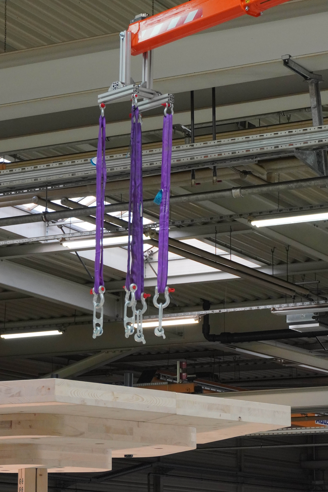
</Figure>

Mit maschineller Bildverarbeitung könnte das Gerät die Löcher erkennen, während es bei der Montage mit dem Kran abgesenkt wird. Der Abstand zwischen den Löchern könnte dann mit dem digitalen Modell abgeglichen werden, um die aktuelle Position und Rotation des zu montierenden Elements zu berechnen. Der gesamte Montagevorgang könnte dann durch ein Feedbacksystem automatisiert werden, das mit der Steuerung des Krans verbunden ist. Die Dübel und Ausrichtungskanäle würden dann dazu dienen, das Element in seine endgültige Position gleiten zu lassen.
Die Platte würde abgesenkt, bis die Dübel auf die Oberfläche der Holzstruktur treffen, von wo aus sie dann entlang der Oberfläche gezogen werden kann, bis die Holzdübel in den Ausrichtungskanal gleiten. Damit ist die Bewegung der Platte auf eine Richtung eingeschränkt; sie kann dann durch den eingefrästen Kanal gezogen werden, bis die Dübel in ihre vorgesehenen Löcher gleiten.

<Figure>
  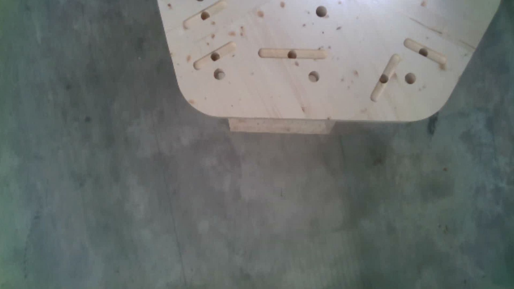
</Figure>

<Figure>
  
</Figure>

<Figure>
  
</Figure>

<Figure>
  
</Figure>

Abbildung 62: Locherkennung der Holzelemente mittels maschineller Bildverarbeitung.

Erste Tests wurden als Machbarkeitsnachweis für die vorgeschlagene Idee durchgeführt. Dazu wurde eine externe Kamera an dem Element befestigt, das am Kran hing. Wir verwendeten die Intel RealSense D435. Mithilfe der Bibliotheken realsense2 und OpenCV war es dann möglich, die Löcher zu erkennen. Das Kamerabild wurde schrittweise gefiltert, um die Lage der Löcher relativ zur Kamera als Koordinaten zu gewinnen: erst eine Umwandlung in Graustufen, dann eine Glättung zur Rauschminderung und schließlich ein Schwellenwertfilter für einen bestimmten Grauwert. Daraus konnten die Konturen herausgefiltert und deren Fläche überprüft werden, um sie mit der erwarteten Pixelgröße der Löcher abzugleichen. Diese Methode erwies sich unter guten Lichtverhältnissen als sehr zuverlässig. Da die Baustelle jedoch eine unstrukturierte Umgebung ist, müssten diese Methoden feinjustiert werden, um konsistentere Ergebnisse zu liefern.
#### Demonstrator
Ein verkleinerter Abschnitt des Holzsystems wurde als Demonstrator ausgewählt, um den Montageprozess zu validieren und die Systemtoleranzen zu bewerten. Er besteht aus einer Stütze mit drei kreuzweise übereinander verleimten Lagen aus 10 cm dicken BSP-Platten, misst oben drei Meter im Durchmesser und ist insgesamt 2,70 Meter hoch.
Die Elemente wurden auf einer 3-Achs-CNC-Maschine bearbeitet; dabei wurden die Löcher gebohrt, die Ausrichtungskanäle eingefräst und die Konturen zugeschnitten. Anschließend wurden die Elemente in das IntCDC-Labor in Waiblingen gebracht, um die Montage zu demonstrieren.

<Figure>
  
</Figure>

<Figure>
  
</Figure>
Der robotische Aufbau bestand hier aus TIM, einer mobilen Roboterplattform für die Holzfertigung, einem Spinnenkran und unserem robotischen Klemmgerät. Zusätzlich wurde ein Endeffektor entwickelt, der bei der automatisierten Positionierung der Geräte und der Dübel hilft. Zwei Prozesse ließen sich bei der abschließenden Montage nicht vorführen: Zum einen wurde der Klebstoff von Hand aufgetragen, da zu diesem Zeitpunkt die Klebepistole von TIM nicht betriebsbereit war, zum anderen wurden M20-Bolzen verwendet, um den Druck in situ aufzubringen, da ein einziger funktionsfähiger Prototyp des Geräts nicht ausreichte, um die gesamte Struktur zu montieren.

<Figure>
  
</Figure>

<Figure>
  
</Figure>

<Figure>
  
</Figure>

<Figure>
  
</Figure>

<Figure>
  
</Figure>

<Figure>
  
</Figure>

<Figure>
  
</Figure>

<Figure>
  
</Figure>

<Figure>
  
</Figure>

<Figure>
  
</Figure>

<Figure>
  
</Figure>
### Diskussion
Die Montage des fertigen Demonstrators zeigte das Potenzial des Systems im Maßstab 1:1. Obwohl der Prototyp des vorgeschlagenen Geräts die geschätzte Kraft nicht erreichte, sehen wir eine vielversprechende Entwicklung in diese Richtung. Wir sind optimistisch, dass diese Kraftwerte in weiteren Iterationen erreicht werden können. Weiterentwicklungsbedarf besteht auch beim Fallmechanismus. Obwohl der Mechanismus funktioniert, bestehen Bedenken hinsichtlich der Langlebigkeit des Geräts in einem realen Bauszenario. Bisherige Ideen zur Lösung dieses Problems sehen einen Dämpfungsmechanismus am unteren Ende des Geräts vor. Ein anderer, konzeptioneller Ansatz wäre, grundsätzlich zu hinterfragen, ob das Gerät überhaupt zu Boden fallen muss.
Dank der Ausrichtungskanäle ließen sich die Elemente sehr präzise montieren, ohne dass ihre Lage in situ korrigiert werden musste. Ein zusätzlicher Vorteil der Dübel: Die gesamte Struktur ließ sich ohne Gerüst montieren, weil die Dübel die Platten stabil genug hielten, um anschließend in situ zu verpressen. Dies war besonders wichtig, da der Schwerpunkt der „Blätter“ zu diesem Zeitpunkt nicht über der Hauptstruktur lag; ohne die Dübel wären sie gekippt. Befürchtete Probleme wie abtropfender Klebstoff beim Transport der Elemente mit dem Kran traten bei der Montage nicht auf.
### Ausblick
Das vorgeschlagene Holzsystem zeigt, dass sich eine quasi-monolithische Platte herstellen lässt. Das ermöglicht eine punktgestützte Holzplatte mit unbegrenzten Abmessungen, was mehr Gestaltungsflexibilität im Grundriss eröffnet und den architektonischen Entwurfsraum erweitert. Um es jedoch vollständig als funktionierendes Bausystem zu validieren, müssen weitere Aspekte wie Schall- und Brandschutz sowie die Integration von Haustechnik berücksichtigt werden.
Die Arbeit zeigte die Vorteile eines heterogenen Robotersystems und wie sich der Holzbau auf der Baustelle durch ein Co-Design mit dem Material weiter automatisieren lässt. Die Integration von Konstruktionslogik in das Material stellt einen Ansatz dar, um hohe Präzision während der Montage zu erreichen und den Betrieb eines Krans zu automatisieren. Die Anwendung des verteilten Geräts für das In-situ-Verpressen von Klebeverbindungen zeigt vielversprechende Ansätze zur Automatisierung dieses Prozesses. Insbesondere angesichts der exponentiellen Entwicklung bei Klebstoffen und der Tatsache, dass Holzkonstruktionen mit Beton konkurrieren müssen, sehen wir ein großes Potenzial für den Einsatz des Geräts in einem industriellen Umfeld.
## Danksagung
Wir möchten danken…

**Samuel Leder & Hans Jakob Wagner** für ihre beständige Unterstützung während unserer Masterarbeit und wertvolle Einblicke, ohne die diese Arbeit nicht möglich gewesen wäre. Und natürlich für ihre Geduld und das Beantworten unserer spätabendlichen E-Mails.

**Dem gesamten ITECH-Jahrgang 2021** für eine unglaubliche gemeinsame Zeit in den letzten zwei Jahren.

**Katja Rinderspacher** dafür, dass sie immer für uns da war und uns durch unsere Zeit an der Universität begleitet hat.

**Bernhard Rolle** für wertvolle Einblicke in den neuesten Stand der Automatisierung und der Krantechnik für die Montage vor Ort.

**Anja Lauer** dafür, dass sie uns alles über den Kranbetrieb beigebracht und uns zugetraut hat, keinen Kran zu Fall zu bringen.

**Tzu-Ying Chen** für ihre ingenieurtechnische Beratung und dafür, dass sie sich stets Zeit für unsere statischen Fragen nahm.

**Sergej Klassen & Kai Stiefenhofer** für ihre Unterstützung und Anleitung während der Fertigung unseres Demonstrators.

**Michael Preisack, Michael Schneider & Michael Tondera** für ihre Hilfe in der Holz- und Metallwerkstatt und ihre Geduld mit unseren schweren Holzplatten.

**Prof. Achim Menges & Prof. Jan Knippers** für ihr wertvolles Feedback, ihre Weisheit und die Chance, Teil dieses Studiengangs zu sein.

**Festo, Müllerblaustein und Henkel** für die Bereitstellung der Materialien und der Ausrüstung, ohne die diese Arbeit nicht möglich gewesen wäre.

**IntCDC**, teilweise gefördert durch die Deutsche Forschungsgemeinschaft (DFG) im Rahmen der Exzellenzstrategie des Bundes und der Länder – EXC 2120/1 – 390831618.

**Unseren Familien und Freunden** dafür, dass sie immer hinter uns standen und uns angefeuert haben.

[^kaufmann-2018]: H. Kaufmann, S. Krötsch, and S. Winter, *Manual of multi-storey timber construction*. Munich: Detail Business Information, 2018. ISBN 978-3955533946.

[^un-2019]: United Nations, Department of Economic and Social Affairs, Population Division, *World urbanization prospects: the 2018 revision*, 2019. [Online]. Available: [https://web.archive.org/web/20210207015917/https://population.un.org/wup/Publications/Files/WUP2018-Report.pdf](https://web.archive.org/web/20210207015917/https://population.un.org/wup/Publications/Files/WUP2018-Report.pdf) (accessed Feb. 22, 2021). ISBN 978-92-1-148319-2.

[^petersen-2019]: K. H. Petersen, N. Napp, R. Stuart-Smith, D. Rus, and M. Kovac, "A review of collective robotic construction," *Sci. Robot.*, vol. 4, no. 28, p. eaau8479, Mar. 2019, doi: [10.1126/scirobotics.aau8479](https://doi.org/10.1126/scirobotics.aau8479).

[^barbosa-mckinsey]: F. Barbosa et al., "Reinventing Construction: A Route to Higher Productivity," McKinsey & Company. [Online]. Available: [https://www.mckinsey.com/capabilities/operations/our-insights/reinventing-construction-through-a-productivity-revolution](https://www.mckinsey.com/capabilities/operations/our-insights/reinventing-construction-through-a-productivity-revolution) (accessed Feb. 02, 2021).

[^bock-2015]: T. Bock, "The future of construction automation: Technological disruption and the upcoming ubiquity of robotics," *Autom. Constr.*, vol. 59, pp. 113–121, Nov. 2015, doi: [10.1016/j.autcon.2015.07.022](https://doi.org/10.1016/j.autcon.2015.07.022).

[^bock-linner-2015]: T. Bock and T. Linner, *Robot-Oriented Design: Design and Management Tools for the Deployment of Automation and Robotics in Construction*. New York: Cambridge University Press, 2015, doi: [10.1017/CBO9781139924146](https://doi.org/10.1017/CBO9781139924146).

[^desoto-skibniewski-2020]: B. G. de Soto and M. J. Skibniewski, "Future of robotics and automation in construction," in *Construction 4.0*, 1st ed., A. Sawhney, M. Riley, and J. Irizarry, Eds. Routledge, 2020, pp. 289–306, doi: [10.1201/9780429398100-15](https://doi.org/10.1201/9780429398100-15).

[^melenbrink-2020]: N. Melenbrink, J. Werfel, and A. Menges, "On-site autonomous construction robots: Towards unsupervised building," *Autom. Constr.*, vol. 119, p. 103312, Nov. 2020, doi: [10.1016/j.autcon.2020.103312](https://doi.org/10.1016/j.autcon.2020.103312).

[^vasey-2020]: L. Vasey, B. Felbrich, M. Prado, B. Tahanzadeh, and A. Menges, "Physically distributed multi-robot coordination and collaboration in construction: A case study in long span coreless filament winding for fiber composites," *Constr. Robot.*, vol. 4, no. 1–2, pp. 3–18, Jun. 2020, doi: [10.1007/s41693-020-00031-y](https://doi.org/10.1007/s41693-020-00031-y).

[^wagner-tim-2020]: H. J. Wagner, M. Alvarez, O. Kyjanek, Z. Bhiri, M. Buck, and A. Menges, "Flexible and transportable robotic timber construction platform, TIM," *Autom. Constr.*, vol. 120, p. 103400, Dec. 2020, doi: [10.1016/j.autcon.2020.103400](https://doi.org/10.1016/j.autcon.2020.103400).

[^willmann-2016]: J. Willmann, F. Gramazio, and M. Kohler, "New paradigms of the automatic," in *Advancing Wood Architecture*, 1st ed., A. Menges, T. Schwinn, and O. D. Krieg, Eds. New York: Routledge, 2016, pp. 13–28, doi: [10.4324/9781315678825-2](https://doi.org/10.4324/9781315678825-2).

[^ramage-2017]: M. H. Ramage et al., "The wood from the trees: The use of timber in construction," *Renew. Sustain. Energy Rev.*, vol. 68, pp. 333–359, Feb. 2017, doi: [10.1016/j.rser.2016.09.107](https://doi.org/10.1016/j.rser.2016.09.107).

[^menges-2015]: A. Menges, "The New Cyber-Physical Making in Architecture: Computational Construction," *Archit. Des.*, vol. 85, no. 5, pp. 28–33, Sep. 2015, doi: [10.1002/ad.1950](https://doi.org/10.1002/ad.1950).

[^holzbau-offensive-bw]: "Ziele Handlungsfelder, Holzbau-Offensive BW," [https://www.holzbauoffensivebw.de/de/p/ziele-der-landesregierung/ziele-handlungsfelder-1075.html](https://www.holzbauoffensivebw.de/de/p/ziele-der-landesregierung/ziele-handlungsfelder-1075.html) (accessed Oct. 19, 2021).

[^holz-zentralblatt-2021]: "Design as in reinforced concrete, but build in wood," *Holz-Zentralblatt*, p. 13, 2021. [Online]. Available: [https://www.ts3.biz/de/medien/pdf/Holzzentralblatt_01_2021Seite-2.pdf](https://www.ts3.biz/de/medien/pdf/Holzzentralblatt_01_2021Seite-2.pdf) (accessed Feb. 24, 2021).

[^wagner-chai-2020]: H. J. Wagner, H. Chai, Z. Guo, A. Menges, and P. F. Yuan, "Towards an On-site Fabrication System for Bespoke, Unlimited and Monolithic Timber Slabs," 2020, doi: [10.13140/RG.2.2.14098.68802/1](https://doi.org/10.13140/RG.2.2.14098.68802/1).

[^ts3]: TS3, "Timber Structures 3.0." [Online]. Available: [https://www.ts3.biz/en/technologien/index.php](https://www.ts3.biz/en/technologien/index.php) (accessed Feb. 24, 2021).

[^kairi-2000]: M. Kairi, "Schraubenverleimungen erlauben neue Möglichkeiten im Ingenieurholzbau (Screw gluing gives new possibilities for wood engineering)," 2000. [Online]. Available: [https://www.forum-holzbau.com/pdf/matti_00.pdf](https://www.forum-holzbau.com/pdf/matti_00.pdf) (accessed Feb. 05, 2021).

[^schneider-2017]: B. H. Schneider, A. Forrest, Y. Vobis, D. Croteau, and M. Oberholzer, "Development of a Two-way Column-supported Flat Plate in Cross Laminated Timber," in *IABSE Symposium, Vancouver 2017: Engineering the Future*, Vancouver, Canada, 2017, pp. 1957–1964, doi: [10.2749/vancouver.2017.1957](https://doi.org/10.2749/vancouver.2017.1957).

[^swinerton-2020]: "Innovating to Thrive for the Next 130 Years," Swinerton, Oct. 19, 2020. [https://web.archive.org/web/20201203202254/https://swinerton.com/blog/innovating-to-thrive-for-the-next-130-years/](https://web.archive.org/web/20201203202254/https://swinerton.com/blog/innovating-to-thrive-for-the-next-130-years/) (accessed Jul. 27, 2021).

[^leung-2021]: P. Y. V. Leung, A. A. Apolinarska, D. Tanadini, F. Gramazio, and M. Kohler, "Automatic Assembly of Jointed Timber Structure Using Distributed Robotic Clamps," p. 10. [https://doi.org/10.3929/ethz-b-000481928](https://doi.org/10.3929/ethz-b-000481928).

[^wu-2017]: J. Wu, L. Liu, and H. Xu, "Evaluation Method For Wooden Buildings Disassemblability and Case Verification," p. 6, 2017. [https://doi.org/10.3390/su12062220](https://doi.org/10.3390/su12062220).

[^menges-2013]: A. Menges, "Morphospaces of Robotic Fabrication," in *Rob | Arch 2012*, S. Brell-Çokcan and J. Braumann, Eds. Vienna: Springer Vienna, 2013, pp. 28–47, doi: [10.1007/978-3-7091-1465-0_3](https://doi.org/10.1007/978-3-7091-1465-0_3).

## Anhang
<Figure>
  
</Figure>
<Figure>
  
</Figure>
<Figure>
  
</Figure>
<Figure>
  
</Figure>
<Figure>
  
</Figure>
<Figure>
  
</Figure>
<Figure>
  
</Figure>
<Figure>
  
</Figure>
