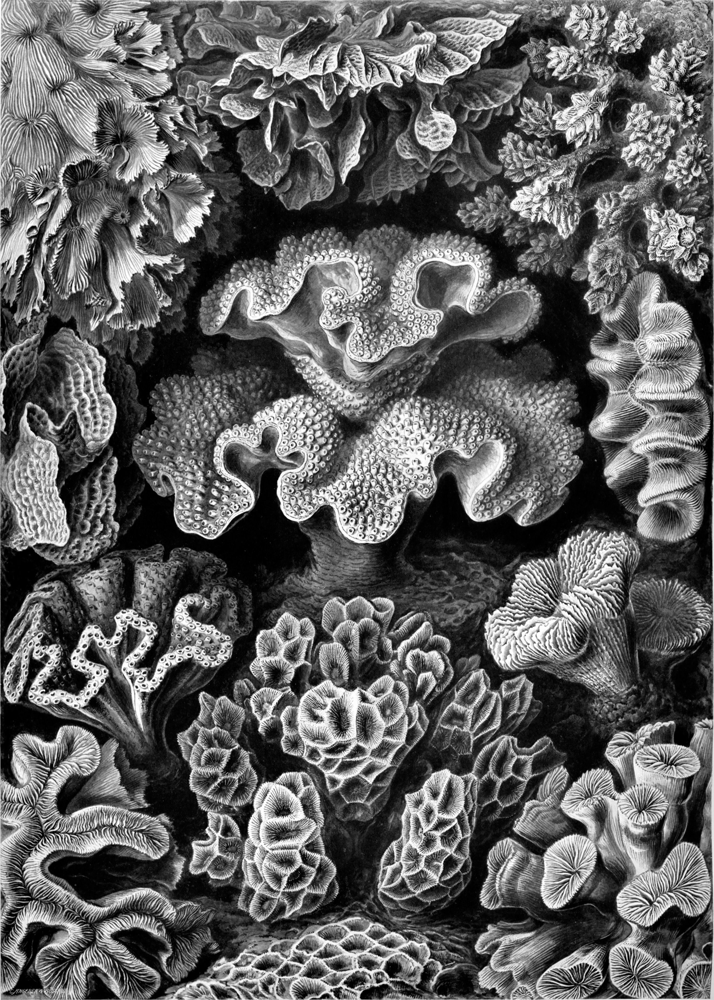
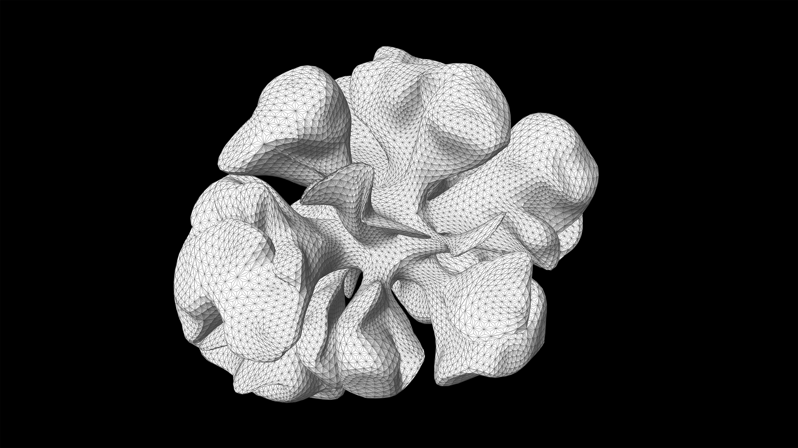
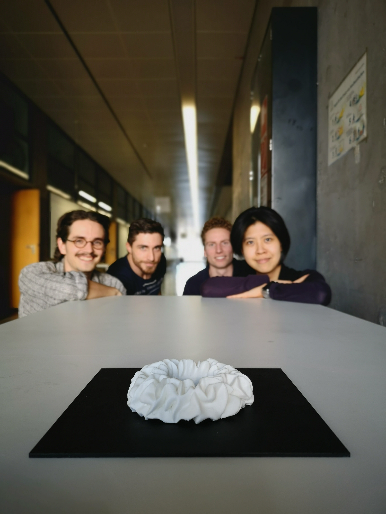

import Video from '@/components/Video.astro'

<Video autoplay src="/media/research/differential-growth-in-corals/differential-growth.mp4" caption="Differentielles Wachstum in Aktion." />

Die Natur entwirft seit mindestens 3,8 Milliarden Jahren. Von Mikroorganismen bis zu großen Säugetieren: Es ist faszinierend, wie die Natur das Beste aus dem verfügbaren Material herausholt. Diese Studie untersuchte eine breite Palette statischer Strukturen in der Natur. Die allgemeine Erkenntnis: Material ist knapp, Form gibt es im Überfluss. Mit anderen Worten: Die Natur spart Material und überlässt Festigkeit und Funktion der Form. Ein Schildkrötenpanzer muss zugleich leicht und stabil sein, und seine Form hat sich genau auf diese Anforderung hin nahezu perfekt entwickelt. Das macht diese Prinzipien für die Architektur so interessant.
Wir untersuchten Korallen auf allen Ebenen, von den Polypen (der kleinsten Einheit einer Koralle) bis zu Atollen, ringförmigen Inseln, die aus vielen Korallen gemeinsam entstehen.

Dann konzentrierten wir uns auf Steinkorallen, insbesondere darauf, wie sie durch Knospung wachsen, einen Prozess, bei dem sich ihre Polypen verdoppeln. Im Lauf der Forschung entwickelten wir viele Strategien des Computational Design weiter. Das Endergebnis ist ein Python-Code, der ein agentenbasiertes System, eine Finite-Elemente-Analyse und Unterstützung durch maschinelles Lernen umsetzt.

<Video autoplay src="/media/research/differential-growth-in-corals/morphogenetic_-design-system_720p.mp4" caption="Eine mit dem vollständigen morphogenetischen Entwurfssystem erzeugte Überdachung." />

