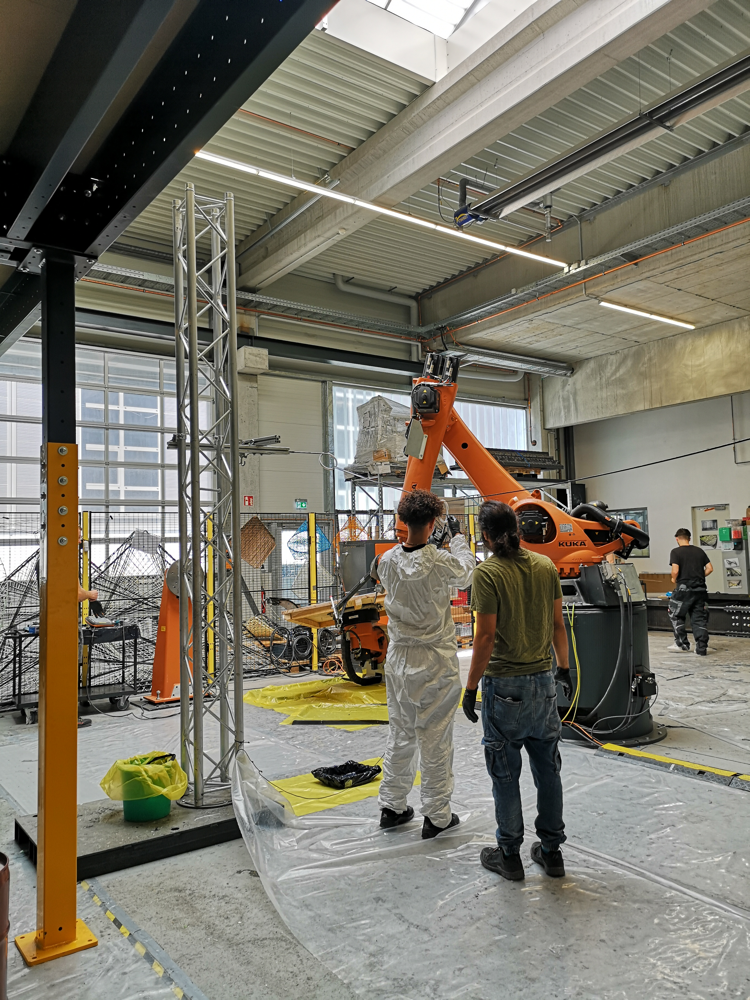
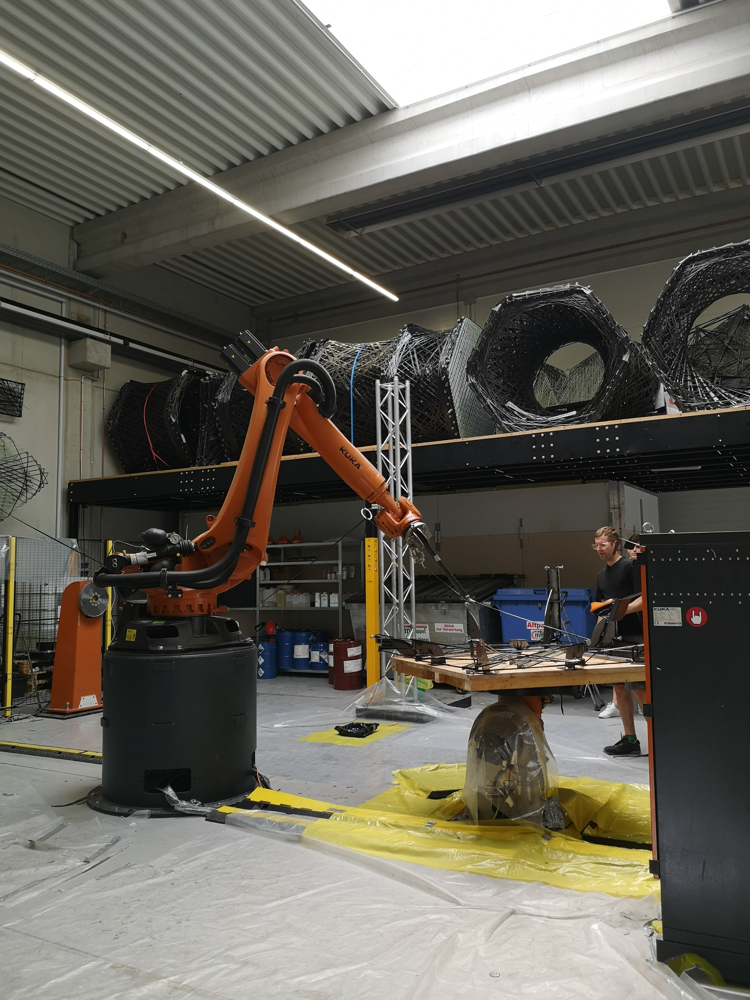
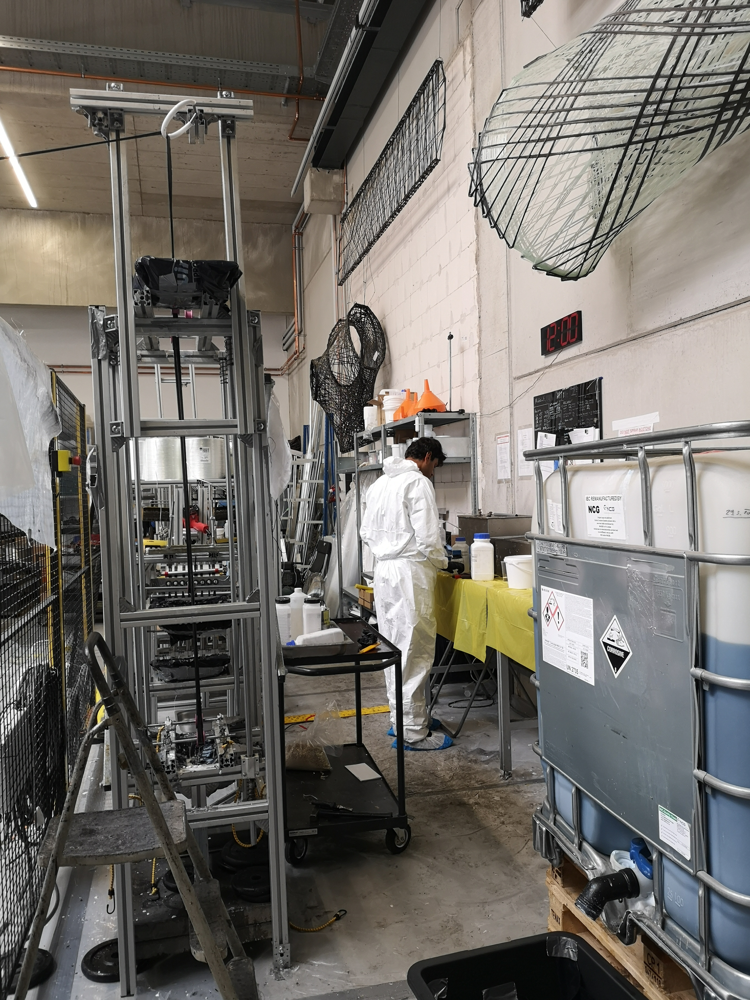
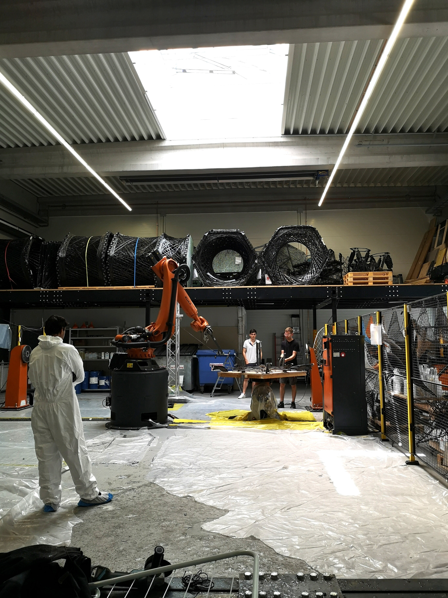
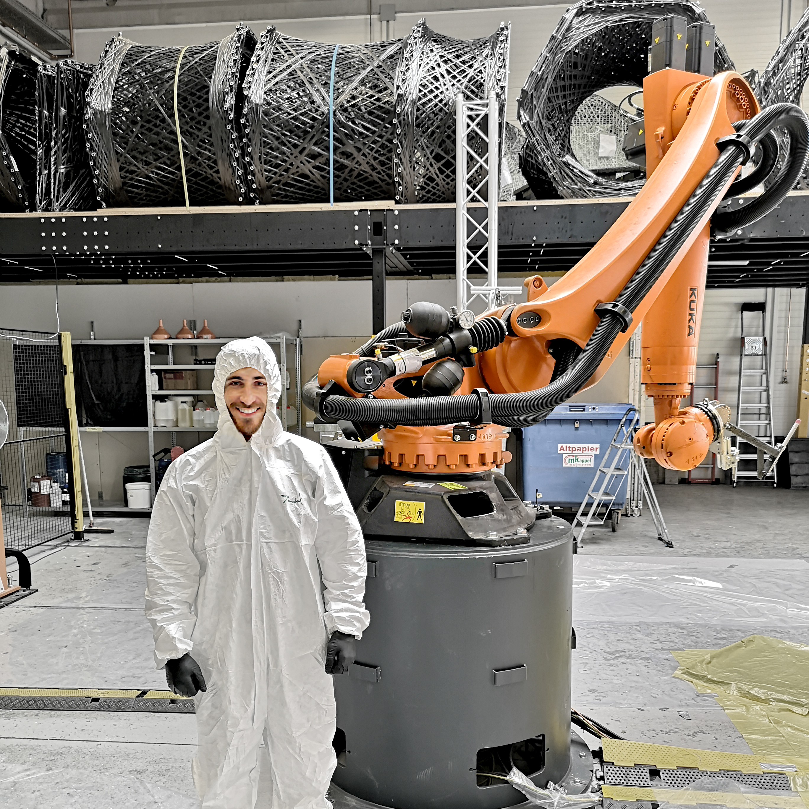
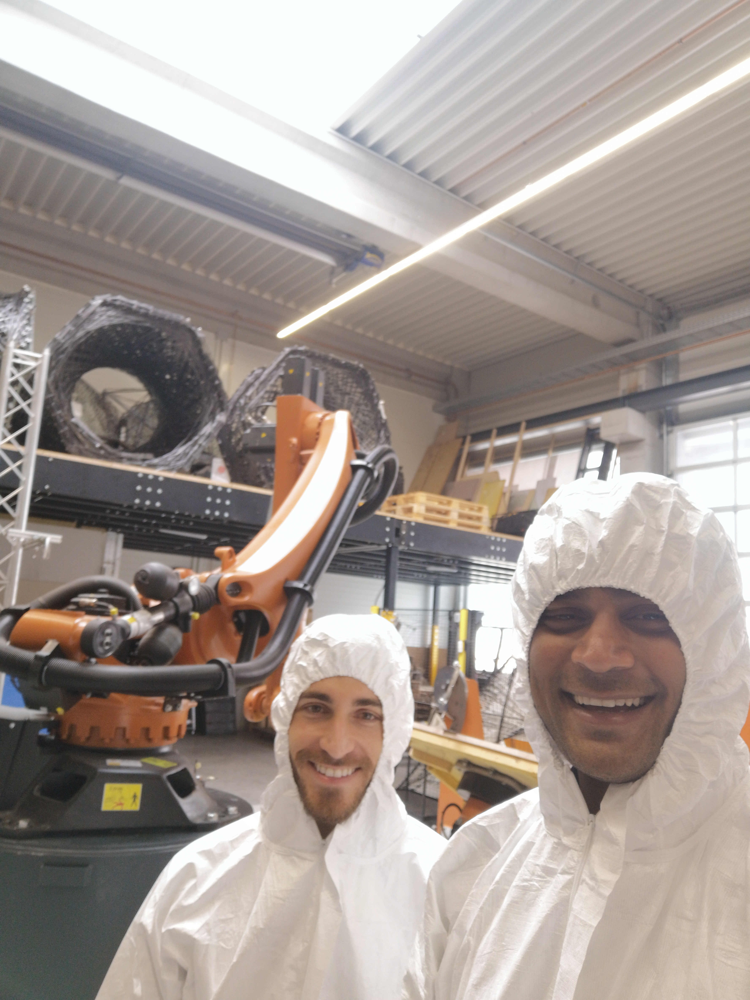

Kernloses Filamentwickeln ist ein Fertigungsverfahren, bei dem ein Roboterarm harzgetränkte Fasern um einen Rahmen wickelt, um ohne massiven Formkern leichte, leistungsfähige Tragelemente herzustellen. Das ICD und das ITKE an der Universität Stuttgart sind Pioniere dieser Technologie und haben immer ambitioniertere Pavillons und Demonstratoren realisiert.

## Das Forschungsproblem

Während der Roboterarm die Fasern zu einer Art dreidimensionalem Geflecht verflicht, wird das Zusammenspiel der Fasern sehr komplex und schwer vorherzusagen. Damals gab es kein zuverlässiges computergestütztes Werkzeug, um das Zusammenwirken der Fasern beim Wickeln genau zu simulieren. Christoph Schlopschnats Forschung zielte darauf ab, diese Lücke zu schließen.

## Meine Rolle

Ich unterstützte Christoph bei seiner Untersuchung computergestützter Methoden, die das Zusammenwirken der Kohlefasern vorhersagen sollen. Meine Aufgaben umfassten:

- **Harzvorbereitung**: Mischen und Auftragen des Harzes, das die Kohlefasern verbindet. Dies erforderte aufgrund der Toxizität der Materialien eine vollständige Schutzausrüstung.
- **Physische Tests im kleinen Maßstab**: Durchführung kontrollierter Wickelexperimente um Daten zum Faserverhalten zu gewinnen.
- **Photogrammetrie**: Aufnahme der gewickelten Probekörper aus mehreren Blickwinkeln, um digitale Zwillinge für den Vergleich mit den Vorhersagen der Simulation zu erstellen.

## Erkenntnisse

Am stärksten in Erinnerung geblieben ist mir bei dieser Arbeit der Umgang mit dem Harz. Das Epoxidharz, das in Kohlefaserverbundwerkstoffen verwendet wird, ist hochgiftig und erfordert Ganzkörper-Schutzanzüge, Handschuhe und eine sorgfältige Vorbereitung des Arbeitsbereichs mit Schutzabdeckungen. Es war eine praktische Einführung in den Alltag der Arbeit mit Hochleistungsverbundwerkstoffen, eine ganz andere Welt als die computergestützte Seite der Forschung. Und ehrlich gesagt schreckte mich die Giftigkeit des Materials stark ab, weshalb ich mich schließlich von dieser Forschungsrichtung abwandte. Aber es war eine wertvolle Erfahrung, die mir ein tieferes Verständnis für die Komplexität der Materialwissenschaft in der architektonischen Fertigung vermittelte.

