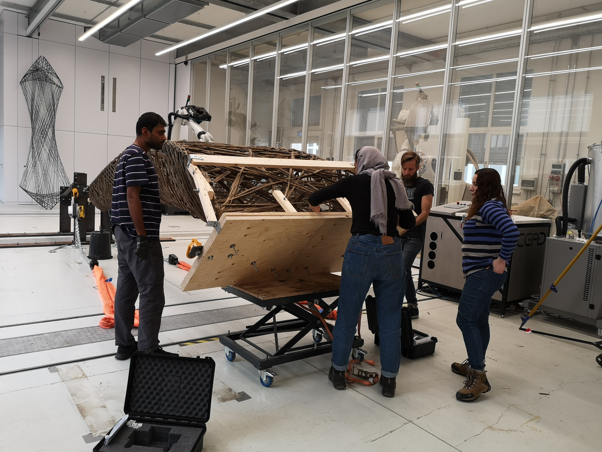
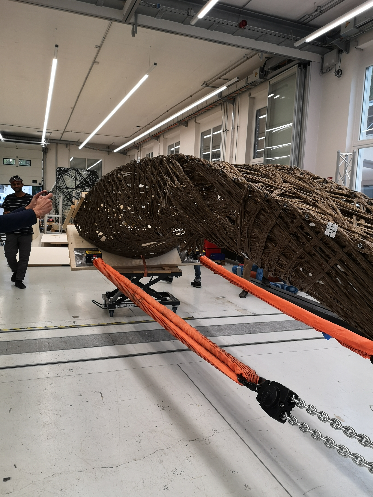
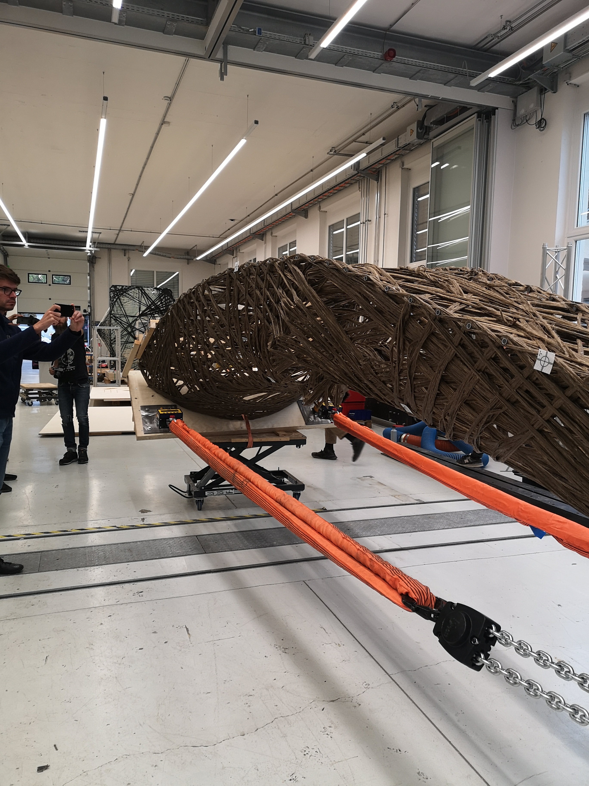
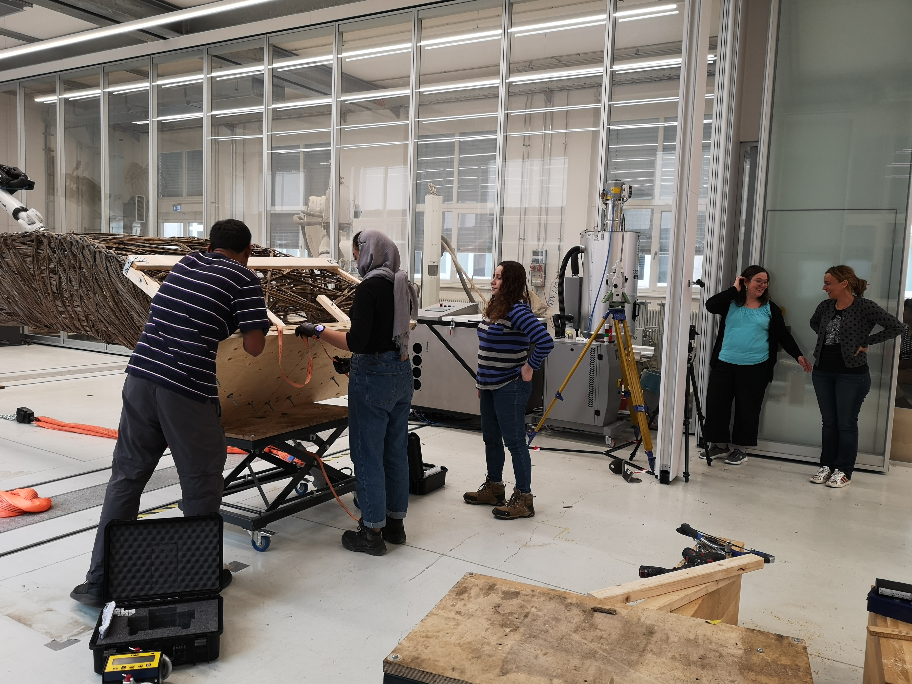

Der livMatS-Pavillon (eine Zusammenarbeit zwischen dem ICD, dem ITKE und dem Exzellenzcluster livMatS der Universität Freiburg) verschob die Grenzen des kernlosen Filamentwickelns, indem er **Naturfasern** statt Kohle- oder Glasfasern verwendete. Der Pavillon wurde schließlich im Botanischen Garten Freiburg errichtet, doch bevor es so weit war, mussten die tragenden Bauteile gründlich geprüft werden.

## Die Herausforderung

Im Gegensatz zu Kohlefaserverbundwerkstoffen, für die Ingenieurdaten aus mehreren Jahrzehnten vorliegen, sind Naturfaserverbundwerkstoffe weit weniger vorhersagbar. Die mechanischen Eigenschaften variieren je nach Herkunft der Fasern, Feuchtigkeitsgehalt und Wickelmustern. Damals gab es keine zuverlässige Methode, das Tragverhalten dieser naturfasergewickelten Elemente am Computer zu simulieren. Die einzige Möglichkeit, den Entwurf zu validieren, waren physische Belastungstests im Realmaßstab.

## Meine Rolle

Als wissenschaftliche Hilfskraft unter der Leitung von Marta Gil Pérez half ich bei der Vorbereitung und Durchführung der Belastungstests. Die Probekörper (große naturfasergewickelte Elemente, die vom ITECH-Jahrgang 2020 gefertigt wurden) wurden auf hydraulischen Plattformen montiert und mithilfe industrieller Lastgurte kontrollierten Kräften ausgesetzt.

## Simulation vs. Realität

Was diese Erfahrung besonders machte, war, die Kluft zwischen computergestützter Vorhersage und realem Verhalten selbst zu erleben. Spitzenforschung wie diese kann das Tragverhalten noch nicht allein per Computersimulation zuverlässig vorhersagen. Für ein standsicheres Ergebnis sind physische Tests im Realmaßstab unerlässlich.

Martas Erfahrung und Intuition im Umgang mit ähnlichen Tragwerken waren entscheidend. Nach jedem Test konnte sie erkennen, welche Anpassungen am Entwurf vorgenommen werden sollten, gestützt auf eine Kombination aus Messdaten und jahrelanger praktischer Erfahrung mit Faserverbundwerkstoffen. Dieses Zusammenspiel von Simulation, Experiment und Intuition macht Forschung an vorderster Front der Bautechnik so spannend.

