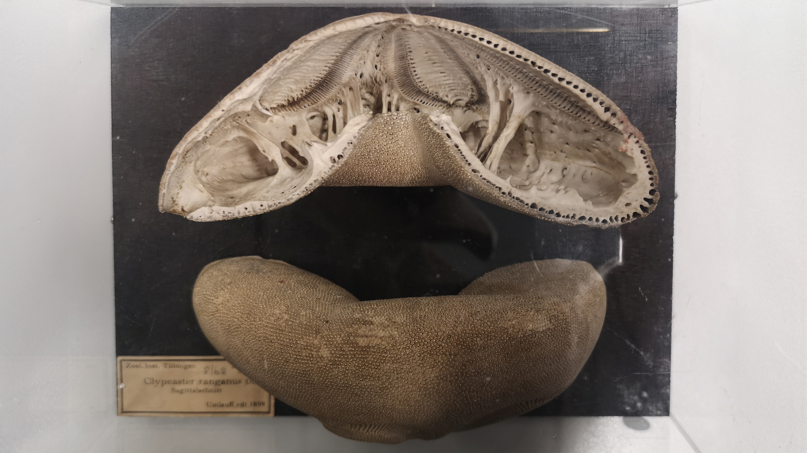
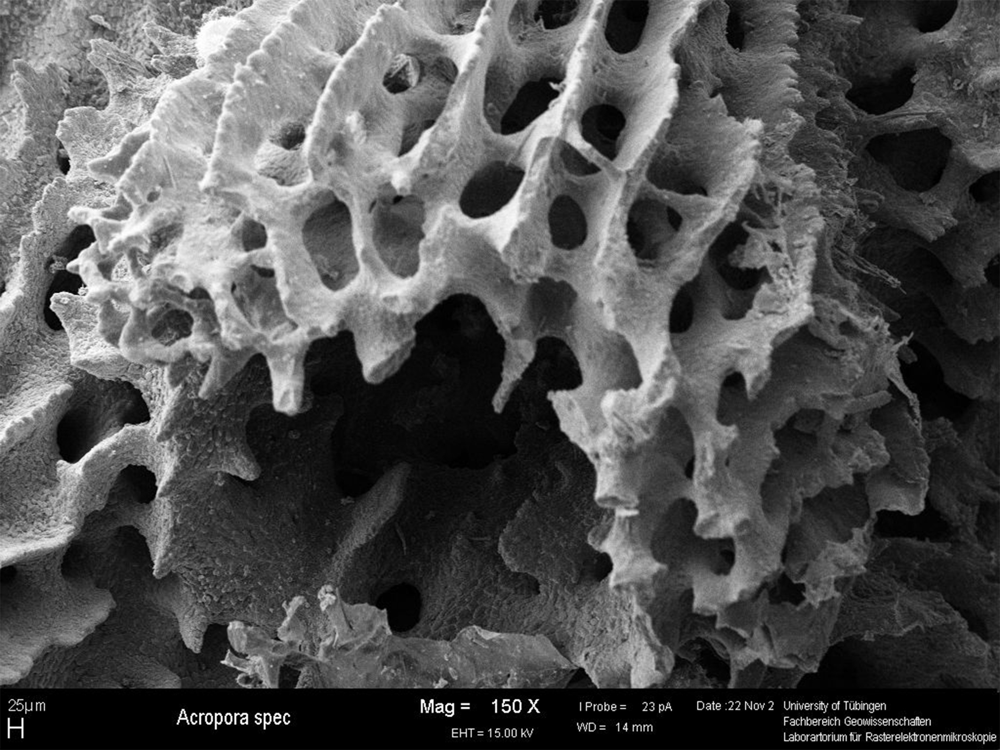
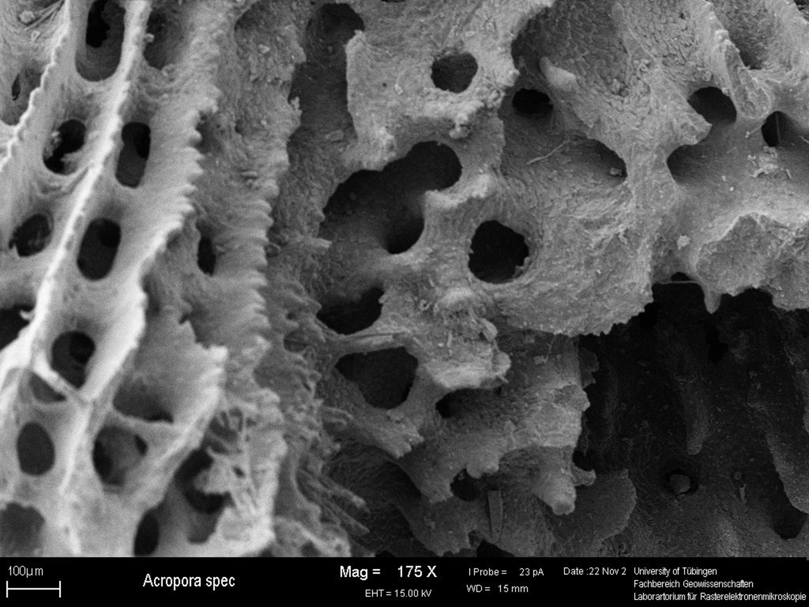
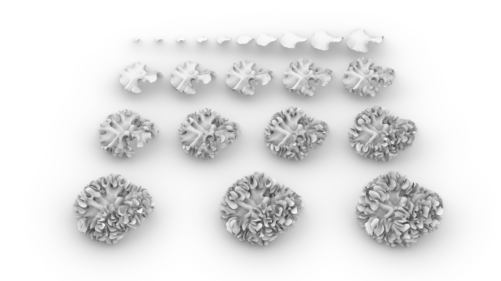
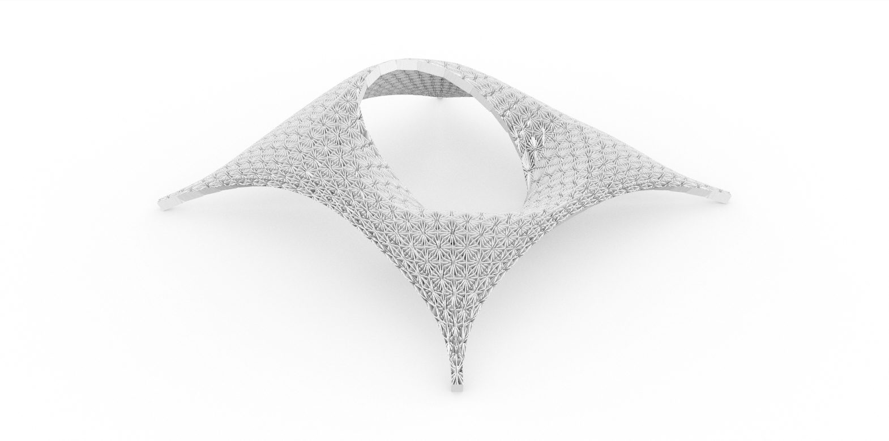
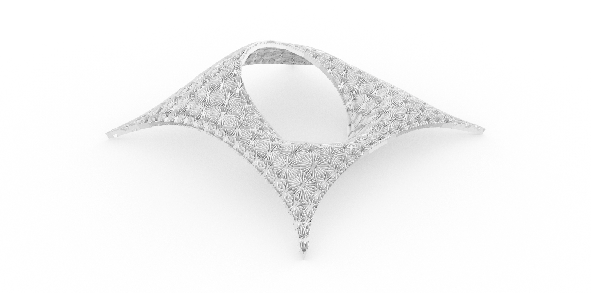
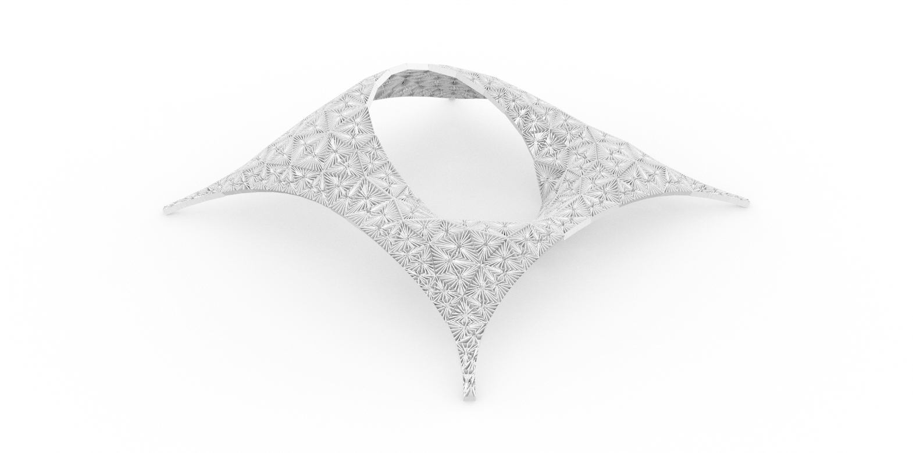
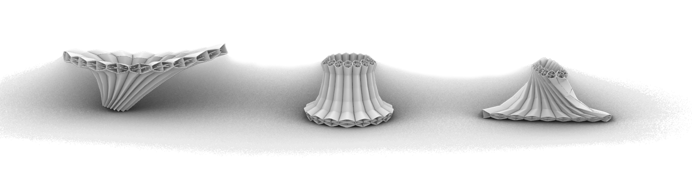
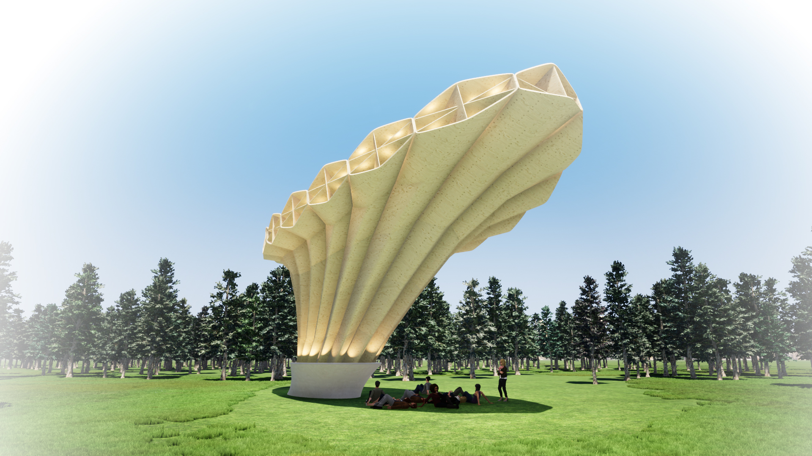

Cada animal tem sua morfologia, anatomia e comportamento únicos. A maioria dessas características é altamente evoluída e cumpre sua função com uma perfeição quase total. A biomimética busca na natureza soluções para os nossos problemas.
A pesquisa começou pelas estruturas estáticas: esqueletos, conchas e outras estruturas mais macias, mas igualmente estáticas.
Em seguida, estudamos os princípios gerais dos corais pétreos, presentes em muitas espécies e em todas as escalas: da estrutura mais simples, o pólipo, passando pelo coral em si, até os recifes.
Desse estudo, abstraímos a relação entre os pólipos que formam um único coral. Aplicamos então essa modularidade à arquitetura no pavilhão Acropora.

