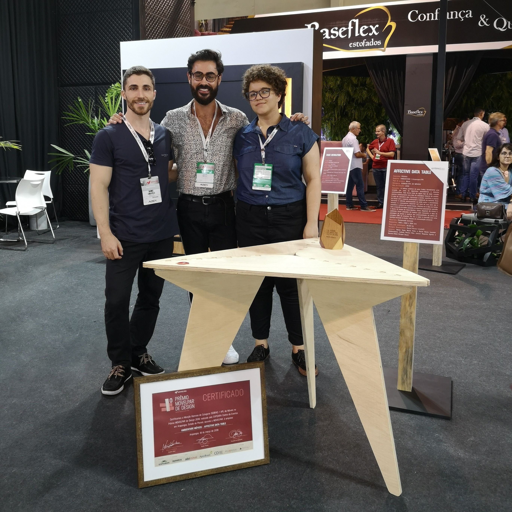
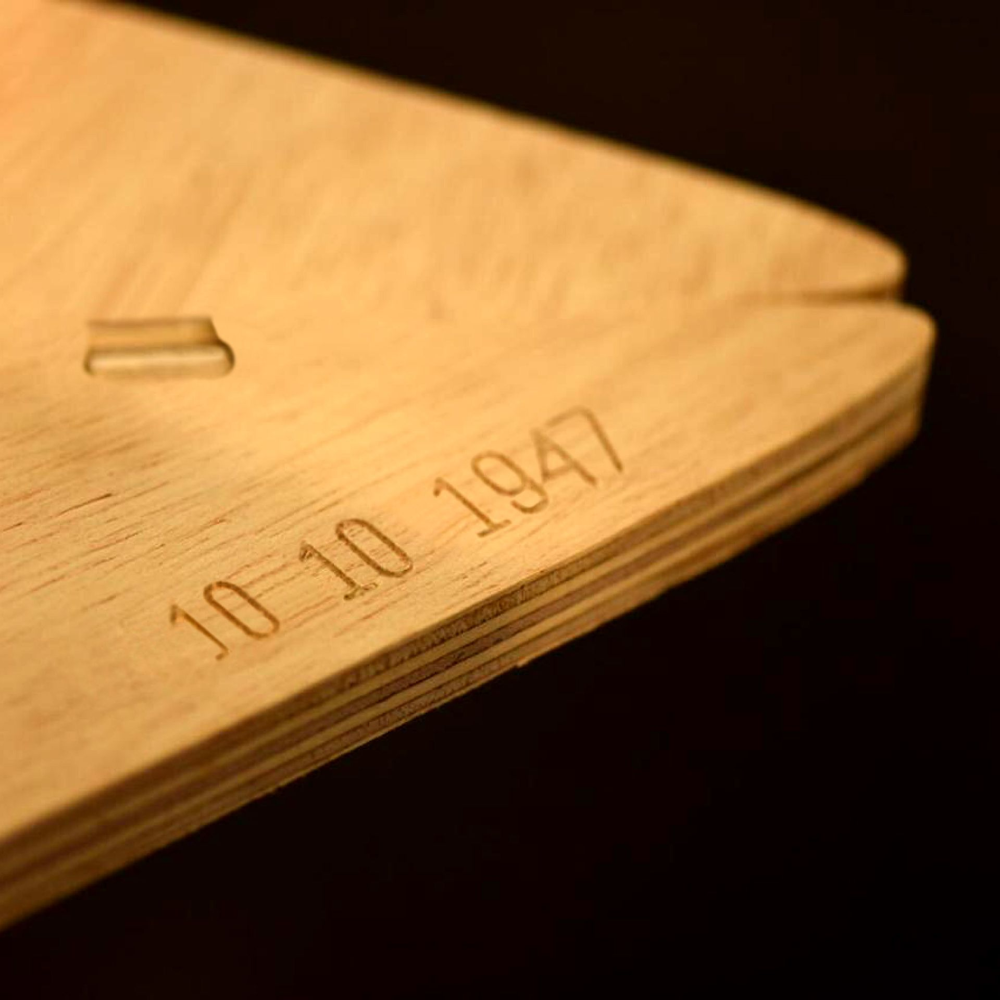
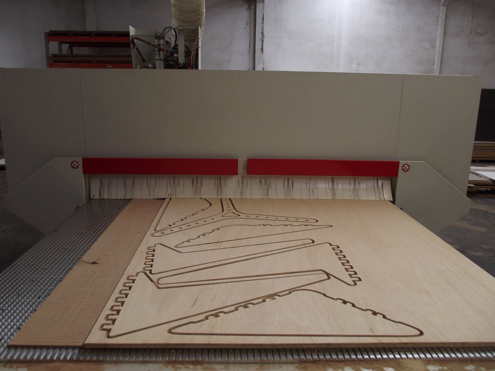
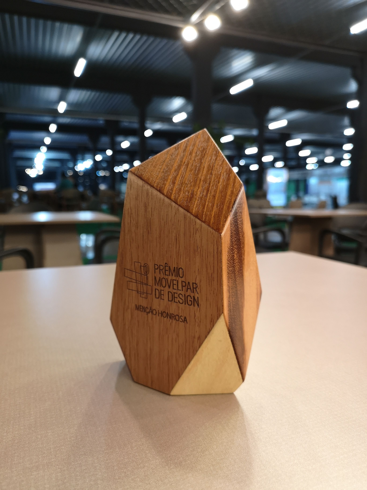

import YouTube from '@/components/YouTube.astro'

<YouTube id="tumc73ImLkg" title="Affective Data Table" />

Fui convidado a orientar alunos da Universidade Estadual de Londrina (UEL) no conceito e no projeto de um móvel para um concurso. Nossa equipe teve a sorte de poder usar a CNC de um fabricante de móveis local. Com isso em mente, começamos a levantar ideias sobre customização em massa, mais especificamente sobre como criar um vínculo emocional entre as pessoas e seus móveis para ajudar a reduzir o desperdício.

## Conceito

Uma mesa que convida o usuário a participar do projeto. A forma nasce de uma data especial para ele, de modo que cada mesa é única e cria um vínculo emocional com quem a usa.

Aliado ao design computacional, o design emocional busca repensar toda a cadeia de produção industrial e aproximar essa cadeia da Indústria 4.0, uma transformação que afeta todo o ciclo de vida do produto: design, fabricação e comportamento do consumidor.

Abstraímos a ideia de tempo inserindo dados pessoais no algoritmo, que gerou a forma do tampo da mesa (pontos, linhas, ângulos). Os vincos e as saliências na madeira transmitem a passagem do tempo, e a data fica marcada, esculpida pela máquina.

Usar dados e algoritmos como geradores de estética amplia as formas de atrair e alcançar o consumidor. A proposta reforça isso ao permitir que o usuário participe da concepção formal do objeto por um aplicativo de e-commerce, o que nos aproxima da chamada Internet de Serviços (IoS), um dos pilares da Indústria 4.0 (Hermann; Pentek; Otto, 2015).

Essa inovação é baseada em um aplicativo desenvolvido no MIT App Inventor e no uso do software Rhinoceros com o plugin Grasshopper para parametrização do móvel. Escolhemos ferramentas de alta tecnologia para destacar o objetivo da empresa de levar a produção, num centro de usinagem CNC, a um novo patamar tecnológico. Dessa forma, revelamos toda a tecnologia e trazemos a afetividade para o primeiro plano.

