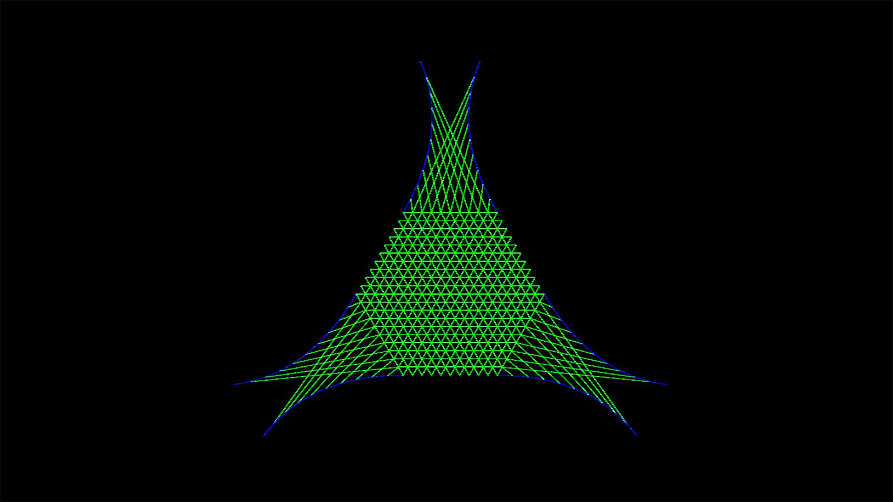
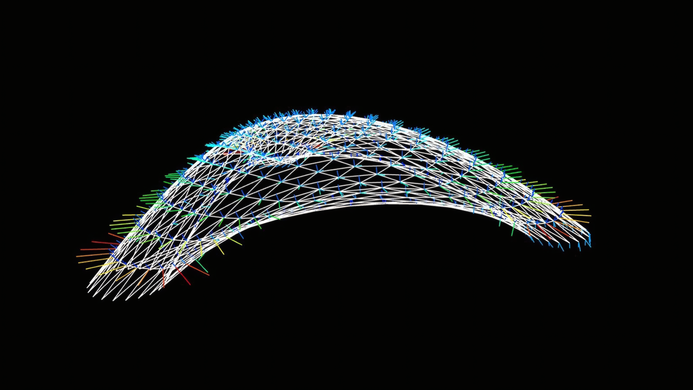
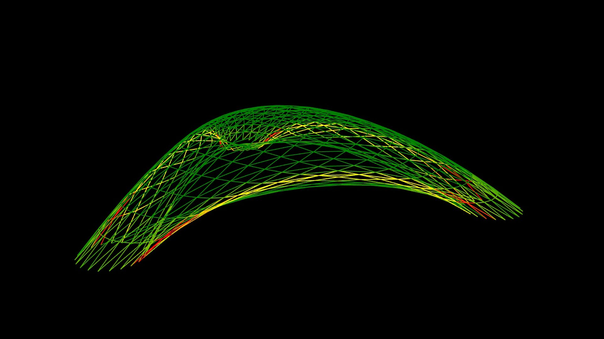
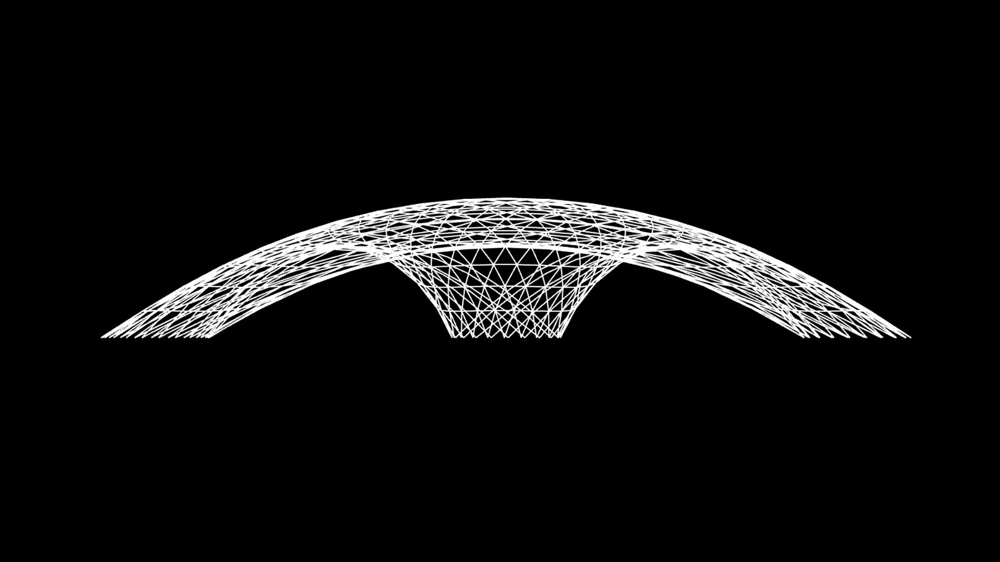
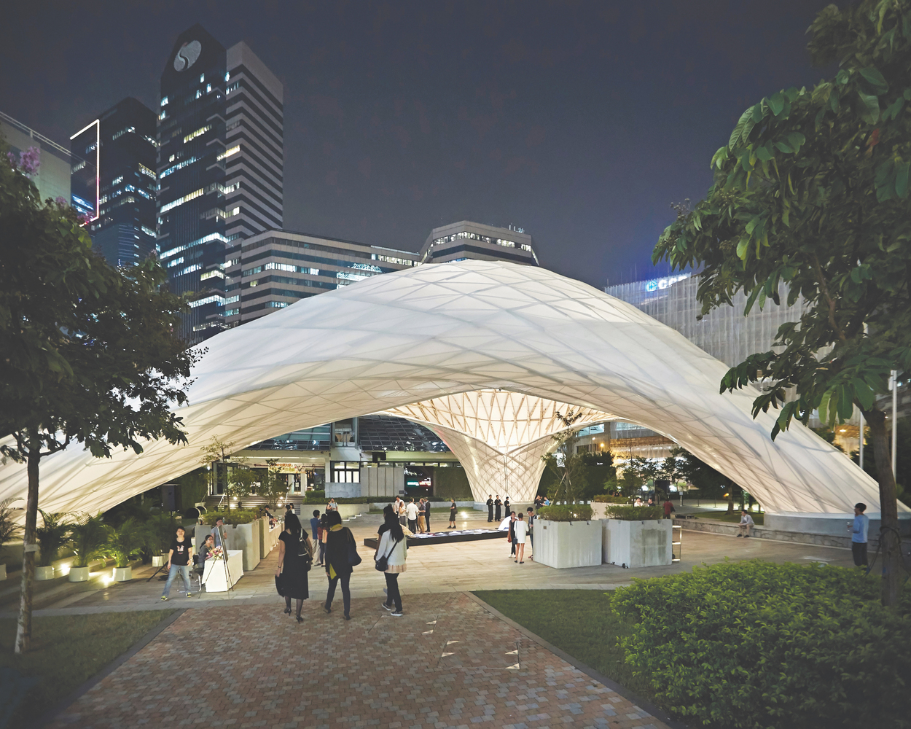

import Video from '@/components/Video.astro'

<Video autoplay src="/media/research/bending-active-bamboo/form-finding.mp4" caption="Processo de busca da forma." />

Desenvolvi este trabalho com Lena Strobel na disciplina Forma e Estrutura do ITECH. Partimos do ZCB Bamboo Pavilion como inspiração, mas desenvolvemos nosso próprio fluxo de trabalho com Grasshopper, Kangaroo Physics e K2Engineering.

## Busca pela forma

Para o projeto da forma inicial, criamos um layout de vigas bidimensional em uma malha triangular. Em seguida, usamos o Kangaroo como um sistema de partículas-mola com cargas, apoios e vigas como restrições de barras em flexão. A forma surge à medida que as vigas tentam se endireitar.

A ideia inicial era fazer engenharia reversa do pavilhão de bambu e usar esse conhecimento para levar a geometria a outra forma poligonal. No entanto, só este estudo já consumiu todo o nosso esforço.

O K2Engineering foi crucial para o desenvolvimento deste trabalho. Com ele, usamos as propriedades do bambu como dados de entrada em análises estruturais que orientaram a otimização dos resultados.

Um grande desafio foi projetar os arcos que estruturavam a forma inicial e definir como se ancoravam nos três apoios circulares predeterminados. Além disso, precisamos acrescentar pontos de interseção numa etapa posterior, pois o resultado inicial não ficou tão satisfatório, estrutural e esteticamente, quanto pretendíamos. Também foi importante usar o Kangaroo Zombie para tornar a otimização mais rápida.

Confira mais informações sobre o pavilhão original aqui: [ZCB Bamboo Pavilion](https://www.archdaily.com/800173/zcb-bamboo-pavilion-the-chinese-university-of-hong-kong-school-of-architecture)

