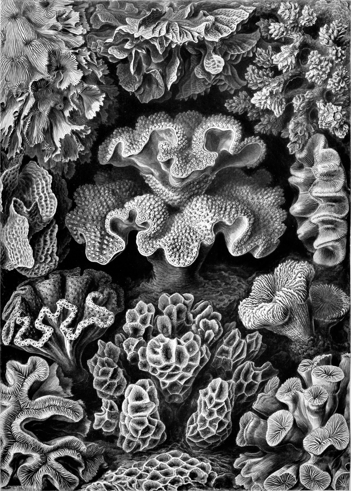
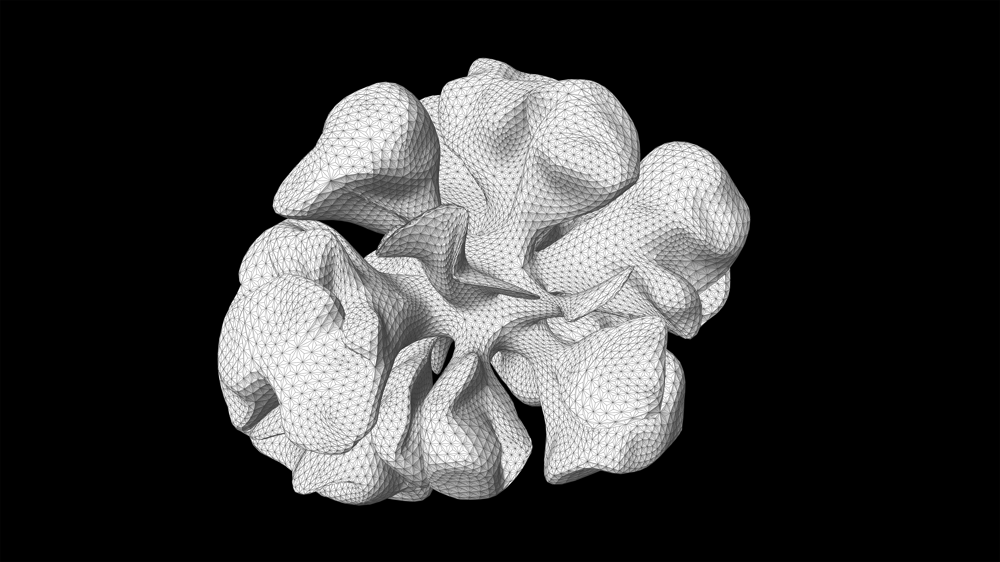
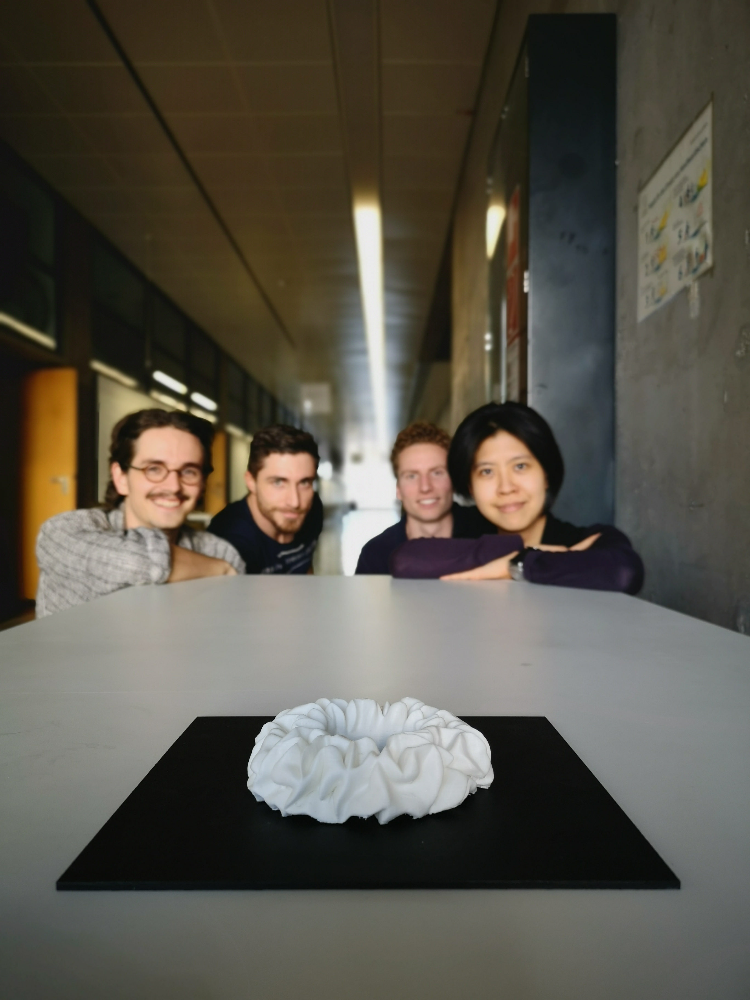

import Video from '@/components/Video.astro'

<Video autoplay src="/media/research/differential-growth-in-corals/differential-growth.mp4" caption="Crescimento diferencial em ação." />

A natureza é uma designer de pelo menos 3,8 bilhões de anos. De microrganismos a grandes mamíferos, é fascinante como a natureza tira o máximo proveito do material disponível.
Exploramos uma ampla gama de estruturas estáticas na natureza, e a lição que fica é que o material é escasso e a forma, abundante. Em outras palavras, a natureza economiza material e confia à forma a resistência e a função: o casco de uma tartaruga precisa ser leve e resistente ao mesmo tempo, e sua forma evoluiu quase até a perfeição em torno dessa necessidade. É isso que torna esses princípios tão interessantes para a arquitetura.
Investigamos tudo sobre corais, do pólipo, a unidade básica de um coral, ao atol, uma ilha em forma de anel formada por muitos corais juntos.

Restringimos a pesquisa aos corais pétreos, mais especificamente à forma como crescem por brotamento, processo em que os pólipos se duplicam. A pesquisa percorreu várias estratégias de design computacional. O resultado final é um código Python que implementa um sistema baseado em agentes, uma análise de elementos finitos e suporte a aprendizado de máquina.

<Video autoplay src="/media/research/differential-growth-in-corals/morphogenetic_-design-system_720p.mp4" caption="Uma cobertura gerada com o sistema completo de design morfogenético." />

