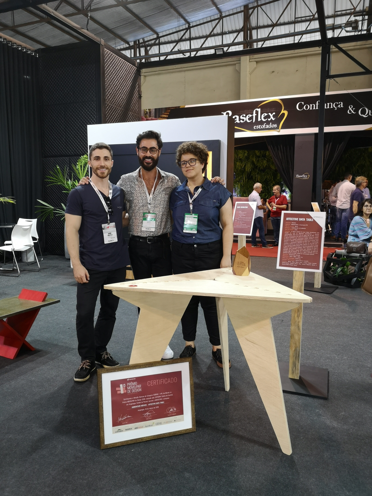
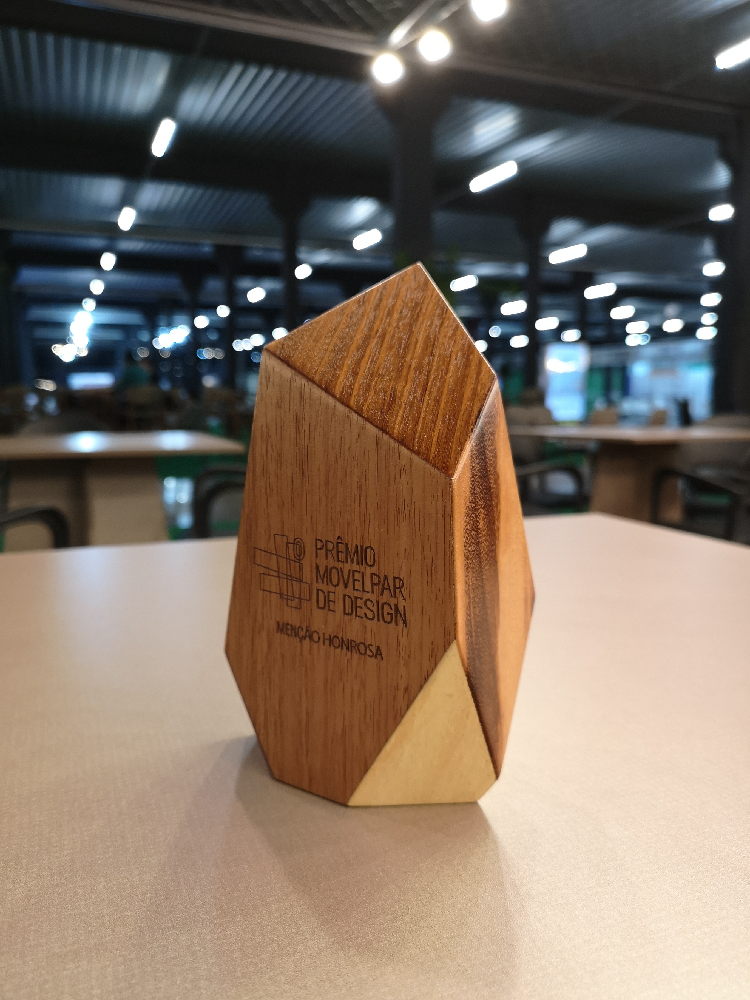
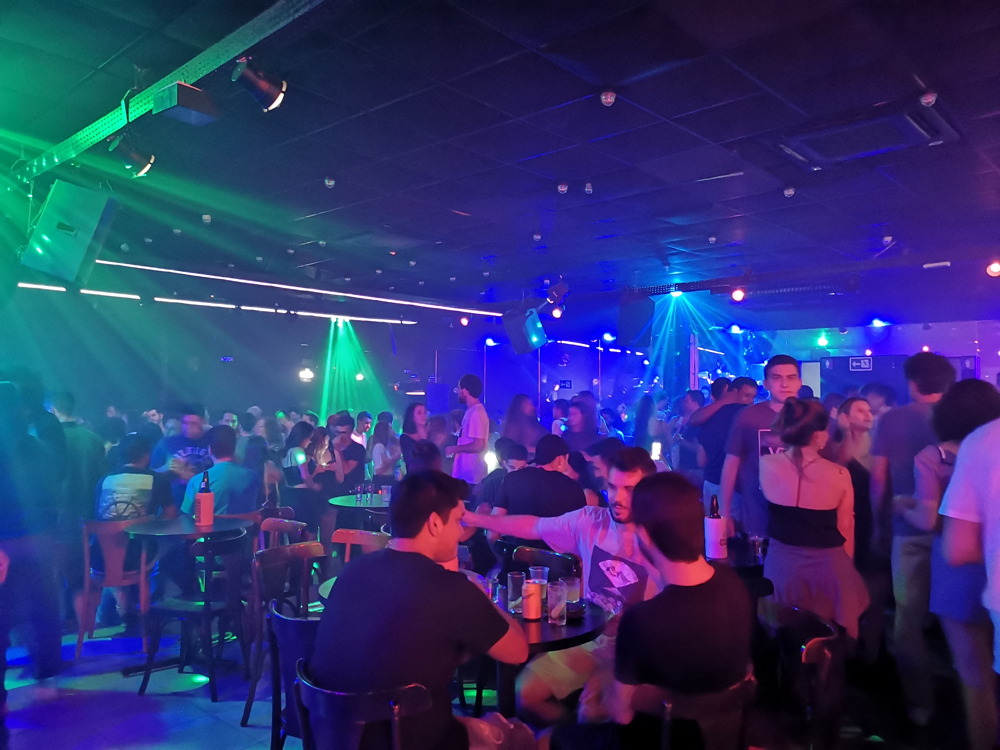

Vortrag auf der MOVELPAR 2019, einer der größten Möbelmessen Lateinamerikas, organisiert von SEBRAE Talks. Die Präsentation ging der Frage nach, wie sich emotionales Design und Technologie im zeitgenössischen Möbel- und Produktdesign verbinden, und zeigte, wie computergestützte Werkzeuge die emotionale Verbindung zwischen Nutzern und gestalteten Objekten verstärken können.

