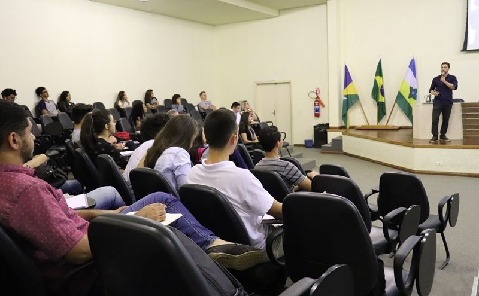
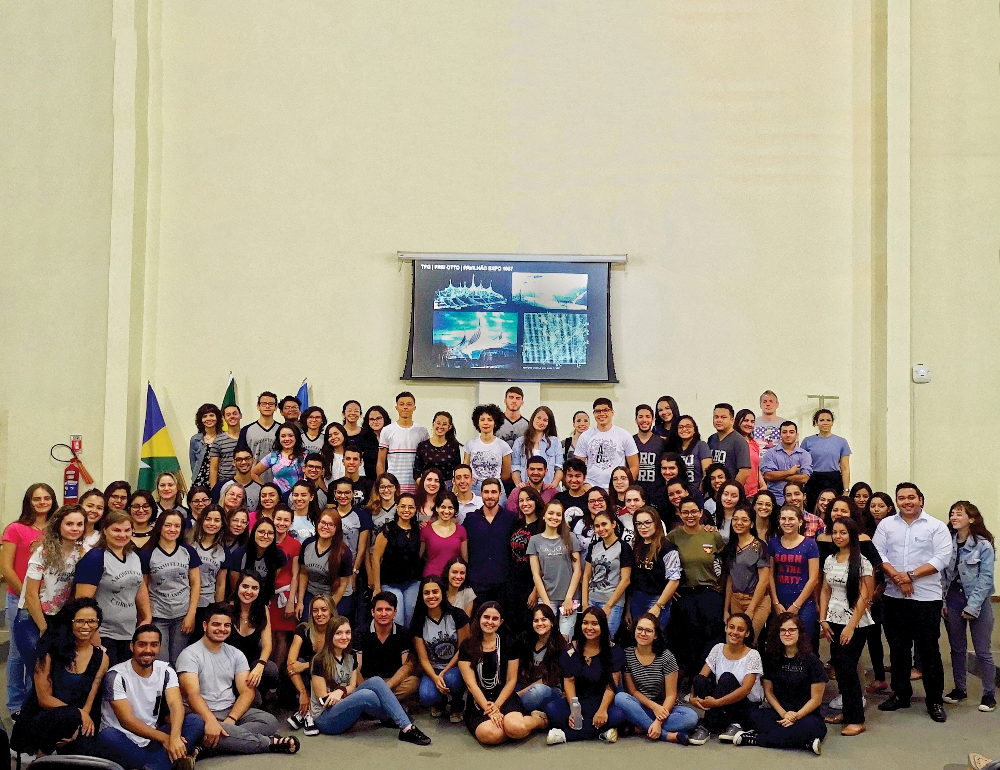

import Figure from '@/components/Figure.astro'

Während meines Besuchs in meiner Heimatstadt schlug ich dem Studiengang Architektur und Städtebau des Bundesinstituts von Rondônia (IFRO) einen Vortrag vor. Ich stellte meine Arbeiten und Forschungen vor und diskutierte die Zukunft des Berufs angesichts so vieler technologischer Veränderungen.

<Figure credit="IFRO Vilhena">
  
</Figure>

Der Vortrag zeichnete meinen akademischen und beruflichen Werdegang nach, angefangen bei meinem Studium an der UNEMAT (2007-2008) über die FAU-USP (2010-2016) bis hin zu meinem Austauschaufenthalt an der Auburn University und der CSU Long Beach (2013-2014).

Anschließend stellte ich meine berufliche Arbeit im Atelier Marko Brajovic vor und zeigte Projekte wie die [Parada Coca-Cola](/projects/parada-coca-cola-by-atelier-marko-brajovic), den [Docol-Pavillon auf der Exporevestir 2017](/projects/o3-pavilion-by-atelier-marko-brajovic-for-docol) mit seinem auf Voronoi-Diagrammen basierenden Entwurf und die [Heineken-Bar auf dem Festival MECA](/projects/bar-stage-heineken-by-atelier-marko-brajovic-for-sherpa42).

Ein zentraler Teil des Vortrags galt der Biomimetik und der Frage, wie biologische Prinzipien meine [Abschlussarbeit (TFG)](/research/architecture-biomimicry-algorithm) beeinflussten, mit Bezügen zu Frei Ottos Expo-Pavillon 1967 und Minimalflächenstrukturen. Ich präsentierte auch den Workshop [Models byNature](/teaching/models-bynature-20) und den ICD/ITKE Research Pavilion 2016-17 als Beispiele für naturinspiriertes Computational Design.

Der Vortrag schloss mit einer Diskussion über die technologische Entwicklung in der AEC-Branche, von Ivan Sutherlands Sketchpad im Jahr 1963 bis hin zu zeitgenössischen Anwendungen künstlicher Intelligenz in der Architektur, darunter Stanislas Chaillous Forschung zu generativem Design in Harvard.

<Figure credit="IFRO Vilhena">
  
</Figure>
