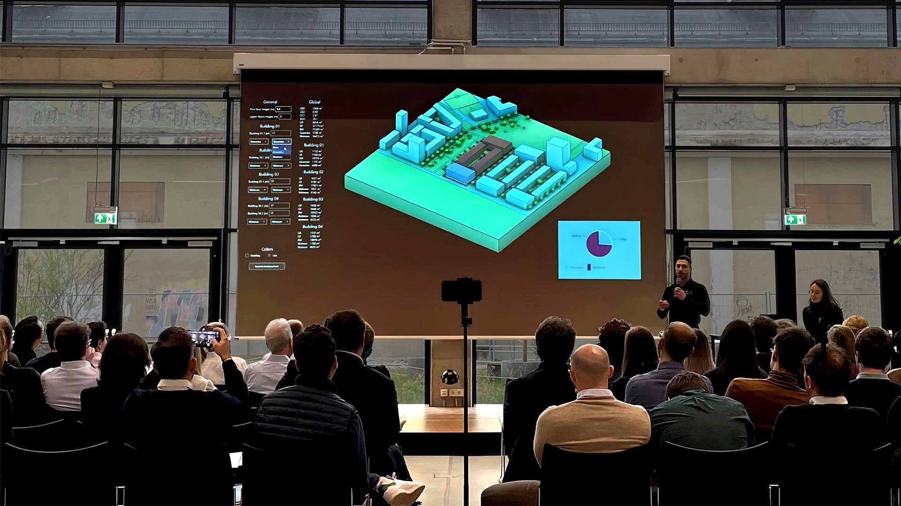

Auf der Siemens Research, Innovation & Ecosystem (RIE) Munich Conference zum Thema „Digitalization & Low Code Engineering in Industry“ präsentierten wir den Ansatz, mit dem BuildSystems eine der größten Herausforderungen der Bauindustrie angeht: Nachhaltigkeitsdaten nutzbar zu machen.

## Der Pitch

Im Kern zeigten wir einen mehrstufigen computergestützten Workflow, der von der Analyse auf Stadtebene bis hinunter zu einzelnen Bauteilen reicht. Die von uns entwickelten Werkzeuge arbeiten in einem geschlossenen Regelkreis:

1. **Werkzeug auf Stadtebene**: bewertet die Machbarkeit eines Neubaus anhand des örtlichen Baurechts und der Brandschutzvorschriften und bestimmt die maximal zulässige Baufläche für jedes Grundstück.
2. **Werkzeug auf Gebäudeebene**: erzeugt auf Basis gängiger Bausysteme ein parametrisches Gebäude, das sich an unterschiedliche Grundstücksmaße anpasst.
3. **Bauteilbibliothek**: speist das parametrische Modell mit Daten aus unserer Bauteilbibliothek, die Informationen über Materialmengen, CO₂-Fußabdruck und Kosten pro Quadratmeter Baufläche enthält.
4. **Wirtschaftliche Ebene**: vergleicht verschiedene Bausysteme nicht nur nach geschätzten Kosten, sondern auch nach ihrem Potenzial, Fördermittel zu erhalten.

Diese Werkzeuge arbeiten in einem geschlossenen Kreislauf und informieren sich fortlaufend gegenseitig, bis ein Gleichgewicht erreicht ist, alles gestützt auf Open-Source-Datenbanken und -Frameworks.

