Dieser Workshop wollte Computational-Design-Praktiken mit natürlichen Phänomenen verbinden und behandelte Themen wie Biomimetik, Modellierung mit der Natur und visuelle Programmiersprachen mit Rhino und Grasshopper. Der Kurs fand im Atelier Marko Brajovic in São Paulo statt, wurde gemeinsam mit Adalberto de Paula geleitet und erstreckte sich über drei Wochenenden; er führte die Teilnehmenden vom physischen Experiment zur computergestützten Modellierung.

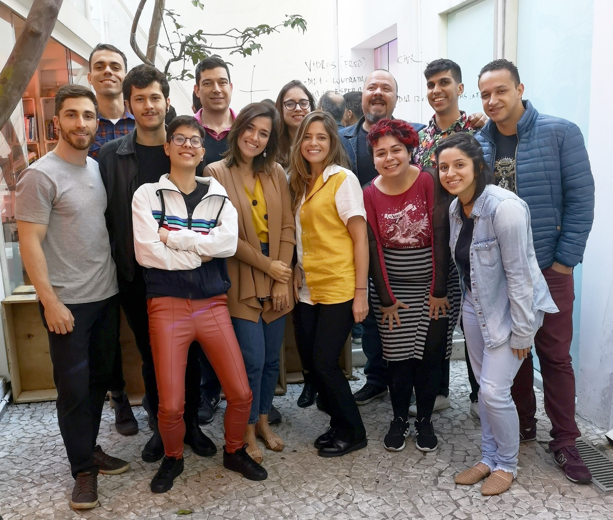

## Formfindungsexperimente

Der erste Tag war vollständig physischen Formfindungsexperimenten gewidmet. Bevor irgendeine Software geöffnet wurde, erkundeten die Teilnehmenden anhand praktischer Übungen mit Alltagsmaterialien, wie natürliche Formen entstehen. Seifenfilme, die über Drahtrahmen gespannt wurden, offenbarten Minimalflächen, während Sand, der über Begrenzungen mit Voronoi-Muster geschüttet wurde, zeigte, wie sich granulare Materialien selbst organisieren. Über Rahmen gespannte Stoffe demonstrierten, wie Membranstrukturen unter Schwerkraft ihr Gleichgewicht finden. Diese Experimente vermittelten ein intuitives, haptisches Verständnis der Prinzipien, die computergestützte Werkzeuge später formalisieren.

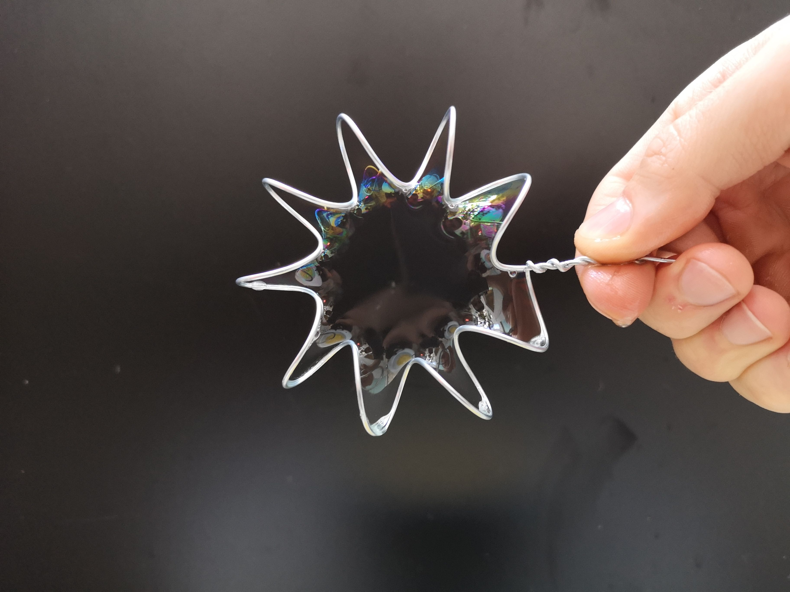

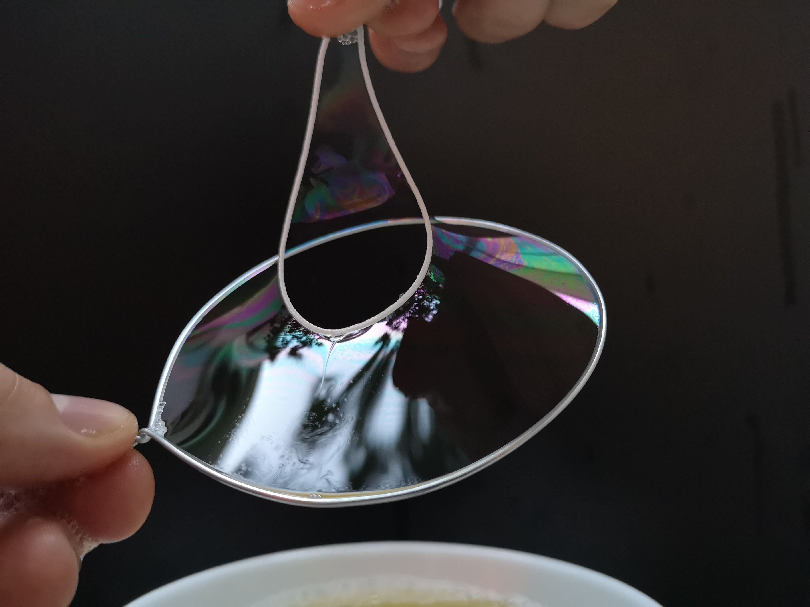

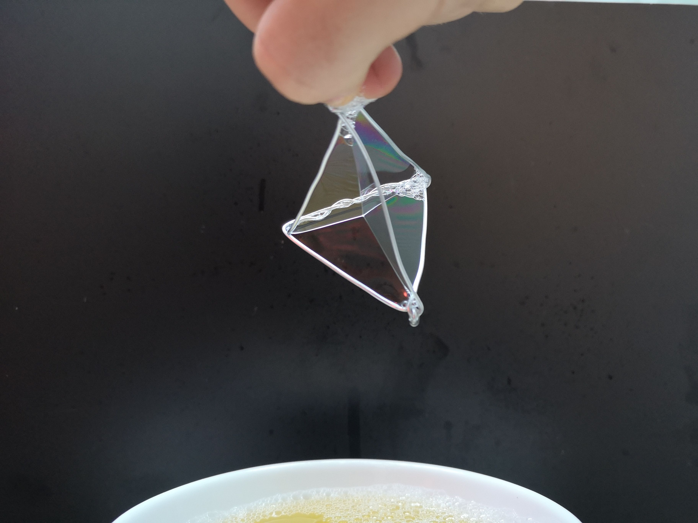

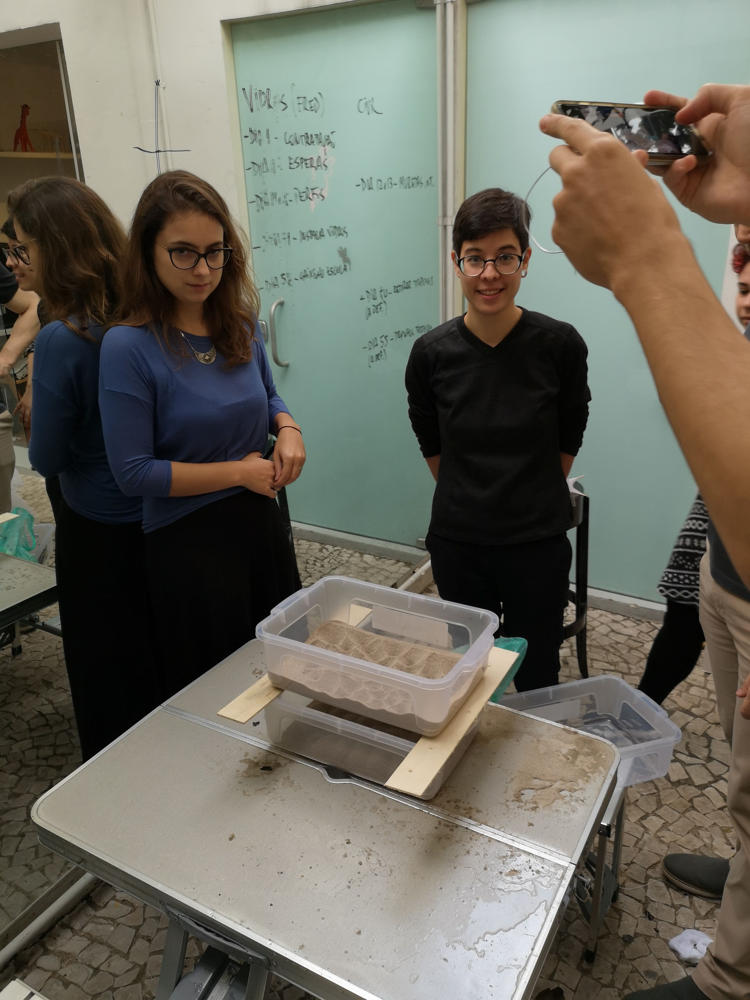

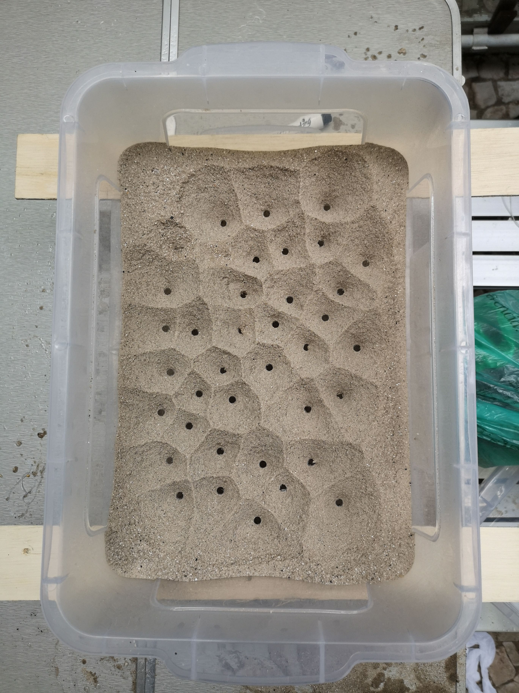

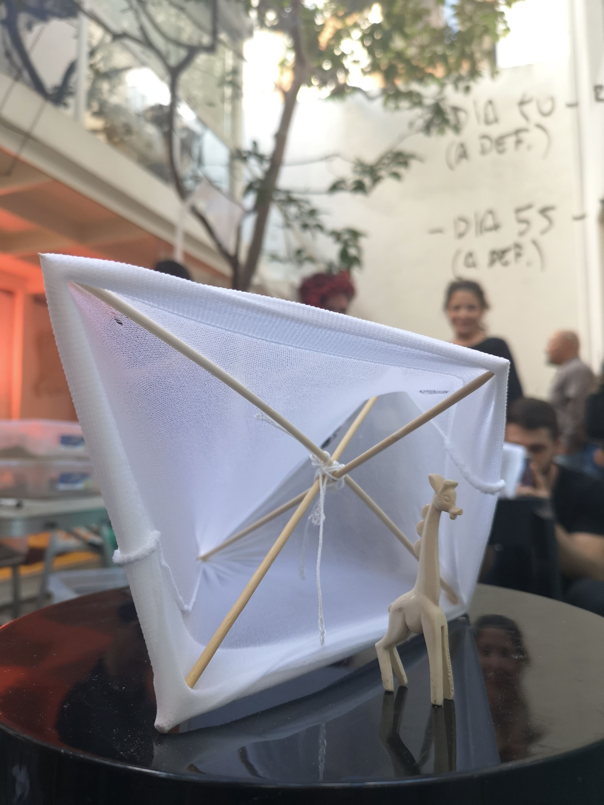

## Computational-Design-Phase

In den folgenden Sitzungen übertrugen die Teilnehmenden ihre physischen Experimente in digitale Modelle mit Rhino und Grasshopper. Behandelt wurden parametrische Modellierung, Voronoi-Tessellation, Mesh-Relaxation mit Kangaroo und Flächenunterteilung mit Weaverbird. Alle Teilnehmenden entwickelten einen eigenen Entwurf, ausgehend von den natürlichen Prozessen, die sie am ersten Tag beobachtet hatten. Der Übergang vom Physischen zum Digitalen unterstrich eine zentrale Idee des Workshops: Computational Design ist am wirkungsvollsten, wenn es auf einem Verständnis der Phänomene basiert, die es simuliert.

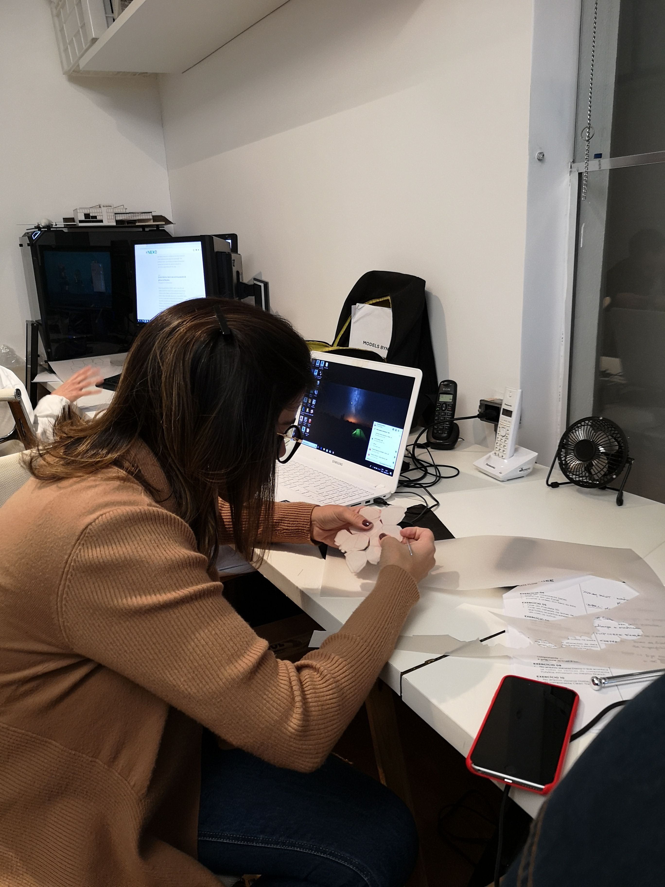

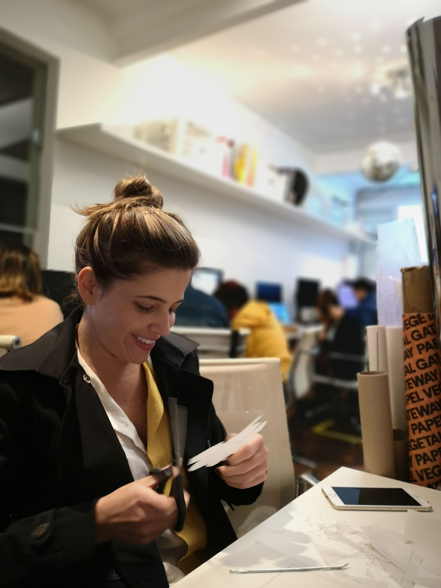

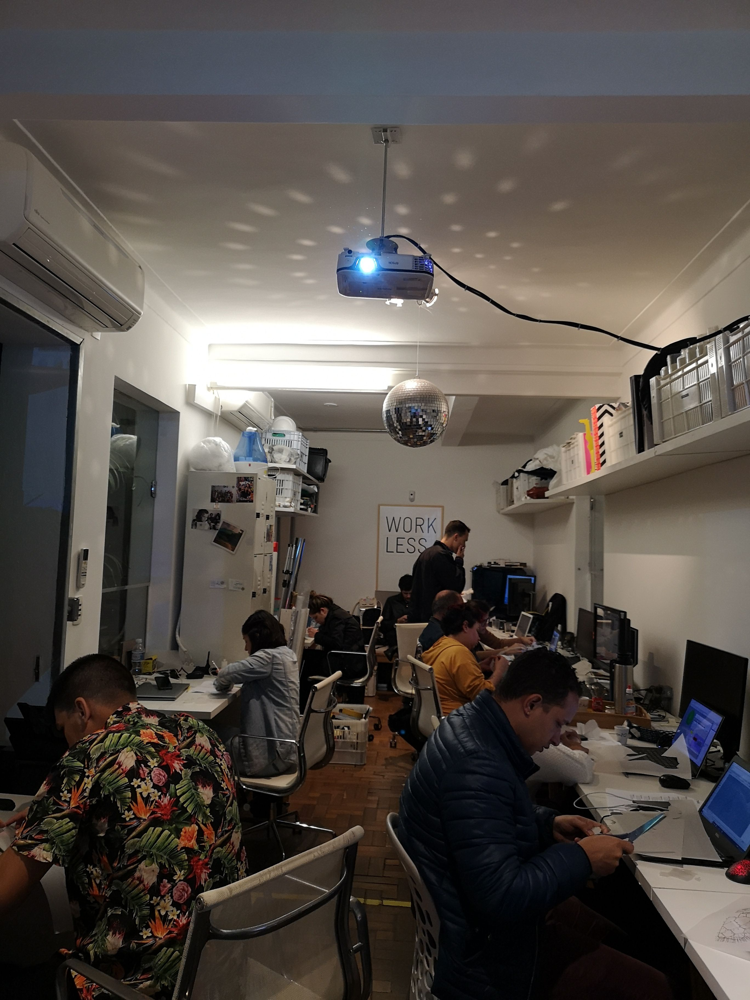

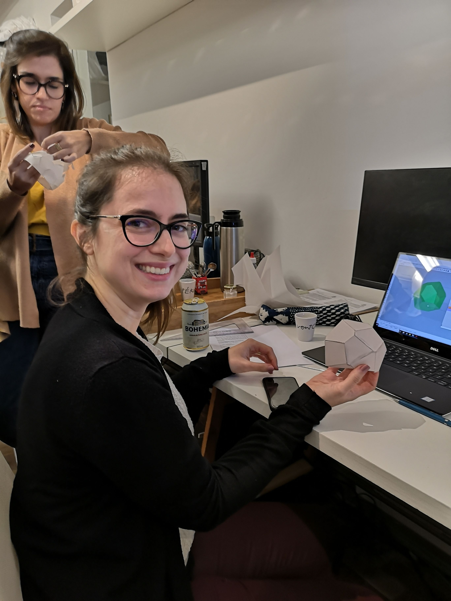

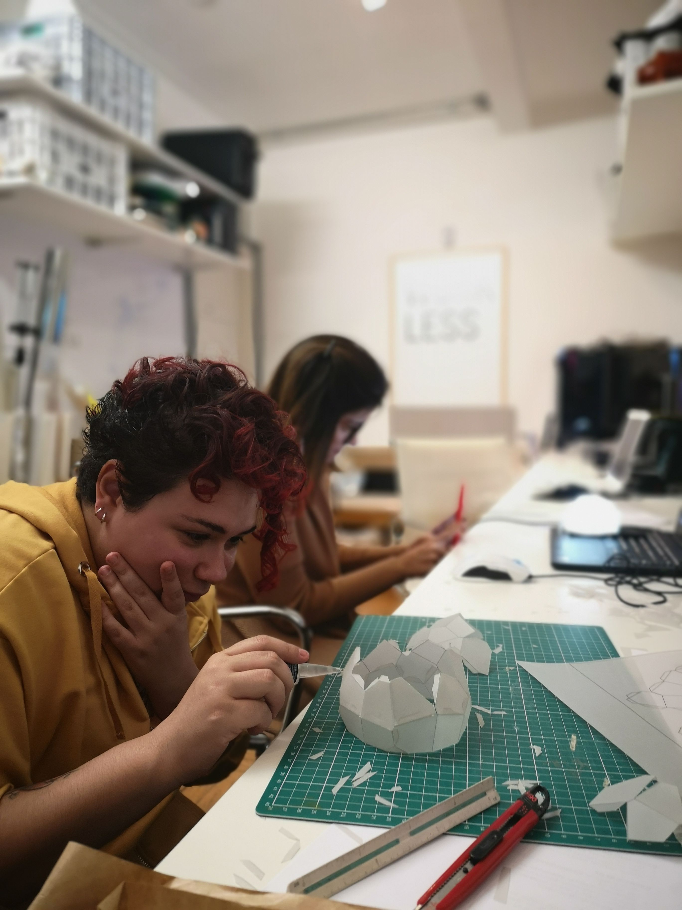

## Abschlusspräsentationen

Am letzten Tag präsentierten die Teilnehmenden ihre individuellen Projekte. Die Ergebnisse reichten von Voronoi-Pavillons bis hin zu organischen Flächenstrukturen, wobei jedes eine andere Interpretation der im Workshop erforschten natürlichen Prozesse widerspiegelte. Der Architekt Marko Brajovic nahm an der Abschlusssitzung teil, um über Biomimetik und ihre Rolle in der zeitgenössischen Architektur zu diskutieren.

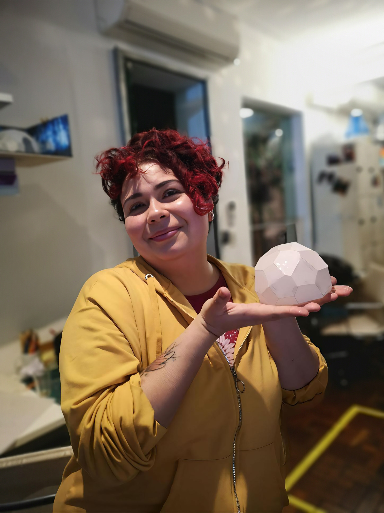

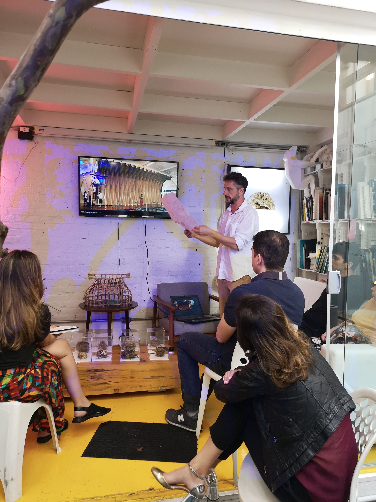
