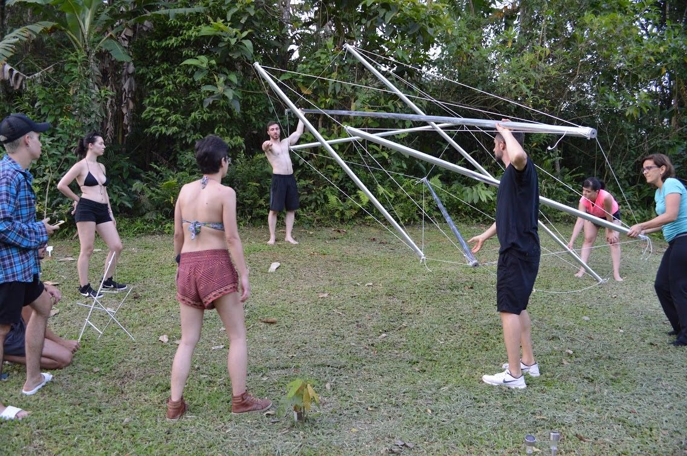
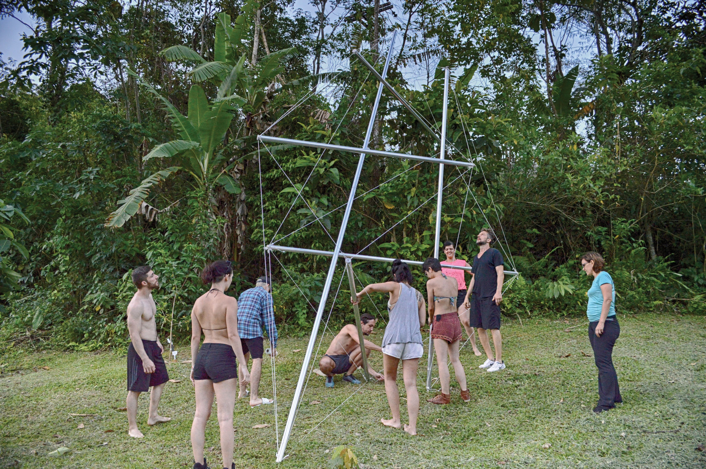
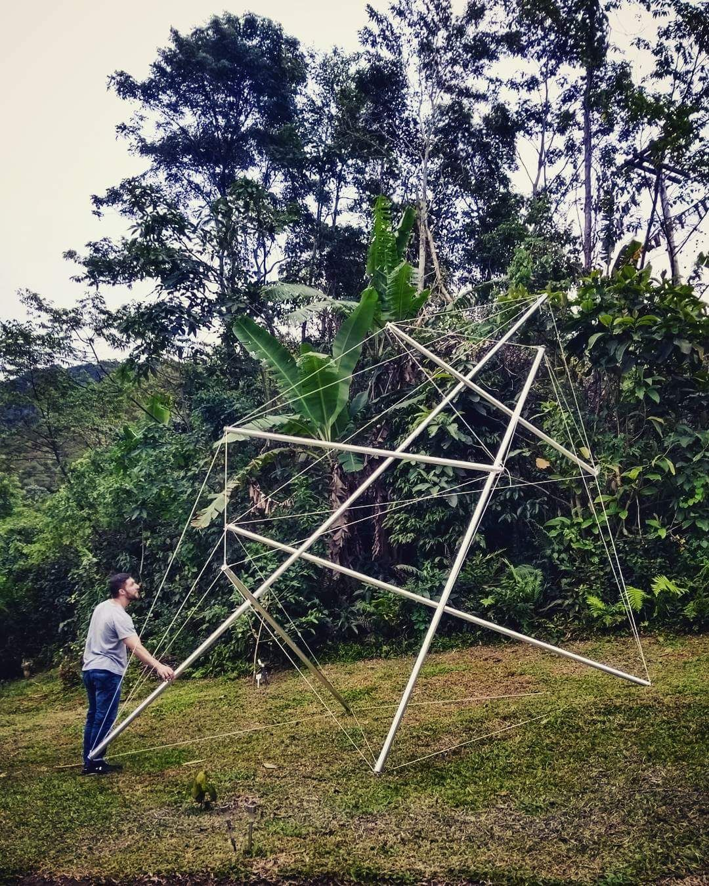
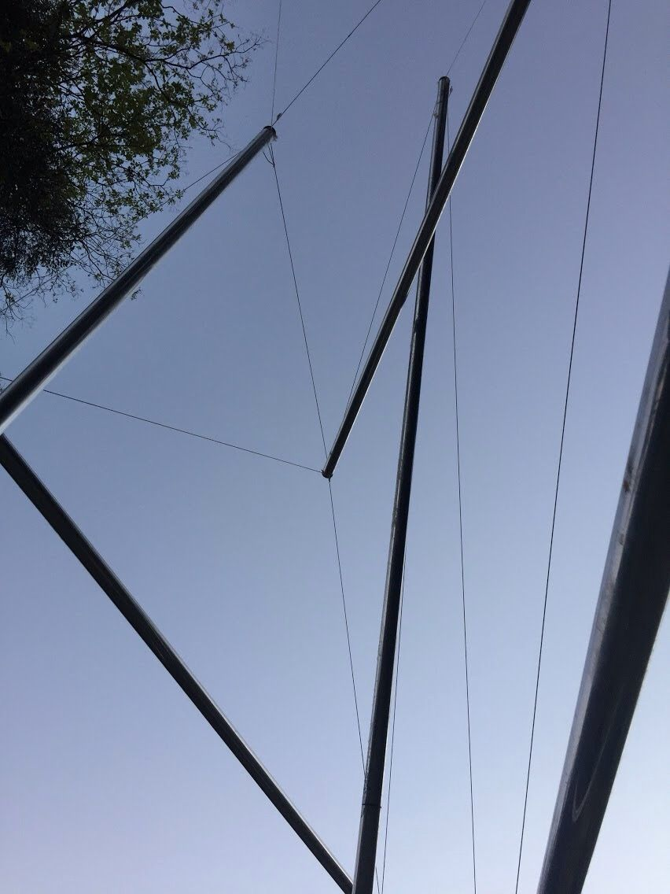

import Figure from '@/components/Figure.astro'

Wir kamen als Team des Atelier Marko Brajovic in Paraty, Brasilien, zusammen, um gemeinsam eine Tensegrity-Struktur zu bauen und dabei noch enger zusammenzuwachsen.

## Was ist eine Tensegrity?

Eine Tensegrity (Kurzwort aus engl. *tensional integrity*) ist ein Tragsystem, bei dem starre Stäbe in einem kontinuierlichen Netzwerk von Zugseilen schweben. Kein Stab berührt einen anderen; die Struktur hält ihre Form ausschließlich durch das Kräftegleichgewicht, ein Konzept, das von Buckminster Fuller und Kenneth Snelson populär gemacht wurde.

## Der Bau

Mit Metallrohren für Druck und Seilen für Zug montierten wir die Struktur im Freien. Jede Person hielt einen Stab oder zog an einem Seil, während das System allmählich sein Gleichgewicht fand. Die Struktur konnte nur stehen, wenn alle gleichzeitig mitmachten; hätte eine einzige Person losgelassen, wäre alles eingestürzt.

<Figure credit="Adalberto de Paula">
  
</Figure>

## Das Ergebnis

Die fertige Struktur war über drei Meter hoch, ein selbsttragendes System aus schwebenden Stäben, die ausschließlich durch Zugkräfte zusammengehalten wurden. Die Struktur gemeinsam mit den eigenen Händen im Gleichgewicht zu halten, spiegelte wider, wie wir im Atelier zusammenarbeiten.

