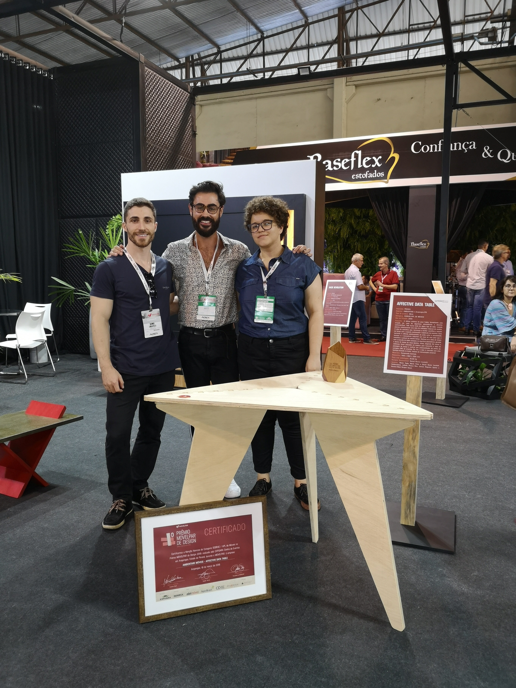
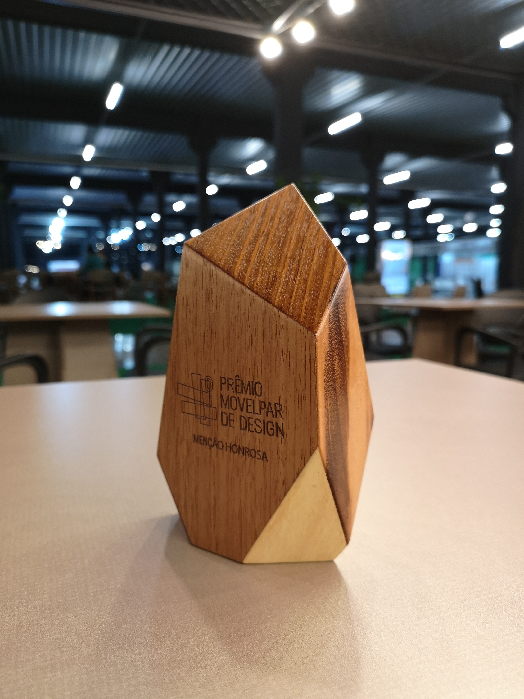
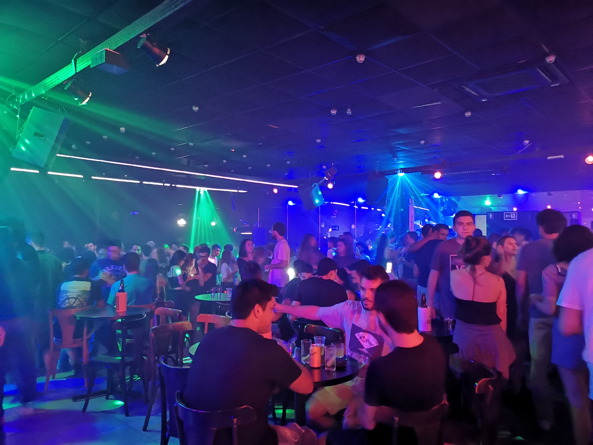

Palestra na MOVELPAR 2019, uma das maiores feiras de móveis da América Latina, organizada pelo SEBRAE Talks. Falei sobre como o design emocional e a tecnologia se encontram no design contemporâneo de móveis e produtos, e mostrei como ferramentas computacionais podem fortalecer a conexão emocional entre as pessoas e os objetos.

